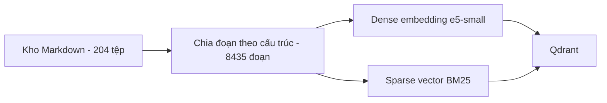
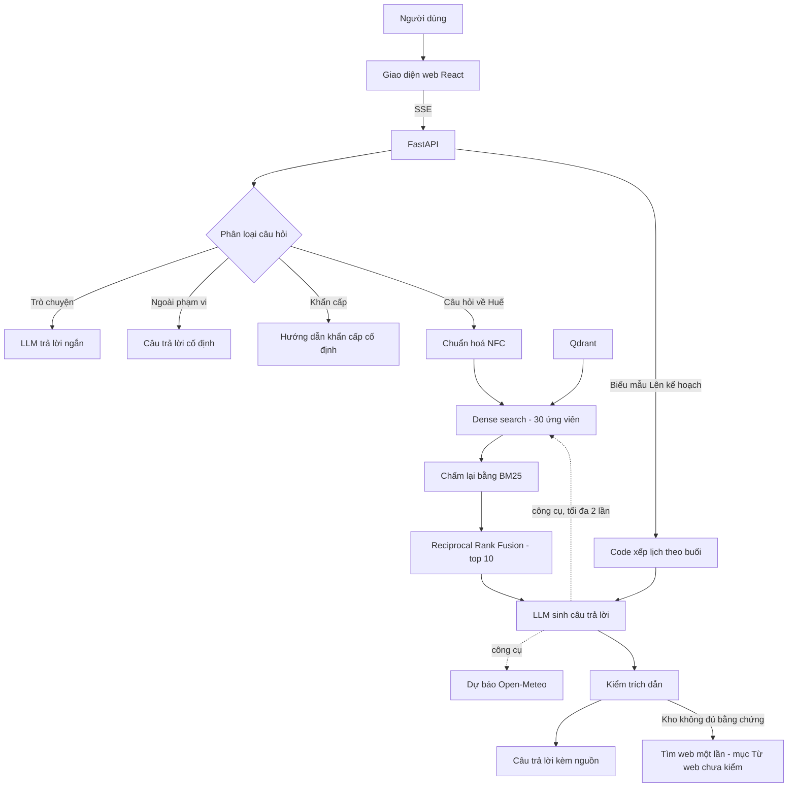

# Hue RAG — Trợ lý văn hóa và du lịch Huế

Ứng dụng hỏi đáp về văn hóa và du lịch Huế dựa trên **Retrieval-Augmented Generation (RAG)**. Hệ thống chỉ trả lời từ một kho tri
thức tiếng Việt đã biên soạn, gồm 5 chủ đề: ẩm thực, di tích, lễ hội, nghệ thuật biểu diễn và du lịch. Mỗi ý trong câu trả lời đều có
trích dẫn tới đoạn nguồn. Câu hỏi nằm ngoài kho được từ chối, không suy đoán.

## Tính năng

- **Trả lời có trích dẫn.** Model gắn số nguồn `[n]` cho từng ý; backend kiểm mọi trích dẫn, trích dẫn không hợp lệ thì câu trả lời bị thu hồi.
  Giao diện không hiện số trong chữ mà hiện dòng **"Nguồn: …"** dưới câu trả lời; bấm tên nguồn để xem đoạn trích và mở cả bài.
- **Closed-world.** Khi ngữ cảnh không đủ bằng chứng, hệ thống trả một câu từ chối cố định thay vì tự suy đoán.
- **Phân loại câu hỏi.** Mỗi câu được phân vào một trong bốn nhóm:
  - trò chuyện thông thường;
  - câu hỏi về Huế;
  - câu ngoài phạm vi (kèm câu gợi ý trong phạm vi);
  - tình huống khẩn cấp: trả hướng dẫn cố định kèm số 113 / 114 / 115 / 112.
- **Tìm thêm.** Sau lần tìm đầu bằng chính câu hỏi, trợ lý được tự gọi công cụ tìm trong kho thêm tối đa 2 lần cho câu cần nhiều nguồn.
- **Nhớ hội thoại.** Trợ lý nhớ 3 câu hỏi gần nhất của cuộc trò chuyện (trong 30 phút, lưu trong bộ nhớ máy chủ) để hiểu câu hỏi tiếp
  như "còn chỗ kia thì sao"; không nhớ câu trả lời. Nút "Cuộc trò chuyện mới" xoá ngữ cảnh.
- **Tra web khi kho không có.** Câu hỏi về Huế mà kho không đủ bằng chứng ⇒ một lần tìm web (Serper), kết quả hiện ở mục riêng
  **"Từ web (chưa kiểm)"**, tách khỏi phần trả lời từ kho. Link chỉ lấy từ kết quả tìm; code kiểm số tiền / thời gian thực trong phần này.
- **Thời tiết.** Câu hỏi về thời tiết Huế dùng dự báo Open-Meteo 7 ngày; mọi con số do code in, model chỉ viết lời. Câu về bão / lũ trả câu
  cố định trỏ tới nguồn khí tượng chính thức và số 112.
- **Lên kế hoạch.** Trang biểu mẫu: chọn số ngày, người đi cùng, sở thích ⇒ **code** xếp lịch theo buổi từ bảng điểm tham quan (luật xếp
  kiểm bằng code, kèm link Google Maps từng điểm) ⇒ model chỉ viết lời quanh lịch, có nguồn.
- **Cổng du lịch.** Trang chủ, **Khám phá** (204 bài của kho theo 5 chủ đề, đọc cả bài), **Giới thiệu** (trợ lý làm được gì, giới hạn);
  khung **Trợ lý Huế** nổi ở mọi trang và có trang riêng.
- **Streaming.** Câu trả lời hiển thị dần ngay khi model sinh.
- **Cảnh báo thông tin theo thời điểm.** Câu trả lời liên quan tới vé, điểm đến, lễ hội có dòng nhắc rằng thông tin có thể đã thay đổi.
- **Đánh giá 👍 / 👎** dưới mỗi câu trả lời (chỉ ghi mã lượt + đánh giá, không ghi nội dung).
- **Quan sát được.** Mỗi yêu cầu ghi một dòng số đo: tuyến, thời gian từng khâu, token, chi phí USD của từng lần gọi model và công cụ.
  Log không ghi nội dung hội thoại.
- **Đang tắt / đang làm:** hỏi bằng ảnh (model gợi ý ≤ 3 tên trong danh sách, người dùng bấm xác nhận rồi mới trả lời — code có, đang tắt);
  hỏi bằng giọng nói (đang phát triển).

## Kiến trúc

### Lập chỉ mục



### Hỏi đáp



| Thành phần | Công nghệ |
|---|---|
| Embedding | [`intfloat/multilingual-e5-small`](https://huggingface.co/intfloat/multilingual-e5-small) (384 chiều, chạy CPU) |
| Sparse retrieval | BM25 tách theo âm tiết tiếng Việt |
| Vector database | Qdrant (Docker), dense + sparse trong cùng một collection |
| Hybrid retrieval | 30 ứng viên dense, chấm lại bằng BM25, hợp nhất bằng Reciprocal Rank Fusion (k = 60) |
| Sinh câu trả lời | OpenAI `gpt-6-luna` qua OpenAI Agents SDK |
| Backend | Python 3.13, FastAPI, Server-Sent Events |
| Frontend | React 19, Vite 8, Tailwind CSS 4 |
| Quản lý môi trường | `uv` |

## Đánh giá

Đánh giá trên bộ **176 câu hỏi có đáp án mẫu** (5 loại câu: một dữ kiện, nhiều nguồn, có điều kiện, so sánh, ngoài phạm vi),
chấm theo phương pháp **LLM-as-a-judge** (Claude) và đối chiếu với một vòng đọc mù của người. Kèm theo là một bộ 32 câu về an toàn
thông tin (vé, giờ mở cửa, điều kiện tham quan) và các bộ câu giữ kín, chỉ dùng ở lần đo cuối.

| Chỉ số | Kết quả |
|---|---|
| Câu ngoài phạm vi bị trả lời | **0** trên mọi bộ đo |
| Câu có trong kho bị từ chối nhầm | 12 / 158 |
| Trích dẫn tới nguồn không tồn tại | 0 |
| Bộ an toàn 32 câu | 0 câu đảo ngược cảnh báo; 2 câu sai điều kiện, trong ngưỡng cho phép |
| Tăng ngữ cảnh từ 5 lên 10 đoạn, trên 33 câu giữ kín | đủ ý +0,82, chính xác +0,70 (thang 1–5), không câu nào giảm |
| Chi phí | ≈ 0,0003–0,0004 USD / câu hỏi về Huế |
| Độ trễ tới ký tự đầu tiên | trung vị 3,05 s, p95 5,64 s (từ khi có bước phân loại câu hỏi) |

Số liệu đo trong tháng 10–11/2026.

## Cài đặt

### Yêu cầu

- Python 3.13 và [`uv`](https://docs.astral.sh/uv/)
- Node.js 24
- Docker
- OpenAI API key
- Serper API key (tuỳ chọn, chỉ cho tra web; dự báo Open-Meteo không cần key)

### Dữ liệu

Kho tri thức (`knowledge-base-hue/`) và bộ đánh giá **không** được công bố trong repository này. Mã nguồn và phần lớn test chạy độc lập
với dữ liệu. Để chạy hỏi đáp đầy đủ, cần:

- kho Markdown theo cấu trúc `knowledge-base-hue/<foods|heritages|festivals|performing_arts|travel>/`;
- tệp quy tắc chia đoạn `knowledge-base-hue/meta/full_corpus_conditions.json`.

### Chạy

```bash
# Môi trường Python
uv sync

# API key (tệp .env đã nằm trong .gitignore)
echo "OPENAI_API_KEY=sk-..." > .env

# Qdrant: HTTP 6335, gRPC 6336
docker compose up -d qdrant

# Tải model vào cache Hugging Face (ứng dụng chỉ đọc từ cache, không tự tải)
uv run python -c "from huggingface_hub import snapshot_download as d; \
  d('intfloat/multilingual-e5-small', revision='614241f622f53c4eeff9890bdc4f31cfecc418b3'); \
  d('intfloat/multilingual-e5-base'); d('CODE4LIFEOFFICIAL/huydang-dek21-embedding')"

# Lập chỉ mục
cd backend
HF_HUB_OFFLINE=1 uv run python -m ingestion.full_corpus_pipeline build --candidate e5-small-384

# Build giao diện
cd ../frontend && npm ci && npm run build

# Khởi động
cd ../backend
HF_HUB_OFFLINE=1 uv run --env-file ../.env uvicorn api.app:app --port 8000
```

Mở <http://127.0.0.1:8000>.

Khi khởi động, API đối chiếu hash từng tệp trong kho với bản ghi của lần lập chỉ mục. Nếu kho đã thay đổi mà chưa lập chỉ mục lại,
mọi yêu cầu nhận mã `409`. Qdrant hoặc model tìm kiếm không sẵn sàng thì nhận `503`; lỗi phía model sinh thì nhận `502`.

### API

| Endpoint | Mô tả |
|---|---|
| `POST /api/chat` | Hỏi đáp, trả JSON `{answer, sources}` |
| `POST /api/chat/stream` | Hỏi đáp dạng Server-Sent Events: `status`, `delta`, `sources`, `notice`, `clarify`, `lich_trinh`, `web`, `error`, `done` |
| `POST /api/conversation/new` | Bắt đầu cuộc trò chuyện mới (xoá ngữ cảnh đang nhớ) |
| `POST /api/feedback` | Ghi đánh giá 👍 / 👎 của một lượt |
| `GET /api/kham_pha`, `GET /api/kham_pha/bai?id=` | Danh sách bài của kho / nội dung một bài (trang Khám phá) |
| `GET /api/thoi_tiet` | Dự báo thời tiết Huế (Open-Meteo, cache 30 phút) |
| `GET /api/tinh_nang` | Tính năng đang bật (giao diện đọc để ẩn / hiện) |
| `POST /api/anh/ung_vien` | Hỏi bằng ảnh — gợi ý tên ứng viên (đang tắt ⇒ `404`) |
| `GET /health` | Trạng thái các thành phần |

### Kiểm thử

```bash
cd backend
HF_HUB_OFFLINE=1 uv run python -m pytest tests -q
```

Một số test cần `OPENAI_API_KEY` (`uv run --env-file ../.env …`), cần kho tri thức hoặc cần bản build giao diện.

## Cấu trúc thư mục

```text
backend/
  api/            FastAPI app và các route
  core/           cấu hình, kiểu dữ liệu chung
  ingestion/      đọc và chia đoạn kho, lập chỉ mục
  embedding/      dense embedding
  scoring/        BM25
  vectorstore/    Qdrant client
  retrieval/      hybrid retrieval, dựng ngữ cảnh
  llm/            phân loại câu hỏi, prompt, sinh câu trả lời, kiểm trích dẫn
  evaluation/     đánh giá trên bộ câu hỏi chuẩn
  reranking/      reranker (dùng trong thí nghiệm, không bật ở runtime)
  experiments/    mã thí nghiệm
  config/         settings.yaml
  tests/
frontend/         giao diện React + Vite + Tailwind
docs/             tài liệu thiết kế
guides/           hướng dẫn kỹ thuật
notebooks/        notebook minh hoạ embedding, Qdrant, sinh câu trả lời
docker-compose.yml
```

## Giới hạn

- Câu hỏi cần tổng hợp nhiều nguồn hoặc so sánh có chất lượng thấp hơn câu hỏi một dữ kiện.
- Thông tin theo thời điểm (giá vé, giờ mở cửa, lịch lễ hội) có thể đã cũ so với thực tế.
- Câu hỏi theo ngày tương đối ("tối nay", "tuần này") thường bị từ chối.
- Chỉ hỗ trợ tiếng Việt có dấu.
- Chỉ nhớ 3 câu hỏi gần nhất trong 30 phút, lưu trong bộ nhớ máy chủ: tải lại máy chủ là mất; không nhớ câu trả lời.
- Phần "Từ web" chưa được kiểm như phần trả lời từ kho (chỉ kiểm link, số tiền, thời gian thực).
- Lịch trình chỉ có từ biểu mẫu "Lên kế hoạch"; câu hỏi lịch trình gõ tự do được trả lời như câu hỏi thường.
