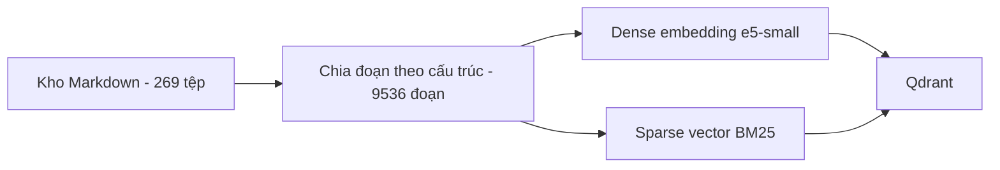
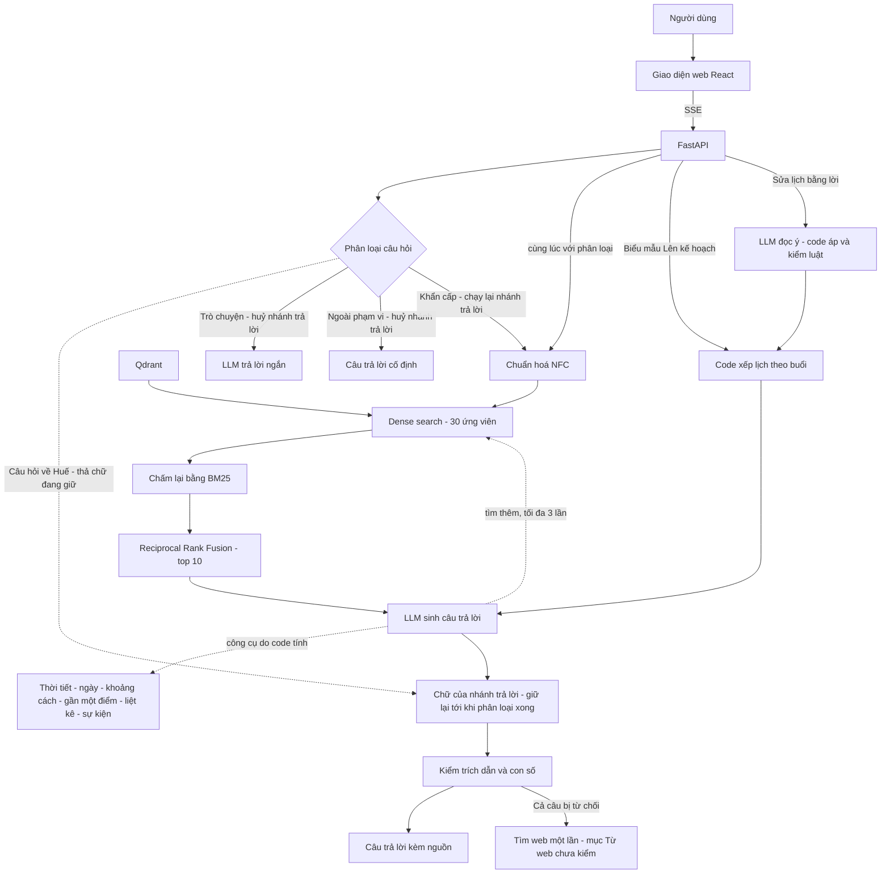

# Hue RAG — Trợ lý văn hóa và du lịch Huế

Ứng dụng hỏi đáp về văn hóa và du lịch Huế dựa trên **Retrieval-Augmented Generation (RAG)**. Hệ thống chỉ trả lời từ một kho tri
thức tiếng Việt đã biên soạn (269 bài, 5 chủ đề: ẩm thực, di tích, lễ hội, nghệ thuật biểu diễn, du lịch). Câu trả lời kèm
trích dẫn tới đoạn nguồn và được code kiểm trước khi hiện. Câu hỏi nằm ngoài kho được từ chối, không suy đoán. Việc phải luôn đúng — phép tính, ngày tháng, khoảng
cách, xếp lịch — do code làm; model chỉ đọc ý người dùng và diễn đạt.

## Tính năng

**Hỏi đáp**

- **Trả lời có trích dẫn.** Model được dặn gắn số nguồn `[n]` sau từng nhận định; backend kiểm: câu trả lời không có trích dẫn nào hoặc trích một nguồn không có thật thì bị thu hồi.
  Giao diện hiện dòng **"Nguồn: …"** dưới câu trả lời; bấm tên nguồn để xem đoạn trích và mở cả bài.
- **Closed-world.** Ngữ cảnh không đủ bằng chứng ⇒ một câu từ chối cố định. Tin hỏi nhiều ý: trả lời ý kho có, ý thiếu ghi rõ
  "Tư liệu chưa có thông tin về: …".
- **Phân loại câu hỏi.** Mỗi câu được model xếp vào: trò chuyện thông thường · câu hỏi về Huế · câu ngoài phạm vi (trả một câu cố định) · khẩn cấp (đi
  chung đường với câu hỏi về Huế). Bước này chạy song song với việc tìm kho và viết câu trả lời (sơ đồ ở mục Kiến trúc). Lượt biểu mẫu Lên kế hoạch không qua bước này.
- **Tìm trong kho nhiều lần.** Sau lần tìm đầu bằng chính câu hỏi, trợ lý được gọi công cụ tìm thêm tối đa 3 lần (trong trần 5 vòng công cụ). Tin nhiều ý: lần tìm
  đầu nối thêm kết quả tìm riêng cho từng vế hỏi.
- **Công cụ do code tính** (model chỉ quyết định gọi và viết lời quanh kết quả): dự báo thời tiết Huế 7 ngày (Open-Meteo; câu về bão / lũ
  trả câu cố định trỏ tới nguồn khí tượng chính thức và số 112) · ngày dương – âm lịch · khoảng cách và thời gian đi giữa 40 điểm tham
  quan (bảng dựng sẵn, lúc chạy không gọi mạng) · "gần X có gì": tối đa 5 quán ăn / cà phê có bài trong kho trong 2 km quanh một điểm (kèm giờ hoạt động với 30 quán kho có ghi giờ),
  hoặc 5 điểm tham quan gần nhất · liệt kê các bài của kho theo loại ("kể hết các lăng"). Lễ hội, sự kiện theo khoảng ngày thì code tự tra
  bảng rồi đưa vào nguồn, không chờ model gọi.
- **Nhớ hội thoại.** Mỗi cuộc trò chuyện giữ 3 lượt gần nhất (30 phút, trong bộ nhớ máy chủ) để hiểu câu hỏi tiếp; kèm câu trả lời
  liền trước dưới dạng "không phải nguồn" (không giữ câu cố định, lượt lịch và lượt dùng công cụ đổi theo giờ). Nút "Cuộc trò chuyện mới" xoá ngữ cảnh.
- **Bộ nhớ đệm câu trả lời.** Câu trả lời từ kho được lưu 24 giờ (trong bộ nhớ) và trả lại khi có người gõ đúng câu đó ở lượt đầu một cuộc mới.
- **Tra web khi kho không có.** Cả câu bị từ chối ⇒ một lần tìm web (Serper), kết quả hiện ở mục riêng **"Từ web (chưa kiểm)"**, tách
  khỏi phần trả lời từ kho. Khi khung **"Từ web (chưa kiểm)"** có nội dung, giao diện ẩn bong bóng dẫn lặp phía trên và hiển thị thẳng khung web. Link chỉ lấy từ kết quả tìm; code kiểm số tiền / thời gian thực trong phần này.
- **Hỏi bằng ảnh.** Luồng một lần bấm trên danh sách đóng 55 tên: gửi ảnh kèm câu hỏi ⇒ model đoán tên và trả lời ngay theo tên xếp đầu; bên dưới câu trả lời có nút **"Hỏi lại với…"** cho tên dự đoán còn lại và nút tự gõ tên nếu chưa đúng.
- **Cảnh báo thông tin theo thời điểm.** Câu trả lời có nguồn về vé, điểm đến, lễ hội kèm dòng nhắc rằng thông tin có thể đã thay đổi.

**Lên kế hoạch & Tổng hợp chuyến đi**

- **Xếp lịch bằng code.** Biểu mẫu chọn số ngày, người đi cùng, kiểu đi, sở thích ⇒ code xếp lịch theo buổi từ bảng **47 điểm** (41 điểm ban ngày + 6 mục chỉ dùng buổi tối, không còn Chợ Đông Ba buổi tối) và
  kiểm bằng luật xếp (giờ mở cửa, khu, độ dày); kèm ảnh thẻ lịch (**47/47** điểm), bản đồ, quán ăn và nơi ở gợi ý (ảnh lưu trú **70/136** cơ sở, riêng khách sạn 4–5 sao **24/24**). Model chỉ viết câu tả từng điểm, có nguồn.
- **Sửa lịch bằng lời.** "Bỏ / thêm / thay / dời một điểm", "đổi chỗ ngày 1 với ngày 2", gọi tên ngắn hoặc gọi tên mục tối, đổi số ngày, kiểu đi, ngày đi: model chỉ đọc ý,
  code áp và kiểm luật. Khi thiếu ngày/buổi hoặc đụng điểm khác, hệ thống hỏi lại kèm nút gợi ý trước khi sửa; việc không làm được thì lịch giữ nguyên và trợ lý nói rõ; lệnh thêm / thay bị luật xếp chặn thì kèm lý do và tối đa
  hai cách code đã thử là làm được — "thêm" không tự bỏ một điểm đang có. Tin vừa sửa lịch vừa hỏi: lịch được sửa, câu hỏi được nhắc gửi riêng. Có nút **"Hoàn tác lần sửa này"** (`POST /api/lich/hoan_tac`) để lùi 1 bước sửa gần nhất.
- **Xuất lịch.** Tệp `.ics` cho ứng dụng lịch, PowerPoint, in / lưu PDF, sao chép lịch ra chữ thường.
- **Sổ tay cho chuyến đi** (`#/so-tay`, `POST /api/so_tay` — *đang mở ở máy demo/local, tắt mặc định ở gói deploy*). Tổng hợp lịch trình đã xếp thành từng thẻ điểm và ăn uống mỗi ngày: địa chỉ, giờ mở cửa, giá vé do code chép từ kho; model viết ngắn phần "Nên xem", "Lưu ý" và "Trước khi đi" kèm cảnh báo an toàn; hỗ trợ in / lưu PDF.
- **Hồ sơ theo chủ đề** (`#/kham-pha/chu-de`, `GET /api/ho_so/chu_de` + `POST /api/ho_so` — *đang mở ở máy demo/local, tắt mặc định ở gói deploy*). Dải chủ đề hiển thị ở cả Trang chủ và Khám phá, dẫn tới 20 chủ đề do code dựng sẵn từ mục lục kho (268/269 bài Khám phá có ảnh), model tóm tắt theo mục kèm khối giờ/vé, lưu ý an toàn và đường dẫn về bài gốc.

**Cổng thông tin và vận hành**

- **Các trang.** Trang chủ (kèm dải **Hồ sơ theo chủ đề** khi bật), **Khám phá** (đọc cả bài của kho theo chủ đề), **Hồ sơ theo chủ đề**, **Bản đồ**, **Lên kế hoạch**, **Sổ tay**, **Chỗ ở**, **Trợ lý Huế** (trang
  riêng và khung nổi ở các trang khác), **Giới thiệu** (đã rút gọn theo góc nhìn người dùng: còn các thẻ tính năng, `Huế qua các thời kỳ` và hộp **"Lưu ý khi dùng"**).
- **Quan sát được.** Mỗi yêu cầu ghi một dòng số đo: tuyến, kết cục, thời gian từng khâu, token của từng lần gọi model, tên và thời gian từng công cụ. Log
  không ghi nội dung hội thoại. Trang **theo dõi** (`#/theo-doi`, không có trong menu, mở bằng khoá đặt qua biến môi trường) gom các dòng
  đó thành bảng theo ngày.
- **Cập nhật kho.** Một lệnh tìm mọi chỗ trong kho còn ghi một mức giá cũ và soạn bản đề xuất kèm tệp vá; người giữ kho đọc rồi duyệt
  bằng lệnh thứ hai. Sau khi kho đổi, một lệnh cập nhật chỉ mục tại chỗ: chỉ đoạn đổi chữ được tính lại vector, không lập lại cả chỉ mục.

Phần lớn tính năng có một công tắc cấu hình trong `backend/config/settings.yaml`; tắt là hệ thống chạy như trước khi có nó.

**Dịch vụ ngoài mà hệ thống gọi:** nhà cung cấp model sinh · Serper (chỉ khi tra web; câu gửi đi là câu tìm kiếm) · Open-Meteo (dự báo) · ô bản đồ
OpenStreetMap (trình duyệt của người dùng tải trực tiếp).

## Kiến trúc

### Lập chỉ mục



### Hỏi đáp



Bước phân loại và nhánh trả lời (tìm kho rồi gọi model viết) được khởi động **cùng lúc** để người dùng không phải chờ hai lần gọi model nối tiếp.
Sự kiện của nhánh trả lời nằm trong hàng đợi cho tới khi có kết quả phân loại: câu hỏi về Huế ⇒ thả ra cho người dùng; trò chuyện hoặc ngoài
phạm vi ⇒ nhánh trả lời bị huỷ, không chữ nào của nó tới người dùng; khẩn cấp ⇒ chạy lại đúng đường tìm kho rồi trả lời. Tìm web chỉ chạy sau khi
đã biết câu thuộc loại "câu hỏi về Huế". Lượt biểu mẫu Lên kế hoạch không có bước phân loại nên không có gì chạy song song
(`backend/llm/assistant.py`, hàm `_answer_core`).

| Thành phần | Công nghệ |
|---|---|
| Embedding | [`intfloat/multilingual-e5-small`](https://huggingface.co/intfloat/multilingual-e5-small) (384 chiều, chạy CPU) |
| Sparse retrieval | BM25 tách theo âm tiết tiếng Việt |
| Vector database | Qdrant (Docker), dense + sparse trong cùng một collection |
| Hybrid retrieval | 30 ứng viên dense, chấm lại bằng BM25 lúc hỏi, hợp nhất bằng Reciprocal Rank Fusion; 10 đoạn vào ngữ cảnh |
| Sinh câu trả lời | OpenAI Agents SDK. Cấu hình đang commit: `provider: openai` (`gpt-6-luna`, trả chữ chạy dần). Lớp nối Claude Sonnet 5.5 trên Amazon Bedrock (`backend/llm/bedrock_model.py`) vẫn giữ trong code, đổi qua lại bằng một dòng `provider` trong `backend/config/settings.yaml` |
| Backend | Python 3.13, FastAPI, Server-Sent Events |
| Frontend | React 19, Vite 8, Tailwind CSS 4 |
| Quản lý môi trường | `uv` |

## Đánh giá

Đánh giá nền trên bộ **176 câu hỏi có đáp án mẫu** (5 loại câu: một dữ kiện, nhiều nguồn, có điều kiện, so sánh, ngoài phạm vi), chấm
theo phương pháp **LLM-as-a-judge**; một lần người đọc 20 cặp câu trả lời để tham khảo. Kèm theo là một bộ 32 câu về an toàn thông tin
(vé, giờ mở cửa, điều kiện tham quan) và các bộ câu giữ kín dùng ở các lượt đo chốt.

**Mốc nền 12/11/2026 (bộ đã thấy, 176 câu + an toàn 32 câu):**

| Chỉ số | Kết quả |
|---|---|
| Câu ngoài kho hỏi đơn lẻ bị trả lời | **0** (18 / 18 bị từ chối, lượt đo 12/11) |
| Chỗ phạm mức tối thiểu ở lượt đo 12/11 | 3: hai câu ngoài chủ đề bị đem đi tra web · một câu an toàn thiếu một điều kiện cảnh báo · một lượt hỏi tiếp trong bộ kín bị máy đếm là trả lời câu ngoài kho |
| Câu có trong kho bị từ chối nhầm | 3 / 158 (12/11); trước khi có bước "tìm thêm": 12 / 158 |
| Bộ an toàn 32 câu | 0 câu đảo ngược cảnh báo ở cả hai lượt (01/11 và 12/11) |
| Ngữ cảnh 10 đoạn + chuẩn hoá NFC so với 5 đoạn, trên 33 câu giữ kín | đủ ý +0,82, chính xác +0,70 (thang 1–5), không câu nào giảm |
| Độ trễ tới ký tự đầu tiên | trung vị khoảng 2,2 s (09/11, sau khi cho bước phân loại chạy song song với bước trả lời) |

**Đợt đo bộ câu kín mốc cuối trên `gpt-6-luna` (25/11/2026, `main` `ea96e47c`, chỉ mục 9.536 đoạn — `report_agent/2026-11-25/E_BO_CAU_KIN_LUNA_2511.md`):**

| Bộ đo | Kết quả | Ghi nhận thêm |
|---|---|---|
| **K kín** (7 câu theo ngày mới) | Trợ lý **7 / 7 OK** vs RAG mốc **5 / 7 OK** (2 từ chối) | Chênh **+0,286**; đồng thuận 2 người chấm mù **14 / 14 (100%)** |
| **N đối chứng cùng ngày** (28 câu ngày đã thấy) | Trợ lý **27 / 28 OK** (1 từ chối `R8`) vs RAG mốc **12 / 28 OK** | Chênh **+0,536**; 0 lỗi giả định ngày / tính sai lịch / sai kho |
| **S kín ×2** (10 câu ngoài phạm vi mới) | Lượt 1: **9 / 10** từ chối đúng; Lượt 2: **8 / 9** câu chạy được từ chối đúng | `b_kin_10` bị trả lời bằng kho ở cả 2 lượt; `b_kin_09` lỗi kỹ thuật ở lượt 2 dù đã thử lại 1 lần; 0 câu mở web |
| **T kín** (28 câu mới: 8 phần `a` + 20 tuyến B1) | Xã giao được đáp **8 / 8** | Trượt 2 mã định tuyến: `a_kin_08` (S3 ở phần `a`) và `s15` (rẽ `tro_chuyen` và trả lời câu ngoài phạm vi ở tuyến B1) |
| **C kín** (15 chuỗi / 33 lượt; 5 cặp hỏi tiếp) | Nhớ tên **4 / 4**; hỏi tiếp (thang 1–5): Đúng **5,00 vs 3,40**, Đủ ý **5,00 vs 3,40**, Trọng tâm **4,80 vs 3,20** | Hỏi tiếp thắng 2 / hoà 3 / thua 0 về Đủ ý; trượt `K-N2` (1 chuỗi ngoài kho bị trả lời) |
| **L kín** (sửa lịch bằng lời trên bộ kín) | **`NOT RUN`** | Bước mô phỏng trước khi chạy khớp **4 / 5** chuỗi trên bảng điểm bản 16 nên dừng theo thiết kế |

Trích dẫn tới nguồn không tồn tại không thể tới người dùng: code chặn trước khi hiện.

## Cài đặt

### Yêu cầu

- Python 3.13 và [`uv`](https://docs.astral.sh/uv/)
- Node.js (dự án đang dùng bản 24; Vite 8 cần 20.19+ hoặc 22.12+)
- Docker
- Khoá gọi model sinh: OpenAI API key (`OPENAI_API_KEY`) với cấu hình mặc định `provider: openai`; nếu chuyển sang `provider: bedrock` thì cần tệp khoá tạm của
  Amazon Bedrock, đường dẫn đặt qua biến môi trường `HUE_BEDROCK_CREDS_FILE` (xem `guides/DOI_MODEL_VIET.md`)
- Serper API key (tuỳ chọn, chỉ cho tra web; dự báo Open-Meteo không cần key)

### Dữ liệu

Kho tri thức (`knowledge-base-hue/`), bộ câu mẫu và ảnh của trang Lên kế hoạch có trong repository này; chỉ mục tìm kiếm và thư mục
`data/` (bảng điểm tham quan, bảng khoảng cách, bảng quán, bảng sự kiện, danh sách tên cho hỏi bằng ảnh…) thì không. Với cấu hình đang
commit, máy chủ nạp các bảng đó lúc khởi động — **thiếu `data/` thì máy chủ không khởi động được**; chỉ từ repository này chưa đủ để chạy trọn
hệ thống. Phần tìm kho cần:

- kho Markdown theo cấu trúc `knowledge-base-hue/<foods|heritages|festivals|performing_arts|travel>/`;
- tệp quy tắc chia đoạn `knowledge-base-hue/meta/full_corpus_conditions.json`.

### Chạy

```bash
# Môi trường Python
uv sync

# Khoá model sinh (tệp .env đã nằm trong .gitignore; cấu hình đang commit là provider: openai)
echo "OPENAI_API_KEY=sk-..." > .env

# Qdrant: HTTP 6335, gRPC 6336
docker compose up -d qdrant

# Tải model vào cache Hugging Face (ứng dụng chỉ đọc từ cache, không tự tải)
uv run python -c "from huggingface_hub import snapshot_download as d; \
  d('intfloat/multilingual-e5-small', revision='614241f622f53c4eeff9890bdc4f31cfecc418b3'); \
  d('intfloat/multilingual-e5-base'); d('CODE4LIFEOFFICIAL/huydang-dek21-embedding')"

# Lập chỉ mục lần đầu
cd backend
HF_HUB_OFFLINE=1 uv run python -m ingestion.full_corpus_pipeline build --candidate e5-small-384

# Build giao diện
cd ../frontend && npm ci && npm run build

# Cách 1 — bật nhanh một lệnh từ gốc dự án (tự kiểm tra Qdrant, chỉ mục, khoá model và bật cổng 8010):
cd .. && scripts/bat_he_thong.sh

# Cách 2 — khởi động thủ công (nếu dùng provider: bedrock, thêm HUE_BEDROCK_CREDS_FILE=<tệp khoá> trước lệnh):
cd backend
HF_HUB_OFFLINE=1 uv run --env-file ../.env uvicorn api.app:app --port 8010
```

Mở <http://127.0.0.1:8010>.

Khi khởi động, API đối chiếu hash từng tệp trong kho với bản ghi của lần lập chỉ mục. Kho đã thay đổi mà chỉ mục chưa cập nhật thì máy
chủ vẫn bật nhưng mọi câu hỏi nhận mã `409`. Qdrant hoặc model tìm kiếm không sẵn sàng thì nhận `503`; lỗi phía model sinh thì nhận `502`.
Sau khi sửa kho, cập nhật chỉ mục tại chỗ (tắt máy chủ trước, bật lại sau):

```bash
cd backend
HF_HUB_OFFLINE=1 uv run python -m ingestion.cap_nhat_rieng --chi-xem   # chỉ xem bài nào khác chỉ mục
HF_HUB_OFFLINE=1 uv run python -m ingestion.cap_nhat_rieng             # cập nhật
```

### API

21 API/health endpoint (cộng thêm `GET /` phục vụ giao diện web khi có `frontend/dist`):

| Endpoint | Mô tả |
|---|---|
| `POST /api/chat` | Hỏi đáp, trả JSON (`answer`, `sources` và các trường phụ như `notice`, `web`, `lich_trinh`) |
| `POST /api/chat/stream` | Hỏi đáp dạng Server-Sent Events: `status`, `delta`, `thay_chu`, `sources`, `notice`, `clarify`, `lich_trinh`, `web`, `error`, `done`; lượt lịch thêm `lich_khung`, `lich_cau`, `lich_xong`, `sua_the` |
| `POST /api/conversation/new` | Bắt đầu cuộc trò chuyện mới (xoá ngữ cảnh đang nhớ) |
| `GET /api/kham_pha`, `GET /api/kham_pha/bai?id=` | Danh sách bài của kho / nội dung một bài (trang Khám phá) |
| `GET /api/ho_so/chu_de`, `POST /api/ho_so` | Danh sách 20 chủ đề / tạo hồ sơ theo chủ đề (SSE; `404` khi `ho_so_chu_de` tắt) |
| `POST /api/bao_sai` | Báo một bài có thông tin chưa đúng (chỉ ghi mã bài) |
| `POST /api/feedback` | Ghi đánh giá của một lượt (còn trong API; giao diện hiện không có nút đánh giá) |
| `GET /api/ban_do`, `GET /api/cho_o`, `GET /api/lich_mau` | Dữ liệu của trang Bản đồ, trang Chỗ ở, lịch ví dụ ở trang Lên kế hoạch |
| `GET /api/lich/pptx` | Tải lịch đang có dạng PowerPoint |
| `POST /api/lich/hoan_tac` | Hoàn tác 1 lần sửa lịch bằng lời gần nhất (`409` khi không còn bản hoàn tác hợp lệ) |
| `POST /api/so_tay` | Tạo Sổ tay cho chuyến đi từ lịch đã xếp (SSE; `404` khi `so_tay` tắt) |
| `GET /api/thoi_tiet` | Dự báo thời tiết Huế (Open-Meteo) |
| `GET /api/tinh_nang` | Tính năng đang bật (giao diện đọc để ẩn / hiện) |
| `GET /api/anh/ung_vien`, `POST /api/anh/ung_vien` | Kiểm tra cờ hỏi bằng ảnh / nhận diện ảnh và gợi ý tên ứng viên |
| `GET /api/theo_doi` | Số đo theo ngày cho trang theo dõi (cần khoá; chưa đặt khoá ⇒ `404`) |
| `GET /health` | Trạng thái các thành phần |

### Kiểm thử

```bash
cd backend
HF_HUB_OFFLINE=1 uv run python -m pytest tests/test_citations.py -q     # từng tệp một
```

Lần chạy đủ ngày **25/11/2026** trên `c2d0ee68` (từng tệp, không nạp `.env`, cây tạm nối `data/` và `frontend/dist`): **101 tệp test · 97 chạy · 4 bỏ (cần `OPENAI_API_KEY`) · 2.397 ca đạt · 0 tệp hỏng** (+ các tệp chạm sau các bản sửa ngày 25/11 đều đạt). Nhiều tệp dựng cả ứng dụng nên cần Qdrant đang chạy, kho tri thức và thư mục `data/`.

## Cấu trúc thư mục

```text
backend/
  api/            FastAPI app và các route
  core/           cấu hình, kiểu dữ liệu chung
  ingestion/      đọc và chia đoạn kho, lập chỉ mục, cập nhật chỉ mục tại chỗ
  embedding/      dense embedding, thống kê từ khoá
  scoring/        BM25
  vectorstore/    Qdrant client
  retrieval/      hybrid retrieval, dựng ngữ cảnh
  llm/            phân loại câu hỏi, prompt, sinh câu trả lời, công cụ, xếp và sửa lịch, sổ tay, hồ sơ chủ đề, kiểm trích dẫn
  ops/            lệnh đề xuất và duyệt sửa kho
  evaluation/     đánh giá trên bộ câu hỏi chuẩn
  reranking/      reranker (dùng trong thí nghiệm, không bật ở runtime)
  experiments/    mã thí nghiệm
  config/         settings.yaml, logging.yaml
  tests/
frontend/         giao diện React + Vite + Tailwind
knowledge-base-hue/  kho tri thức Markdown
bai_hoc/          giáo trình và bài giải thích hệ thống bằng lời thường
deploy/           tài liệu hướng dẫn, Docker và Terraform chuẩn bị triển khai
guides/           hướng dẫn kỹ thuật, sổ tay bàn giao
docs/             tài liệu thiết kế
notebooks/        notebook minh hoạ embedding, Qdrant, sinh câu trả lời
scripts/          script tiện ích (`bat_he_thong.sh`, `commit_push.sh`, `grep_kb.sh`, ...)
reports/, report_agent/, session_prompt/, skills/   hồ sơ và quy ước làm việc của nhóm phát triển
docker-compose.yml
```

## Giới hạn

- Câu hỏi cần tổng hợp nhiều nguồn hoặc so sánh có chất lượng thấp hơn câu hỏi một dữ kiện.
- Thông tin theo thời điểm (giá vé, giờ mở cửa, lịch lễ hội) có thể đã cũ so với thực tế.
- Chỉ hỗ trợ tiếng Việt có dấu.
- Không có hướng dẫn riêng cho tình huống khẩn cấp: câu như vậy đi chung đường với câu hỏi về Huế.
- Trí nhớ hội thoại (3 lượt, 30 phút), bộ nhớ đệm câu trả lời, bản hoàn tác lịch gần nhất và bộ đệm RAM của Hồ sơ theo chủ đề nằm trong bộ nhớ máy chủ: khởi động lại là mất.
- Phần "Từ web" chưa được kiểm như phần trả lời từ kho (chỉ kiểm link, mã nguồn web, số tiền, thời gian thực).
- Lịch trình chỉ có từ biểu mẫu "Lên kế hoạch"; gõ "lên lịch giúp mình" trong ô hỏi đáp thì trợ lý dẫn sang trang đó. Hoạt động buổi
  tối có thể gọi tên để chọn hoặc đổi trong nhóm 11 mục tối của bảng điểm (một số mục chưa có tên gọi riêng vẫn giữ theo bộ xếp).
- Công cụ "gần X" chỉ biết các quán có bài trong kho đã có vị trí trong bảng (kèm giờ hoạt động với 30 quán kho có ghi giờ); các quán ngoài kho không tra qua công cụ này.
- Một số tính năng mới mở ở máy demo/local (`Sổ tay cho chuyến đi`, `Hồ sơ theo chủ đề`, cùng dải Hồ sơ ở Trang chủ) được ép tắt mặc định trong gói `deploy/` cho tới khi có trần chi phí/lượt riêng.
