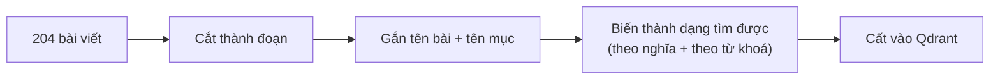
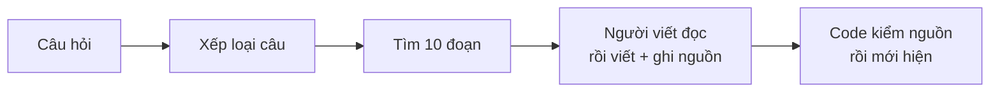

# Bài 0 — hue_rag trong 3 phút

*Cập nhật lần cuối: 09:55, ngày 11/11/2026 · viết lại: kể thẳng từ đầu, một hình ảnh xuyên suốt (người hướng dẫn viên và cuốn sổ tay).*

## Bảng từ — tên mình dùng và tên gốc

Anh đã biết phần lớn các từ này từ khoá học RAG. Từ anh chưa gặp có ghi **mới**.

| Tên trong bài | Tên gốc | Nghĩa ngắn |
|---|---|---|
| Kho (cuốn sổ tay) | **knowledge base** / **corpus** | 204 bài viết về Huế: tất cả những gì chatbot biết. |
| Đoạn (thẻ ghi chú) | **chunk** | Mẩu nhỏ cắt ra từ một bài. Chatbot tìm và đọc từng đoạn. |
| Vector nghĩa | **embedding** (dense vector) | Dãy 384 con số đại diện cho ý nghĩa một đoạn; hai đoạn cùng ý thì vector gần nhau. |
| Từ khoá — **mới** | **BM25** (sparse) | Cách chấm đoạn theo số chữ trùng với câu hỏi; mạnh với tên riêng, con số. |
| Trộn hai bảng xếp hạng — **mới** | **RRF** (Reciprocal Rank Fusion) | Gộp bảng "theo nghĩa" và bảng "theo từ khoá": đoạn đứng cao ở cả hai thì lên đầu. |
| Kho tìm kiếm | **Qdrant** (vector database) | Nơi cất các đoạn cùng vector và từ khoá để tìm nhanh. |
| Tìm | **retrieval** | Bước chọn ra 10 đoạn hợp câu hỏi nhất. |
| Người viết | **LLM**; ở đây là **gpt-6-luna** của OpenAI | Đọc 10 đoạn rồi viết câu trả lời. |
| Ghi nguồn | **citation** | Dòng "Nguồn: …" dưới câu trả lời, bấm vào đọc lại bài gốc. |
| Xếp loại câu — **mới** | **router** (trong code: *định tuyến*) | Bước xem câu hỏi là chào hỏi, về Huế hay ngoài chủ đề. |
| Trợ lý — **mới** | **agent** | Chatbot biết tự nhờ code làm việc (tính ngày, lấy thời tiết, tìm thêm). |
| Bộ câu hỏi mẫu | **Golden set** | 176 câu hỏi có đáp án mẫu, dùng để chấm chatbot. |

---

## Bắt đầu từ một người hướng dẫn viên

Hình dung anh đi Huế với một người hướng dẫn viên. Người này không giỏi nhớ, nhưng rất cẩn thận, và luôn mang theo một **cuốn sổ tay du lịch do chính họ
soạn**: món ăn, di tích, lễ hội, nơi nên đi.

Anh hỏi: *"Chùa Thiên Mụ mở cửa mấy giờ?"*. Họ không trả lời theo trí nhớ. Họ lật sổ, tìm vài trang nói về chùa Thiên Mụ, đọc, rồi mới trả lời, kèm câu "mình
đọc ở trang này". Nếu sổ không có, họ nói thẳng: "Sổ của mình không có thông tin này". Họ không đoán.

Giữ hình ảnh này trong đầu. Cả bộ bài học sẽ quay lại người hướng dẫn viên này.

## hue_rag là gì

hue_rag là **chatbot trợ lý du lịch và văn hoá Huế** chạy trên một trang web. Người dùng gõ câu hỏi bằng tiếng Việt có dấu. Chatbot trả lời **chỉ từ một kho
204 bài viết** đã soạn sẵn, và dưới mỗi câu trả lời có dòng "Nguồn" để bấm vào đọc lại bài gốc.

Ví dụ: người dùng gõ *"Cuối tuần này mình ở Huế, nên ăn bún bò ở đâu?"*. Chatbot tìm trong kho những đoạn nói về bún bò và các quán bún bò, rồi viết câu trả
lời kể vài quán có trong kho, kèm địa chỉ và giờ mở như bài ghi. Nó không thêm quán nào ngoài kho. Dưới câu trả lời là dòng "Nguồn" liệt kê các bài đã dùng.

Chatbot giống người hướng dẫn viên ở chỗ:
- **cuốn sổ tay** là **kho**;
- **lật sổ tìm trang** là bước **tìm**;
- **đọc rồi nói, kèm "đọc ở trang này"** là **người viết** và **ghi nguồn**.

## Bên trong có hai giai đoạn

**Giai đoạn 1 — chuẩn bị sổ** (làm một lần, mỗi khi kho đổi). Từng bước:
- máy cắt 204 bài thành **8.435 đoạn** nhỏ theo cấu trúc bài: mỗi đoạn văn, mỗi mục danh sách, mỗi bảng là một đoạn; bảng quá dài thì mỗi dòng một đoạn (bài 2);
- gắn **tên bài và đường tiêu đề** vào từng đoạn, ví dụ "Bún bò Huế > Quán nổi tiếng" (bài 3);
- mỗi đoạn được biến thành hai dạng để tìm (bài 4):
  - một **vector 384 con số** đại diện cho ý nghĩa, tính bằng model embedding nhỏ **e5-small** chạy ngay trên máy, không tốn tiền;
  - một **bảng từ khoá** để chấm theo chữ trùng (**BM25**);
- tất cả được cất vào **Qdrant**, một cơ sở dữ liệu chuyên để tìm vector nhanh (bài 5). Máy ghi lại "dấu" của từng bài lúc chuẩn bị, để sau này biết kho có
  bị sửa hay không.

**Giai đoạn 2 — trả lời** (mỗi câu hỏi). Từng bước:
- **xếp loại câu** bằng một lần gọi model rất ngắn (bài 12);
- **tìm** (bài 6):
  - câu hỏi cũng được biến thành vector, Qdrant lấy ra **30 đoạn gần nghĩa nhất**;
  - 30 đoạn đó được chấm lại theo từ khoá;
  - hai bảng xếp hạng được trộn lại (cách trộn tên là **RRF**: đoạn đứng cao ở cả hai bảng thì lên đầu), giữ **10 đoạn đầu**;
- **viết** (bài 8): gpt-6-luna đọc lời dặn cố định cùng 10 đoạn, viết câu trả lời tiếng Việt, mỗi ý ghi số nguồn. Chữ hiện dần trên trang trong lúc model đang
  viết;
- **kiểm** (bài 8): viết xong, code kiểm mỗi số nguồn phải trỏ tới một đoạn có thật, rồi mới hiện dòng "Nguồn: tên bài".

## Ba nguyên tắc làm nên chatbot

1. **Chỉ nói điều kho có.** Không đủ bằng chứng thì chatbot trả đúng một câu cố định: "Tôi không tìm thấy đủ thông tin trong nguồn dữ liệu để trả lời câu hỏi
   này." Với khách du lịch, nói chắc mà sai giờ mở cửa hay giá vé còn tệ hơn là không nói.
2. **Nghe xem khách hỏi gì trước khi lật sổ.** Câu chào hỏi thì đáp luôn. Câu không liên quan tới Huế (ví dụ giá vàng hôm nay) thì lịch sự từ chối. Chỉ câu
   về Huế mới đi tìm trong kho.
3. **Việc dễ nhầm thì để code làm.** Hôm nay là ngày mấy âm lịch, cuối tuần này là ngày nào, dự báo bao nhiêu độ: code tính hoặc lấy về, người viết chỉ chép
   lại cho thành câu. Người viết hay tính nhầm ngày và hay tự thêm con số, dù đã được dặn đừng làm vậy.

Khi chatbot biết tự nhờ code những việc như vậy, mình gọi nó là **trợ lý**.

## Tốt tới đâu

Chatbot được chấm ở hai chỗ, đúng như cách đánh giá anh đã học: chấm **bước tìm** (đoạn có đáp án có lọt vào 10 đoạn không) và chấm **câu trả lời** (một model
khác là Claude chấm từng câu so với đáp án mẫu, không biết câu đó của bản nào). Ba con số anh cần nhớ:

- **Điểm "đúng" 4,7 trên 5**, ở lần chấm đầy đủ gần nhất (01/11, khoảng 130 câu hỏi mẫu có đáp án trong kho). Vì sao gọi là tốt: nếu chỉ tính những câu
  chatbot thật sự trả lời thì điểm lên **4,96**, gần như tuyệt đối. Nghĩa là khi đã trả lời thì chatbot gần như không nói sai. Phần điểm bị trừ chủ yếu đến
  từ những câu nó từ chối dù kho có đáp án: người chấm coi câu từ chối như vậy là "không có nội dung để chấm", nên điểm rất thấp và kéo trung bình xuống.
- **Từ chối nhầm khoảng 4–6 trên 158 câu**, tức khoảng 3 %. Trước khi chatbot có bước "tìm thêm" (bài 13), con số này là 12. Đây là lỗi còn nhiều nhất.
- **0 câu ngoài kho bị trả lời** trên mọi bộ đã đo. Đây là mức tối thiểu đặt ra từ đầu, và chưa lần nào bị vượt qua.

Tốc độ: chữ đầu tiên hiện sau khoảng **2,2 giây** với câu về Huế. Yêu cầu anh đặt là dưới 3 giây, nên đạt.

## Đồ án đã làm những gì

1. **Soạn và giữ đúng kho 204 bài**: rà toàn kho tìm chỗ mâu thuẫn hoặc cũ, rồi sửa có kiểm (bài 1).
2. **Dựng chatbot hỏi đáp từ kho, và thử nhiều cách ở mỗi bước**: cách cắt đoạn, model biến đoạn thành dạng tìm được, cách xếp lại kết quả tìm, đưa bao nhiêu
   đoạn. Mỗi bước giữ cách đo ra tốt nhất (bài 2–8).
3. **Dựng cách chấm**: bộ 176 câu hỏi mẫu, một bộ câu kín để kiểm cuối, chấm riêng bước tìm và câu trả lời (bài 9–11).
4. **Nâng chatbot thành trợ lý**: xếp loại câu, tìm thêm, nhớ 3 câu hỏi gần nhất, ngày âm lịch, thời tiết, tra web khi kho không có, biểu mẫu lên lịch trình,
   hỏi bằng ảnh, trên một trang cổng du lịch (bài 12–15).

## Một chuyện thật: 5 đoạn hay 10 đoạn

Hồi đầu, chatbot chỉ đưa **5 đoạn** cho người viết. Lúc chấm, loại câu cần ghép nhiều nguồn (ví dụ so sánh hai món, hay hỏi chung nhiều điểm) hay bị thiếu ý:
5 đoạn không chứa đủ các mảnh cần ghép. Thử đưa **10 đoạn** thì điểm "đủ ý" tăng rõ, nhiều nhất đúng ở loại câu đó. Trong cả đợt rà lại mọi lựa chọn cũ, đây là
thay đổi duy nhất thắng rõ, và chatbot dùng 10 đoạn từ cuối tháng 10.

## Khi nào hỏng

- **Kho có mà tìm không ra.** Đoạn có đáp án không lọt vào 10 đoạn đưa người viết, nên chatbot nói "không đủ thông tin". Khi rà kỹ các câu bị như vậy, khoảng
  một nửa có đoạn đúng nằm ở hạng 11–30, nửa còn lại nằm ngoài cả 30 đoạn ứng viên (bài 6).
- **Kho cũ.** Giá, giờ có thể đổi mà kho chưa sửa. Câu trả lời về vé, điểm tham quan và lễ hội luôn kèm dòng "thông tin có thể đã thay đổi".
- **Kiểm nguồn mới kiểm được số nguồn.** Code kiểm được rằng nguồn được ghi là có thật, chưa kiểm được câu viết ra có khớp từng chữ với nguồn hay không.

## Nếu cần kể trong 3 phút

> hue_rag là chatbot trợ lý du lịch và văn hoá Huế. Nó trả lời **chỉ từ một kho 204 bài viết** em đã soạn và kiểm, và dưới mỗi câu trả lời đều ghi nguồn để
> người dùng đọc lại bài gốc. Kho không có thì chatbot nói không đủ thông tin chứ không đoán. Cách làm này gọi là RAG.
>
> Hệ thống có hai giai đoạn. Giai đoạn chuẩn bị cắt kho thành khoảng 8.400 đoạn nhỏ, biến chúng thành dạng tìm được theo nghĩa và theo từ khoá, rồi cất vào
> Qdrant. Giai đoạn trả lời xếp loại câu hỏi, tìm 10 đoạn hợp nhất, để model gpt-6-luna đọc và viết câu trả lời, rồi code kiểm nguồn trước khi hiện. Những
> việc dễ nhầm như tính ngày âm lịch hay lấy dự báo thời tiết thì code làm, model chỉ diễn đạt.
>
> Ở mỗi bước, em thử nhiều cách và giữ cách đo ra tốt nhất. Kết quả: điểm đúng 4,7 trên 5, và khi đã trả lời thì gần như không sai; chưa câu ngoài kho nào
> bị trả lời; chữ đầu tiên hiện sau khoảng 2 giây. Chỗ yếu còn lại là đôi khi kho có đáp án mà bước tìm không đưa ra được, nên chatbot từ chối nhầm, khoảng
> 3 % số câu.

## Ba điều chính

1. hue_rag giống **người hướng dẫn viên tra sổ tay**: tìm trong kho rồi mới trả lời, ghi nguồn, kho không có thì nói không có.
2. Hai giai đoạn: **chuẩn bị sổ** (cắt đoạn, gắn tên, biến thành dạng tìm được, cất vào Qdrant) và **trả lời** (xếp loại, tìm 10 đoạn, viết, kiểm nguồn).
3. Khi đã trả lời thì **gần như không nói sai**. Lỗi còn nhiều nhất là **từ chối nhầm**, gốc ở **bước tìm**.

**Bài sau:** Bài 1 — Cuốn sổ tay: kho gồm những gì, được soạn ra sao, và vì sao mỗi câu trong kho phải "đọc riêng vẫn hiểu".

---

Nguồn (để giữ bài đúng — anh không cần đọc)

- 10 đoạn đưa người viết: `backend/config/settings.yaml` (`max_context_documents: 10`) [code]
- Xếp loại câu: `backend/llm/assistant.py` hàm `_pick_route` (4 loại: chào hỏi / về Huế / ngoài phạm vi / khẩn cấp — khẩn cấp đi đường câu về Huế) [code]
- Câu từ chối cố định: `backend/llm/full_corpus_prompt.py` [code] · ngày do code tính: `backend/llm/ngay_lich.py` hàm `lich_san` [code]
- 8.435 đoạn từ 204 bài: build record `data/full_corpus_builds/hue_full_corpus_7a2_e5_small_384.json` (05/11) [đã chạy]
- Ví dụ "bún bò cuối tuần": câu tự đặt, theo ví dụ trong sổ ghi việc `bao_cao_he_thong/01_LUONG_HOAT_DONG_HE_THONG.md` [ví dụ tự đặt]
- Điểm Đúng 4,71 (129 câu, 01/11); 4,96 khi chỉ tính câu được trả lời (121 câu): `report_agent/2026-10-31_streaming_spec/do_cuoi_b_bo_kin.md`, `bao_cao_he_thong/10_BAO_CAO_DANH_GIA.md` [đã chạy]. Cách chấm câu từ chối nhầm: `backend/evaluation/full_corpus_judge_prompt.md` [code]
- **Sửa 11/11:** bản trước ghi "đoạn đúng nằm ở hạng 11–30" cho mọi câu từ chối nhầm — chưa đủ: khoảng một nửa nằm ngoài cả 30 ứng viên (`bao_cao_he_thong/06_BAO_CAO_TIM_KIEM.md`, rà 8.1 / B42) [đã chạy]
- Từ chối nhầm 4–6 / 158 (03/11; trước "tìm thêm": 12); 0 câu ngoài kho bị trả lời; chữ đầu tiên 2,16 giây (09/11): `bao_cao_he_thong/README.md` "Số chính" [đã chạy]
- 5 → 10 đoạn (Phase 8.1: Đủ ý +0,26 trên nhóm thử, lợi nhất ở câu nhiều nguồn / so sánh; vào chatbot 28/10): `session_prompt/Project_Status.md` §2 [đã chạy]
- Tên gốc trong bảng từ: `router` / định tuyến trong `assistant.py`; `chunk` trong `backend/ingestion/chunking/`; Golden ở `knowledge-base-hue/evaluation/` (riêng tư) [code]

