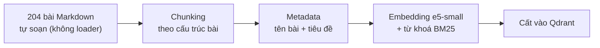
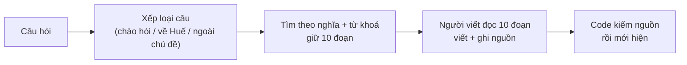

# Bài 0 — hue_rag trong 3 phút

*Cập nhật lần cuối: 09:40, ngày 11/11/2026 · viết lại theo xương sống anh chọn: bám đúng sơ đồ RAG hai giai đoạn anh đã biết.*

## Bảng từ — tên mình dùng và tên gốc

Anh đã biết phần lớn các từ này từ khoá học RAG. Từ nào anh chưa gặp thì có ghi **mới**.

| Tên trong bài | Tên gốc | Nghĩa ngắn |
|---|---|---|
| Kho (sổ tay) | *knowledge base* / *corpus* | 204 bài viết về Huế: tất cả những gì chatbot biết. |
| Đoạn | *chunk* | Mẩu nhỏ cắt ra từ một bài. Chatbot tìm và đọc từng đoạn. |
| Tìm theo nghĩa | *dense retrieval* (dùng *embedding*) | Tìm đoạn có ý gần với câu hỏi, kể cả khi khác chữ. |
| Tìm theo từ khoá | **BM25** — **mới** | Chấm đoạn theo số chữ trùng với câu hỏi. Mạnh với tên riêng, con số. |
| Người viết | *LLM*; ở đây là *gpt-6-luna* của OpenAI | Đọc các đoạn tìm được rồi viết câu trả lời. |
| Trợ lý | *agent* — **mới** | Chatbot biết tự xếp loại câu hỏi và tự nhờ code làm việc (tính ngày, tìm thêm…). |
| Bộ câu hỏi mẫu | *Golden set* | 176 câu hỏi có đáp án mẫu, dùng để chấm chatbot. |

---

*Anh đã có sẵn tấm bản đồ RAG hai giai đoạn. Bài này đặt hue_rag lên đúng tấm bản đồ đó và chỉ ra những chỗ hue_rag đi khác.*

## Hình ảnh nền: người hướng dẫn viên tra sổ tay

Hình dung một người hướng dẫn viên ở Huế không giỏi nhớ nhưng rất cẩn thận. Khách hỏi gì, họ lật cuốn sổ tay tự soạn, tìm vài trang liên quan, đọc rồi mới trả
lời, kèm câu "mình đọc ở trang này". Sổ không có thì họ nói không có, không đoán. hue_rag là người hướng dẫn viên đó. Cuốn sổ là **kho**. Lật sổ là **tìm**.
Đọc rồi nói là **người viết**.

Vì sao lại chọn cách này? Với khách du lịch, nói chắc mà sai giờ mở cửa hay giá vé còn tệ hơn là không nói. Tra sổ trước thì câu nào cũng có nguồn để kiểm. Sổ
sai thì sửa sổ là sửa được câu trả lời.

## Giai đoạn 1 — chuẩn bị kho (chạy một lần, mỗi khi kho đổi)

## Giai đoạn 2 — trả lời một câu hỏi

## Những chỗ hue_rag đi khác bản cơ bản

Mỗi dòng dưới đây sẽ có một bài riêng kể kỹ.

- **Không có loader.** Kho là 204 bài Markdown soạn tay, không phải PDF hay Word cần rút chữ. Đổi lại phải tốn công soạn và giữ kho đúng *(bài 1)*.
- **Cắt đoạn theo cấu trúc bài**, không cắt theo số ký tự. Mỗi đoạn văn, mỗi mục danh sách, mỗi dòng bảng là một đoạn *(bài 2)*.
- **Model embedding nhỏ chạy ngay trên máy**, không tốn tiền. Đã thử một model lớn hơn nhiều: tìm kém hơn mà lại chậm hơn *(bài 4)*.
- **Tìm bằng hai cách rồi trộn kết quả**: theo nghĩa và theo từ khoá. Từ khoá bắt được tên riêng và con số mà tìm theo nghĩa hay trượt *(bài 6)*.
- **Không có reranking.** Đã thử ba cách, không cách nào đáng dùng *(bài 7)*.
- **Đưa 10 đoạn cho người viết**, không phải 5 *(bài 6)*.
- **Câu từ chối viết sẵn và code kiểm nguồn.** Không đủ bằng chứng thì chatbot trả đúng một câu cố định. Mỗi số nguồn nó ghi phải trỏ tới đoạn có thật *(bài 8)*.
- **Thêm phần trợ lý.** Chatbot xếp loại câu trước khi tìm. Những việc dễ nhầm như tính ngày âm lịch hay lấy dự báo thời tiết thì code làm, người viết chỉ
  diễn đạt *(bài 12–15)*.

## Tốt tới đâu (chấm theo hai giai đoạn, đúng như anh học)

Chatbot được chấm ở hai chỗ: **bước tìm** (đoạn có đáp án có lọt vào 10 đoạn không) và **câu trả lời** (một model khác, Claude, chấm từng câu so với đáp án
mẫu mà không biết câu đó của bản nào). Ba con số anh cần nhớ:

- **Điểm "đúng" 4,7 trên 5** ở lần chấm đầy đủ gần nhất (01/11, khoảng 130 câu mẫu có đáp án trong kho). Số này ổn là vì: nếu chỉ tính những câu chatbot
  thật sự trả lời thì điểm lên 4,96, gần như tuyệt đối. Nghĩa là **khi đã trả lời thì chatbot gần như không nói sai**. Phần điểm bị trừ chủ yếu đến từ những
  câu nó từ chối dù kho có đáp án.
- **Từ chối nhầm khoảng 4–6 trên 158 câu**, tức khoảng 3 %. Mốc so sánh: trước khi có bước "tìm thêm" ở phần trợ lý, con số này là 12. Đây là lỗi còn nhiều
  nhất. Lỗi này nằm ở bước tìm, không phải ở người viết.
- **0 câu ngoài kho bị trả lời** trên mọi bộ đã đo. Đây là mức tối thiểu đặt ra từ đầu, và chưa lần nào bị vượt qua.

Về tốc độ, chữ đầu tiên hiện sau khoảng **2,2 giây** với câu về Huế. Yêu cầu anh đặt là dưới 3 giây, nên đạt.

## Một chuyện thật

Hồi đầu, chatbot chỉ đưa **5 đoạn** cho người viết. Lúc chấm, loại câu cần ghép nhiều nguồn (ví dụ so sánh hai món, hay hỏi chung nhiều điểm) hay bị thiếu ý,
vì 5 đoạn không chứa đủ các mảnh cần ghép. Thử đưa **10 đoạn**: điểm "đủ ý" tăng rõ, và tăng nhiều nhất đúng ở loại câu đó. Đổi từ 5 lên 10 là thay đổi chất
lượng duy nhất thắng rõ trong đợt rà lại mọi lựa chọn cũ, và chatbot dùng 10 đoạn từ cuối tháng 10.

## Khi nào hỏng

- **Kho có mà tìm không ra.** Đoạn có đáp án nằm ở hạng 11–30 trong kết quả tìm, không lọt vào 10 đoạn đưa người viết, nên chatbot nói "không đủ thông tin".
- **Kho cũ.** Giá, giờ có thể đổi mà kho chưa sửa. Câu trả lời về vé, điểm tham quan và lễ hội có kèm dòng "thông tin có thể đã thay đổi".
- **Kiểm nguồn chỉ kiểm số.** Code kiểm được rằng nguồn được ghi là có thật, chưa kiểm được câu viết ra có khớp từng chữ với nguồn hay không.

## Ba điều chính

1. hue_rag đi đúng hai giai đoạn RAG anh đã biết, với vài chỗ khác có chủ đích: **không loader, cắt theo cấu trúc, tìm hai cách rồi trộn, không reranking,
   10 đoạn**, và thêm phần trợ lý.
2. Khi đã trả lời thì chatbot **gần như không nói sai**. Lỗi còn nhiều nhất là **từ chối nhầm**, và gốc của nó nằm ở **bước tìm**.
3. Mọi lựa chọn đều được **thử và đo** trước khi giữ. Các bài sau kể từng lựa chọn: đã thử gì, đo ra sao, vì sao giữ.

## Bài sau

**Bài 1 — Dữ liệu vào:** vì sao hue_rag không cần loader, kho gồm gì, và vì sao mỗi câu trong kho phải "đọc riêng vẫn hiểu".

Nguồn (anh không cần đọc)

- 10 đoạn đưa người viết: `backend/config/settings.yaml` (`max_context_documents: 10`) [code]
- Xếp loại câu: `backend/llm/assistant.py` hàm `_pick_route` [code] · câu từ chối cố định: `backend/llm/full_corpus_prompt.py` [code]
- Tìm theo nghĩa lấy 30 rồi trộn với từ khoá (RRF), không reranking: `session_prompt/Project_Status.md` §4 [code, theo sổ ghi việc]
- Điểm Đúng 4,71 (129 câu, 01/11); 4,96 khi chỉ tính câu được trả lời: `bao_cao_he_thong/10_BAO_CAO_DANH_GIA.md` [đã chạy]
- Từ chối nhầm 4–6 / 158 (03/11; trước "tìm thêm": 12); 0 câu ngoài kho bị trả lời; chữ đầu tiên 2,16 giây (09/11): `bao_cao_he_thong/README.md` "Số chính" [đã chạy]
- Chuyện 5 → 10 đoạn (Phase 8.1, điểm Đủ ý +0,26 trên nhóm thử, lợi nhất ở câu nhiều nguồn / so sánh; vào chatbot 28/10): `session_prompt/Project_Status.md` §2 [đã chạy]
- Model lớn (Qwen3-8B) kém hơn, chậm hơn (30/10); 3 cách reranking (2 model chạy trên GPU + để gpt-6-luna tự xếp lại) không đáng dùng: `bao_cao_he_thong/91_BAO_CAO_SO_SANH_PHUONG_AN.md` [đã chạy]
- Ví dụ "so sánh hai món" là ví dụ tự đặt, không phải câu trong bộ chấm.

