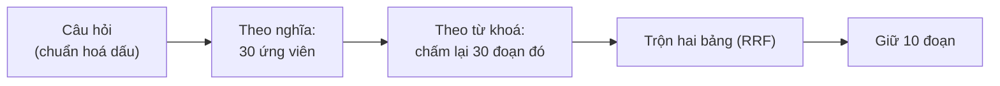

# Bài 6 — Rút đúng thẻ: retrieval

*Cập nhật lần cuối: 10:19, ngày 11/11/2026 · bài mới.*

## Bảng từ — tên mình dùng và tên gốc

Từ đánh dấu **mới** là lần đầu gặp; các từ còn lại đã có ở bài trước hoặc anh đã biết từ khoá học.

| Tên trong bài | Tên gốc | Nghĩa ngắn |
|---|---|---|
| Tìm | **retrieval** | Chọn ra các đoạn hợp câu hỏi nhất. |
| Ứng viên — **mới** | **candidate pool** (trong code: `candidate_pool = 30`) | 30 đoạn gần nghĩa nhất được lấy ra trước, để xét tiếp. |
| Trộn hai bảng xếp hạng | **RRF** (Reciprocal Rank Fusion, `rrf_k = 60`) | Gộp bảng "theo nghĩa" và bảng "theo từ khoá" (đã gặp ở bài 0). |
| Cách tìm đang dùng — **mới** | **`dense_bm25_rrf`** | Tên trong code của cả chuỗi: tìm theo nghĩa → chấm lại theo từ khoá → trộn. |
| Số đoạn đưa người viết | **`max_context_documents: 10`** (top-k) | Giữ 10 đoạn đầu sau khi trộn. |
| Thứ hạng trung bình — **mới** | **MRR** (Mean Reciprocal Rank) | Đoạn đúng đứng hạng 1 được 1 điểm, hạng 2 được 1/2, hạng 5 được 1/5… rồi lấy trung bình. Càng gần 1 càng tốt. |
| Từ chối nhầm | **false refusal** | Kho có đáp án mà chatbot vẫn nói "không đủ thông tin". |

---

*Bài 5 kể 8.435 thẻ được cất trong tủ Qdrant, mỗi thẻ có vector nghĩa và bảng từ khoá. Bài này kể lúc khách hỏi, chatbot rút ra 10 thẻ nào, theo cách nào.*

## Quay lại người hướng dẫn viên

Khách hỏi: *"Đi chùa Thiên Mụ xong thì ăn gì gần đó?"*. Người hướng dẫn viên làm ba việc nhanh trong đầu:
1. **Nghĩ theo ý**, rút ra khoảng 30 thẻ có vẻ liên quan: thẻ về chùa Thiên Mụ, về món ăn gần sông Hương, về quán ở phía tây thành phố…
2. **Dò lại 30 thẻ đó theo chữ**: thẻ nào có đúng chữ "Thiên Mụ", thẻ nào có tên món, thì để ý hơn.
3. **Gộp hai cách nhìn**, xếp lại, giữ **10 thẻ tốt nhất** để đọc kỹ rồi trả lời.

Retrieval của hue_rag làm đúng ba bước đó.

## Bốn bước tìm

1. **Chuẩn bị câu hỏi.** Chữ có dấu được đưa về một dạng chuẩn (NFC), thêm nhãn `query: ` ở đầu (bài 4), rồi tính vector nghĩa bằng e5-small.
2. **Tìm theo nghĩa.** Qdrant so vector câu hỏi với 8.435 vector đoạn, trả về **30 đoạn gần nghĩa nhất**, xếp từ gần tới xa. Đây là 30 ứng viên.
3. **Chấm lại theo từ khoá.** Câu hỏi được tách thành từ (bài 4). BM25 chấm điểm **đúng 30 ứng viên đó** theo chữ trùng, ra một bảng xếp hạng thứ hai. Đoạn
   không trùng chữ nào thì không có mặt ở bảng này.
4. **Trộn hai bảng và giữ 10.** Mỗi đoạn được cộng điểm từ cả hai bảng theo công thức **1 / (60 + hạng)**. Đứng hạng 1 ở một bảng thì được 1/61, hạng 2 được 1/62…
   Đoạn đứng cao **ở cả hai bảng** thì tổng điểm cao nhất và lên đầu. Hai đoạn bằng điểm thì xếp theo mã, để chạy lại lần nào cũng ra cùng thứ tự. Sau cùng
   giữ **10 đoạn đầu** đưa cho người viết.

Vì sao trộn theo **hạng** mà không cộng thẳng điểm? Điểm theo nghĩa (cosine, từ 0 tới 1) và điểm từ khoá (BM25, có thể lên vài chục) không cùng thước đo. Cộng
thẳng thì bên điểm to sẽ lấn át. Trộn theo hạng thì công bằng: chỉ cần biết đoạn đứng thứ mấy ở mỗi bảng. Số 60 là hằng số chuẩn của RRF, làm cho chênh lệch
giữa hạng 1 và hạng 5 không quá lớn. Thử đổi sang 10 hay 30: không khác.

Tất cả mất rất ít thời gian: tính vector câu hỏi và tìm khoảng **21 mili giây**, chấm từ khoá khoảng **1 mili giây**. Phần chậm của cả câu nằm ở người viết,
không nằm ở bước tìm.

## Đo bước tìm thế nào

Đây là nửa đầu của cách đánh giá hai giai đoạn anh đã học: chấm riêng bước tìm, chưa cần nhìn câu trả lời. hue_rag có hai thước:

- **MRR theo từ khoá đáp án** (trên 158 câu hỏi mẫu có đáp án trong kho): mỗi câu có vài từ khoá của đáp án. Xem đoạn đầu tiên chứa từ khoá đó đứng hạng mấy.
  Hiện nay MRR khoảng **0,72**. Nghĩa là trung bình đoạn chứa từ khoá đáp án thường đứng hạng 1 hoặc 2. Theo loại câu: câu **một dữ kiện 0,80** (tốt), câu
  **nhiều nguồn 0,54** và **so sánh 0,53** (kém hơn rõ). Lý do: câu cần ghép nhiều chỗ thì khó có mọi mảnh cùng đứng cao.
- **Đoạn đúng** (55 câu khó, có người gắn nhãn chính xác đoạn nào chứa đáp án): xem đoạn đúng có lọt vào 10 đoạn không. Trên 40 câu thử: **24 câu có đủ đoạn
  đúng trong 10 đoạn**, nhưng **33 câu có đủ trong 30 ứng viên**. Nghĩa là ở **9 câu**, đáp án đã được lấy về nhưng bị xếp ở hạng 11–30, nên người viết không
  thấy. Đây là chỗ nghẽn chính: **lấy về thì được, xếp hạng chưa tốt**.

Một lưu ý: MRR theo từ khoá là thước gần đúng. Đoạn chứa từ khoá chưa chắc đã đủ ý, và đoạn diễn đạt khác chữ thì bị tính là trượt. Vì vậy các quyết định quan
trọng dùng thước "đoạn đúng", dù nó chỉ có 55 câu.

## Vì sao đôi khi từ chối nhầm

Người viết chỉ đọc 10 đoạn. Đoạn đúng không nằm trong 10 đoạn đó thì nó **không thể** trả lời, dù kho có. Khi đó nó làm đúng luật: nói "không đủ thông tin".

Rà kỹ **22 câu từ chối nhầm** của bản đầu tiên (hồi còn đưa 5 đoạn) cho thấy **cả 22 đều thiếu đoạn đúng trong ngữ cảnh**. Không câu nào có đủ đoạn mà người
viết vẫn từ chối. Các lần rà sau cũng ra cùng kết luận. Nguyên nhân chia gần đều hai nửa:
- khoảng **một nửa**: đoạn đúng có trong 30 ứng viên nhưng ở **hạng 11–30**;
- khoảng **một nửa**: đoạn đúng **không lọt cả 30 ứng viên**, tức tìm theo nghĩa đã bỏ sót từ đầu.

Hiện nay từ chối nhầm còn khoảng **4–6 trên 158 câu** (khoảng 3 %). Mốc: hồi chỉ đưa 5 đoạn là 22 câu; lên 10 đoạn còn 12 câu; thêm bước "tìm thêm" ở phần
trợ lý (bài 13) còn 4–6.

## Một chuyện thật: lấy rộng hơn mà không khá hơn, đưa nhiều hơn thì khá hơn

**Thử 1: lấy 100 ứng viên thay vì 30** (26/10). Nghe hợp lý: lấy rộng hơn thì ít sót hơn. Đúng là ít sót hơn: số câu có đủ đoạn đúng trong ứng viên tăng
từ 31 lên **37 trên 40**. Nhưng số câu có đủ đoạn đúng **trong 10 đoạn đưa người viết** chỉ tăng từ 22 lên **23**, và có 1 câu bị mất đoạn đúng. Luật là không
được làm mất câu nào, nên bỏ, giữ 30. Bài học: thêm ứng viên mà xếp hạng không tốt hơn thì ứng viên mới cũng nằm dưới hạng 10.

**Thử 2: đưa 10 đoạn thay vì 5** (Phase 8.1, 25/10). Lần này không đổi cách tìm, chỉ cho người viết thấy nhiều hơn. Kết quả trên nhóm câu thử: điểm "đủ ý"
tăng **+0,26** trên thang 5, và phép thử thống kê xác nhận đây không phải may rủi. Từ chối nhầm giảm từ 13 xuống 7. Nhóm câu kiểm riêng cũng tăng tương tự
(+0,27). Đổi lại, tiền mỗi câu tăng khoảng 1,5 lần, vì gửi nhiều chữ hơn. Ngày 28/10 chatbot chuyển sang 10 đoạn. Ngày 01/11 anh tự đọc 20 cặp câu trả lời
(không biết cặp nào là 5 hay 10 đoạn) và chọn giữ 10.

Hai thử nghiệm cùng chỉ một hướng: **chỗ cần sửa là xếp hạng, hoặc cho người viết thấy nhiều chỗ hơn**, không phải lấy thêm ứng viên. Bài 7 kể các lần thử
xếp hạng lại.

Một thử nghiệm nhỏ nữa: để Qdrant tự tìm cả hai cách trên **toàn kho** rồi trộn, thay vì chỉ chấm từ khoá trên 30 ứng viên. MRR gần như không đổi (0,726 so
với 0,721) nhưng mất đoạn đúng ở 1–2 câu, nên giữ cách đang dùng.

## Khi nào hỏng

- **Câu cần ghép nhiều nguồn, câu so sánh.** MRR chỉ khoảng 0,53–0,54. Mọi mảnh cần ghép khó cùng lọt top 10.
- **Dòng bảng giá.** Đoạn rất ngắn, ít chữ (bài 2), dễ bị xếp rất thấp. Có lần một dòng giá đúng đứng tận hạng 191.
- **Tìm theo nghĩa bỏ sót từ đầu.** Từ khoá chỉ chấm lại 30 ứng viên, nên đoạn ngoài 30 thì dù trùng chữ y hệt cũng không cứu được.
- **Câu không có từ nào trong từ điển của kho.** Bảng từ khoá rỗng, chỉ còn tìm theo nghĩa.
- **Câu gõ không dấu.** MRR tụt từ 0,73 xuống khoảng 0,16–0,19. Câu không dấu nằm ngoài phạm vi.
- **Thước đo nhỏ.** "Đoạn đúng" chỉ có cho 55 câu, mỗi ý chỉ đánh dấu một chỗ trong kho. Chênh lệch nhỏ thì chưa đo ra.

## Ba điều chính

1. Tìm gồm 4 bước: **theo nghĩa lấy 30 ứng viên → theo từ khoá chấm lại 30 đoạn đó → trộn hai bảng theo hạng (RRF) → giữ 10**. Tất cả mất khoảng 20 mili giây.
2. Chỗ nghẽn là **xếp hạng**: ở 9 / 40 câu, đáp án đã được lấy về nhưng nằm ở hạng 11–30. Từ chối nhầm hiện còn khoảng **3 %**, nửa do xếp hạng, nửa do tìm
   theo nghĩa bỏ sót.
3. Lấy 100 ứng viên **không giúp**. Đưa 10 đoạn thay vì 5 **giúp rõ** (+0,26 điểm đủ ý), nên chatbot dùng 10.

**Bài sau:** Bài 7 — Xếp lại thẻ (reranking): đã thử ba cách xếp lại 10 đoạn cho đúng hơn. Có cách xếp đúng hơn hẳn mà câu trả lời vẫn tệ đi. Vì sao.

---

Nguồn (để giữ bài đúng — anh không cần đọc)

- 4 bước, `candidate_pool = 30`, `rrf_k = 60`, phá hoà theo mã, giữ 10, đoạn 0 điểm bị loại khỏi nhánh từ khoá: `backend/retrieval/full_corpus.py` (`normalize_query`, `reciprocal_rank_fusion`, `search`) [code, xem 11/11]; 10 đoạn: `backend/config/settings.yaml` [code]
- 21 ms tìm theo nghĩa, khoảng 0,9 ms BM25: `qwen3_8b_implementation.md` (30/10), 91 thẻ N2-11 [đã chạy]
- MRR 0,72 (158 câu, kho 05/11), theo loại câu 0,80 / 0,543 / 0,527: `bao_cao_he_thong/06_BAO_CAO_TIM_KIEM.md` [đã chạy]
- Đoạn đúng (nhãn bản 5, 30/10): 24 / 40 trong 10 đoạn, 33 / 40 trong 30 ứng viên: `06_BAO_CAO_TIM_KIEM.md`; thước "đoạn đúng": `backend/experiments/phase_8_1/g1_retrieval.py` [đã chạy + code]
- Nguyên nhân từ chối nhầm (mọi câu thiếu đoạn đúng; khoảng nửa ngoài 30 ứng viên): rà Phase 8.1 G1.6 và B42, `06_BAO_CAO_TIM_KIEM.md`, `10_BAO_CAO_DANH_GIA.md` [đã chạy]
- Từ chối nhầm 22 → 12 → 4–6 / 158: `bao_cao_he_thong/07_BAO_CAO_SINH_CAU_TRA_LOI_API.md` §1, `b134_b2_implementation.md` (03/11) [đã chạy]
- Pool 100 (K1, 26/10, nhãn bản 1): 31 → 37 / 40 trong ứng viên, 22 → 23 trong 10 đoạn, mất 1 câu: 91 thẻ T3-01 [đã chạy]
- 5 → 10 đoạn (Phase 8.1 S2): Đủ +0,261 [+0,080; +0,477] trên nhóm thử, +0,268 nhóm kiểm, từ chối nhầm 13 → 7; vào chatbot 28/10; B0 01/11: `session_prompt/Project_Status.md` §2, 91 thẻ S2 [đã chạy]
- Tìm cả hai cách trên toàn kho (`native_hybrid_rrf`): MRR 0,726 so với 0,721, mất 1–2 câu; đổi k RRF: không khác: 91 [đã chạy]
- Dòng giá ở hạng 191 (24/10, kho cũ): `06_BAO_CAO_TIM_KIEM.md` [đã chạy]; không dấu 0,73 → 0,16–0,19: `06_BAO_CAO_TIM_KIEM.md` [đã chạy]
- Câu "Thiên Mụ xong ăn gì gần đó" là ví dụ tự đặt.

