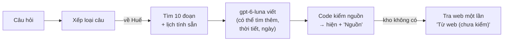

# Bài 16 — Kể đồ án trong 2–3 phút, và chỗ còn yếu

*Cập nhật lần cuối: 14:28, ngày 11/11/2026 · gom lại bài 0–15; bổ sung việc anh cần quyết lúc lên AWS (chi tiết ở bài 18), trỏ sang bài 17–19.*

## Bảng từ

Bài này không có từ mới. Mọi từ đã gặp ở bài 0–15. Muốn tra lại một từ, xem bảng từ ở đầu bài nhắc tới nó.

---

*Bài 0 có một đoạn kể ngắn. Sau 15 bài, anh đã biết từng bước chạy thế nào, vì sao chọn, đo ra sao. Bài này gom tất cả lại thành ba thứ: **một bức tranh**, **một
đoạn kể bản đủ**, và **danh sách chỗ còn yếu kèm hướng sửa**.*

## Cả hệ thống trên một hình

Phía sau là giai đoạn chuẩn bị: 204 bài → 8.435 đoạn → vector nghĩa + từ khoá → Qdrant, có phiếu chuẩn bị chặn chatbot chạy trên kho lệch (bài 1–5). Hai đường
phụ: biểu mẫu "Lên kế hoạch" (code xếp lịch, bài 14) và hỏi bằng ảnh (gợi ý, chờ xác nhận, bài 15).

## Đoạn kể 2–3 phút (bản đủ)

> Đồ án của em là **trợ lý du lịch và văn hoá Huế** dựa trên RAG. Người dùng hỏi bằng tiếng Việt; trợ lý trả lời **chỉ từ một kho 204 bài** em đã soạn, kiểm
> và sửa, và câu nào cũng ghi nguồn để người dùng đọc lại bài gốc. Kho không có thì trợ lý nói rõ là không đủ thông tin, không đoán. Em chọn cách này vì với
> khách du lịch, nói chắc mà sai giờ mở cửa hay giá vé còn tệ hơn không nói.
>
> Hệ thống có hai giai đoạn. **Chuẩn bị:** cắt mỗi bài theo đúng cấu trúc, mỗi đoạn văn, mục danh sách hay dòng bảng là một đoạn, được khoảng 8.400 đoạn. Mỗi
> đoạn mang tên bài và tên mục. Mỗi đoạn được biến thành vector nghĩa bằng model nhỏ e5-small chạy ngay trên máy, cộng một bảng từ khoá BM25, rồi cất vào
> Qdrant. Mỗi lần khởi động, hệ thống tự so dấu từng file kho với phiếu chuẩn bị; kho đã sửa mà chưa chuẩn bị lại thì nó từ chối chạy. **Trả lời:** câu hỏi được
> xếp loại trước: chào hỏi, về Huế, ngoài chủ đề hay khẩn cấp. Câu về Huế được tìm theo nghĩa lấy 30 ứng viên, chấm lại theo từ khoá, trộn hai bảng xếp hạng,
> giữ 10 đoạn. Model gpt-6-luna đọc 10 đoạn đó rồi viết, và code kiểm mọi số nguồn trước khi hiện.
>
> Phần **trợ lý** em thêm ở giai đoạn sau: model được tìm thêm trong kho khi thiếu, nhớ ba câu hỏi gần nhất của cuộc trò chuyện, và những việc dễ nhầm như tính
> ngày âm lịch, dự báo thời tiết, xếp lịch trình thì **code làm, model chỉ diễn đạt**. Khi kho không có, trợ lý tra web một lần và hiện riêng mục "chưa kiểm",
> có rào chắn bằng code cho số tiền, link và câu thiên tai.
>
> Ở mỗi bước em **thử nhiều cách và giữ cách đo ra tốt nhất**, với luật ghi trước khi đo. Ví dụ đoạn to hơn thì tìm thấy nhiều hơn nhưng làm mất đáp án; model
> embedding lớn gấp mười lần thì chậm trăm lần mà còn kém hơn; xếp lại bằng model thì chữa được xếp hạng nhưng làm một số câu tệ đi và chậm gấp đôi. Thứ giúp
> thật là đưa 10 đoạn thay vì 5 và cho trợ lý tìm thêm.
>
> Kết quả chấm mù trên bộ câu hỏi mẫu: điểm đúng 4,7 trên 5, và khi đã trả lời thì gần như không sai; chưa câu ngoài kho nào bị trả lời; chữ đầu tiên hiện sau
> khoảng 2 giây; mỗi câu khoảng 12 đồng. Chỗ yếu còn lại là khoảng 3 % câu bị từ chối nhầm, chủ yếu ở câu cần ghép nhiều nguồn, và trên bộ câu kín chưa ai thấy
> thì điểm đủ ý thấp hơn khoảng 0,4. Đó là hai hướng em sẽ làm tiếp.

## Mỗi lựa chọn chính trong một câu

| Bước | Lựa chọn | Vì sao (một câu) | Bài |
|---|---|---|---|
| Dữ liệu | kho 204 bài tự soạn, không loader | kiểm được trước, chatbot chỉ nói điều kho có | 1 |
| Chunking | theo cấu trúc bài, không gối đầu | kho đã viết mỗi đoạn một ý; đoạn to làm mất đáp án ở 4–6 / 32 câu | 2 |
| Metadata | tên bài + đường tiêu đề trong chữ để tìm | bỏ đi thì 7–8 câu mất đáp án, chỉ 3–4 câu tốt lên | 3 |
| Embedding | e5-small, chạy trên máy | 0 đồng, khoảng 21 ms; Qwen3-8B mất 3 câu và chậm khoảng 100 lần | 4 |
| Từ khoá | BM25 tách theo âm tiết | bắt tên riêng và con số; cách tách "đúng tiếng Việt" hơn lại kém | 4 |
| Lưu trữ | Qdrant + phiếu chuẩn bị, đóng khi lệch | thà không chạy còn hơn trả lời bằng kho cũ mà không ai biết | 5 |
| Tìm | 30 ứng viên → chấm từ khoá → trộn RRF → 10 | lấy 100 ứng viên không giúp; 10 đoạn thay 5: đủ ý +0,26 | 6 |
| Xếp lại | không dùng | thử 3 cách: mất đoạn đúng, hoặc 5 câu tụt và chậm gấp đôi | 7 |
| Viết | gpt-6-luna, câu từ chối cố định, code kiểm nguồn | trả lời một phần làm câu ngoài kho bị trả lời | 8 |
| Chấm | Claude chấm mù, so theo cặp, so với dao động tự nhiên | để không nhầm dao động là tiến bộ | 9–11 |
| Trợ lý | xếp loại + công cụ; phép tính do code | dặn model "đừng tính" không đủ | 12, 14 |
| Tìm thêm | model tự đặt câu tìm, tối đa 2 lần | từ chối nhầm 12 → 4–6; câu nhiều nguồn +1,17 | 13 |
| Nhớ | chỉ nhớ 3 câu hỏi, không nhớ câu trả lời | bản nhớ câu trả lời từng mượn nhầm đoạn của đối tượng khác | 13 |
| Web, ảnh | web chỉ khi kho từ chối, tách riêng; ảnh chờ xác nhận | rào bằng code; model từng gán tên Huế cho ảnh ngoài Huế | 15 |

## Chỗ còn yếu và hướng sửa

Xếp theo thứ tự anh nên biết trước. Cột "hướng sửa" là **đề xuất**. Mục nào ghi "chưa đo" nghĩa là chưa có bằng chứng nó sẽ giúp.

| Chỗ yếu | Vì sao còn | Hướng sửa (đề xuất) | Đo bằng gì |
|---|---|---|---|
| **Từ chối nhầm khoảng 3 %**, dồn ở câu nhiều nguồn, so sánh | đoạn đúng ở hạng 11–30, hoặc ngoài cả 30 ứng viên (bài 6) | thử lại model xếp lại ở cấu hình 10 đoạn (các lần thử cũ làm ở 5 đoạn); hoặc một cách để luna chọn đoạn đủ nhanh. **Chưa đo** | nhãn đoạn đúng + luật "không làm hỏng" (bài 10, 11) |
| **Kiểm nguồn chỉ kiểm số, chưa kiểm nghĩa** | code biết `[3]` có thật, chưa biết đoạn 3 có nói điều đó (bài 8) | mở rộng luật đã có ở mục web: số tiền, giờ trong câu trả lời phải có trong đoạn được trích. **Chưa đo** | bộ an toàn 32 câu + đếm số "lạ" trên 176 câu |
| **Bản đang chạy chưa chấm lại trên cả 176 câu** | mỗi phần trợ lý chỉ đo trên bộ riêng trước khi bật (bài 11) | lượt đo cuối Phase 9 (đã có kế hoạch nháp) | cùng thước với lượt đo cuối Phase 8 |
| **Đề chưa có câu người dùng thật**, bộ quen lạc quan | mọi câu do AI soạn; bộ kín thấp hơn khoảng 0,4 (bài 9) | thu câu thật khi đưa lên mạng (không ghi nội dung vào log, cần cách thu có đồng ý) | bộ câu thật mới, giữ kín |
| **Câu chào hỏi chậm** (câu chậm 7,73 s), **ảnh** chậm (6–9 s), **mục web** chậm (khoảng 13 s) | chờ xếp loại; model nhìn ảnh chậm; tra web thêm một vòng | chạy song song cho câu chào hỏi đã thử và chưa đạt (bài 12); các phần khác chưa thử | đo chữ đầu tiên trên trình duyệt thật |
| **Tiền sát trần** (0,00047 / 0,0005 USD) | phần trợ lý gần gấp đôi tiền (bài 8) | theo dõi; chưa cần sửa khi còn dưới trần | log tiền mỗi câu |
| **Không nhớ câu trả lời** ("quán thứ hai bạn vừa kể") | lựa chọn an toàn (bài 13) | nhớ câu trả lời kèm kiểm đúng đối tượng; cần bộ câu hỏi tiếp lớn hơn 6 câu bẫy. **Chưa đo** | điểm câu hỏi tiếp + câu bẫy |
| **Kho thiếu**: chỗ ở, chợ / chùa ngoài khu di tích, sự kiện theo ngày | chưa soạn (bài 1) | thêm vào kho theo luật sửa kho; chỗ ở thì gợi khu nên ở + link tìm phòng do code dựng (đã đưa vào việc để sau) | đếm câu "về Huế mà kho không có" |
| **Một nhà cung cấp model, chưa đưa lên mạng** | chạy trên máy anh; bản đóng gói Docker đã chạy thử | đưa lên máy chủ (AWS) khi anh quyết tài khoản, tên miền HTTPS, khoá OpenAI riêng có hạn mức, tra web và hỏi bằng ảnh bật hay tắt, số lượt mỗi IP, log truy cập (đủ danh sách ở bài 18) | kiểm sau khi đưa lên |
| **Chưa bật**: lịch trình từ câu gõ tự do, bản đồ cả lịch trình, giọng nói | chưa qua luật, hoặc chờ anh (toạ độ, thu 40 câu giọng nói) | làm tiếp khi có dữ liệu anh duyệt | luật ghi trước của từng phần |
| **Câu gõ không dấu** | ngoài phạm vi (anh chốt 25/10) | không làm trong đồ án | — |

## Đồ án làm tốt nhất ở đâu

Nếu chỉ được nói ba điều đáng tự hào:
1. **Không bịa:** chưa câu ngoài kho nào bị trả lời; khi đã trả lời thì điểm đúng 4,96 / 5. Có phiếu chuẩn bị để không bao giờ trả lời bằng kho lệch.
2. **Mọi lựa chọn đều được đo**, với luật ghi trước, so theo cặp, và giữ cả kết quả âm (Qwen3-8B, reranking, pool 100, trả lời một phần…). Đây là lý do
   giải thích được "vì sao chọn cách này" ở mọi bước.
3. **Chia việc rõ giữa code và model:** phép tính, luật tiền, câu an toàn, link đều ở code; model chỉ chọn và diễn đạt. Những lỗi nguy hiểm nhất đều được
   chặn bằng code, không bằng lời dặn.

## Ba điều chính

1. Đoạn kể bản đủ có 5 ý: **trợ lý chỉ nói điều kho có** · **hai giai đoạn** · **phần trợ lý, phép tính do code** · **mọi lựa chọn đều được thử và đo** · **kết quả và
   chỗ yếu**.
2. Chỗ yếu lớn nhất: **từ chối nhầm khoảng 3 %** ở câu nhiều nguồn, **kiểm nguồn chưa kiểm nghĩa**, và **bản đang chạy chưa chấm lại trên cả bộ**.
3. Điểm mạnh nhất: **không bịa**, **đo mọi lựa chọn**, **code giữ những việc không được sai**.

**Bài sau:** Bài 17 — Giao diện và tốc độ. Ba bài cuối (17–19) bù phần đã làm mà bài 0–16 chỉ nhắc qua: trang người dùng thấy, đóng gói Docker, và bảng tổng mọi
lần so sánh. Muốn hiểu kỹ một bước, quay lại đúng bài đó theo bảng "Mỗi lựa chọn chính trong một câu".

---

Nguồn (để giữ bài đúng — anh không cần đọc)

- Mọi số trong bài lấy từ bài 0–15, mỗi bài có mục Nguồn riêng.
- Các việc chưa bật hoặc đang chờ (bản đồ, giọng nói, AWS, lượt đo cuối Phase 9): `session_prompt/CURRENT_HANDOFF.md` "PHIÊN SAU ĐỌC TRƯỚC" [tài liệu, 10/11]
- Chỗ ở: việc để sau ở Phase 11: `session_prompt/Project_Status.md` §5 (05/11) [quyết định của anh]
- Dòng "chưa đưa lên mạng": bổ sung 11/11 chiều theo bài 18 (bản trước thiếu khoá riêng, số lượt, log truy cập, hỏi bằng ảnh) [tài liệu]
- Các "hướng sửa" là đề xuất của mình, chưa có bằng chứng đo, trừ các mục ghi rõ "đã thử".

