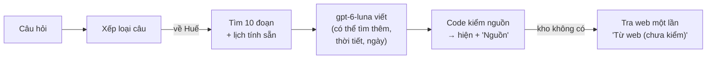

# Bài 16 — Kể đồ án trong 2–3 phút, và chỗ còn yếu

*Cập nhật lần cuối: 20:37, ngày 13/11/2026 · sửa theo kiểm độc lập; thêm kết quả lượt đo giữa kỳ 12/11 (cả trợ lý so với RAG 1–8, 3 chỗ phạm sàn); sửa các câu đã sai sau lượt đo đó (ghi ở Nguồn).*

## Bảng từ

Mọi từ khác đã gặp ở bài 0–15. Muốn tra lại một từ, xem bảng từ ở đầu bài nhắc tới nó.

| Tên trong bài | Tên gốc | Nghĩa ngắn |
|---|---|---|
| Lượt đo giữa kỳ — **mới** | — (tên việc ghi ở Nguồn) | Lần đầu so **cả trợ lý** với bản RAG Phase 1–8 trên cùng bộ câu, cùng kho (12/11). Lượt cuối chạy lại khi đóng code. |

---

*Bài 0 có một đoạn kể ngắn. Sau 15 bài, anh đã biết từng bước chạy thế nào, vì sao chọn, đo ra sao. Bài này gom tất cả lại thành ba thứ: **một bức tranh**, **một
đoạn kể bản đủ**, và **danh sách chỗ còn yếu kèm hướng sửa**.*

## Cả hệ thống trên một hình

Phía sau là giai đoạn chuẩn bị: 204 bài → 8.435 đoạn → vector nghĩa + từ khoá → Qdrant, có phiếu chuẩn bị chặn chatbot chạy trên kho lệch (bài 1–5). Hai đường
phụ: biểu mẫu "Lên kế hoạch" (code xếp lịch, bài 14) và hỏi bằng ảnh (gợi ý, chờ xác nhận, bài 15).

## Đoạn kể 2–3 phút (bản đủ)

> Đồ án của em là **trợ lý du lịch và văn hoá Huế** dựa trên RAG. Người dùng hỏi bằng tiếng Việt; trợ lý trả lời **chỉ từ một kho 204 bài** em đã soạn, kiểm
> và sửa, và câu nào cũng ghi nguồn để người dùng đọc lại bài gốc. Kho không có thì trợ lý nói rõ là không đủ thông tin, không đoán. Em chọn cách này vì với
> khách du lịch, nói chắc mà sai giờ mở cửa hay giá vé còn tệ hơn không nói.
>
> Hệ thống có hai giai đoạn. **Chuẩn bị:** cắt mỗi bài theo đúng cấu trúc, mỗi đoạn văn, mục danh sách hay dòng bảng là một đoạn, được khoảng 8.400 đoạn. Mỗi
> đoạn mang tên bài và tên mục. Mỗi đoạn được biến thành vector nghĩa bằng model nhỏ e5-small chạy ngay trên máy, cộng một bảng từ khoá BM25, rồi cất vào
> Qdrant. Mỗi lần khởi động, hệ thống tự so dấu từng file kho với phiếu chuẩn bị; kho đã sửa mà chưa chuẩn bị lại thì nó từ chối chạy. **Trả lời:** câu hỏi được
> xếp loại trước: chào hỏi, về Huế, ngoài chủ đề hay khẩn cấp. Câu về Huế được tìm theo nghĩa lấy 30 ứng viên, chấm lại theo từ khoá, trộn hai bảng xếp hạng,
> giữ 10 đoạn. Model gpt-6-luna đọc 10 đoạn đó rồi viết, và code kiểm mọi số nguồn trước khi hiện.
>
> Phần **trợ lý** em thêm ở giai đoạn sau: model được tìm thêm trong kho khi thiếu, nhớ ba câu hỏi gần nhất của cuộc trò chuyện, và những việc dễ nhầm như tính
> ngày âm lịch, dự báo thời tiết, xếp lịch trình thì **code làm, model chỉ diễn đạt**. Khi kho không có, trợ lý tra web một lần và hiện riêng mục "chưa kiểm",
> có rào chắn bằng code cho số tiền, link và câu thiên tai.
>
> Ở mỗi bước em **thử nhiều cách và giữ cách đo ra tốt nhất**, với luật ghi trước khi đo. Ví dụ đoạn to hơn thì tìm thấy nhiều hơn nhưng làm mất đáp án; model
> embedding lớn gấp mười lần thì chậm trăm lần mà còn kém hơn; xếp lại bằng model thì chữa được xếp hạng nhưng làm một số câu tệ đi và chậm gấp đôi. Thứ giúp
> thật là đưa 10 đoạn thay vì 5 và cho trợ lý tìm thêm.
>
> Kết quả chấm mù trên bộ câu hỏi mẫu: bản RAG ban đầu được điểm đúng 4,7 trên 5, và khi đã trả lời thì gần như không sai; câu ngoài kho hỏi đơn lẻ đều được
> từ chối; chữ đầu tiên hiện sau khoảng 2 giây; mỗi câu khoảng 12 đồng. Lượt đo giữa kỳ so cả trợ lý với bản ban đầu trên cùng bộ câu: trợ lý tốt hơn rõ ở câu
> nhiều nguồn, câu theo ngày và câu hỏi tiếp, từ chối nhầm giảm từ 13 xuống 3 trên 158 câu. Lượt đó cũng ghi lại 3 chỗ phạm mức tối thiểu; trước lượt đo cuối,
> từng chỗ sẽ được sửa hoặc ghi nhận là giới hạn. Trên bộ câu kín chưa ai thấy thì điểm đủ ý thấp hơn khoảng 0,4, nên số trên bộ quen còn lạc quan.

## Mỗi lựa chọn chính trong một câu

| Bước | Lựa chọn | Vì sao (một câu) | Bài |
|---|---|---|---|
| Dữ liệu | kho 204 bài tự soạn, không loader | kiểm được trước, chatbot chỉ nói điều kho có | 1 |
| Chunking | theo cấu trúc bài, không gối đầu | kho đã viết mỗi đoạn một ý; đoạn to làm mất đáp án ở 4–6 / 32 câu | 2 |
| Metadata | tên bài + đường tiêu đề trong chữ để tìm | bỏ đi thì 7–8 câu mất đáp án, chỉ 3–4 câu tốt lên | 3 |
| Embedding | e5-small, chạy trên máy | 0 đồng, khoảng 21 ms; Qwen3-8B mất 3 câu và chậm khoảng 100 lần | 4 |
| Từ khoá | BM25 tách theo âm tiết | bắt tên riêng và con số; cách tách "đúng tiếng Việt" hơn lại kém | 4 |
| Lưu trữ | Qdrant + phiếu chuẩn bị, đóng khi lệch | thà không chạy còn hơn trả lời bằng kho cũ mà không ai biết | 5 |
| Tìm | 30 ứng viên → chấm từ khoá → trộn RRF → 10 | lấy 100 ứng viên không giúp; 10 đoạn thay 5: đủ ý +0,26 | 6 |
| Xếp lại | không dùng | thử 3 cách: mất đoạn đúng, hoặc 5 câu tụt và chậm gấp đôi | 7 |
| Viết | gpt-6-luna, câu từ chối cố định, code kiểm nguồn | trả lời một phần làm câu ngoài kho bị trả lời | 8 |
| Chấm | Claude chấm mù, so theo cặp, so với dao động tự nhiên | để không nhầm dao động là tiến bộ | 9–11 |
| Trợ lý | xếp loại + công cụ; phép tính do code | dặn model "đừng tính" không đủ | 12, 14 |
| Tìm thêm | model tự đặt câu tìm, tối đa 2 lần, rồi code cất công cụ | từ chối nhầm 12 → 4–6 (giữa kỳ: 3); câu nhiều nguồn +1,17 | 13 |
| Nhớ | chỉ nhớ 3 câu hỏi, không nhớ câu trả lời | bản nhớ câu trả lời từng mượn nhầm đoạn của đối tượng khác | 13 |
| Web, ảnh | web chỉ khi kho từ chối, tách riêng; ảnh chờ xác nhận | rào bằng code; model từng gán tên Huế cho ảnh ngoài Huế | 15 |

## Lượt đo giữa kỳ: cả trợ lý so với RAG Phase 1–8 (12/11)

**Vì sao cần.** Tới 11/11, mỗi phần của trợ lý chỉ được đo trên bộ câu riêng của nó trước khi bật. Chưa lần nào so **cả hệ** trên đủ 176 câu mẫu. Câu cần trả
lời: hôm nay trợ lý đã hơn bản RAG Phase 1–8 chưa, và hơn ở đâu.

**Đo thế nào.** Chạy hai bản cạnh nhau: bản RAG Phase 1–8 (đóng lại 01/11) và trợ lý như ngày 12/11, **cùng bộ câu, cùng kho đã chuẩn bị** (8.435 đoạn), chỉ khác
code. Trên bộ câu mẫu, trợ lý chỉ tìm trong kho, không tra web, để so công bằng; các bộ an toàn, ngoài chủ đề và web thì chạy cả hệ, có web thật. Claude chấm mù
(bài 11), luật ghi trước. Một agent khác **tính lại độc lập** từ dữ liệu thô, khớp. Gọi là "giữa kỳ" vì anh chốt: lượt cuối chạy lại khi đóng code (cuối tháng
12); chỗ phạm sàn lúc này được ghi nguyên, rồi trước lượt cuối anh quyết sửa hay nhận là giới hạn.

**Kết quả 1: tốt hơn ở cả ba nhóm câu khó.** So theo cặp; vì so ba nhóm cùng lúc nên ngưỡng được nâng lên (Holm, bài 11). Cả ba khoảng tin cậy đều không chứa 0:

| Nhóm câu | Đo gì | Trợ lý ↔ RAG 1–8 | Nghĩa là |
|---|---|---|---|
| Câu nhiều nguồn (18 câu) | điểm Đủ ý 1–5 | **4,44 ↔ 3,44**, chênh +1,0 [+0,28; +1,83]; tốt lên / như cũ / tụt: 6 / 11 / 1 | tìm thêm (bài 13) chữa đúng loại câu yếu nhất |
| Câu theo ngày (28 câu) | câu "dùng được", 2 người chấm khớp 28 / 28 | **27 ↔ 11**; bản cũ từ chối 17 câu | bản cũ không biết hôm nay là ngày nào; trợ lý có ngày do code tính (bài 14) |
| Câu hỏi tiếp (14 lượt, có 5 lượt kín) | điểm Đủ ý 1–5 | chênh **+1,64** [+0,64; +2,71]; phần kín không ngược chiều | bản cũ không nhớ câu trước nên không hiểu câu hỏi tiếp (bài 13) |

**Kết quả 2: không làm hỏng câu thường, nhưng không còn biên.** Trên 129 câu mẫu có đáp án, Đủ ý trung bình **+0,19** [+0,05; +0,36]; tốt lên / như cũ / tụt:
10 / 115 / **4**. Luật "không làm hỏng" cho tụt tối đa bằng dao động tự nhiên (1 câu) cộng 3, tức **4**. Vậy là qua, nhưng **vừa đúng ngưỡng**. Từ chối nhầm trên
158 câu trong kho: **3 ↔ 13** (khoảng 2 %). 18 câu ngoài kho trong bộ mẫu: cả hai bản đều từ chối đủ 18.

**Kết quả 3: việc mới.** Nhớ đúng tên đối tượng qua chuỗi hỏi tiếp: **10 / 10** (cần ít nhất 9). Tra web: **6 / 10** câu cần web có mục web hợp lệ, **vừa đúng
ngưỡng 6**. Trò chuyện: 8 / 8 câu đã thấy được đáp, không câu nào tự nêu thông tin Huế cụ thể; phần câu kín chưa chạy nên
**chưa kết luận**. Tiền: **0,00042 USD** (khoảng 10 đồng) một câu về Huế,
dưới trần 0,0005. Cả lượt đo tốn khoảng 0,31 USD (khoảng 7.800 đồng).

**Ba chỗ phạm mức tối thiểu.** Ghi nguyên, chưa sửa:
1. **2 / 44 câu ngoài chủ đề bị tra web**, ở cả hai lượt chạy. Hai câu này bị xếp nhầm vào loại "về Huế", kho từ chối đúng, nhưng vì đi đường câu Huế nên cổng
   web mở. Luật kiểm bỏ mục web, người dùng chỉ thấy câu cố định. Không có chữ sai nào tới người dùng, nhưng tốn một lượt tra và câu hỏi đã bị gửi ra dịch vụ
   tìm, đúng điều sàn này cấm.
2. **1 câu an toàn (loại miễn / giảm vé) thiếu một điều kiện cảnh báo**: trợ lý thiếu 3 / 6 lần sinh, bản cũ 1 / 6. Kiểm độc lập ra nguyên nhân: đoạn chứa điều kiện đó
   chỉ có trong tay trợ lý vì **tìm thêm mang về** (8 / 8 lần ở trợ lý, 0 / 7 lần ở bản cũ). Nên một nửa là do **cách so**: bản cũ không bao giờ có đoạn đó nên
   không thể bị bắt lỗi "thiếu". Nửa kia là **lỗi thật của khâu viết**: có đoạn trong tay mà bỏ điều kiện 5 / 8 lần. Cũng ở câu đó, bản cũ nói sai điều kiện 1 / 6
   lần, trợ lý 0 / 6, nên đây không có nghĩa trợ lý kém an toàn hơn nói chung. Vẫn ghi phạm; đề xuất đổi cách so cho lượt cuối, ghi trước khi chạy.
3. **1 lượt hỏi tiếp trong bộ câu kín bị máy đếm là "trả lời câu ngoài kho"**: kho không có, lẽ ra từ chối, nhưng trợ lý viết một câu trả lời có 2 nguồn sau 2
   lần tìm thêm. Kiểm bằng độ dài và dấu hiệu thì máy không đếm nhầm. Câu đó **đúng hay sai thì chưa biết**, vì chưa ai được giao mở bộ kín ra đọc. Cùng chuỗi
   này cũng từng bị đếm như vậy ở lượt kín đầu tháng 11, nên đây là lỗi lặp lại.

**Giới hạn.** Cỡ mẫu nhỏ (18, 28, 14 câu); người chấm là Claude, chưa có mốc người cho lượt này; mọi bộ đều đã thấy hoặc đã dùng, nên chưa chứng minh được chatbot
làm tốt với câu mới. Chấm mù chưa hoàn toàn: một ít câu của bản cũ còn kiểu ghi nguồn cũ, và chỉ bên trợ lý có mục web. Hai chỗ vừa đúng ngưỡng (4 câu tụt,
web 6 / 10) có thể trượt ở lượt cuối. Lượt cuối sẽ chạy với "hết lượt tìm thì dừng" đã bật (bài 13), lượt giữa kỳ thì chưa có.

## Chỗ còn yếu và hướng sửa

Xếp theo thứ tự anh nên biết trước. Cột "hướng sửa" là **đề xuất**. Mục nào ghi "chưa đo" nghĩa là chưa có bằng chứng nó sẽ giúp.

| Chỗ yếu | Vì sao còn | Hướng sửa (đề xuất) | Đo bằng gì |
|---|---|---|---|
| **Từ chối nhầm 3 / 158 câu** (khoảng 2 %, lượt giữa kỳ), dồn ở câu nhiều nguồn | đếm 12/11: cả 3 do lần tìm đầu thiếu đoạn đúng; 0 câu có đủ đoạn mà model không dùng (bài 20) | sửa ở **bước tìm**, không ở lời dặn: thử lại model xếp lại ở cấu hình 10 đoạn (các lần thử cũ làm ở 5 đoạn); hoặc một cách để luna chọn đoạn đủ nhanh. **Chưa đo** | nhãn đoạn đúng + luật "không làm hỏng" (bài 10, 11) |
| **Kiểm nguồn chỉ kiểm số, chưa kiểm nghĩa** | code biết `[3]` có thật, chưa biết đoạn 3 có nói điều đó (bài 8) | đã đếm 12/11 trên 155 câu trợ lý trả lời: **0** số tiền, giờ, ngày không có trong đoạn nào (cần ít nhất 3 mới xây) ⇒ **chưa xây** bộ kiểm số; giới hạn: đếm theo dãy chữ số, không theo nghĩa (bài 20) | đếm lại ở lượt cuối |
| **Ba chỗ phạm mức tối thiểu ở lượt đo giữa kỳ**, hai chỗ vừa đúng ngưỡng | xem mục trên | trước lượt cuối anh quyết từng chỗ: sửa hay nhận là giới hạn; câu an toàn: đổi cách so, ghi trước khi chạy; lượt hỏi tiếp kín: cần người được giao đọc. **Đề xuất** | lượt đo cuối khi đóng code |
| **Đề chưa có câu người dùng thật**, bộ quen lạc quan | mọi câu do AI soạn; bộ kín thấp hơn khoảng 0,4 (bài 9) | thu câu thật khi đưa lên mạng (không ghi nội dung vào log, cần cách thu có đồng ý) | bộ câu thật mới, giữ kín |
| **Câu chào hỏi chậm** (câu chậm 7,73 s), **ảnh** chậm (6–9 s), **mục web** chậm (khoảng 13 s, 05/11; câu kho thiếu nhanh hơn khoảng 6,7 s từ khi bật "hết lượt tìm thì dừng", bài 13) | chờ xếp loại; model nhìn ảnh chậm; tra web thêm một vòng | chạy song song cho câu chào hỏi đã thử và chưa đạt (bài 12); các phần khác chưa thử | đo chữ đầu tiên trên trình duyệt thật |
| **Tiền sát trần** (0,00047 / 0,0005 USD) | phần trợ lý gần gấp đôi tiền (bài 8) | theo dõi; chưa cần sửa khi còn dưới trần | log tiền mỗi câu |
| **Không nhớ câu trả lời** ("quán thứ hai bạn vừa kể") | lựa chọn an toàn (bài 13) | nhớ câu trả lời kèm kiểm đúng đối tượng; cần bộ câu hỏi tiếp lớn hơn 6 câu bẫy. **Chưa đo** | điểm câu hỏi tiếp + câu bẫy |
| **Kho thiếu**: chỗ ở, chợ / chùa ngoài khu di tích, sự kiện theo ngày | chưa soạn (bài 1) | thêm vào kho theo luật sửa kho; chỗ ở thì gợi khu nên ở + link tìm phòng do code dựng (đã đưa vào việc để sau) | đếm câu "về Huế mà kho không có" |
| **Một nhà cung cấp model, chưa đưa lên mạng** | chạy trên máy anh; bản đóng gói Docker đã chạy thử (bài 18) | đưa lên máy chủ thật | kiểm sau khi đưa lên |
| **Lịch trình từ câu gõ tự do chưa đạt** | thử 2 lần, "hợp người đi cùng" chưa đủ mức ghi trước (bài 14, 19) | hiện chỉ dùng qua biểu mẫu nút | luật ghi trước của lịch trình |
| **Câu gõ không dấu** | ngoài phạm vi (anh chốt 25/10) | không làm trong đồ án | — |

## Đồ án làm tốt nhất ở đâu

Nếu chỉ được nói ba điều đáng tự hào:
1. **Không bịa:** câu ngoài kho hỏi đơn lẻ chưa câu nào bị trả lời (lượt giữa kỳ: 18 / 18 câu ngoài kho được từ chối, 0 / 44 câu ngoài chủ đề bị trả lời); khi đã trả
   lời thì điểm đúng 4,96 / 5. Còn một lượt hỏi tiếp trong bộ kín bị máy đếm là trả lời câu ngoài kho, chưa biết sai thật hay không (mục trên). Có phiếu chuẩn
   bị để không bao giờ trả lời bằng kho lệch.
2. **Mọi lựa chọn đều được đo**, với luật ghi trước, so theo cặp, và giữ cả kết quả âm (Qwen3-8B, reranking, pool 100, trả lời một phần…). Đây là lý do
   giải thích được "vì sao chọn cách này" ở mọi bước.
3. **Chia việc rõ giữa code và model:** phép tính, luật tiền, câu an toàn, link đều ở code; model chỉ chọn và diễn đạt. Những lỗi nguy hiểm nhất đều được
   chặn bằng code, không bằng lời dặn.

## Ba điều chính

1. Đoạn kể bản đủ có 5 ý: **trợ lý chỉ nói điều kho có** · **hai giai đoạn** · **phần trợ lý, phép tính do code** · **mọi lựa chọn đều được thử và đo** · **kết quả và
   chỗ yếu**.
2. **Lượt đo giữa kỳ (12/11):** trợ lý tốt hơn bản RAG 1–8 ở câu nhiều nguồn, câu theo ngày, câu hỏi tiếp; từ chối nhầm **13 → 3**; câu tụt **vừa đúng ngưỡng**;
   **3 chỗ phạm mức tối thiểu** ghi nguyên; trước lượt cuối anh quyết sửa hay nhận là giới hạn. Chỗ yếu khác: **kiểm nguồn chưa kiểm nghĩa**, đề toàn câu AI soạn.
3. Điểm mạnh nhất: **không bịa**, **đo mọi lựa chọn**, **code giữ những việc không được sai**.

**Bài sau:** Bài 17 — Giao diện và tốc độ. Các bài 17–21 bù phần đã làm mà bài 0–16 chỉ nhắc qua: trang người dùng thấy, đóng gói Docker, bảng tổng mọi lần so sánh,
đồ án được làm thế nào, và dữ liệu người dùng + bảo mật. Muốn hiểu kỹ một bước, quay lại đúng bài đó theo bảng "Mỗi lựa chọn chính trong một câu".

---

Nguồn (để giữ bài đúng — anh không cần đọc)

- Mọi số trong bài lấy từ bài 0–15, mỗi bài có mục Nguồn riêng, trừ mục "Lượt đo giữa kỳ" dưới đây.
- Lượt đo giữa kỳ 12/11 = việc B7 (hai bên: tag `p9-moc` = `18e8f42` ↔ `main` `dfd0c96`; 8.435 điểm; Golden đường chỉ-kho; nhiều nguồn 4,44 ↔ 3,44, +1,0 [+0,278; +1,833], 6 / 11 / 1 sau sửa m-1; theo ngày 27 ↔ 11, từ chối 1 ↔ 17, 28 / 28; hỏi tiếp gộp kín +1,643 [+0,643; +2,714]; Holm 3 / 3; Đủ 129 câu +0,194 [+0,054; +0,357], 10 / 115 / 4, ngưỡng 4 = A/A + 3; từ chối nhầm 3 ↔ 13; F1 0, 18 / 18; nhớ tên 10 / 10; web 6 / 10; trò chuyện 8 / 8, kín NOT RUN; 0,00042 USD / câu; 0,313 USD; S2b 2 / 44 ×2; S1 thiếu cảnh báo 3 / 6 ↔ 1 / 6; chuỗi kín 1 mã, cùng mã phạm 03/11): `report_agent/2026-11-08_phase_9_ban_13/b7_implementation.md` §3, §4.1–4.4, §5, §8 [đã chạy]; tính lại độc lập, chẩn đoán câu an toàn (8 / 8 ↔ 0 / 7, bỏ 5 / 8, sai điều kiện 1 / 6 ↔ 0 / 6), mù không hoàn toàn (6 / 176 câu mốc còn dạng `[Nguồn n]`): `…/b7_review.md` §4, §6, §7, m-4 [đã chạy]; nhãn "giữa kỳ", lượt cuối có cờ hết lượt: `docs/superpowers/plans/2026-11-10-phase-9-b7-plan.md` [quyết định của anh]; S2b chi tiết: `report_agent/2026-11-12_ra_khoang_cach/c_phan_chua_on.md` §3c (2) [đã chạy]
- Đếm 3 câu từ chối nhầm là tìm trượt; 0 số không nguồn / 155 câu: `c_phan_chua_on.md` §3b (a), (c) [đã chạy]. Bản ghi số liệu: `data/hoc_cung_user_2026-11-10/fact_viec_12_11.md` (riêng tư)
- Chỗ ở: việc để sau ở Phase 11: `session_prompt/Project_Status.md` §5 (05/11) [quyết định của anh]
- Các "hướng sửa" là đề xuất của mình, chưa có bằng chứng đo, trừ các mục ghi rõ "đã thử".

- **Sửa 20:22 13/11/2026:** "chưa câu ngoài kho nào bị trả lời" (đoạn kể, mục "làm tốt nhất") sai từ lượt đo giữa kỳ ⇒ nói đúng: câu đơn đạt, một lượt hỏi tiếp kín bị máy đếm phạm; "bản đang chạy chưa chấm lại trên cả 176 câu" sai ⇒ đã chấm ở lượt giữa kỳ; "từ chối nhầm khoảng 3 %" ⇒ 3 / 158 (khoảng 2 %); "kiểm số tiền, giờ … chưa đo" ⇒ đã đếm, 0 / 155, không xây.
- **Sửa 14:48 11/11/2026:** theo luật anh chốt ("phần chưa xong thì không đưa vào bài học"), gỡ đoạn tả việc chưa làm xong: dòng "Chưa bật: bản đồ, giọng nói" (đang làm dở) và chi tiết các câu anh cần quyết lúc lên AWS; dòng lịch trình câu gõ tự do giữ vì đã thử xong (chưa đạt).
- **Sửa 20:37 13/11/2026** theo kiểm độc lập (`data/hoc_cung_user_2026-11-10/kiem_doc_lap_13_11.md`, riêng tư): sàn phạm: "em sẽ xử lý" ⇒ "sửa hoặc ghi nhận là giới hạn, anh quyết" (B7i §6); bảng từ bỏ mã việc; thống nhất tên lỗi an toàn.

