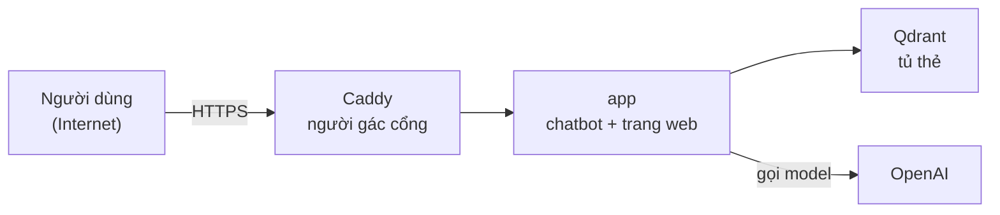

# Bài 18 — Mang cả chatbot sang máy khác: đóng gói Docker

*Cập nhật lần cuối: 14:48, ngày 11/11/2026 · bài mới; đã qua một lượt kiểm độc lập; gỡ phần chưa làm (lên AWS).*

## Bảng từ — tên mình dùng và tên gốc

Từ đánh dấu **mới** là lần đầu gặp; các từ còn lại đã có ở bài trước hoặc anh đã biết từ khoá học.

| Tên trong bài | Tên gốc | Nghĩa ngắn |
|---|---|---|
| Bản đóng gói — **mới** | **Docker image** (dựng theo `Dockerfile`) | Một gói đủ chương trình, thư viện, model, dữ liệu cần để chạy; máy nào có Docker cũng chạy giống nhau. |
| Hộp chạy | **container** | Một bản đóng gói đang chạy. Bộ ba hộp chạy cùng nhau được mô tả trong file **`compose.yml`**. |
| Người gác cổng | **Caddy** (reverse proxy) | Cửa duy nhất mở ra Internet; chuyển câu hỏi vào chatbot và tự lo HTTPS. |
| Danh sách cho phép — **mới** | **allowlist** (file `.dockerignore` sinh tự động) | Mặc định cấm hết, chỉ mở đúng từng file cần. Ngược với **danh sách chặn** (blocklist): mặc định cho hết, chỉ cấm thứ liệt kê. |
| Giới hạn lượt — **mới** | **rate limit** (biến `HUE_LUOT_MOI_NGAY`, mã lỗi **429**) | Mỗi địa chỉ IP chỉ được hỏi một số lần mỗi ngày; quá thì nhận câu báo "hết lượt". |
| Biến môi trường | environment variable | Công tắc đặt từ bên ngoài lúc chạy, không phải sửa mã. |

---

*Bài 5 kể Qdrant chạy trong Docker trên máy anh. Bài 17 kể trang web và tốc độ. Bài này kể bước đã làm để chuẩn bị đưa **cả chatbot** lên một máy chủ trên
mạng: đóng gói ra sao, và vì sao phần khó nhất lại là **không mang theo** những thứ không được mang.*

## Quay lại người hướng dẫn viên

Người hướng dẫn viên được mời sang làm ở một quầy mới trong thành phố. Họ xếp một **vali**: cuốn sổ tay, bút, bảng giá, đủ để làm việc ngay. Nhưng trên bàn ở nhà
còn **đề kiểm tra** người ta dùng để chấm họ, cùng bản nháp đáp án. Những thứ đó **không được bỏ vào vali**: quầy mới là chỗ công cộng, ai cũng có thể ngó vào.

Có hai cách xếp vali. Cách một: bỏ hết vào, rồi **nhặt ra** những thứ cấm. Quên nhặt một tờ là tờ đó đi theo. Cách hai: vali để trống, chỉ **bỏ vào** từng thứ có
tên trong danh sách. Quên một thứ thì tới nơi thấy thiếu ngay, và không có tờ cấm nào lọt.

## Gói gồm những gì

Ba hộp chạy trên **một máy**, nói chuyện với nhau qua một mạng riêng bên trong:

- **Caddy:** cửa duy nhất mở ra ngoài. Tự xin chứng chỉ HTTPS khi có tên miền. Không nén luồng chữ trả lời, để chữ vẫn hiện dần (bài 17).
- **app:** chatbot cùng trang web đã dựng sẵn, model tìm kiếm e5-small (bài 4) được đóng **sẵn trong gói** để lúc chạy không phải tải từ mạng. Thư viện học máy
  dùng **bản chạy CPU**, vì máy chủ không có card đồ hoạ. Khoá OpenAI **không nằm trong gói**, chỉ được nạp lúc chạy. App **không mở cổng ra ngoài**, chỉ Caddy
  gọi được nó.
- **Qdrant:** giữ 8.435 thẻ như bài 5. Dữ liệu là một **bản chép** gắn vào từ bên ngoài, cũng **không mở cổng** ra ngoài.

Trong gói có: mã chatbot, trang web, **đúng 204 bài kho** (lúc khởi động, chatbot so từng bài với phiếu chuẩn bị ở bài 5, lệch là không chạy), và 4 file dữ liệu
nhỏ chatbot cần. Không có: khoá API, bộ câu hỏi mẫu, câu kín, bản sao lưu kho, ghi chú soạn kho, log, ảnh không có giấy phép mở.

Vì trong gói có kho bài, gói **không được đẩy lên kho ảnh công khai** (kiểu Docker Hub). Gói sẽ được dựng ngay trên máy chủ.

## Chặn dữ liệu kín: từ danh sách chặn sang danh sách cho phép

Bây giờ: một đoạn mã nhỏ **sinh** danh sách cho phép từ phiếu chuẩn bị của Qdrant. Dòng đầu là "cấm hết". Sau đó mở đúng 9 mục cần thiết và **từng bài một**
trong 204 bài. Nếu trong phiếu có đường dẫn lạ (thư mục đánh giá, câu kín, thư mục sao lưu…), đoạn mã **dừng**, không sinh danh sách.

Sau khi dựng, người kiểm **đếm thẳng trong bản đóng gói cuối**:

| Đếm gì | Số | Mốc phải đạt |
|---|---|---|
| bài kho | **204** | đúng bằng phiếu chuẩn bị |
| câu kín, file sao lưu, khoá API | **0 · 0 · 0** | 0 |
| ảnh không có giấy phép mở | **0** | 0 |
| file mã chatbot | 107 | bằng số file mã trên Git |

## Một chuyện thật: lệnh kiểm chỉ nhìn 3 dòng đầu

Ngày 07/11, bản đóng gói đầu tiên dùng **danh sách chặn**. Dòng chặn thư mục đánh giá chỉ khớp thư mục đó **ở gốc kho**. Nhưng kho còn **7 thư mục đánh giá lồng
bên trong** từng chủ đề. Người dựng kiểm "trong gói có file đánh giá không" bằng một lệnh tìm, nhưng lệnh **chỉ in 3 dòng đầu**. Ba dòng đó đều là file của thư
viện, nên report ghi "0 file đánh giá".

Người kiểm (một session khác) đếm lại **toàn bộ** gói: có **16 file đánh giá**, trong đó có câu hỏi mẫu, và **148 file** ghi chú, sao lưu. Chatbot không phục vụ
những file này ra ngoài, nhưng gói sẽ nằm trên một máy công khai. Gói chưa rời máy anh. Cách sửa không phải "thêm dòng chặn cho đủ", mà **đổi hẳn sang danh sách
cho phép**, sinh tự động, rồi đếm lại như bảng trên.

Ngày 10/11 có hai lần nữa cho thấy cả hai mặt của danh sách cho phép:
- **Suýt lọt:** danh sách mở **cả thư mục** trang web, mà trong đó có một ảnh lễ hội không có giấy phép mở. Người dựng tự bắt trước khi dựng, chặn lại thư mục
  ảnh đó. Bài học: mở cả một thư mục thì vẫn có thể lọt thứ nằm bên trong.
- **Thiếu thì tính năng tắt:** gói chạy tốt mọi điểm kiểm, nhưng "hỏi bằng ảnh" **tự tắt**, chỉ để lại một dòng log, vì danh sách thiếu file danh sách 42 tên (bài
  15). Người kiểm phát hiện; người dựng thêm file, dựng lại. Đây là cái giá của danh sách cho phép: an toàn, nhưng thiếu thì phải có người để ý.

Hai bài học chung: **"kiểm" là đếm đủ**, không nhìn vài dòng đầu; và **người dựng không tự duyệt việc của mình**.

## Bốn chốt trước khi lên mạng

Bốn chốt có sẵn trong mã. Ba chốt đầu trên máy anh **không đặt thì hành vi như cũ**; log xoay vòng bật cho mọi máy từ 09/11. Bản lên mạng đặt trong `compose.yml`:

| Chốt | Bản lên mạng đặt | Vì sao |
|---|---|---|
| **Giới hạn lượt** theo IP mỗi ngày (chung cho hỏi chữ và hỏi bằng ảnh) | **50 lượt** (anh đổi được) | Mỗi câu tốn tiền OpenAI. Link công khai không giới hạn thì ai gửi liên tục là cháy tiền. 50 lượt × khoảng 0,0005 USD ≈ 0,025 USD / IP / ngày. |
| **Cookie chỉ gửi qua HTTPS** | bật | Trình duyệt không gửi mã cuộc trò chuyện qua kết nối không mã hoá, nên khó bị đọc trộm trên đường truyền. Phải có tên miền HTTPS, nếu không trình duyệt bỏ cookie, chatbot **mất nhớ hội thoại** mà không báo lỗi. |
| **Tắt trang tài liệu API** | bật | Người lạ không xem được sơ đồ toàn bộ API. |
| **Log xoay vòng** | luôn bật | File log đầy 10 MB thì sang file mới, giữ 3 bản cũ, ổ đĩa máy chủ không đầy. |

Tra web trên bản lên mạng đang **tắt** tới khi anh quyết. Còn một chi tiết: phía sau Caddy, mọi câu hỏi tới app đều "từ Caddy". App phải đọc địa chỉ thật mà
Caddy ghi kèm, nếu không thì **cả nước chung một sổ đếm lượt**.

## Lần chạy thử trên máy anh (10/11)

| Kiểm | Kết quả |
|---|---|
| Dựng gói | **191 giây**; gói nặng **3,57 GB** (lần 07/11: 6,1 GB, vì còn bộ nhớ đệm thư viện thừa) |
| Khởi động | Qdrant ⇒ app ⇒ Caddy; kiểm sức khoẻ **5 / 5** sau 10 giây |
| Qua Caddy | trang chủ mở được, có rào an toàn trình duyệt; trang tài liệu API **không mở được** (đúng ý) |
| 1 câu trong kho, 1 câu ngoài kho | trả lời có nguồn; câu ngoài kho đúng câu từ chối |
| Giới hạn (đặt 2 lượt để thử) | lượt 3 bị chặn; lượt 4 **giả địa chỉ IP** cũng bị chặn |
| Cookie HTTPS | **chưa thử**: máy anh chỉ có http nên lần thử tắt chốt này |
| Log của chatbot | 0 chữ câu hỏi, 0 địa chỉ IP |
| Bộ nhớ | app khoảng 940 MB, Qdrant 230 MB, Caddy 18 MB |
| Tiền | dưới 0,001 USD |

Người kiểm đọc lại cả việc: vòng 1 ra 1 lỗi đáng sửa (hỏi bằng ảnh tự tắt, ở trên) và 2 chỗ nhỏ, vòng 2 đạt.

Chưa thử được trên máy anh: HTTPS thật (máy anh chỉ có http). Việc đưa lên máy chủ thật chưa làm; khi làm xong sẽ viết bổ sung vào bài này.

## Khi nào hỏng

- **Quên đặt tên miền HTTPS** mà cookie vẫn bật ⇒ mất nhớ hội thoại, không báo lỗi.
- **Ai đó mở cổng cho app** ra ngoài, đi vòng qua Caddy ⇒ người dùng tự khai địa chỉ IP giả để lách giới hạn được.
- **Khởi động lại app** ⇒ sổ đếm lượt (nằm trong bộ nhớ) bị xoá, mọi người có lại đủ lượt.
- **Nhiều người chung một wifi** là chung một IP, tức chung số lượt mỗi ngày.
- Giới hạn theo IP **không phải trần tiền tổng**: nhiều IP vẫn cộng dồn. Trần tiền thật phải đặt ở hạn mức chi tiêu của khoá OpenAI.
- **Kho đổi** mà quên sinh lại danh sách cho phép ⇒ app thấy bài lệch phiếu, không chạy. Tình huống này an toàn nhưng phải để ý.
- Gói lọt ra ngoài là lọt kho bài ⇒ không đẩy lên kho ảnh công khai.

## Ba điều chính

1. **Ba hộp trên một máy:** Caddy (cửa duy nhất, HTTPS), app (chatbot + trang web + model đóng sẵn), Qdrant (bản chép, không mở cổng). Khoá API chỉ nạp lúc chạy.
2. **Danh sách cho phép, sinh tự động, rồi đếm trong gói cuối.** Chuyện thật: danh sách chặn đã lọt 16 file đánh giá và 148 file ghi chú, sao lưu, vì lệnh kiểm chỉ
   nhìn 3 dòng đầu. Đếm lại: 204 bài, 0 câu kín.
3. **Bốn chốt trước khi lên mạng** (50 lượt / IP / ngày, cookie HTTPS, tắt tài liệu API, log xoay vòng) đã có trong mã; trên máy anh đã thử đạt giới hạn
   lượt và tắt tài liệu API, cookie HTTPS chờ HTTPS thật.

**Bài sau:** Bài 19 — Bảng tổng các lần so sánh: mọi lựa chọn chính trên một trang, để tra lại nhanh.

---

Nguồn (để giữ bài đúng — anh không cần đọc)

- Ba hộp, Qdrant ghim bản, không mở cổng, app chờ Qdrant sẵn sàng, Caddy không nén luồng chữ, `HUE_SITE`: `data/phase_12/deploy_nhap/compose.yml`, `Caddyfile` (riêng tư) [code]
- Gói nhiều tầng, torch bản CPU, e5-small đóng sẵn + `HF_HUB_OFFLINE=1`, một tiến trình, `--proxy-headers --forwarded-allow-ips '*'` (app không mở cổng nên chỉ Caddy tới được): `data/phase_12/deploy_nhap/Dockerfile` (riêng tư) [code]
- Danh sách cho phép sinh từ phiếu chuẩn bị, 9 mục + 204 bài, dừng khi gặp đường dẫn lạ: `data/phase_12/deploy_nhap/dung_dockerignore.py` (riêng tư) [code]
- Sự cố 07/11 (16 + 148 file, 7 thư mục lồng, lệnh chỉ in 3 dòng): `report_agent/2026-11-07_tu_soi_lo_trinh/e_review_b_dep.md` §3, `b_dep_build_cuc_bo.md` [đã chạy]
- Lần chạy 10/11 (191 s, 3,57 GB, 5 / 5 sau 10 s, 429 kể cả IP giả, đếm 204 / 0, RAM), review vòng 1 (hỏi bằng ảnh tự tắt) + vòng 2 đạt: `report_agent/2026-11-08_phase_9_ban_13/b_deploy_cuc_bo_implementation.md` §2, §5, `b_deploy_cuc_bo_review.md` [đã chạy]
- Bốn chốt: giới hạn lượt `backend/api/gioi_han.py` (`HUE_LUOT_MOI_NGAY`, không đặt ⇒ tắt, 3 đường gọi model chung sổ, 429, đếm trong RAM), gắn ở `backend/api/app.py`; `HUE_TAT_DOCS` `app.py`; `HUE_COOKIE_SECURE` `backend/api/routes/chat.py`; log xoay vòng `backend/config/logging.yaml`; `HUE_TRA_WEB`, `HUE_QDRANT_URL`: `backend/core/settings_loader.py` [code, xem 11/11]
- "Chung wifi = chung lượt", "khởi động lại xoá sổ": suy ra từ cách đếm trong RAM theo IP (`gioi_han.py`) [suy ra, chưa chạy]. (Câu cũ "log truy cập ghi IP" đã bỏ: phép thử 11/11 cho thấy cấu hình log của chatbot tắt log truy cập của uvicorn — bài 21.)
- Bản ghi số liệu cho bài này (agent con, chỉ đọc, 11/11): `data/hoc_cung_user_2026-11-10/fact_bai_18_dong_goi_docker.md` (riêng tư)
- Ví dụ vali là ví dụ tự đặt.
- **Sửa 14:41 11/11/2026** (người kiểm độc lập bắt, mình đối chiếu nguồn): lần thử 10/11 đặt `HUE_COOKIE_SECURE=0` (`b_deploy_cuc_bo_implementation.md` §2) nên chốt cookie chưa thử — bản trước ghi "bốn chốt đã thử đạt"; 1,9 GB (07/11, ngoài Docker) ↔ ~1,2 GB (10/11, `docker stats`) khác cách đếm; log xoay vòng bật mọi máy (`ccc9f4f`). Biên bản kiểm: `data/hoc_cung_user_2026-11-10/review_bai_17_19.md` (riêng tư).

- **Sửa 14:48 11/11/2026:** theo luật anh chốt ("phần chưa xong thì không đưa vào bài học"), gỡ đoạn tả việc chưa làm xong: mục "Còn thiếu để lên AWS" (việc lên máy chủ chưa làm; các câu anh cần quyết vẫn ở `session_prompt/CURRENT_HANDOFF.md` "Câu hỏi cho User"). Giữ lại phần thuộc gói đã dựng (chung wifi chung lượt, trần tiền thật ở khoá OpenAI).

