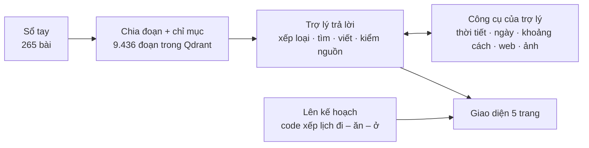

# Bản đồ dự án hue_rag — đọc trang này trước

*Cập nhật lần cuối: 16:28, ngày 20/11/2026 · mục "Nhóm đang làm gì": sửa hai dòng trạng thái ("lên lịch giúp mình" đã gộp, cờ tắt; "nhớ cả câu trả lời" đã đếm) · trước đó 16:24, ngày 20/11/2026 · bảng "Cái gì ĐANG chạy" đủ 31 cờ đang bật (thêm các cờ bật 19–20/11); mục "Nhóm đang làm gì" viết lại theo đợt hoàn thiện Phase 9–12 · trước đó 16:22, ngày 20/11/2026 · bảng "Cái gì ĐANG chạy" thêm hai dòng bật 20/11 (lấy lại câu trả lời cũ giữa các cuộc trò chuyện; dòng "danh sách có thể chưa đủ") · trước đó 16:09, ngày 18/11/2026 · trang mới: các khối hệ thống, cái gì đang chạy, đọc bài nào trước, nhóm đang làm gì.*

Trang này là **cửa vào**: đọc 5–10 phút là biết hệ thống gồm những khối nào, khối nào đang bật, và muốn hiểu sâu một khối thì mở bài nào. Mọi con số ở đây là
**số của hệ thống hôm nay**; các bài viết trước ngày 14/11 (bài 0–18) viết lúc kho còn 204 bài, nên anh sẽ gặp số nhỏ hơn ở đó, không phải lỗi.

## Bảng từ

| Tên trong trang | Tên gốc | Nghĩa ngắn |
|---|---|---|
| sổ tay | *knowledge base* | kho bài viết tự soạn — mọi thứ trợ lý được phép nói |
| Qdrant | Qdrant | cơ sở dữ liệu chuyên tìm đoạn văn theo nghĩa |
| RRF | *Reciprocal Rank Fusion* | cách trộn hai bảng xếp hạng: đoạn nào đứng cao ở cả hai bảng thì lên đầu |
| trợ lý | *agent* | chatbot biết nhờ code làm việc (tính ngày, tra thời tiết, xếp lịch…) rồi mới diễn đạt |
| lời dặn | *prompt* | đoạn chữ hướng dẫn gửi kèm cho model mỗi lần gọi |
| cờ | *feature flag* | một dòng bật / tắt một tính năng trong file cấu hình |
| p50 / p95 | *percentile* | p50: một nửa số câu nhanh hơn mức này; p95: 95 % số câu nhanh hơn mức này |
| câu thường | — | câu trả lời được ngay sau lần tìm đầu, không phải tìm thêm, không tra web |
| sổ bàn giao | *runbook* | sổ hướng dẫn từng lệnh cho người (hoặc agent) làm tiếp |
| lượt đo cuối | — | lần chấm toàn bộ trợ lý trên bản code đã đứng yên, trước khi đóng giai đoạn trợ lý |
| sàn (mức tối thiểu) | — | ngưỡng ghi trước khi đo; kết quả dưới ngưỡng thì thay đổi không được bật |
| luật ghi trước | — | tiêu chí đạt / trượt viết ra **trước** khi chạy đo, để không sửa tiêu chí theo kết quả |
| nghiệm thu | — | lượt kiểm cuối của một tính năng theo luật ghi trước, trước khi bật cho người dùng |
| sổ số đo | *log* | file ghi mỗi câu hỏi một dòng số (thời gian, tiền, đi đường nào) — không ghi nội dung câu |
| bộ câu kín | *held-out set* | bộ câu hỏi cất riêng, người làm không được xem, chỉ mở để chấm ở mốc cuối |
| chấm mù, so theo cặp | — | người chấm không biết câu trả lời nào của bản nào; hai bản trả lời cùng một câu được so trực tiếp |
| trung vị | *median* | giá trị đứng giữa khi xếp các số theo thứ tự (chính là p50) |
| bản đồ mở | OpenStreetMap | bản đồ do cộng đồng góp, dùng tự do — dữ liệu quán lấy từ đây chưa ai kiểm ngoài đời |

## Dự án trong 5 câu

1. hue_rag là **trợ lý du lịch và văn hoá Huế** trên một trang web: người dùng hỏi bằng tiếng Việt có dấu, trợ lý trả lời **chỉ từ cuốn sổ tay** (kho bài viết
   tự soạn) và ghi nguồn dưới mỗi câu, kho không có thì nói không có, giống người hướng dẫn viên tra sổ tay ở bài 0.
2. Sổ tay nay có **265 bài, cắt thành 9.436 đoạn** (tới 13/11 là 204 bài / 8.435 đoạn), cất trong **Qdrant**.
3. Mỗi câu hỏi: model **xếp loại câu**, code **tìm 10 đoạn** hợp nhất, model **gpt-6-luna** đọc rồi viết, code **kiểm nguồn** rồi mới hiện; thiếu thì trợ lý
   **tự tìm thêm** tối đa 2 lần, kho vẫn không có thì **tra web một lần** và để riêng mục "chưa kiểm".
4. Việc dễ nhầm (ngày âm lịch, thời tiết, khoảng cách, xếp lịch, chọn khách sạn / quán) **code làm, model chỉ diễn đạt** — đó là phần "trợ lý".
5. Hệ thống chạy **trên máy anh**, chưa đưa lên mạng. Code đứng yên tối thứ Bảy 21/11, lượt đo cuối Chủ nhật 22/11. Trước cuối tháng 11: kế hoạch deploy
   và sổ bàn giao; **deploy chỉ bàn khi dự án xong**.

## Các khối của hệ thống

Ngoài hình: **khối đo / chấm** đứng cạnh để kiểm mọi thay đổi, và **khối đóng gói** (Docker) để mang cả hệ thống sang máy khác.

| Khối | Nó làm gì | Đang chạy thế nào (số hôm nay) | Bài nên đọc |
|---|---|---|---|
| **Sổ tay** | Tất cả những gì trợ lý được nói: món ăn, di tích, lễ hội, nghệ thuật, đi lại / vé / chỗ ở | **265 bài** Markdown, 5 chủ đề (mốc: 204 bài tới 13/11; thêm 61 bài 14–16/11; mỗi lần ghi đều kiểm câu cũ không tụt — hai lần đầu chấm điểm, các lần sau đọc tay từng câu chạm bài mới) | 1, 22 |
| **Chia đoạn + chỉ mục** (*chunking*, *embedding*) | Cắt bài thành đoạn nhỏ, biến mỗi đoạn thành vector nghĩa (dãy số đại diện ý) và bảng từ khoá, cất vào Qdrant | **9.436 đoạn**; mỗi đoạn thành một dãy 384 con số (vector) từ model nhỏ **e5-small** chạy trên máy, 0 đồng; từ khoá **BM25** (chấm theo chữ trùng); lúc khởi động thấy kho lệch chỉ mục thì từ chối chạy | 2, 3, 4, 5 |
| **Tìm** (*retrieval*) | Chọn đoạn hợp câu hỏi | Theo nghĩa lấy 30 ứng viên ⇒ chấm lại theo từ khoá ⇒ trộn hai bảng xếp hạng (RRF) ⇒ giữ **10 đoạn**; **không xếp lại bằng model** | 6, 7 |
| **Trợ lý trả lời** | Xếp loại câu (chào hỏi / về Huế / ngoài chủ đề / khẩn cấp — loại cuối đi chung đường câu về Huế), viết bằng **gpt-6-luna**, kiểm số nguồn | Bật: xếp loại; chạy song song xếp loại với trả lời; **tìm thêm ≤ 2 lần** — đã tìm thêm đủ 2 lần thì trợ lý không được tìm nữa, phải trả lời hoặc nói không có; **nhớ 3 câu hỏi gần nhất** (không nhớ câu trả lời); câu nhiều ý | 8, 12, 13, 25 |
| **Công cụ của trợ lý** | Việc phải đúng thì code làm | Bật cả sáu: **ngày + âm lịch** (code tính) · **thời tiết** 7 ngày (Open-Meteo) · **câu bão / lũ** (model không nhận con số nào, code nối khối chỉ dẫn cố định) · **khoảng cách** hai điểm (bảng dựng sẵn, lúc chạy không gọi mạng) · **tra web** (Serper, một lần, 5 giây, mục "Từ web (chưa kiểm)") · **hỏi bằng ảnh** (model đoán tên trong danh sách 42 nơi / món, câu trả lời vẫn từ kho) | 14, 15 |
| **Lên kế hoạch** (lịch trình bản 2) + sửa lịch bằng lời | Biểu mẫu nút ⇒ code xếp lịch theo buổi; người dùng nhắn "đổi…" ⇒ model hiểu ý, code áp và kiểm | Bảng **41 điểm**; chỗ ở **136 cơ sở** (67 có ảnh); **468 quán** cho bữa ăn (phần lớn từ bản đồ mở, chưa kiểm ngoài đời); bản đồ ghim; file lịch .ics (mở được bằng Google Calendar / lịch điện thoại); lịch từ **câu gõ tự do** vẫn TẮT | 14, 23, 25 |
| **Giao diện 5 trang** | Trang chủ · Khám phá · Lên kế hoạch · Trợ lý · Giới thiệu (thêm trang Chỗ ở, chỉ mở từ ô Nơi ở của lịch) | Giao diện viết bằng React (thư viện làm trang web), dựng sẵn thành file tĩnh rồi server gửi cho trình duyệt; chữ hiện dần; câu thường: chữ đầu tiên **p50 2,10 / p95 4,32 giây** (đếm lại từ sổ số đo ngày 15/11 trên 55 câu, chủ yếu là câu thử của nhóm — chưa có người dùng thật; sàn anh đặt 3 / 5 giây ⇒ đạt) | 17, 24 |
| **Đo / chấm** | Kiểm mọi thay đổi trước khi bật | Bộ **176 câu mẫu** + bộ câu kín + bộ an toàn; Claude chấm mù, so theo cặp; sổ số đo ghi mỗi câu một dòng, không ghi nội dung | 9, 10, 11, 19 |
| **Đóng gói / deploy** | Mang hệ thống sang máy chủ thật | Gói Docker (cách đóng phần mềm vào hộp để chạy giống nhau ở mọi máy) gồm ba hộp: cửa HTTPS (nhận kết nối mã hoá từ trình duyệt) · app · Qdrant; đã chạy thử trên máy anh; **chưa deploy** | 18, 21 |

## Cái gì ĐANG chạy, cái gì TẮT hoặc đã bỏ

Mỗi tính năng của trợ lý là **một cờ**; tắt một cờ thì chỉ phần đó mất, phần khác giữ nguyên. Bảng dưới đúng với file cấu hình chiều 20/11: **31 cờ đang bật** (đếm bằng lệnh ở sổ tay bàn giao mục 0), mọi cờ bật đều có trong bảng.

| Tên người dùng thấy | Trạng thái | Vì sao (một dòng) |
|---|---|---|
| Xếp loại câu (chào hỏi / về Huế / ngoài chủ đề) | **bật** | câu chào đáp luôn, câu ngoài chủ đề từ chối lịch sự, chỉ câu về Huế đi tìm kho |
| Trả lời song song với xếp loại | **bật** | chữ đầu câu về Huế nhanh hơn 1,37 giây (trung vị 20 cặp câu, đo 04/11, so với chạy lần lượt) |
| Tìm thêm (tối đa 2 lần) + hết lượt thì dừng | **bật** | câu nhiều nguồn đủ ý hơn +1,17 điểm (thang 1–5, 18 câu, so bản không tìm thêm); 8 / 8 câu kho không có bớt được ít nhất một lần gọi model, nhanh hơn khoảng 6,7 giây cả câu |
| Nhớ 3 câu hỏi gần nhất | **bật** | câu hỏi tiếp bị từ chối nhầm 5 / 19 ⇒ 0 / 19 (so bản không nhớ) |
| Nhớ cả câu trả lời (trong MỘT cuộc trò chuyện) | **tắt** | bản thử từng mượn nhầm đoạn của nơi khác |
| Người sau gõ đúng câu người trước đã hỏi ⇒ lấy lại câu trả lời cũ (giữa CÁC cuộc trò chuyện, 24 giờ) | **bật** (20/11) | lượt thật 20/11: lần đầu 7,5 giây và 0,00076 USD, người sau 0,11 giây và 0 USD, chữ + nguồn + ảnh giống hệt (một câu, ba cuộc trò chuyện — mẫu nhỏ); chỉ khớp đúng chữ, không lưu câu từ chối / web / thời tiết / lịch — `VIEC_MOI_XONG.md` mục 21 |
| Câu xin danh sách ⇒ thêm dòng "danh sách có thể chưa đủ" | **bật** (20/11) | trước đó danh sách thiếu nơi mà không nói gì (đo sáng 20/11: thiếu ở 5 / 6 lần); bộ câu thử của người khác soạn: nhận 19 / 20 câu xin danh sách, hiện nhầm ở 2 trên 32 câu không phải xin danh sách (tổng 52 câu thử); KHÔNG làm danh sách đủ hơn — `VIEC_MOI_XONG.md` mục 22 |
| Câu hỏi nhiều ý (ý kho có thì trả lời, ý thiếu mới ra web) | **bật** | từ 14/11 |
| Hỏi tiếp "cho địa chỉ quán đó": trợ lý biết TÊN nơi mình vừa nhắc | **bật** (19/11) | lượt hỏi tiếp nói đúng nơi vừa nêu 15 / 17 chuỗi ↔ 2 / 17 khi tắt (lượt thật); 0 lượt nói chắc về sai nơi; chỉ nhớ tên bài đã trích, không nhớ chữ model viết — `VIEC_MOI_XONG.md` mục 15, 16 |
| Nhờ trợ lý TỰ LÀM (đặt phòng, gửi thư, xem còn phòng không) ⇒ câu nói thật "mình không làm thay được" kèm cách tự làm | **bật** (19/11) | 11 / 12 lượt đích ra câu nói thật đúng loại; 5 / 5 lượt từ chối đúng giữ nguyên (lượt thật, người thứ hai đọc tay 100 %); lượt bão / dông vẫn giữ câu từ chối + khối an toàn |
| Dòng in đậm "tạm ngừng khi lũ / thời tiết xấu / có lệnh cấm" chép từ bài nguồn khi câu trả lời chưa nêu | **bật** (19/11) | lượt thật 2 / 3, dữ liệu cũ 7 / 7 có dòng; 0 ca gán nhầm cảnh báo của nơi khác; chỉ hiện khi câu trả lời TRÍCH bài có cảnh báo |
| Tra web khi kho từ chối · câu hỏi nối tiếp ra web | **bật** · **bật** | mục web tách riêng, code chặn link lạ / số tiền không có trong đoạn trích; câu nối tiếp: 8 / 8 nêu đúng nơi (mẫu nhỏ) |
| Thời tiết · câu bão / lũ | **bật** · **bật** (17/11) | số dự báo do code dựng; câu bão / lũ model không nhận số nào, code nối khối chỉ dẫn cố định |
| Ngày + âm lịch | **bật** | model hay tính nhầm ngày; câu theo ngày "dùng được" 27 / 28 ↔ 11 / 28 ở bản chưa có trợ lý (đo 12/11) |
| Khoảng cách hai điểm · tra sẵn khi câu nêu rõ hai nơi | **bật** · **bật** (16/11) | tra sẵn: chữ đầu p50 3,7 ⇒ 1,9 giây (13 câu, mẫu nhỏ; so lúc model tự gọi công cụ) |
| Dòng "thông tin có thể đã thay đổi" (vé, điểm đến, lễ hội, chỗ ở) | **bật** | giá / giờ có thể đổi mà kho chưa sửa |
| Hỏi bằng ảnh | **bật** | gợi ý tên kèm "có thể sai"; sai nơi 6 / 66 lượt ↔ 14 / 66 nếu lượt nào cũng trả lời thẳng (33 ảnh × 2 lượt, mẫu nhỏ) |
| Lên kế hoạch bản 2 · ảnh từng điểm · bản đồ ghim · chỗ ở · quán ăn | **bật** cả năm | bật 14/11 (bản đồ 16/11) sau nghiệm thu; chỗ ở chỉ hiện khi người dùng chọn hạng |
| Sửa lịch bằng lời · câu sửa chưa làm được ⇒ giữ lịch + câu cố định | **bật** · **bật** (17/11) | câu thường trong cuộc có lịch: chữ đầu p50 2,65 giây (20 câu) sau khi sửa tốc độ, trước đó 4,17 giây |
| Sửa lịch: câu dời HAI điểm một lúc do chương trình đọc | **bật** (19/11) | 10 chuỗi sửa lịch × 2 lần: đạt 9 / 10 ↔ 7 / 10 trước đó, 0 lượt sửa sai (lượt thật); chỉ mẫu câu hẹp, còn lại vẫn báo "chưa làm" |
| Sửa lịch: không dời được một điểm ⇒ nói lý do + gợi ý chỗ dời được | **có** từ 20/11 (không có cờ riêng) | tỉ lệ dời được KHÔNG tăng (24 / 176 lần thử); 152 / 152 lần từ chối nay có lý do, 92 / 92 gợi ý dời được thật — `VIEC_MOI_XONG.md` mục 19 |
| Hỏi tiếp về lịch vừa lập ("lịch này mấy giờ xong", "ngày 2 đi đâu"): trợ lý nhìn đúng lịch đã lưu, số giờ do chương trình tính | **bật** (19/11) | 3 kịch bản từng nói chắc mà sai nay trả lời trên đúng lịch; 0 lượt bị rút lại / 57 (lượt thật); tổng TIỀN vé vẫn do model tự cộng — giới hạn đã ghi — `VIEC_MOI_XONG.md` mục 13 |
| Xuất lịch: nút "In / Lưu PDF" + "Tải PowerPoint" (trang Lên kế hoạch) | **bật** (19/11) | đã thử qua giao diện thật: file 4 trang mở được bằng PowerPoint, có câu an toàn khi lượt có bão; CHƯA giới hạn số lượt tải — phải làm trước khi đưa lên mạng |
| Trang "Bản đồ" riêng trong menu (40 điểm tham quan, lọc theo loại) | **có** từ 20/11 (theo cờ bản đồ ghim) | số ghim = số điểm chương trình trả về = 40; đã thử ở màn rộng và bề rộng điện thoại; chỉ điểm tham quan, chưa có quán / chỗ ở — `VIEC_MOI_XONG.md` mục 20 |
| Lịch trình từ câu gõ tự do | **tắt** | thử 2 lần chưa đạt luật ghi trước; chỉ dùng qua biểu mẫu nút |
| Dòng "hôm nay là ngày…" đầu mọi tin nhắn | **tắt** | không làm giảm từ chối nhầm |
| Sổ vết debug có nội dung | **tắt** mặc định | chỉ bật trên máy anh khi cần xem từng bước; bản công khai không bật |

**Đã thử rồi bỏ** (giữ hồ sơ, để kể được "vì sao không dùng"):
- **Xếp lại bằng model** (*reranking*, ba cách, thử lúc còn đưa 5 đoạn): hai model trên máy làm mất đoạn đúng 1–3 câu; để gpt-6-luna tự chọn đoạn thì 5 câu tụt, chậm
  gấp đôi, đắt gần gấp 4 (bài 7).
- **Model embedding lớn Qwen3-8B** (lớn khoảng 70 lần): mất đoạn đúng ở 3 câu, chậm khoảng 100 lần (bài 4).
- **Lấy 100 ứng viên thay vì 30**: gần như không khá hơn mà làm mất đoạn đúng ở 1 câu (bài 6). **Trả lời một phần khi thiếu bằng chứng**: làm câu ngoài kho bị
  trả lời (bài 8).
- **Tắt phần "nghĩ" của model xếp loại cho nhanh**: 2 câu an toàn bị xếp nhầm "ngoài chủ đề" (bài 17).
- **Dịch vụ web Exa** thay Serper: thử 12/11, không bật (bài 15).
- **Cho model tìm hai lần cùng lúc** và **trần tìm thêm 1 lần** (để nhanh hơn): nhanh hơn chút nhưng phạm luật an toàn — một bản để lọt câu ngoài kho, một bản từ
  chối nhầm nhiều hơn — gác (15/11).
- **Giọng nói**, so ảnh bằng embedding: dẹp, không làm trong đợt này (anh chốt 16–17/11).

## Đọc bài nào

**5 bài nên đọc trước**, theo thứ tự (cộng lại khoảng 1.000 dòng):

1. **Bài 0 — hue_rag trong 3 phút**: bức tranh người hướng dẫn viên tra sổ tay và hai giai đoạn của RAG; mọi bài sau đều quay lại hình ảnh này.
2. **Bài 5 — Qdrant**: khối anh sẽ tự bật sáng thứ Bảy 21/11; hiểu vì sao hệ thống báo lỗi và không chịu chạy khi kho lệch chỉ mục.
3. **Bài 12 — Vì sao cần trợ lý**: từ chatbot thường thành trợ lý — xếp loại câu, công cụ, và luật "phép tính thì code làm".
4. **Bài 16 — Kể đồ án và chỗ còn yếu**: cả hệ trên một hình, lượt đo giữa kỳ 12/11 (trợ lý so với bản RAG trước khi có trợ lý), bảng chỗ yếu; đây là bài để trình bày.
5. **Bài 23 — "Lên kế hoạch" bản 2**: tính năng người xem thấy nhiều nhất; cách code xếp lịch theo luật và vì sao nghiệm thu trượt rồi đạt nhờ sửa dữ liệu và ba sửa nhỏ.

**Muốn đào sâu khối nào thì đọc bài nào:**

| Khối | Bài |
|---|---|
| Sổ tay và cách thêm bài không làm hỏng trang cũ | 1, 22 |
| Chia đoạn, tên bài trên đoạn, vector + từ khoá | 2, 3, 4 |
| Qdrant và phiếu chuẩn bị | 5 |
| Tìm, xếp lại (đã bỏ) | 6, 7 |
| Viết câu trả lời và kiểm nguồn | 8 |
| Đo / chấm: bộ câu mẫu, chấm bước tìm, chấm câu trả lời, bảng mọi lần so sánh | 9, 10, 11, 19 |
| Trợ lý: xếp loại, tìm thêm, nhớ câu hỏi | 12, 13 |
| Công cụ: ngày, thời tiết, bão / lũ, khoảng cách · tra web, hỏi bằng ảnh | 14 · 15 |
| Lên kế hoạch, sửa lịch bằng lời, câu nhiều ý, chỗ ở, quán ăn, ảnh dưới câu trả lời | 23, 25 |
| Giao diện và tốc độ | 17, 24 |
| Đóng gói Docker · dữ liệu người dùng và bảo mật | 18 · 21 |
| Đồ án được làm thế nào (nhiều agent, rào bằng máy, tiền) · cách làm việc với coding agent chốt 18/11 (bảng quyền, báo cáo bốn ý, giám khảo khác hãng) | 20 · 26 |

Lưu ý khi đọc bài 0–18: số kho trong đó (204 bài, 8.435 đoạn) là số lúc viết; số hôm nay ở trang này.

## Nhóm đang làm gì, xong tới đâu

*Mục này viết lại lúc 16:24, ngày 20/11/2026 (anh đã duyệt giữ mục này để biết ai đang làm gì — nó là ngoại lệ của luật "bài học chỉ viết việc đã xong"). Nguồn: bảng trạng thái của phiên điều phối
(`session_prompt/VIEC_DANG_MO.md` khối 0, bản 16:08 20/11/2026) cộng các việc xong sau đó mà người viết trang này trực tiếp làm hoặc kiểm.*

Nhóm là bốn phiên Claude Code chạy song song: A điều phối và nói chuyện với anh; B, C, E làm và kiểm chéo nhau (người viết không tự kiểm).

**Việc chính bây giờ: đợt hoàn thiện các tính năng đã chốt ở Phase 9–12** (anh nói rõ 15:25 20/11/2026). "Không thêm tính năng mới" nghĩa là không thêm gì NGOÀI thứ đã chốt;
thứ đã chốt thì phải xong hết trước buổi anh test. Trước đó nhóm hiểu hẹp hơn ý anh (chỉ bốn việc của Phase 9) — hệ thống ở máy **chưa** xong. Buổi anh test một lần hoãn tới khi đợt này xong.
Bảng kiểm kê từng tính năng, có nguồn từng dòng, nằm ở thư mục riêng tư `data/kiem_ke_phase_2026-11-20/`.

**Cách làm anh chọn chiều 20/11:** mỗi việc đếm hoặc thử một lượt trước khi viết · kế hoạch một trang · test vừa đủ + MỘT lượt thật qua giao diện · một người khác đọc cả nhánh ·
cả bộ test chỉ chạy một lượt ở cuối đợt · lỗi hiếm thì ghi lại, không sửa · việc đo lại vẫn không đạt thì báo anh, không lặng lẽ ghi giới hạn.

| Việc | Trạng thái | Chi tiết ở đâu |
|---|---|---|
| Dời một điểm trong lịch bị từ chối: nói lý do + gợi ý chỗ dời được | **xong**, đang chạy | `VIEC_MOI_XONG.md` mục 19 |
| Người sau gõ đúng câu người trước đã hỏi ⇒ lấy lại câu trả lời cũ | **xong**, đã bật 20/11 | mục 21 |
| Câu xin danh sách: dòng "danh sách có thể chưa đủ" | **xong**, đã bật 20/11 | mục 22 |
| Trang "Bản đồ" riêng trong menu | **xong**, đang chạy | mục 20 |
| Ứng xử / trang phục | **coi là đã có** qua hỏi đáp thường: 6 câu thật ⇒ 4 trả lời từ kho có nguồn, 2 nói thật kèm mục web; không xây gì thêm. Kho còn thiếu hai ý (chụp ảnh trong lăng, cởi giày vào chùa) | chưa có mục riêng |
| Sự kiện theo ngày ("cuối tuần này Huế có lễ hội gì") | code xong, **cờ tắt**; bảng 27 dòng đã có người thứ hai đọc đủ (số đúng 27 / 27), code đã có người thứ hai kiểm; còn thiếu lượt thật | chưa viết (xong mới viết) |
| Gõ "lên lịch giúp mình" trong ô chat ⇒ dẫn sang trang Lên kế hoạch | code xong, đã gộp, **cờ tắt**; bộ câu thử của phiên khác đạt (nhận 20 / 20, nhận nhầm 0 / 20); chờ một lượt thật trên giao diện rồi mới bật | chưa viết |
| Sửa lịch "đổi chỗ ngày 1 với ngày 2" | đang viết code (kế hoạch đã duyệt) | — |
| Nhớ cả câu trả lời trong một cuộc trò chuyện | đã đếm: thiếu nó làm 3 / 122 lượt hỏi tiếp bị từ chối (kiểu "quán thứ hai bạn vừa nói…"), 0 lượt trả lời sai; kế hoạch một trang có hai phương án (giữ tắt ↔ bản nhỏ chỉ nhớ câu trả lời liền trước), chờ phiên điều phối quyết | `report_agent/2026-11-20/b_nho_cau_tra_loi_plan.md` |
| Hỏi lại khi thiếu thông tin · "gần X có gì ăn" trong ô chat · trang theo dõi · agent đề xuất sửa kho có anh duyệt | **chưa bắt đầu** | — |
| Câu nhiều ý mà kho chỉ có một phần thì bị từ chối cả câu | **giữ giới hạn** — anh chọn theo số đếm (khoảng 1 % lượt) | sổ tay bàn giao mục 10.1 |
| Bốn việc từng hẹn "sau lượt đo cuối" | **giữ giới hạn** cả bốn (hiếm hoặc chưa có lượt thật nào gặp) | sổ tay bàn giao mục 10 |
| So sánh cuối trên bộ câu giữ kín (chỉ anh gõ lệnh) · đưa lên AWS | sau khi các việc trên xong | — |

**Chưa làm** (nói thẳng để anh không tưởng đã xong):
- **Cả bộ test chưa chạy lại** sau các thay đổi chiều 20/11 — lần chạy đủ gần nhất là 13:44–14:04 20/11/2026 (55 file, 1.555 ca đạt, 0 hỏng), trước khi gộp năm việc ở trên. Theo cách làm mới, cả bộ chạy một lượt ở cuối đợt.
- **Chưa ai thử trên điện thoại thật**; nhóm mới thử bằng trình duyệt ở bề rộng màn hình điện thoại.
- Giọng nói: tài liệu cũ ghi hai nghĩa ("bỏ hẳn" ↔ "không làm trước 30/11") — nhóm đang coi là bỏ, chờ anh nói lại.
- Kế hoạch đưa lên AWS đã viết nhưng chưa duyệt; 11 câu cần anh quyết (tài khoản, tên miền, khoá, ngân sách…) để tới bước đó.

**Ai giữ việc gì:** A điều phối, giữ trang hiện trạng và danh sách việc đang mở · B, C, E nhận việc theo từng mục, người viết một việc không tự kiểm việc đó.

## Chỗ còn yếu đã biết

1. **Từ chối nhầm**: kho có đáp án mà trợ lý nói không có — **3 / 158 câu** (khoảng 2 %) ở lượt đo giữa kỳ 12/11, so với **13** ở bản RAG trước khi có trợ lý.
   Gốc ở **bước tìm** (đoạn đúng không lọt vào 10 đoạn). Ví dụ còn mở: hỏi quán gần chùa Thiên Mụ, kho có mà trợ lý không tìm ra — để sau lượt đo cuối.
2. **Kiểm nguồn mới kiểm số, chưa kiểm nghĩa**: code biết nguồn [3] có thật, chưa biết đoạn 3 có nói đúng điều câu trả lời viết.
3. **Ba chỗ phạm mức tối thiểu** ở lượt giữa kỳ (2 / 44 câu ngoài chủ đề bị đem đi tra web; 1 câu an toàn thiếu một điều kiện cảnh báo; 1 lượt hỏi tiếp kín bị
   máy đếm là trả lời câu ngoài kho) và hai chỉ số **vừa đúng ngưỡng** (4 câu tụt / ngưỡng 4; web 6 / 10 / ngưỡng 6) — lượt cuối Chủ nhật 22/11 có thể trượt.
4. **Câu phải tìm thêm thì chậm**: chữ đầu tiên p50 **5,78 giây**, trượt sàn 3 giây — nhưng số này chỉ từ **5 lượt** đếm được trong sổ số đo ngày 15/11, rất ít;
   câu tìm thêm + tra web chiếm khoảng 11,5 % số lượt thử. Câu thường đạt (2,10 giây).
5. **Đề toàn câu AI soạn**, chưa có câu người dùng thật; trên bộ kín điểm đủ ý thấp hơn khoảng 0,4 (thang 1–5) so với bộ quen — đo 01/11 trên bản RAG trước khi có
   trợ lý; trợ lý chưa đo lại trên bộ kín đủ — nên số đẹp còn lạc quan. Mọi giám khảo hiện đều là Claude.
6. **Chưa lên mạng**: chỉ chạy trên máy anh, một nhà cung cấp model (OpenAI); quán từ bản đồ mở trong lịch **chưa kiểm ngoài đời**.
7. **Tài liệu điều phối quá dài** (sổ việc đang mở khoảng 176 KB, sổ hiện trạng khoảng 101 KB — đo sáng 18/11) và sổ bàn giao còn thiếu mục 8–9: nhóm đánh giá đây là
   rủi ro lớn nhất khi giao cho người hoặc công cụ khác làm tiếp (anh chưa duyệt nhận định này).
8. **Chỗ các tính năng gặp nhau** (soát sáng 18/11, sau khi từng tính năng đều đã được kiểm riêng và đạt): ra **11 điểm**. Nặng nhất: câu hỏi về bão / lũ mà trợ lý
   đã dùng hết lượt tìm thì chỉ còn câu từ chối, **mất câu chỉ dẫn xem bản tin chính thức và số 112** — đã sửa; trong sổ số đo chưa lần nào thấy xảy ra (0 / 11 lượt hỏi
   về bão). Đã sửa thêm 2 điểm nhỏ; **8 điểm còn lại ghi vào sổ bàn giao như giới hạn**, trong đó hai điểm (một câu về thời tiết bị nối nhầm vào câu hỏi tiếp không về
   thời tiết, làm mất mục web) sẽ sửa chung sau lượt đo cuối. Ba điểm đã sửa đều có test; hai điểm nhỏ đã có thêm một lượt chạy thật trên server sáng 18/11 (mỗi ý mới một lượt), riêng điểm câu bão chưa đo trên hệ thống thật.

---

Nguồn (để giữ trang đúng — anh không cần đọc)

Bảng đối chiếu từng số / khẳng định ⇒ `file:dòng` và biên bản kiểm độc lập 93 ý (77 đúng, 4 sai, 11 lệch — đã sửa hết vào bản này): `data/ban_do_2026-11-18/NGUON.md`,
`BIEN_BAN_KIEM.md` (riêng tư). Tóm tắt:
- 265 bài / 9.436 đoạn: `data/full_corpus_builds/hue_full_corpus_7a2_e5_small_384.json` (`corpus.file_count`, `corpus.chunk_count`, đọc 18/11) [đã chạy]; `session_prompt/Project_Status.md` mục 4 [Project_Status]
- Mô hình, cách tìm, 10 đoạn, không xếp lại, mọi cờ trong bảng "đang chạy": `backend/config/settings.yaml` (từng dòng ở NGUON.md) [settings]
- Bốn loại câu: `backend/llm/assistant.py`; năm trang + Chỗ ở: `frontend/src/route.js` [code]
- 41 điểm / 136 cơ sở / 468 quán / 42 tên ảnh: đếm các bảng trong `data/phase_9/lich_trinh/`, `data/anh_user_2026-11-15_ghep/`, `data/phase_10/anh/` (18/11) [đã chạy]
- Số đo (tốc độ, từ chối nhầm, giữa kỳ): `session_prompt/Project_Status.md` mục 2 + 4, `report_agent/2026-11-12_ra_khoang_cach/`, `bai_hoc/13`–`16` [số của phiên trước, chưa đo lại]
- Mốc ngày, việc sáng 18/11, soát 11 điểm: `session_prompt/CURRENT_HANDOFF.md` mục "PHIÊN SÁNG 18/11"; sổ bàn giao `guides/RUNBOOK_BAN_GIAO.md` mục 1–3, 8–10 [đã đọc 18/11]
- Cỡ hai sổ: `wc -c` 10:14 18/11 — 175.884 và 101.162 byte [đã chạy]; 0 / 11 lượt bão, 1 / 18 câu hết lượt: B đếm 18/11 [đã chạy, chưa ai tính lại]

