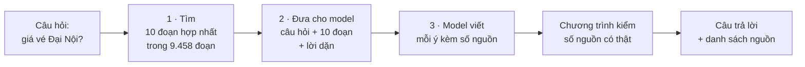

# Bài 2 — RAG là gì: cho model đọc tài liệu trước khi trả lời

*Cập nhật 14:17, ngày 22/11/2026 · ví dụ là ba lượt hỏi thật lấy từ sổ ghi từng lượt của hệ thống (ngày 20 và 21/11); số của kho đếm lại theo bản ghi hiện trạng lúc 13:33 22/11 (266 bài, 9.458 đoạn); người viết không chạy lại.*

**Bài trước đã biết:** model ngôn ngữ viết ra chữ tiếp theo có khả năng cao nhất. Nó viết trôi chảy cả khi không biết, và không tự nói được nó lấy thông tin từ đâu.
**Bài này thêm:** cách hue_rag xử lý chuyện đó. Cách này có tên là RAG, và nó là tên của chính đề tài. Bài này cũng nói vì sao chọn cách này thay cho các cách khác.

## Ý chính

- **RAG** là ba việc nối nhau: **tìm** các đoạn tài liệu hợp câu hỏi, **đưa** các đoạn đó cho model đọc, rồi model **viết** câu trả lời kèm số nguồn.
- Model được dặn không trả lời theo trí nhớ của nó, chỉ dùng những đoạn vừa được đưa, và ghi số nguồn sau mỗi ý. Chương trình kiểm lại rằng mọi số nguồn đều có thật.
- Trước khi có câu hỏi đầu tiên, có một **giai đoạn chuẩn bị** làm một lần: cắt 266 bài của kho thành 9.458 đoạn và lập chỉ mục để tìm cho nhanh.
- Tài liệu không có điều được hỏi thì hệ thống **từ chối bằng một câu cố định**, không đoán; sau đó nó tra web một lần và để kết quả ở một mục riêng. RAG không bảo đảm đúng tuyệt đối: bước tìm bỏ sót đoạn đúng thì hệ thống từ chối cả câu mà kho có.
- Muốn sửa điều hệ thống "biết" thì sửa bài trong kho. Không phải dạy lại model; đổi model viết cũng không làm mất kiến thức.

## Từ dùng trong bài

| Tên trong bài | Tên gốc | Nghĩa |
|---|---|---|
| RAG | **Retrieval-Augmented Generation** | sinh câu trả lời (generation) có bổ sung (augmented) bằng bước tìm tài liệu (retrieval) |
| kho | **knowledge base**, **corpus** | 266 bài viết về Huế do nhóm soạn; mọi thứ hệ thống được phép nói đều nằm ở đây |
| đoạn | **chunk** | một mẩu cắt ra từ một bài; kho có 9.458 đoạn |
| tìm | **retrieval** | chọn ra 10 đoạn hợp câu hỏi nhất trong 9.458 đoạn |
| ngữ cảnh | **context** | phần chữ gửi cho model cùng câu hỏi: các đoạn vừa tìm được, kèm lời dặn |
| chỉ mục | **index** | dạng đã xử lý sẵn của kho để tìm nhanh (bài 10–12) |
| số nguồn | **citation** | dấu [1], [2]… đặt sau mỗi ý, chỉ ý đó lấy từ đoạn nào |
| huấn luyện lại | **fine-tuning** | cho model học thêm trên dữ liệu riêng để chính model đổi; hue_rag không làm việc này |

## Hỏi thẳng model một con số thì không có gì để kiểm

Lấy ví dụ chính của cả bộ. Một du khách gõ: *"Giá vé tham quan Đại Nội Huế là bao nhiêu?"*

Nếu gửi thẳng câu này cho một model ngôn ngữ, nó sẽ trả lời ngay, bằng một con số. Con số đó đến từ những gì model đã đọc lúc được huấn luyện: có thể đúng, có thể là giá của nhiều năm trước, có thể lẫn với giá của nơi khác. Người hỏi không có cách nào phân biệt, vì câu trả lời đúng và câu trả lời sai trông giống hệt nhau, và model không chỉ ra được nguồn.

Với một ứng dụng du lịch, đây là lỗi nặng nhất: nói chắc mà sai. RAG được dùng để chặn đúng lỗi này.

## RAG là ba việc: tìm, đưa cho model đọc, viết kèm nguồn

Với RAG, câu hỏi về vé Đại Nội không đi thẳng tới model. Nó đi qua ba bước.

**Bước 1, tìm.** Chương trình chọn ra 10 đoạn hợp câu hỏi nhất trong 9.458 đoạn của kho. Ở lượt này 10 đoạn đó nằm trong 3 bài: hai bài về vé và một bài về nghệ thuật biểu diễn. Bước này không gọi model viết (nó chỉ dùng một model nhỏ chạy ngay trên máy, bài 10) và mất khoảng 40 mili giây. Số đoạn nói chung: 10 đoạn ở lần tìm đầu; trợ lý được tìm thêm tối đa 2 lần; tin nhiều ý được nối thêm 2 đoạn mỗi ý (bài 21, 23).

**Bước 2, đưa cho model đọc.** Chương trình ghép một lời gọi gồm ba phần: lời dặn (trong đó có câu "chỉ dùng các phần Bằng chứng trong ngữ cảnh"; "Bằng chứng" là nhãn đặt trước chữ của mỗi đoạn; và câu "Đặt citation [n] ngay sau mỗi nhận định được nguồn [n] hỗ trợ"), câu hỏi, và 10 đoạn, mỗi đoạn được đánh số từ 1 tới 10 kèm tên bài và tên mục của nó.

**Bước 3, model viết.** Model đọc 10 đoạn rồi viết. Câu trả lời thật của lượt này mở đầu như sau:

> Giá vé vào cổng Đại Nội Huế là 200.000 đồng/người lớn [1]. Trẻ em 7–12 tuổi là 40.000 đồng, và trẻ dưới 7 tuổi được miễn phí [4].

Số [1] trỏ tới một đoạn của bài về vé các điểm tham quan. Số [4] trỏ tới một đoạn của bài cẩm nang nghệ thuật biểu diễn, đoạn này nhắc giá vé vào cổng khi nói về vé xem biểu diễn trong Đại Nội. Cả câu trả lời dùng 5 trong 10 đoạn. Bước viết mất 3,6 giây.

Ô hỏi đáp cho chữ hiện trước, kiểm sau; kiểm hỏng thì rút lại. Phép kiểm: mọi số nguồn trong câu trả lời phải là số của một đoạn đã thật sự được đưa cho model. Có số lạ thì chữ đã hiện bị xoá và thay bằng một lời báo (bài 6, 16).

Điểm cần nắm: con số 200.000 đồng không đến từ trí nhớ của model; nó nằm trong đoạn số 1, bấm vào nguồn là đọc được.

## Trước đó có một giai đoạn chuẩn bị, làm một lần

Bước tìm chỉ mất 40 mili giây vì kho đã được xử lý sẵn. Việc xử lý đó là **giai đoạn chuẩn bị**, làm một lần, và làm lại khi kho đổi:

1. Cắt 266 bài thành 9.458 đoạn (bài 8).
2. Gắn vào mỗi đoạn tên bài và tên các mục chứa nó (bài 9).
3. Biến mỗi đoạn thành hai dạng máy tìm được: một dãy số mang nghĩa và một bảng từ khoá (bài 10, 11).
4. Cất tất cả vào một cơ sở dữ liệu chuyên cho việc tìm, tên là Qdrant (bài 12).

Vậy RAG có hai giai đoạn tách hẳn nhau. **Chuẩn bị**: chạy khi không có người dùng nào, mất vài phút. **Trả lời**: chạy mỗi lần có câu hỏi, mất vài giây.

## Kho không có thì hệ thống từ chối, không đoán

Lời dặn gửi model có một câu bắt buộc: nếu các đoạn được đưa không đủ để trả lời thì trả đúng một câu cố định, *"Tôi không tìm thấy đủ thông tin trong nguồn dữ liệu để trả lời câu hỏi này."*

Ví dụ thật: một người gõ *"Chùa Thiên Mụ có chỗ đậu ô tô không?"*. Kho có một bài dài về chùa Thiên Mụ nhưng không chỗ nào nói về chỗ đậu xe. Bước tìm vẫn trả về 10 đoạn, cả 10 đều của bài chùa Thiên Mụ (bước tìm luôn trả về các đoạn gần nhất, dù gần tới đâu), nhưng không đoạn nào trả lời được. Model đọc xong và trả đúng câu từ chối.

Sau câu từ chối, hue_rag làm thêm một việc: tra web một lần và để kết quả ở một mục riêng có nhãn "chưa kiểm" (bài 25). Khi mục đó có nội dung, giao diện thay câu từ chối bằng câu dẫn "Tư liệu của mình chưa có thông tin này — dưới đây là thông tin từ web (chưa kiểm)."

## Sửa kho là sửa được điều hệ thống biết

Vì mọi thông tin nằm trong kho chứ không nằm trong model, cập nhật thông tin là việc sửa văn bản. Khi một giá vé đổi: sửa bài, tắt máy chủ, chạy lệnh cập nhật chỉ mục (khoảng nửa phút), bật lại máy chủ; từ đó câu trả lời dùng giá mới. Model không đổi gì.

## Quyết định và lý do

### 1. Vì sao cho model đọc tài liệu, mà không huấn luyện lại model trên dữ liệu về Huế?

- **Đã chọn:** RAG; model viết giữ nguyên, thông tin về Huế nằm ở kho.
- **Vì sao:** quyết định đã ghi: tên đề tài chốt với giảng viên ngày 01/11 là một ứng dụng dựa trên RAG. Lập luận chung, không phải số đo của dự án: model đã huấn luyện lại không chỉ ra được nguồn của từng ý, giá đổi thì phải huấn luyện lại, và khó buộc nó từ chối đúng những điều nó không được dạy.
- **Cách khác:** huấn luyện lại (fine-tuning): chưa thử.
- **Cái giá:** chất lượng bị chặn bởi bước tìm. Mỗi câu hỏi tốn thêm một bước tìm (khoảng 40 mili giây) và một lời gọi model dài hơn.

### 2. Vì sao chỉ đưa cho model vài đoạn, và vì sao là 10?

- **Đã chọn:** 10 đoạn ở lần tìm đầu, cộng phần tìm thêm của trợ lý và phần nối thêm cho tin nhiều ý.
- **Vì sao 10 chứ không 5:** đã đo (gpt-6-luna): cùng cách tìm, giữ 10 đoạn thay vì 5 làm điểm "đủ ý" tăng 0,26 trên thang 5, và câu từ chối nhầm giảm từ 13 xuống 7 trên 88 câu (bài 13). Đưa vào hệ thống từ 28/10; ngày 01/11, một lần so lại cho kết quả gần như ngang nhau, chủ dự án chọn giữ 10.
- **Cách khác:** 15 đoạn: đã đo, không khá hơn (bài 13). Dán cả kho vào mỗi lời gọi: chưa thử; lập luận, không phải số đo: 10 đoạn, lời dặn và phần mô tả công cụ đã khoảng 5.100 token (đơn vị model dùng để đếm chữ, bài 1), nên tiền và thời gian chờ sẽ tăng theo cỡ kho.
- **Cái giá:** tiền mỗi câu tăng khoảng một nửa so với 5 đoạn (bài 13).

### 3. Vì sao phần chuẩn bị kho làm trước, một lần, mà không làm lúc có câu hỏi?

- **Đã chọn:** bốn bước chuẩn bị chạy khi kho đổi; lúc hỏi chỉ còn bước tìm.
- **Vì sao:** lập luận từ hai số đo: dựng lại toàn bộ chỉ mục mất khoảng 225 giây, phần lớn là tính vector cho mọi đoạn; tìm trên chỉ mục đã có mất khoảng 40 mili giây.
- **Cách khác:** chưa thấy ai đề xuất hay thử.
- **Cái giá:** sửa kho xong phải cập nhật chỉ mục, khoảng nửa phút cho vài bài (bài 12); quên thì xem dòng 2 của bảng dưới.

### 4. Vì sao kho không có thì trả một câu từ chối cố định, rồi mới tra web để riêng?

- **Đã chọn:** model trả đúng một câu từ chối đặt sẵn; sau đó chương trình tra web một lần và để kết quả ở mục "chưa kiểm".
- **Vì sao từ chối:** luật đã ghi của sản phẩm: chỉ trả lời từ kho, câu ngoài kho phải bị từ chối. **Vì sao là một câu cố định:** lý do ghi trong chương trình là bộ chấm và các sàn đo dựa vào đúng câu này. Ngoài ra chương trình so đúng từng chữ của nó: câu đó được miễn bước kiểm số nguồn, và chỉ khi câu trả lời đúng bằng nó thì bước tra web mới chạy.
- **Cách khác:** để model trả lời theo hiểu biết chung, hoặc tự tìm trên Internet: không làm; quyết định đã ghi là web chỉ là đường phụ, luôn để riêng (bài 25).
- **Cái giá:** người hỏi một câu kho có mà tìm không ra (lượt "cởi giày") cũng chỉ nhận câu từ chối và mục web chưa kiểm.

### 5. Vì sao chương trình còn kiểm số nguồn, khi model đã được dặn chỉ dùng các đoạn được đưa?

- **Đã chọn:** chương trình kiểm mọi số nguồn sau khi model viết; chữ hiện trước, kiểm sau.
- **Vì sao:** lời dặn là lời nhờ, model có thể không theo; luật quan trọng thì cần một bước chương trình đếm được (bài 16, 21). Hiện trước: để người dùng đọc sớm, đã đo ngày 01/11 (bài 6).
- **Cách khác:** kiểm xong mới hiện (bản trước 01/11). Chỉ dựa vào lời dặn: không làm; bước kiểm có từ bản đầu.
- **Cái giá:** có lượt người dùng thấy chữ rồi mất (bài 16). Và phép kiểm mới biết số [4] có thật, chưa biết đoạn 4 có nói đúng điều câu trả lời viết.

## Nếu… thì sao

Bài nền; tình huống hỏng của từng khối ở bài 6. Ba điều kiện đổi:

| Nếu | Hệ thống làm gì | Người dùng thấy gì | Ai làm gì |
|---|---|---|---|
| một giá vé đổi | trả lời theo bài cho tới khi bài được sửa | giá cũ, kèm dòng "Giờ mở cửa, giá vé, lịch lễ hội có thể đã thay đổi — hãy kiểm lại với nơi đến trước khi đi." | người vận hành làm như mục "Sửa kho" ở trên (bài 7, 12) |
| kho đã sửa nhưng chỉ mục chưa cập nhật, rồi máy chủ khởi động lại | máy chủ vẫn chạy, mọi câu hỏi nhận lời báo | "Dữ liệu tra cứu cần được lập chỉ mục lại." | người vận hành chạy lệnh cập nhật chỉ mục khi máy chủ đã tắt (bài 12), rồi khởi động lại máy chủ |
| đổi sang model viết của hãng khác | kho, chỉ mục và bước tìm giữ nguyên | câu trả lời viết khác đi (với model đang chạy: dài hơn, chữ hiện một lần) | sửa một dòng cấu hình; lời dặn và các ngưỡng phải đo lại; đã làm một lần (bài 33) |

## Dễ nhầm

- **"RAG làm model giỏi hơn."** Không. Model vẫn là model đó. RAG đổi thứ model được đọc trước khi viết.
- **"Model đã học thuộc kho."** Không. Model không học gì từ các lượt hỏi. Mỗi câu hỏi được tìm lại trong kho và model được đưa các đoạn vừa tìm ra.
- **"Có RAG thì không sai được."** Không. Bước tìm có thể không lấy ra đoạn đúng, khi đó hệ thống từ chối một câu mà kho thật ra có (câu hỏi tự kiểm 4).

## Câu hỏi tự kiểm

1. RAG gồm những việc gì, và việc nào làm trước khi có câu hỏi?

Tìm các đoạn hợp câu hỏi, đưa cho model đọc, model viết kèm số nguồn. Trước đó có giai đoạn chuẩn bị làm một lần: cắt 266 bài thành 9.458 đoạn, gắn tên bài, tính vector và bảng từ khoá, cất vào Qdrant.

2. Vì sao đưa 10 đoạn chứ không 5, và không dán cả kho?

Đã đo: 10 đoạn làm điểm đủ ý tăng 0,26 và từ chối nhầm giảm từ 13 xuống 7 trên 88 câu; 15 đoạn không khá hơn. Dán cả kho thì chưa thử; mỗi câu sẽ tốn tiền và thời gian theo cỡ kho.

3. Vì sao chương trình phải kiểm số nguồn, khi đã dặn model rồi?

Lời dặn là lời nhờ, model có thể không theo. Chương trình kiểm mọi số nguồn có thật; sai thì chữ đã hiện bị rút lại. Phép kiểm chưa biết đoạn được trích có nói đúng điều câu trả lời viết.

4. Một câu kho có mà hệ thống vẫn từ chối: lỗi nằm ở đâu?

Thường ở bước tìm: đoạn có đáp án không nằm trong các đoạn được đưa cho model, nên model đúng luật mà trả câu từ chối. Ví dụ thật: câu *"Vào chùa ở Huế có phải cởi giày không?"* bị từ chối, trong khi bài chùa Thiên Mụ có một câu nói phải bỏ giày dép khi vào điện thờ; ba lần tìm của lượt đó đều không lấy ra đoạn ấy.

## Chi tiết để tra

- Ví dụ chính là lượt hỏi ngày 21/11/2026, model viết là Claude Sonnet 5.5. Cả lượt: 3,7 giây, 2 lần gọi model (một lần xếp loại câu 0,74 giây, một lần viết 3,63 giây), tốn 0,0178 USD (khoảng 445 đồng). Lần viết nhận 5.085 token, viết ra 425 token.
- Trên màn hình, các số [n] không hiện trong chữ; dưới câu trả lời có một dòng "Nguồn:" ghi tên các bài đã được trích, bấm vào là xem được đoạn gốc (bài 16).
- Ở lượt này chữ hiện ra một lần sau khi model viết xong, vì bộ khoá đang dùng với Claude không có quyền nhận chữ dần (bài 33).
- Ví dụ "chỗ đậu ô tô" là lượt hỏi ngày 20/11/2026, model viết là gpt-6-luna. Trước khi từ chối, trợ lý đã tự tìm thêm một lần (bài 21) và không ra đoạn mới nào. Cả lượt 8,3 giây, 0,0017 USD (khoảng 41 đồng), gồm cả lần tra web. Mục web của lượt đó viết: chưa xác minh được chùa có chỗ đậu ô tô trong khuôn viên hay không; một nguồn nhắc chỗ gửi xe ở các bến xe, một nguồn nói ô tô bị cấm trên một đoạn đường qua khu vực chùa.
- "Kho không nói về chỗ đậu xe ở chùa Thiên Mụ" được dò bằng cách tìm các chữ đậu xe, đỗ xe, bãi đỗ, bãi xe, gửi xe, giữ xe, chỗ để xe, dừng xe trong kho (người viết dò, rồi một agent kiểm dò lại rộng hơn): không câu nào nói chỗ đậu xe của chùa. Phép dò theo chữ này không loại trừ được một câu diễn đạt bằng chữ khác.
- Ví dụ "cởi giày" (kho có mà vẫn từ chối) cũng là lượt hỏi ngày 20/11/2026: trợ lý tìm thêm hai lần, cả ba lần tìm không lấy ra đoạn nói về giày dép của bài chùa Thiên Mụ; sau đó mục web trả lời thay.
- Câu hỏi nhiều ý mà kho chỉ có một phần thì không bị từ chối cả câu: ý có thì trả lời, ý thiếu được ghi bằng một dòng "Tư liệu chưa có thông tin về: …" (bài 23).
- Tỉ lệ "kho có mà hệ thống vẫn từ chối" ở lần đo cả bộ gần nhất có số này: 3 trên 158 câu (lượt đo giữa kỳ 12/11, model gpt-6-luna). Cách đo ở chặng 4.
- Dựng lại toàn bộ chỉ mục mất khoảng 225 giây; cập nhật riêng phần của các bài vừa sửa mất khoảng nửa phút (bài 12).

**Bài sau (bài 3):** RAG mới cho model đọc tài liệu. Có những việc đọc tài liệu không giải quyết được: hôm nay là ngày mấy âm lịch, mai có mưa không, hai điểm cách nhau bao xa. Bài 3 giảng cách cho model "nhờ" chương trình làm những việc đó.

Nguồn (để giữ bài đúng — anh không cần đọc)

- Ví dụ chính (câu hỏi, 10 đoạn thuộc 3 bài, 5 nguồn được trích, chữ câu trả lời, thời gian từng bước, token, tiền, model): sổ vết ngày 21/11/2026, lượt 09:58:36, bản sao riêng tư ở `data/hoc_cung_D/vi_du_di_suot_vet.json` [đã chạy; người viết không chạy lại]. Đoạn số 4 có chứa giá vé trẻ em: đọc trực tiếp trong trường ngữ cảnh của bản sao đó.
- Ví dụ "chỗ đậu ô tô" (10 đoạn đều của bài chùa Thiên Mụ, một lần tìm thêm không ra đoạn mới, câu từ chối, mục web, 8,3 giây, 0,0017 USD): sổ vết ngày 20/11/2026, lượt 15:58:44, `data/hoc_cung_D/vi_du_kho_khong_co_2_vet.json` [đã chạy]. Dò kho: `scripts/grep_kb.sh` với các chữ nêu ở "Chi tiết để tra", chạy 22/11/2026 [đã chạy].
- Ví dụ "cởi giày": sổ vết ngày 20/11/2026, lượt 15:58:10, `data/hoc_cung_D/vi_du_kho_khong_co_vet.json`; câu về giày dép ở bài chùa Thiên Mụ và việc đoạn đó có trong chỉ mục nhưng không được lấy ra: biên bản kiểm độc lập `data/hoc_cung_D/kiem/bai_02_10.md` dòng 26 [agent kiểm tìm ra; người viết chưa tự mở lại đoạn đó].
- Câu dẫn sang mục web do giao diện thay: `frontend/src/moDauWeb.js` [code].
- 266 bài, 9.458 đoạn: `data/full_corpus_builds/hue_full_corpus_7a2_e5_small_384.json` (`corpus.file_count`, `corpus.chunk_count`) và số điểm trong Qdrant, đọc 10:02 22/11/2026 [đã chạy].
- Lời dặn và câu từ chối cố định: `backend/llm/full_corpus_prompt.py`, hằng `ANSWER_SYSTEM_INSTRUCTIONS`, `INSUFFICIENT_ANSWER` [code].
- Kiểm số nguồn: `backend/llm/citations.py`, hàm `select_cited_sources` [code].
- Tên đề tài có chữ Retrieval-Augmented Generation: `session_prompt/Project_Status.md` (phần quyết định, dòng ghi tên đề tài chốt 01/11) [quyết định đã ghi].
- 3 / 158 câu từ chối nhầm (lượt giữa kỳ 12/11): `bai_hoc/BAN_DO_DU_AN.md` mục "Chỗ còn yếu đã biết" ý 1 [số của phiên trước, chưa đo lại trên model đang chạy].
- 225 giây dựng lại, khoảng nửa phút cập nhật riêng: `guides/RUNBOOK_BAN_GIAO.md` mục 5b; `report_agent/2026-11-22/c_cap_nhat_rieng.md` [đã chạy, phiên khác đo].
- Ba lý do không huấn luyện lại, và ý "tiền, thời gian tăng theo cỡ kho": lập luận thiết kế [kiến thức chung], không phải số đo của dự án.
- Luật "chỉ trả lời từ kho, câu ngoài kho phải bị từ chối": `session_prompt/HIEN_TRANG.md` mục 4, phần "Sản phẩm" [quyết định đã ghi].
- Tỷ giá quy đổi 1 USD ≈ 25.000 đồng: quy ước của bộ bài học.
- Mục "Quyết định và lý do", "Nếu… thì sao", "Câu hỏi tự kiểm" (thêm 13:37 22/11/2026 theo khuôn mới; gom từ mục "Vì sao không làm cách khác" cũ và các nguồn trên). Câu chuẩn về số đoạn: `backend/config/settings.yaml` (`tim_theo_ve`), `backend/llm/assistant.py` (`MODEL_SEARCH_LIMIT = 2`, `SO_DOAN_MOI_VE = 2`) [code]. 10 thay vì 5 (đủ ý +0,26; 13 ⇒ 7 trên 88 câu; tiền tăng khoảng một nửa; 15 đoạn không khác): bài 13 mục "Đã so" [chép]; chủ dự án giữ 10 ngày 01/11: `session_prompt/Project_Status.md` dòng "B0 01/11 … User giữ 10" [quyết định đã ghi]. Tên đề tài chốt 01/11: cùng file, dòng 2026-11-01 [quyết định đã ghi]. Câu từ chối được so đúng từng chữ, miễn kiểm số nguồn và là điều kiện mở bước tra web: `backend/llm/citations.py` (`select_cited_sources`), `backend/llm/assistant.py` (`web_gate_open`) [code]; lý do chọn một câu cố định: dòng Nguồn cuối. 225 giây / 40 mili giây: các nguồn trên. Chữ hiện trước, kiểm sau; lời báo rút lại: bài 6 quyết định 4 [chép]. Dòng "có thể đã thay đổi": `backend/llm/full_corpus_prompt.py` (`MAY_HAVE_CHANGED_NOTICE`), áp cho nguồn vé theo `NOTICE_SOURCE_PREFIXES` ở `backend/llm/assistant.py` [code]. Lời báo lập chỉ mục lại: `backend/api/app.py` [code].
- Các mục mới đã qua một lượt đối chiếu độc lập (một agent khác chỉ đọc, 22/11/2026), các dòng sai / lệch đã sửa lúc 14:17: `data/hoc_cung_D/kiem/muc_moi_02_07_11_va_phu_luc.md` [riêng tư]. Lý do giữ một câu từ chối cố định ("sàn closed-world, bộ chấm dựa vào nó"): chú thích đầu `frontend/src/moDauWeb.js` [code]; bước kiểm số nguồn có từ bản sinh câu trả lời đầu tiên: `docs/superpowers/specs/2026-09-14-phase-6-full-corpus-generation-api-ui-written-spec.md` mục 11 [tài liệu]; 10 đoạn đưa vào hệ thống 28/10: `bai_hoc/19_BANG_TONG_CAC_LAN_SO_SANH.md` hàng 10.

