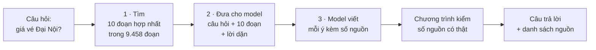

# Bài 2 — RAG là gì: cho model đọc tài liệu trước khi trả lời

*Cập nhật 10:21, ngày 22/11/2026 · ví dụ là ba lượt hỏi thật lấy từ sổ ghi từng lượt của hệ thống (ngày 20 và 21/11); số của kho đếm sáng 22/11; người viết không chạy lại.*

**Bài trước đã biết:** model ngôn ngữ viết ra chữ tiếp theo có khả năng cao nhất. Nó viết trôi chảy cả khi không biết, và không tự nói được nó lấy thông tin từ đâu.
**Bài này thêm:** cách hue_rag xử lý chuyện đó. Cách này có tên là RAG, và nó là tên của chính đề tài.

## Ý chính

- **RAG** là ba việc nối nhau: **tìm** các đoạn tài liệu hợp câu hỏi, **đưa** các đoạn đó cho model đọc, rồi model **viết** câu trả lời kèm số nguồn.
- Model được dặn không trả lời theo trí nhớ của nó, chỉ dùng những đoạn vừa được đưa, và ghi số nguồn sau mỗi ý. Chương trình kiểm lại rằng mọi số nguồn đều có thật.
- Trước khi có câu hỏi đầu tiên, có một **giai đoạn chuẩn bị** làm một lần: cắt 266 bài của kho thành 9.458 đoạn và lập chỉ mục để tìm cho nhanh.
- Tài liệu không có điều được hỏi thì hệ thống **từ chối bằng một câu cố định**, không đoán; sau đó nó tra web một lần và để kết quả ở một mục riêng.
- Muốn sửa điều hệ thống "biết" thì sửa bài trong kho. Không phải dạy lại model.

## Từ dùng trong bài

| Tên trong bài | Tên gốc | Nghĩa |
|---|---|---|
| RAG | **Retrieval-Augmented Generation** | sinh câu trả lời (generation) có bổ sung (augmented) bằng bước tìm tài liệu (retrieval) |
| kho | **knowledge base**, **corpus** | 266 bài viết về Huế do nhóm soạn; mọi thứ hệ thống được phép nói đều nằm ở đây |
| đoạn | **chunk** | một mẩu cắt ra từ một bài; kho có 9.458 đoạn |
| tìm | **retrieval** | chọn ra 10 đoạn hợp câu hỏi nhất trong 9.458 đoạn |
| ngữ cảnh | **context** | phần chữ gửi cho model cùng câu hỏi; thường là 10 đoạn vừa tìm được, nhiều hơn khi trợ lý tìm thêm (bài 21) |
| chỉ mục | **index** | dạng đã xử lý sẵn của kho để tìm nhanh (bài 10–12) |
| số nguồn | **citation** | dấu [1], [2]… đặt sau mỗi ý, chỉ ý đó lấy từ đoạn nào |
| huấn luyện lại | **fine-tuning** | cho model học thêm trên dữ liệu riêng để chính model đổi; hue_rag không làm việc này |

## Hỏi thẳng model một con số thì không có gì để kiểm

Lấy ví dụ chính của cả bộ. Một du khách gõ: *"Giá vé tham quan Đại Nội Huế là bao nhiêu?"*

Nếu gửi thẳng câu này cho một model ngôn ngữ, nó sẽ trả lời ngay, bằng một con số. Con số đó đến từ những gì model đã đọc lúc được huấn luyện: có thể đúng, có thể là giá của nhiều năm trước, có thể lẫn với giá của nơi khác. Người hỏi không có cách nào phân biệt, vì câu trả lời đúng và câu trả lời sai trông giống hệt nhau, và model không chỉ ra được nguồn.

Với một ứng dụng du lịch, đây là lỗi nặng nhất: nói chắc mà sai. RAG được dùng để chặn đúng lỗi này.

## RAG là ba việc: tìm, đưa cho model đọc, viết kèm nguồn

Với RAG, câu hỏi về vé Đại Nội không đi thẳng tới model. Nó đi qua ba bước.

**Bước 1, tìm.** Chương trình chọn ra 10 đoạn hợp câu hỏi nhất trong 9.458 đoạn của kho. Ở lượt này 10 đoạn đó nằm trong 3 bài: hai bài về vé và một bài về nghệ thuật biểu diễn. Bước này không gọi model viết (nó chỉ dùng một model nhỏ chạy ngay trên máy, bài 10) và mất khoảng 40 mili giây.

**Bước 2, đưa cho model đọc.** Chương trình ghép một lời gọi gồm ba phần: lời dặn (trong đó có câu "chỉ dùng các phần Bằng chứng trong ngữ cảnh"; "Bằng chứng" là nhãn đặt trước chữ của mỗi đoạn; và câu "Đặt citation [n] ngay sau mỗi nhận định được nguồn [n] hỗ trợ"), câu hỏi, và 10 đoạn, mỗi đoạn được đánh số từ 1 tới 10 kèm tên bài và tên mục của nó.

**Bước 3, model viết.** Model đọc 10 đoạn rồi viết. Câu trả lời thật của lượt này mở đầu như sau:

> Giá vé vào cổng Đại Nội Huế là 200.000 đồng/người lớn [1]. Trẻ em 7–12 tuổi là 40.000 đồng, và trẻ dưới 7 tuổi được miễn phí [4].

Số [1] trỏ tới một đoạn của bài về vé các điểm tham quan. Số [4] trỏ tới một đoạn của bài cẩm nang nghệ thuật biểu diễn, đoạn này nhắc giá vé vào cổng khi nói về vé xem biểu diễn trong Đại Nội. Cả câu trả lời dùng 5 trong 10 đoạn. Bước viết mất 3,6 giây.

Sau khi model viết xong, chương trình kiểm lại: mọi số nguồn trong câu trả lời phải là số của một đoạn đã thật sự được đưa cho model. Có số lạ thì câu trả lời không được hiện (bài 16).

Điểm cần nắm: con số 200.000 đồng không đến từ trí nhớ của model. Nó nằm trong đoạn số 1, và người dùng bấm vào nguồn là đọc được đúng đoạn đó.

## Trước đó có một giai đoạn chuẩn bị, làm một lần

Bước tìm chỉ mất 40 mili giây vì kho đã được xử lý sẵn. Việc xử lý đó là **giai đoạn chuẩn bị**, làm một lần, và làm lại khi kho đổi:

1. Cắt 266 bài thành 9.458 đoạn (bài 8).
2. Gắn vào mỗi đoạn tên bài và tên các mục chứa nó (bài 9).
3. Biến mỗi đoạn thành hai dạng máy tìm được: một dãy số mang nghĩa và một bảng từ khoá (bài 10, 11).
4. Cất tất cả vào một cơ sở dữ liệu chuyên cho việc tìm, tên là Qdrant (bài 12).

Vậy RAG có hai giai đoạn tách hẳn nhau. **Chuẩn bị**: chạy khi không có người dùng nào, mất vài phút. **Trả lời**: chạy mỗi lần có câu hỏi, mất vài giây. Chặng 2 của giáo trình đi qua giai đoạn chuẩn bị; chặng 3 đi qua giai đoạn trả lời.

## Kho không có thì hệ thống từ chối, không đoán

Lời dặn gửi model có một câu bắt buộc: nếu các đoạn được đưa không đủ để trả lời thì trả đúng một câu cố định, *"Tôi không tìm thấy đủ thông tin trong nguồn dữ liệu để trả lời câu hỏi này."*

Ví dụ thật: một người gõ *"Chùa Thiên Mụ có chỗ đậu ô tô không?"*. Kho có một bài dài về chùa Thiên Mụ nhưng không chỗ nào nói về chỗ đậu xe. Bước tìm vẫn trả về 10 đoạn, cả 10 đều của bài chùa Thiên Mụ (bước tìm luôn trả về các đoạn gần nhất, dù gần tới đâu), nhưng không đoạn nào trả lời được. Model đọc xong và trả đúng câu từ chối.

Model hoàn toàn có thể trả lời câu này theo hiểu biết chung của nó. Hệ thống cố ý không cho: luật của sản phẩm là chỉ trả lời từ kho, và câu ngoài kho phải bị từ chối.

Sau câu từ chối, hue_rag làm thêm một việc: tra web một lần và để kết quả ở một mục riêng có nhãn "chưa kiểm" (bài 25). Khi mục đó có nội dung, giao diện thay câu từ chối bằng câu dẫn "Tư liệu của mình chưa có thông tin này — dưới đây là thông tin từ web (chưa kiểm)." Phần từ web luôn tách khỏi phần trả lời từ kho, để người dùng biết phần nào đã được kiểm.

## Sửa kho là sửa được điều hệ thống biết

Vì mọi thông tin nằm trong kho chứ không nằm trong model, cập nhật thông tin là việc sửa văn bản. Khi một giá vé đổi: sửa bài, tắt máy chủ, chạy lệnh cập nhật chỉ mục (khoảng nửa phút), bật lại máy chủ; từ đó câu trả lời dùng giá mới. Model không đổi gì.

Cũng nhờ vậy mà đổi được model viết sang một model của hãng khác trong khi kho, chỉ mục và bước tìm giữ nguyên. Hệ thống đã đổi như thế một lần (bài 33).

## Dễ nhầm

- **"RAG làm model giỏi hơn."** Không. Model vẫn là model đó. RAG đổi thứ model được đọc trước khi viết.
- **"Model đã học thuộc kho."** Không. Model không học gì từ các lượt hỏi. Mỗi câu hỏi được tìm lại trong kho và model được đưa các đoạn vừa tìm ra.
- **"Có RAG thì không sai được."** Không. Bước tìm có thể không lấy ra đoạn đúng, khi đó hệ thống từ chối một câu mà kho thật ra có. Ví dụ thật: câu *"Vào chùa ở Huế có phải cởi giày không?"* bị từ chối, trong khi bài chùa Thiên Mụ có một câu nói phải bỏ giày dép khi vào điện thờ; ba lần tìm của lượt đó đều không lấy ra đoạn ấy. Ngoài ra, bước kiểm nguồn mới kiểm số nguồn có thật, chưa kiểm đoạn đó có nói đúng điều câu trả lời viết (bài 16).

## Những điều cần nhớ

- RAG: tìm đoạn hợp câu hỏi, đưa cho model đọc, model viết kèm số nguồn.
- Hai giai đoạn: chuẩn bị (một lần, 266 bài thành 9.458 đoạn có chỉ mục) và trả lời (mỗi câu hỏi: tìm 10 đoạn, viết).
- Model được dặn chỉ dùng các đoạn vừa đưa; không đủ thì trả một câu từ chối cố định.
- Thông tin nằm ở kho: sửa kho là sửa được câu trả lời, đổi model không làm mất kiến thức.
- RAG không bảo đảm đúng tuyệt đối: chất lượng phụ thuộc bước tìm có lấy được đoạn đúng không.

## Vì sao không làm cách khác

**Vì sao không huấn luyện lại model trên dữ liệu về Huế (fine-tuning)?** Chưa thử. Quyết định đã ghi: đề tài được chốt là một ứng dụng dựa trên RAG. Ba lý do dưới đây là lập luận chung về hai cách làm, không phải số đo của dự án: model đã huấn luyện lại vẫn không chỉ ra được nguồn của từng ý; giá vé và giờ mở cửa đổi thì phải huấn luyện lại, còn RAG chỉ cần sửa bài; và khó buộc một model đã huấn luyện lại từ chối đúng những điều nó không được dạy.

**Vì sao không dán cả kho vào lời dặn cho model đọc hết?** Chưa thử. Lập luận, không phải số đo: lời gọi viết câu trả lời ở ví dụ chính dài khoảng 5.100 token (đơn vị model dùng để đếm chữ, bài 1) cho 10 đoạn, lời dặn và phần mô tả công cụ; kho có 9.458 đoạn. Gửi cả kho ở mỗi câu hỏi thì tiền và thời gian chờ của mỗi câu tăng theo cỡ kho.

**Vì sao không để model tự tìm trên Internet?** Quyết định đã ghi: sản phẩm chỉ trả lời từ kho đã soạn và kiểm. hue_rag chỉ dùng web như đường phụ, sau khi kho đã từ chối, và luôn để riêng với nhãn "chưa kiểm" (bài 25).

## Chi tiết để tra

- Ví dụ chính là lượt hỏi ngày 21/11/2026, model viết là Claude Sonnet 5.5. Cả lượt: 3,7 giây, 2 lần gọi model (một lần xếp loại câu 0,74 giây, một lần viết 3,63 giây), tốn 0,0178 USD (khoảng 445 đồng). Lần viết nhận 5.085 token, viết ra 425 token.
- Trên màn hình, các số [n] không hiện trong chữ; dưới câu trả lời có một dòng "Nguồn:" ghi tên các bài đã được trích, bấm vào là xem được đoạn gốc (bài 16).
- Ở lượt này chữ hiện ra một lần sau khi model viết xong, vì bộ khoá đang dùng với Claude không có quyền nhận chữ dần (bài 33).
- Ví dụ "chỗ đậu ô tô" là lượt hỏi ngày 20/11/2026, model viết là gpt-6-luna. Trước khi từ chối, trợ lý đã tự tìm thêm một lần (bài 21) và không ra đoạn mới nào. Cả lượt 8,3 giây, 0,0017 USD (khoảng 41 đồng), gồm cả lần tra web. Mục web của lượt đó viết: chưa xác minh được chùa có chỗ đậu ô tô trong khuôn viên hay không; một nguồn nhắc chỗ gửi xe ở các bến xe, một nguồn nói ô tô bị cấm trên một đoạn đường qua khu vực chùa.
- "Kho không nói về chỗ đậu xe ở chùa Thiên Mụ" được dò bằng cách tìm các chữ đậu xe, đỗ xe, bãi đỗ, bãi xe, gửi xe, giữ xe, chỗ để xe, dừng xe trong kho (người viết dò, rồi một agent kiểm dò lại rộng hơn): không câu nào nói chỗ đậu xe của chùa. Phép dò theo chữ này không loại trừ được một câu diễn đạt bằng chữ khác.
- Ví dụ "cởi giày" (kho có mà vẫn từ chối) cũng là lượt hỏi ngày 20/11/2026: trợ lý tìm thêm hai lần, cả ba lần tìm không lấy ra đoạn nói về giày dép của bài chùa Thiên Mụ; sau đó mục web trả lời thay.
- Câu hỏi nhiều ý mà kho chỉ có một phần thì không bị từ chối cả câu: ý có thì trả lời, ý thiếu được ghi bằng một dòng "Tư liệu chưa có thông tin về: …" (bài 23).
- Tỉ lệ "kho có mà hệ thống vẫn từ chối" ở lần đo cả bộ gần nhất có số này: 3 trên 158 câu (lượt đo giữa kỳ 12/11, model gpt-6-luna). Cách đo ở chặng 4.
- Dựng lại toàn bộ chỉ mục mất khoảng 225 giây; cập nhật riêng phần của các bài vừa sửa mất khoảng nửa phút (bài 12).

**Bài sau (bài 3):** RAG mới cho model đọc tài liệu. Có những việc đọc tài liệu không giải quyết được: hôm nay là ngày mấy âm lịch, mai có mưa không, hai điểm cách nhau bao xa. Bài 3 giảng cách cho model "nhờ" chương trình làm những việc đó.

Nguồn (để giữ bài đúng — anh không cần đọc)

- Ví dụ chính (câu hỏi, 10 đoạn thuộc 3 bài, 5 nguồn được trích, chữ câu trả lời, thời gian từng bước, token, tiền, model): sổ vết ngày 21/11/2026, lượt 09:58:36, bản sao riêng tư ở `data/hoc_cung_D/vi_du_di_suot_vet.json` [đã chạy; người viết không chạy lại]. Đoạn số 4 có chứa giá vé trẻ em: đọc trực tiếp trong trường ngữ cảnh của bản sao đó.
- Ví dụ "chỗ đậu ô tô" (10 đoạn đều của bài chùa Thiên Mụ, một lần tìm thêm không ra đoạn mới, câu từ chối, mục web, 8,3 giây, 0,0017 USD): sổ vết ngày 20/11/2026, lượt 15:58:44, `data/hoc_cung_D/vi_du_kho_khong_co_2_vet.json` [đã chạy]. Dò kho: `scripts/grep_kb.sh` với các chữ nêu ở "Chi tiết để tra", chạy 22/11/2026 [đã chạy].
- Ví dụ "cởi giày": sổ vết ngày 20/11/2026, lượt 15:58:10, `data/hoc_cung_D/vi_du_kho_khong_co_vet.json`; câu về giày dép ở bài chùa Thiên Mụ và việc đoạn đó có trong chỉ mục nhưng không được lấy ra: biên bản kiểm độc lập `data/hoc_cung_D/kiem/bai_02_10.md` dòng 26 [agent kiểm tìm ra; người viết chưa tự mở lại đoạn đó].
- Câu dẫn sang mục web do giao diện thay: `frontend/src/moDauWeb.js` [code].
- 266 bài, 9.458 đoạn: `data/full_corpus_builds/hue_full_corpus_7a2_e5_small_384.json` (`corpus.file_count`, `corpus.chunk_count`) và số điểm trong Qdrant, đọc 10:02 22/11/2026 [đã chạy].
- Lời dặn và câu từ chối cố định: `backend/llm/full_corpus_prompt.py`, hằng `ANSWER_SYSTEM_INSTRUCTIONS`, `INSUFFICIENT_ANSWER` [code].
- Kiểm số nguồn: `backend/llm/citations.py`, hàm `select_cited_sources` [code].
- Tên đề tài có chữ Retrieval-Augmented Generation: `session_prompt/Project_Status.md` (phần quyết định, dòng ghi tên đề tài chốt 01/11) [quyết định đã ghi].
- 3 / 158 câu từ chối nhầm (lượt giữa kỳ 12/11): `bai_hoc/BAN_DO_DU_AN.md` mục "Chỗ còn yếu đã biết" ý 1 [số của phiên trước, chưa đo lại trên model đang chạy].
- 225 giây dựng lại, khoảng nửa phút cập nhật riêng: `guides/RUNBOOK_BAN_GIAO.md` mục 5b; `report_agent/2026-11-22/c_cap_nhat_rieng.md` [đã chạy, phiên khác đo].
- Ba lý do không huấn luyện lại, và ý "tiền, thời gian tăng theo cỡ kho": lập luận thiết kế [kiến thức chung], không phải số đo của dự án.
- Luật "chỉ trả lời từ kho, câu ngoài kho phải bị từ chối": `session_prompt/HIEN_TRANG.md` mục 4, phần "Sản phẩm" [quyết định đã ghi].
- Tỷ giá quy đổi 1 USD ≈ 25.000 đồng: quy ước của bộ bài học.

