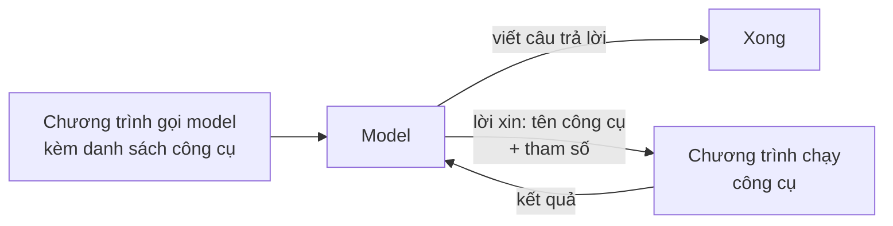

# Bài 3 — Trợ lý và công cụ: model chỉ "xin", chương trình mới là thứ chạy

*Cập nhật 15:43, ngày 22/11/2026 · phần giải thích chung là kiến thức phổ thông; ví dụ là một lượt hỏi thật ngày 20/11 (gpt-6-luna); danh sách công cụ đọc từ chương trình đang chạy sáng 22/11; các trần đọc từ cấu hình sau 14:47 22/11; người viết không chạy lại.*

**Bài trước đã biết:** RAG cho model đọc tài liệu của kho trước khi viết, và model không tự tính toán đáng tin được.
**Bài này thêm:** có những câu hỏi mà đọc tài liệu không trả lời được. Bài này giảng cách cho model "nhờ" chương trình làm việc, và hai chữ hay bị dùng lẫn: luồng cố định và trợ lý.

## Ý chính

- **Công cụ** là một hàm của chương trình mà model được phép xin chạy. Model chỉ gửi ra tên công cụ và tham số; chương trình chạy rồi gửi kết quả lại cho model đọc.
- Model không chạy được gì. Quyền chạy, quyền từ chối chạy, và nội dung kết quả đều nằm ở chương trình.
- **Luồng cố định** là khi chương trình quyết trước mọi bước. **Trợ lý** là khi model được quyết một phần các bước, trong lúc chạy.
- hue_rag là luồng cố định ở hầu hết các bước. Trong lúc trả lời, nó mở cho model quyết ở một chỗ: thấy bằng chứng chưa đủ thì xin tìm thêm, hoặc xin một công cụ khác.
- Việc phải đúng tuyệt đối (ngày tháng, khoảng cách, xếp lịch) được giao cho chương trình, dưới dạng công cụ hoặc dưới dạng tính sẵn, khi chương trình nhận ra câu hỏi cần tới.

## Từ dùng trong bài

| Tên trong bài | Tên gốc | Nghĩa |
|---|---|---|
| công cụ | **tool**; cơ chế gọi là **tool calling** hay **function calling** | một hàm của chương trình mà model được xin chạy |
| tham số | **arguments** | giá trị model gửi kèm khi xin một công cụ, ví dụ câu cần tìm |
| luồng cố định | **workflow** | chuỗi bước do chương trình định sẵn; model chỉ làm việc trong từng bước |
| trợ lý | **agent** | model được quyết bước kế tiếp (xin công cụ nào, hay viết luôn) trong lúc chạy |

## Có những câu hỏi mà đọc tài liệu không trả lời được

Kho có bài về lễ hội, ghi lễ diễn ra ngày mấy âm lịch. Người dùng hỏi "lễ đó năm nay rơi vào ngày dương nào". Tài liệu không có câu trả lời; phải đổi ngày âm sang ngày dương, và bài 1 đã nói model tự tính thì hay sai.

Tương tự: "mai Huế có mưa không" cần dự báo của hôm nay, không tài liệu soạn sẵn nào có. "Từ Đại Nội tới chùa Thiên Mụ bao xa" cần một phép tra khoảng cách.

Ba loại việc này có chung một điểm: một chương trình bình thường làm được, nhanh và luôn đúng. Thứ còn thiếu là cách để model **nhờ** chương trình.

## Model gửi ra một lời xin; chương trình chạy và gửi kết quả lại

Khi gọi model, chương trình gửi kèm một danh sách công cụ. Mỗi công cụ có tên, một đoạn mô tả nó làm gì, và các tham số nó nhận. Model đọc câu hỏi rồi làm một trong hai việc: viết câu trả lời, hoặc gửi ra một **lời xin**: "chạy công cụ này, với tham số này".

Ví dụ thật, lượt "phải tìm thêm" của cả bộ. Người dùng hỏi *"Mặc áo dài vào Đại Nội có được miễn vé không?"*. Mười đoạn đầu tiên không đủ để trả lời. Model gửi ra lời xin công cụ tìm kho, với một tham số duy nhất là câu cần tìm do nó tự viết:

> Mặc áo dài vào Đại Nội Huế có được miễn vé tham quan không? Quy định miễn vé hoặc ưu đãi vé vào Đại Nội khi mặc áo dài.

Tự model không chạy được lần tìm nào; nó chỉ gửi lời xin. Chương trình nhận lời xin, chạy bước tìm của nó (bài 13) với câu trên, được 9 đoạn mới, rồi gửi các đoạn đó lại cho model. Model đọc, và lại chọn: viết, hoặc xin tiếp. Ở lượt này nó xin thêm một lần nữa rồi mới viết (bài 21).

Ba điều rút ra từ hình:

- **Model không chạy gì.** Nó chỉ viết ra một lời xin có dạng cố định.
- **Chương trình có quyền không chạy.** Ví dụ khi model đã dùng hết số lần được tìm, chương trình không cho tìm nữa (bài 21).
- **Tham số do chương trình giới hạn.** Model chỉ được điền những ô chương trình cho: một câu tìm, một khoảng ngày, mã của một điểm tham quan, tên một nhóm bài. Với công cụ tìm kho, tìm trong bộ dữ liệu nào và lấy bao nhiêu đoạn thì model không chỉnh được.

## Luồng cố định và trợ lý khác nhau ở chỗ ai quyết bước kế tiếp

Hai cách tổ chức một hệ thống có model:

- **Luồng cố định:** chương trình định sẵn "bước 1 làm gì, bước 2 làm gì". Model được gọi ở vài bước để làm đúng một việc hẹp (viết, phân loại), rồi trả quyền lại.
- **Trợ lý:** model được đưa mục tiêu và một bộ công cụ, và tự quyết bước kế tiếp: xin công cụ nào, xin mấy lần, lúc nào thì dừng để viết.

Luồng cố định dễ đoán, dễ kiểm, rẻ. Trợ lý linh hoạt hơn nhưng khó đoán hơn: nó có thể xin thừa, xin sai, hoặc không chịu dừng.

hue_rag đứng gần phía luồng cố định, và chỉ mở cho model quyết ở đúng một chỗ:

| Bước của một lượt hỏi | Ai quyết |
|---|---|
| Xếp câu vào một tuyến (về Huế, chào hỏi, ngoài phạm vi, khẩn cấp) | model, trong một lần gọi hẹp chỉ để xếp loại (bài 22) |
| Tìm lần đầu trong kho | chương trình, ở mọi lượt hỏi đáp về Huế |
| Tính sẵn ngày, khoảng cách khi câu hỏi có dấu hiệu cần | chương trình |
| Thấy chưa đủ thì xin tìm thêm, hoặc xin công cụ thời tiết, ngày, khoảng cách… | **model** (đây là phần "trợ lý") |
| Dừng khi quá số lần, quá số vòng | chương trình |
| Kiểm câu trả lời | chương trình |

Trang Lên kế hoạch còn đứng gần luồng cố định hơn nữa: chương trình xếp cả lịch, model chỉ viết mỗi điểm một câu mô tả (chặng 6).

## Các công cụ của hue_rag

| Công cụ | Chương trình làm gì khi được xin |
|---|---|
| tìm kho | chạy bước tìm với câu model viết, trả các đoạn mới |
| thời tiết | lấy dự báo 7 ngày của Huế từ một dịch vụ thời tiết, dựng thành một khối số liệu |
| ngày và âm lịch | đổi ngày dương sang âm và ngược lại, theo lịch Việt Nam |
| khoảng cách | tra khoảng cách và thời gian đi giữa hai điểm tham quan trong một bảng dựng sẵn |
| gần một điểm | liệt kê quán hoặc điểm tham quan có bài trong kho ở gần một điểm |
| liệt kê bài | liệt kê các bài của kho theo nhóm hoặc theo một cụm từ, cho câu hỏi xin danh sách |

Công cụ tìm kho và công cụ liệt kê bài có ở mọi lượt hỏi đáp về Huế. Bốn công cụ còn lại chỉ được đưa cho model khi câu hỏi có từ khoá thuộc việc đó (bài 21, 24). Câu không có từ khoá thì không có công cụ, và model có thể tự xoay xở.

## Quyết định và lý do

### 1. Vì sao chỉ mở cho model quyết ở một chỗ, mà không làm một trợ lý tự do quyết mọi bước?

- **Đã chọn:** chương trình quyết thứ tự các bước. Model chỉ được quyết "viết luôn, hay xin thêm một công cụ": nó được tự tìm thêm nhiều nhất ba lần, và các vòng của trợ lý có nhiều nhất năm lần gọi model (thêm một vòng cho mỗi công cụ ngày, khoảng cách, gần một điểm, liệt kê bài); ngoài ra có lần xếp loại câu và, khi cần, một lần viết lại (bài 21). Hai trần này từ 14:47 ngày 22/11; trước đó là hai lần và bốn vòng.
- **Vì sao:** đã đo. Mở cho model tự tìm thêm tối đa hai lần thì thắng rõ: ở câu cần nhiều nguồn, điểm đủ ý tăng 1,17; từ chối nhầm giảm từ 12 xuống 4 tới 6 trên 158 câu. Nới riêng số lần thì không hơn (đo 21/11): 8 vòng và 4 lần tìm cho 28 so với 28 trên 29; 3 lần tìm cho 15 so với 15 trên 18. Trần 3 chỉ có ích khi đi cùng việc tách câu tìm gộp của model (22/11, một tin 4 ý: đủ hai ý kho có 1 ⇒ 6 trên 6), nên mở cùng nhau (bài 21, 23).
- **Cách khác:** một trợ lý tự quyết toàn bộ các bước: chưa thử.
- **Cái giá:** câu cần nhiều bước hơn mức trần thì không được trả lời trọn.

### 2. Vì sao lần tìm đầu tiên do chương trình làm ở mọi lượt, không chờ model xin?

- **Đã chọn:** chương trình tìm 10 đoạn bằng chính câu người dùng gõ, rồi mới gọi model.
- **Vì sao:** đã đo (03/11, gpt-6-luna). Để model tự gọi công cụ tìm ngay từ đầu, hoặc để model viết lại hay tách câu tìm trước lần tìm đầu, chỉ đưa thêm được 0 tới 1 trên 12 câu đủ thông tin, trong khi luật ghi trước cần ít nhất 3.
- **Cách khác:** chính ba cách vừa nêu: đã thử, bỏ.
- **Cái giá:** câu không cần kho (ví dụ chỉ hỏi ngày âm lịch) vẫn tốn một lần tìm (0,04 tới 0,34 giây ở hai lượt ví dụ) và vẫn gửi 10 đoạn cho model đọc, tức vài nghìn token mỗi lượt.

### 3. Vì sao ngày, khoảng cách, thời tiết là công cụ của chương trình, không để model tự biết?

- **Đã chọn:** chương trình tính hoặc tra; model nhận kết quả rồi diễn đạt.
- **Vì sao:** đã đo ở việc tính ngày: bớt 9 câu từ chối nhầm, không còn câu nào sai ngày (bài 1, bài 24). Thời tiết thì model không thể biết: đó là dữ liệu của hôm nay.
- **Cách khác:** để model tự tính ngày, rồi để model tự gọi công cụ ngày: đã đo, kém hơn. Bản đang chạy còn tính sẵn ngày trước lần gọi model đầu tiên, nên nhanh hơn: thời gian chờ ở câu đứng giữa từ 5,60 xuống 2,35 giây, ở câu chậm từ 10,14 xuống 4,56 giây.
- **Cái giá:** mỗi công cụ là một phần chương trình phải viết, phải test, và là một chỗ có thể hỏng.

### 4. Vì sao bốn công cụ chỉ được đưa cho model khi câu hỏi có từ khoá?

- **Đã chọn:** công cụ thời tiết, ngày, khoảng cách, gần một điểm chỉ có mặt khi câu hỏi có từ thuộc việc đó.
- **Vì sao:** đã gặp. Thêm một ghi chú về công cụ vào lời dặn của mọi lượt làm đổi câu trả lời ở các câu không liên quan; bản đưa công cụ thời tiết ở mọi lượt (17/11) bị lùi vì làm xấu kết quả trên bộ câu mẫu.
- **Cách khác:** luôn đưa cả các công cụ ở mọi lượt: đã dựng sẵn trong chương trình, chưa đo.
- **Cái giá:** câu cần công cụ mà không có từ khoá thì model chỉ có các đoạn của kho. Lần đếm ngày 21/11 trên 310 câu đã gõ vào hệ thống: sót 4 trên 60 câu cần công cụ; ba câu về thời tiết trong đó đã được chữa bằng cách thêm từ khoá; chưa đếm lại.

### 5. Vì sao model chỉ được điền vài ô tham số hẹp?

- **Đã chọn:** mỗi công cụ chỉ nhận đúng thứ cần: một câu tìm, một khoảng ngày, mã của một điểm tham quan, tên một nhóm bài.
- **Vì sao:** lập luận về an toàn, không phải số đo. Thứ model viết ra có thể bị chữ của người dùng lái đi (bài 37); ô càng hẹp thì thứ bị lái càng ít. Model không chỉnh được tìm trong bộ dữ liệu nào, lấy bao nhiêu đoạn, gọi tới địa chỉ nào.
- **Cách khác:** chưa thử cách nào khác.
- **Cái giá:** model không làm được việc nào ngoài các ô đó, kể cả khi việc ấy có ích.

### 6. Vì sao trang Lên kế hoạch để chương trình xếp cả lịch, model chỉ viết câu mô tả?

- **Đã chọn:** chương trình chọn điểm, xếp buổi, tính giờ; model viết mỗi điểm một câu.
- **Vì sao:** việc xếp lịch từ câu gõ tự do, để model tham gia nhiều hơn, đã thử hai lần và chưa đạt điều kiện ghi trước (bài 28).
- **Cái giá:** lịch chỉ gồm các điểm có trong bảng điểm của chương trình (41 điểm), không gồm mọi nơi kho có bài.

## Nếu… thì sao

| Nếu | Hệ thống làm gì | Người dùng thấy gì | Đã có chưa |
|---|---|---|---|
| model đã tìm đủ số lần (3, trước 14:47 22/11 là 2) mà vẫn muốn tìm | chương trình cất công cụ tìm kho khỏi lần gọi kế; model phải viết bằng thứ đang có. Model nộp chữ giữ chỗ không có số nguồn ⇒ viết lại một lần, không công cụ (từ 14:47 22/11) | câu trả lời từ các đoạn đã có; vẫn không có số nguồn, hoặc model vẫn đòi tìm, thì câu từ chối cố định | cất công cụ có từ 13/11 (câu kho thiếu bớt một lần gọi model, câu đứng giữa 22,85 ⇒ 16,15 giây); viết lại có từ 14:47 22/11 (bài 21) |
| model cứ xin công cụ mãi, không chịu viết | chương trình dừng khi hết số vòng | câu từ chối cố định | đã có (bài 21) |
| công cụ thời tiết không lấy được dự báo | công cụ trả về một nguồn ghi "chưa lấy được", không kèm con số nào | một câu do chương trình nối, báo chưa lấy được dự báo và chỉ sang bản tin của cơ quan khí tượng | đã có (bài 24) |
| một công cụ gặp lỗi trong chính chương trình | lỗi không được biến thành chữ cho model đọc, vì model đọc chữ lỗi có thể tưởng kho không có rồi từ chối, hoặc viết bừa; lượt hỏi dừng | lời báo lỗi và nút "Thử lại" (bài 6) | đã có |
| model cần công cụ mà không xin | chương trình không ép được. Nhưng nó làm sẵn hai việc trước khi gọi model: câu có từ chỉ khoảng cách và đúng hai tên điểm thì tra sẵn khoảng cách; câu có "hôm nay", "ngày mai" hay ngày âm thì tính sẵn ngày | câu trả lời từ kho, hoặc câu từ chối | có một phần (bài 24) |
| chữ của người dùng bảo model "hãy gọi công cụ X với tham số Y" | model có thể làm theo, nhưng chỉ trong các ô hẹp chương trình cho | không khác một lượt hỏi thường | giới hạn bằng thiết kế ô tham số; cách thử ở bài 37 |

## Dễ nhầm

- **"Model tự lên mạng lấy thời tiết."** Không. Model chỉ gửi lời xin; chương trình gọi dịch vụ thời tiết và gửi số về.
- **"Có công cụ thì gọi là agent."** Chưa hẳn. Điều làm nên trợ lý là model được quyết bước kế tiếp. Một hệ thống mà chương trình luôn gọi công cụ theo thứ tự định sẵn vẫn là luồng cố định.
- **"Trợ lý càng tự do càng thông minh."** Ở hue_rag các lần thử mở thêm quyền cho model phần lớn không thắng (bài 21).

## Câu hỏi tự kiểm

Thử trả lời bằng lời của mình trước khi bấm mở đáp án.

1. Model có tự chạy được công cụ không? Chương trình giữ những quyền gì?

Không. Model chỉ gửi ra một lời xin gồm tên công cụ và tham số. Chương trình giữ quyền chạy, quyền không chạy (ví dụ khi đã hết số lần tìm), và giới hạn các ô tham số.

2. hue_rag mở cho model quyết ở chỗ nào, và vì sao không mở thêm?

Ở một chỗ: thấy chưa đủ thì xin tìm thêm (nhiều nhất ba lần, từ 14:47 22/11) hoặc xin một công cụ. Đã đo: mở tới hai lần tìm thì thắng rõ (điểm đủ ý của câu nhiều nguồn tăng 1,17); nới riêng số lần tìm và số vòng thì không hơn; trần 3 chỉ được mở cùng việc tách câu tìm gộp, vì chỗ nghẽn là câu tìm.

3. Vì sao lần tìm đầu do chương trình làm, không để model tự quyết?

Đã đo ngày 03/11: để model tự tìm từ đầu, hoặc viết lại câu tìm, chỉ đưa thêm được 0 tới 1 trên 12 câu đủ thông tin (cần ít nhất 3). Cái giá: câu không cần kho vẫn tốn một lần tìm và vẫn gửi 10 đoạn cho model.

4. Dịch vụ thời tiết hỏng thì chuyện gì xảy ra?

Công cụ trả về "chưa lấy được", không kèm con số nào. Câu trả lời vẫn được viết, và chương trình nối một câu báo chưa lấy được dự báo, chỉ sang bản tin của cơ quan khí tượng.

## Chi tiết để tra

- Lượt "áo dài" là lượt hỏi ngày 20/11/2026 với gpt-6-luna: hai lời xin tìm kho, rồi câu trả lời; cả lượt 7,5 giây.
- Danh sách sáu công cụ là của hệ thống lúc 10:02 ngày 22/11. Công cụ liệt kê bài mới mở sáng 22/11. Trong chương trình còn một công cụ thứ bảy, xếp lịch từ câu gõ tự do, đang tắt vì chưa đạt điều kiện ghi trước (bài 28).
- Ngoài trợ lý hỏi đáp, hệ thống có vài lần gọi model hẹp không có công cụ nào: xếp loại câu, viết mục web, viết câu mô tả cho lịch, hiểu ý một lệnh sửa lịch, nhận tên từ ảnh.
- Lệnh soạn bản đề xuất khi một giá trong kho đổi (bài 7) là một luồng cố định có một bước model phán đoán và một người duyệt; nó không phải trợ lý.

**Bài sau (bài 4):** hết phần nền. Chặng 1 nhìn vào chính sản phẩm: ai dùng, hỏi gì, nhận gì, và những thứ hệ thống cố ý không làm.

Nguồn (để giữ bài đúng — anh không cần đọc)

- Phần giải thích chung về công cụ, luồng cố định và trợ lý: kiến thức phổ thông, không phải số đo của dự án.
- Câu tìm do model viết ở lượt "áo dài", hai lời xin, 7,5 giây: `data/hoc_cung_D/vi_du_tim_them_vet.json`, trường `cau_tim_model`, `so_do` [đã chạy].
- Danh sách công cụ và điều kiện đưa: `backend/llm/assistant.py` (hàm `_lich_extra`, các hàm `*_for_turn`), `backend/llm/generator_openai_full_corpus.py` (hàm `_assistant_for`) [code, đọc 22/11/2026]; trạng thái mở / tắt: `backend/config/settings.yaml` mục `assistant` (`thoi_tiet`, `ngay_lich`, `khoang_cach`, `gan_diem`, `liet_ke_bai`, `lich_trinh`), đọc 10:09 22/11/2026.
- Mô tả từng công cụ: `backend/llm/full_corpus_prompt.py` (`THOI_TIET_MO_TA`, `NGAY_LICH_MO_TA`, `LIET_KE_MO_TA`) và chú thích trong `settings.yaml`.
- Các lần gọi model hẹp: `guides/DOI_MODEL_VIET.md` (mục "Từ dùng": các loại lời gọi của model viết).
- Lệnh đề xuất sửa kho là luồng cố định: `bai_hoc/VIEC_MOI_XONG.md` mục 30, ý cuối của phần "Chưa làm / giới hạn".
- Bảng "ai quyết": `backend/llm/assistant.py` (`_pick_route`, `_before_model`, `answer_query`, `_finish_generated`) [code].
- Mục "Quyết định và lý do" và "Nếu… thì sao" (đã sửa theo biên bản `data/hoc_cung_D/kiem/bai_22_va_muc_moi_01_03_04.md`): tự tìm thêm thắng (+1,17; 12 ⇒ 4–6 / 158), nới thêm không hơn (28 so với 28 / 29; 15 so với 15 / 18): `bai_hoc/19_BANG_TONG_CAC_LAN_SO_SANH.md` hàng số 15, 43, 44 và bài 21; lần tìm đầu (ba cách, 0 / 12): `report_agent/2026-11-02_phase_9_code/b134_b2_implementation.md`, bảng tổng hàng số 34; tính sẵn ngày (5,60 / 10,14 ⇒ 2,35 / 4,56 giây): bảng tổng hàng số 23; công cụ theo từ khoá, bản "mọi lượt" bị lùi 17/11, chế độ luôn đưa chưa đo, đếm 4 / 60 trên 310 câu: `backend/llm/full_corpus_prompt.py` (chú thích ở `ASSISTANT_TOOL_NOTE`), `backend/config/settings.yaml` (`cong_cong_cu`), `report_agent/2026-11-21/c_cong_cong_cu.md`; cất công cụ sau hai lần tìm (22,85 ⇒ 16,15 giây): `settings.yaml` (`het_luot_bo_cong_cu`), bảng tổng hàng số 35; lỗi công cụ không thành chữ cho model: `backend/llm/generator_openai_full_corpus.py` (`failure_error_function=None`); thời tiết không lấy được: `backend/llm/thoi_tiet.py`, `backend/llm/assistant.py`; tra sẵn khoảng cách, tính sẵn ngày: `assistant.py` (`_before_model`). "Ô tham số hẹp" là lập luận, ghi rõ trong bài.

- Cập nhật theo bộ thay đổi mở 14:47 22/11/2026: `bai_hoc/VIEC_MOI_XONG.md` mục 42, 43; `guides/RUNBOOK_BAN_GIAO.md` mục 10.1; `backend/config/settings.yaml` (`so_lan_tim_kho: 3`, `so_vong_cong_cu: 5`, `het_luot_viet_lai: true`) [code; số đo: đã chạy, phiên đo; người viết không chạy lại]. Bước viết lại: `backend/llm/assistant.py` `_viet_lai_het_luot` [code].

- "0 trên 12" sửa thành "0 tới 1 trên 12" cho khớp bài 13, 23: `bai_hoc/19_BANG_TONG_CAC_LAN_SO_SANH.md` dòng 76 (hàng 34: "chỉ thêm 0–1 / 12 câu đủ từ khoá (cần ít nhất 3)") [chép, mở 15:18 22/11/2026].

- Đã qua một lượt kiểm chéo sau lượt cập nhật 14:47 (`data/hoc_cung_D/kiem/cap_nhat_14h47.md`) [riêng tư]. Theo đó: "năm lần gọi model" là trần VÒNG của trợ lý, không phải số lần gọi của cả lượt (còn lần xếp loại câu, lần viết mục web, lần viết lại): `backend/llm/generator_openai_full_corpus.py` `max_turns_for`; `backend/llm/assistant.py` `_viet_lai_het_luot` [code].

