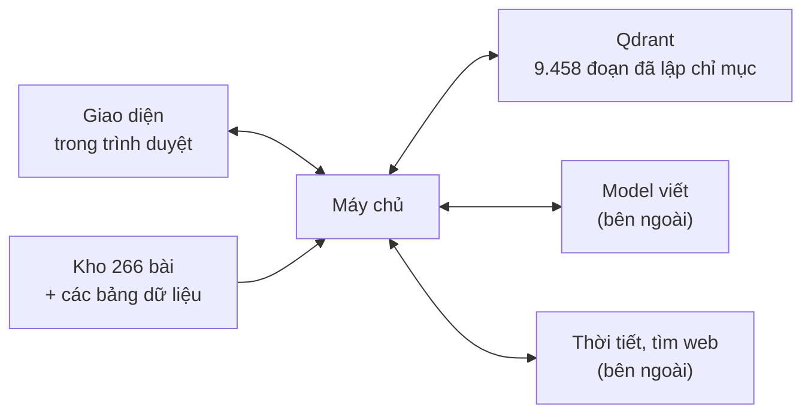

# Bài 6 — Kiến trúc: các khối, vì sao đặt như vậy, và khi một khối hỏng thì sao

*Cập nhật 11:18, ngày 22/11/2026 · các khối, công nghệ và cách xử lý lỗi đọc từ chương trình và cấu hình sáng 22/11; thời gian từng bước lấy từ một lượt hỏi thật ngày 21/11 (Claude Sonnet 5.5). Người viết không chạy lại và không tắt thử dịch vụ nào: mọi dòng "hỏng thì thấy gì" là đọc từ chương trình, chưa thử thật.*

**Bài trước đã biết:** người dùng thấy sáu trang; ở khung Trợ lý họ gõ câu hỏi và nhận câu trả lời có nguồn.
**Bài này thêm:** phía sau màn hình có những khối nào, câu hỏi về giá vé Đại Nội đi qua chúng theo thứ tự nào, **vì sao** các khối được đặt như vậy, và **một khối hỏng thì chuyện gì xảy ra**. Bài mở đầu bằng vài khái niệm về trang web và máy chủ, giảng từ đầu.

## Ý chính

- Hệ thống có **năm khối**: giao diện trong trình duyệt, máy chủ, cơ sở dữ liệu tìm kiếm (Qdrant), kho cùng các bảng dữ liệu, và các dịch vụ bên ngoài (model viết, thời tiết, tìm web).
- **Máy chủ là trung tâm.** Mọi việc của một câu trả lời đi qua nó: nó tìm trong kho, gọi model, chạy công cụ, kiểm, rồi mới gửi kết quả cho giao diện. Giao diện không tự gọi model.
- **Bốn thứ được máy chủ gửi ra ngoài:** lời gọi model viết, ảnh của chức năng hỏi bằng ảnh, yêu cầu lấy dự báo thời tiết, và câu tra web. Việc tìm trong kho chạy hoàn toàn trên máy của dự án.
- Một câu hỏi đi qua sáu bước: xếp loại câu, tìm, ghép ngữ cảnh, model viết, kiểm, hiện. Ở ví dụ chính cả sáu bước mất 3,7 giây, trong đó model viết chiếm 3,6 giây.
- Khi một khối hỏng, hệ thống **nói thật là hỏng**: người dùng thấy một lời báo và nút "Thử lại". Máy chủ không âm thầm hỏi lại dịch vụ đang lỗi, không tự đổi sang model khác, và không thay thứ còn thiếu bằng thứ đoán.

## Từ dùng trong bài

| Tên trong bài | Tên gốc | Nghĩa |
|---|---|---|
| trình duyệt | **browser** | chương trình trên máy của người dùng để mở trang web (Chrome, Safari…) |
| giao diện | **frontend** | phần của ứng dụng chạy trong trình duyệt: các trang, nút bấm, ô gõ |
| máy chủ | **backend**, **server** | chương trình chạy trên máy của dự án, nhận yêu cầu từ giao diện và làm mọi việc phía sau |
| dịch vụ bên ngoài | **external service**, **API** | chương trình của một bên khác, chạy trên máy của họ; muốn dùng thì gửi yêu cầu qua mạng |
| khoá | **API key** | một chuỗi bí mật, như mật khẩu, mà dịch vụ bên ngoài cấp cho dự án để biết ai đang gọi và tính tiền ai |
| hạn giờ | **timeout** | thời gian chờ dài nhất cho một lần gọi; quá thì coi như lần gọi đó lỗi |
| bộ nhớ của máy chủ | **RAM**, **in-memory** | chỗ máy chủ giữ dữ liệu trong lúc đang chạy; tắt hay khởi động lại máy chủ là mất. Khác với **đĩa**, nơi dữ liệu còn nguyên sau khi tắt máy |
| sổ số đo | **log**, **metrics** | file ghi mỗi lượt hỏi một dòng số: thời gian từng bước, tiền, kết cục |

## Trình duyệt, máy chủ, và dịch vụ bên ngoài: ai ở đâu

Phần này dành cho người chưa làm trang web bao giờ. Ba ý là đủ để đọc cả bài.

**Một ứng dụng web có hai nửa chạy trên hai máy khác nhau.** Nửa thứ nhất là giao diện, chạy trong trình duyệt, trên máy của người dùng. Nửa thứ hai là máy chủ, chạy trên máy của dự án. Người dùng gõ câu hỏi và bấm gửi; giao diện gửi câu hỏi đó qua mạng tới máy chủ, rồi chờ. Máy chủ làm việc và gửi kết quả về; giao diện vẽ kết quả lên màn hình.

**Thứ gì nằm ở giao diện thì người dùng xem được và sửa được.** Trình duyệt nào cũng cho người dùng mở xem chương trình của trang đang chạy và đổi nó. Thứ nằm ở máy chủ thì người dùng không chạm tới được. Ý này quyết định nhiều lựa chọn ở dưới.

**Máy chủ không tự làm hết mọi việc; có việc nó phải nhờ bên ngoài.** hue_rag không có model viết của riêng mình. Mỗi lần cần viết, máy chủ gửi một yêu cầu qua mạng tới máy của hãng model, kèm khoá của dự án, rồi chờ câu trả lời. Dự báo thời tiết và tìm web cũng vậy. Nhờ bên ngoài thì có ba điều phải chấp nhận: phải chờ, phải trả tiền (với model và tìm web), và **bên đó có thể hỏng** vào lúc mình đang cần. Vì vậy mỗi lần gọi ra ngoài đều có một hạn giờ, và chương trình phải quyết trước: quá hạn hoặc lỗi thì làm gì.

## Năm khối của hệ thống

| Khối | Làm gì | Làm bằng gì | Chạy ở đâu |
|---|---|---|---|
| **Giao diện** | sáu trang người dùng thấy (bài 5) | React, đóng gói bằng Vite; bản đồ bằng Leaflet | trình duyệt của người dùng |
| **Máy chủ** | nhận câu hỏi, tìm, gọi model, chạy công cụ, kiểm, xếp lịch, ghi sổ | Python, FastAPI; phần gọi model và nhận lời xin công cụ dùng thư viện OpenAI Agents SDK | máy của dự án |
| **Qdrant** | cất vector của mọi đoạn kèm chữ và thông tin của đoạn đó; trả về 30 đoạn gần câu hỏi nhất | Qdrant, chạy trong một hộp Docker | máy của dự án |
| **Kho và các bảng dữ liệu** | 266 bài viết; các bảng điểm tham quan, khoảng cách, chỗ ở, quán ăn, ảnh (dùng cho trang Lên kế hoạch và cho các công cụ của trợ lý); bảng sự kiện theo ngày (chỉ dùng cho ô hỏi đáp) | file chữ và file bảng | máy của dự án |
| **Dịch vụ bên ngoài** | model viết; dự báo thời tiết; tìm web | model: Claude Sonnet 5.5 qua Amazon Bedrock (trước đó gpt-6-luna qua OpenAI) · thời tiết: Open-Meteo · tìm web: Serper | máy của các bên đó |

Một model nữa không có trong hình vì nó nằm ngay trong máy chủ: model embedding nhỏ (multilingual-e5-small), dùng để đổi câu hỏi thành vector (bài 10). Nó chạy trên máy của dự án, không gọi ra ngoài.

## Bốn thứ được gửi ra ngoài

| Thứ ra ngoài | Gửi đi đâu | Gửi những gì |
|---|---|---|
| lời gọi model viết | hãng cung cấp model | lời dặn; câu hỏi; các câu hỏi trước của cuộc trò chuyện và câu trả lời liền trước; các đoạn của kho được chọn; kết quả của công cụ |
| ảnh hỏi bằng ảnh | hãng cung cấp model | tấm ảnh người dùng gửi, đã thu nhỏ |
| yêu cầu dự báo thời tiết | dịch vụ thời tiết | toạ độ cố định của trung tâm Huế, xin dự báo 7 ngày; không có chữ nào của người dùng |
| câu tra web | dịch vụ tìm web | câu hỏi của người dùng ở lượt đó, đã bỏ số điện thoại và email, cắt ngắn, thêm chữ "Huế"; ở câu hỏi nối tiếp thì là câu tìm do model viết. Chỉ gửi khi kho đã từ chối cả câu hỏi |

Việc tìm trong kho (đổi câu hỏi thành vector, hỏi Qdrant, chấm từ khoá) chạy trọn trên máy của dự án. Ngoài bốn thứ trên, trình duyệt của người dùng tự tải các ô nền của bản đồ từ một máy chủ bản đồ công cộng; việc này không đi qua máy chủ của dự án. Bài 37 nói kỹ phần an toàn và dữ liệu người dùng.

## Một câu hỏi đi qua sáu bước

Ví dụ chính: *"Giá vé tham quan Đại Nội Huế là bao nhiêu?"*. Thời gian là của lượt hỏi thật.

| Bước | Ai làm | Việc | Thời gian |
|---|---|---|---|
| 1. Xếp loại câu | model, một lần gọi ngắn | câu này thuộc tuyến "về Huế" (bài 22) | 0,74 giây, chạy song song với các bước 2–4 |
| 2. Tìm | máy chủ, model embedding, Qdrant | chọn 10 đoạn trong kho (bài 13) | 0,04 giây |
| 3. Ghép ngữ cảnh | máy chủ | xếp 10 đoạn thành 10 khối có số nguồn (bài 15) | dưới 0,01 giây |
| 4. Viết | model viết | đọc 10 đoạn, viết câu trả lời có số nguồn; lượt này model không xin tìm thêm | 3,63 giây |
| 5. Kiểm | máy chủ | kiểm số nguồn; nối dòng "có thể đã thay đổi" (bài 16) | dưới 0,01 giây |
| 6. Hiện | giao diện | vẽ câu trả lời, dòng nguồn, dòng ghi chú | — |

Cả lượt: **3,7 giây**, 2 lần gọi model, 0,0178 USD. Sau bước 6, máy chủ ghi một dòng vào sổ số đo: thời gian từng bước, số token, tiền, kết cục. Dòng đó không chứa chữ của câu hỏi hay câu trả lời.

Hai điều đọc được từ bảng:

- **Gần như toàn bộ thời gian chờ là model viết.** Phần của chính hệ thống (tìm, ghép, kiểm) chưa tới 0,1 giây.
- **Bước xếp loại chạy song song** với việc tìm và viết. Ở lượt này nó xong sau 0,75 giây, trước khi model viết xong, nên không cộng thêm vào thời gian chờ.

Những câu khó hơn đi thêm các nhánh: model xin tìm thêm (bài 21), xin một công cụ (bài 24), hoặc kho từ chối rồi tra web (bài 25). Ví dụ "phải tìm thêm" mất 7,5 giây với 4 lần gọi model; lượt đó chạy ngày 20/11 với gpt-6-luna, chưa có lượt tương đương trên Claude.

Trước mọi câu hỏi còn một giai đoạn chuẩn bị, chạy khi không có người dùng: cắt 266 bài thành 9.458 đoạn, đổi mỗi đoạn thành vector, lập thống kê từ khoá, cất vào Qdrant (chặng 2). Bước 2 nhanh là nhờ việc đó đã làm xong từ trước.

## Quyết định và lý do

Mỗi quyết định dưới đây mở bằng vài câu kể tình huống, rồi chốt bằng bốn gạch: đã chọn gì, vì sao, cách khác, cái giá. Chỗ nào không tìm thấy lý do được ghi lại thì ghi thẳng "chưa thấy ghi lý do", kèm điều kiểm được trong chương trình.

### 1. Vì sao mọi việc của câu trả lời nằm ở máy chủ, mà giao diện không gọi thẳng model?

Về kỹ thuật, giao diện gọi thẳng hãng model được: trình duyệt cũng gửi được yêu cầu qua mạng. Làm vậy thì bớt được một chặng. Nhưng muốn gọi hãng model phải kèm khoá của dự án, và mọi thứ nằm ở giao diện thì người dùng mở ra xem được.

- **Đã chọn:** giao diện chỉ nói chuyện với máy chủ của dự án. Chỉ máy chủ gọi model, Qdrant và các dịch vụ bên ngoài.
- **Vì sao:** khoá của hãng model và của dịch vụ tìm web chỉ nằm ở máy chủ; đặt ở giao diện thì ai mở trang cũng lấy được và dùng bằng tiền của dự án. Thêm nữa, các luật của sản phẩm ("chỉ trả lời từ kho", "kiểm số nguồn", "được tìm thêm mấy lần") cũng phải nằm ở nơi người dùng không sửa được. Ý thứ hai là lập luận từ cách trình duyệt hoạt động; chưa có phép thử nào được ghi lại.
- **Cách khác:** chưa thử cách nào khác.
- **Cái giá:** máy chủ ngừng thì ô hỏi đáp và việc lập lịch ngừng theo, dù trang web vẫn mở được.

Giao diện vẫn tự làm vài việc, là những việc chỉ đổi **cách hiện** thứ nó đã có: lọc danh sách bài, bỏ số [n] khỏi chữ, chọn ảnh hiện cạnh câu trả lời (bài 5).

### 2. Vì sao dịch vụ bên ngoài lỗi thì báo lỗi ngay, mà máy chủ không âm thầm hỏi lại?

Khi máy chủ gửi yêu cầu tới hãng model mà không thấy trả lời, có hai cách xử lý. Cách một: lặng lẽ gửi lại lần nữa, người dùng không biết gì, chỉ thấy chờ lâu hơn. Cách hai: dừng, nói thật là đang lỗi, và để người dùng quyết có hỏi lại không.

- **Đã chọn:** cách hai. Phần viết của một lượt hỏi (kể cả các vòng model xin tìm thêm hay xin công cụ) có chung một hạn 45 giây. Hãng model lỗi hoặc quá hạn thì lượt hỏi dừng, người dùng thấy dòng "Không thể tạo câu trả lời vào lúc này." kèm nút "Thử lại". Thời tiết và tìm web cũng chỉ được gọi đúng một lần.
- **Vì sao:** chưa thấy ghi lý do. Điều thấy được trong chương trình: cả ba chỗ gọi ra ngoài đều gọi đúng một lần; riêng với thư viện của OpenAI, chương trình phải tắt hẳn việc tự gọi lại có sẵn của thư viện, tức đây là một lựa chọn có chủ ý.
- **Cách khác:** tự gọi lại khi lỗi mạng hay quá hạn: chưa thử.
- **Cái giá:** hãng model chỉ trục trặc trong chốc lát thì người dùng vẫn thấy lỗi và phải tự bấm "Thử lại".

Có đúng một trường hợp máy chủ tự chạy lại, và nó không phải lỗi mạng. Khi lịch sử cuộc trò chuyện đang mang câu trả lời liền trước, với tin kiểu "sửa lại thứ bạn vừa viết" model hay chép lại lời cũ mà không ghi nguồn; bước kiểm số nguồn rút cả câu, và người dùng gặp màn hình lỗi (đã đo ngày 22/11: 3 trên 7 lần). Từ 22/11, ở đúng trường hợp đó máy chủ gỡ chữ đã hiện và chạy lại cả lượt **một lần**, lần này không đưa câu trả lời cũ vào. Lần hai vẫn hỏng thì báo lỗi như thường.

### 3. Vì sao chỉ dùng một hãng model tại một thời điểm, không có model dự phòng tự chuyển sang?

Nếu hãng đang dùng sập, một hệ thống có thể tự chuyển sang hãng khác để người dùng không thấy gián đoạn. hue_rag có sẵn đường gọi tới hai hãng, nhưng không tự chuyển.

- **Đã chọn:** một dòng trong file cấu hình ghi hãng đang dùng. Đổi hãng là sửa dòng đó rồi khởi động lại máy chủ; việc này do người làm.
- **Vì sao:** chưa thấy ghi lý do riêng cho việc không dự phòng. Điều thấy được: lời dặn và các ngưỡng được đo cho từng model, và cùng một lời dặn thì hai model cư xử khác nhau. Với lời dặn xếp loại câu, gpt-6-luna không xếp nhầm lượt nào trong 56 lượt, còn Claude xếp nhầm 2 tới 4 trên 56 lượt tuỳ mức suy luận (bài 22). Tự chuyển sang một model chưa được đo nghĩa là chạy một hệ thống chưa kiểm.
- **Cách khác:** dự phòng tự động: chưa thử.
- **Cái giá:** hãng đang dùng sập thì ô hỏi đáp ngừng cho tới khi hãng chạy lại hoặc có người đổi cấu hình. Đường quay về gpt-6-luna hiện cũng đang tạm dừng (tài khoản bên đó đang ngừng dùng).

### 4. Vì sao cuộc trò chuyện chỉ được giữ trong bộ nhớ của máy chủ, không ghi ra đĩa?

Để hiểu câu "còn chỗ đó thì sao?", hệ thống phải nhớ các lượt trước của cuộc trò chuyện. Có ba chỗ để giữ: trong trình duyệt của người dùng (rồi gửi lại mỗi lần hỏi), trong bộ nhớ của máy chủ (mất khi máy chủ tắt), hoặc ghi ra đĩa hay một cơ sở dữ liệu (còn mãi).

- **Đã chọn:** bộ nhớ của máy chủ. Mỗi cuộc giữ 3 lượt gần nhất, hết hạn sau 30 phút không hoạt động, nhiều nhất 500 cuộc. Cũng ở đó có nhiều nhất 500 câu trả lời đã nhớ, mỗi câu giữ 24 giờ (bài 34).
- **Vì sao không ghi ra đĩa:** kế hoạch làm phần nhớ hội thoại ghi rõ chữ của người dùng chỉ được nằm trong bộ nhớ và trong lời gọi model, không lưu ra đĩa (bài 37).
- **Vì sao không để trình duyệt giữ rồi gửi lại:** nếu trình duyệt gửi lại "trợ lý đã nói thế này", người dùng có thể sửa câu đó để cài một mệnh lệnh vào lời gọi model. Máy chủ giữ thì phần đó không sửa được từ ngoài. Lý do này được ghi trong chương trình.
- **Cái giá:** khởi động lại máy chủ là mất hết các cuộc đang mở và các câu đã nhớ. Hệ thống hiện chỉ chạy một bản máy chủ trên một máy nên chỗ nhớ của chính bản đó là đủ; nếu sau này chạy nhiều bản cùng lúc, chúng không thấy chỗ nhớ của nhau.

### 5. Vì sao việc tìm trong kho chạy trọn trên máy của dự án, không nhờ một dịch vụ bên ngoài?

Bước tìm cần một model embedding để đổi câu hỏi thành vector. Model đó có thể chạy ngay trong máy chủ, hoặc là một model lớn hơn nhiều của một dịch vụ bên ngoài, gọi qua mạng như model viết.

- **Đã chọn:** model embedding nhỏ chạy bằng CPU ngay trong máy chủ; Qdrant chạy trên cùng máy.
- **Vì sao:** đã đo (bài 10). Một model embedding lớn hơn khoảng 70 lần, gọi qua một dịch vụ bên ngoài, giúp được 2 câu nhưng làm hỏng 3 câu trên 40 câu, và làm bước tìm chậm từ khoảng 0,02 giây lên khoảng 2,2 giây. Chạy trên máy thì bước tìm không tốn tiền mỗi câu, và câu hỏi của người dùng không rời máy ở bước này.
- **Cách khác:** chính là model lớn bên ngoài nói trên: đã đo, bỏ.
- **Cái giá:** máy chủ phải nạp model embedding lúc khởi động và giữ nó trong bộ nhớ.

### 6. Vì sao khi kho và chỉ mục lệch nhau, máy chủ từ chối mọi câu hỏi, mà không cứ trả lời bằng chỉ mục cũ?

Kho là các file bài viết; chỉ mục là bản đã cắt đoạn và cất trong Qdrant. Sửa một bài trong kho mà chưa cập nhật chỉ mục thì hai thứ lệch nhau: chỉ mục còn giữ đoạn cũ.

- **Đã chọn:** lúc khởi động, máy chủ so kho với chỉ mục. Lệch thì máy chủ vẫn chạy, nhưng mọi câu hỏi nhận lời báo "Dữ liệu tra cứu cần được lập chỉ mục lại."
- **Vì sao:** trả lời bằng chỉ mục cũ là trích những đoạn có thể không còn trong kho, hoặc đã sửa giá, sửa giờ (bài 12).
- **Cách khác:** cứ chạy với chỉ mục cũ: không làm.
- **Cái giá:** sửa kho mà quên cập nhật chỉ mục thì từ lần khởi động sau, ô hỏi đáp ngừng hẳn cho tới khi cập nhật. Phép so này chỉ chạy lúc khởi động: trong lúc máy chủ đang chạy, nó không biết kho vừa đổi.

Bốn quyết định nhỏ hơn (khoảng cách tính sẵn, tự viết từng bước, không chạy model viết trên máy, giao diện và máy chủ chung một chỗ) nằm ở nửa để tra, mục "Quyết định nhỏ hơn".

## Nếu… thì sao

Luật chung đọc được từ chương trình: khi một phần hỏng, hệ thống nói thẳng là hỏng. Khi một dịch vụ bên ngoài không trả lời hay trả lỗi, máy chủ không âm thầm hỏi lại; nó báo cho người dùng và để họ bấm "Thử lại".

Mọi dòng trong hai bảng dưới là **đọc từ chương trình**. Chưa ai tắt thử từng dịch vụ để xem màn hình. Các lời báo trong ngoặc kép là nguyên văn trong chương trình.

**Khi một khối hỏng**

| Nếu | Hệ thống làm gì | Người dùng thấy gì | Đã có chưa |
|---|---|---|---|
| hãng model lỗi, hoặc phần viết quá 45 giây | dừng lượt hỏi; không gọi lại; ghi kết cục vào sổ số đo | "Không thể tạo câu trả lời vào lúc này." và nút "Thử lại"; chữ đã hiện (nếu có) bị xoá | có lời báo; **chưa có** model dự phòng |
| hãng model lỗi, nhưng câu hỏi trùng một câu đã nhớ trong 24 giờ | trả lại câu đã nhớ, vì việc này không cần gọi model | câu trả lời như bình thường | đã có |
| lúc khởi động thiếu khoá của hãng model | máy chủ vẫn chạy; mọi câu hỏi và mọi lần lập lịch bị từ chối | cùng lời báo trên; không có nút gửi ảnh; các trang Khám phá, Bản đồ, Chỗ ở vẫn dùng được | đã có |
| khoá của hãng model hết hạn khi máy chủ đang chạy | mỗi lần gọi model bị từ chối; đường báo tình trạng của hệ thống vẫn báo "đủ" vì nó không gọi ra ngoài | cùng lời báo trên | có lời báo; muốn biết model còn chạy không thì phải hỏi thử một câu thật |
| Qdrant không chạy lúc máy chủ khởi động | máy chủ vẫn chạy nhưng không nhận câu hỏi, không lập lịch, không nạp danh sách bài | "Hệ thống tra cứu tạm thời không khả dụng."; trang Khám phá báo chưa tải được danh sách bài; Trang chủ, Bản đồ, Chỗ ở, Giới thiệu vẫn chạy | đã có; phải khởi động lại máy chủ sau khi Qdrant chạy lại |
| Qdrant ngừng giữa lúc máy chủ đang chạy | lượt đang hỏi dừng; các lượt sau cũng lỗi cho tới khi Qdrant chạy lại; chạy lại thì dùng tiếp được ngay, không cần khởi động lại máy chủ | cùng lời báo, kèm nút "Thử lại" | đã có |
| kho đã sửa mà chỉ mục chưa cập nhật, rồi máy chủ khởi động lại | không nhận câu hỏi nào | "Dữ liệu tra cứu cần được lập chỉ mục lại." | đã có (bài 12) |
| bảng điểm của trang Lên kế hoạch trỏ tới một đoạn không còn trong chỉ mục | máy chủ **không khởi động**, báo đúng mã của đoạn thiếu | không vào được trang nào | đã có; chọn dừng hẳn để lỗi lộ ngay lúc bật, không để một trang hỏng âm thầm |
| dịch vụ thời tiết lỗi, hoặc chậm quá 3 giây | công cụ thời tiết trả về "lỗi"; không đưa ra con số nào | câu trả lời nói rõ không lấy được dự báo (bài 24); ở Trang chủ, ô thời tiết ẩn đi | đã có |
| dịch vụ tìm web lỗi, chậm quá 5 giây, hoặc thiếu khoá | lượt đó không có mục web | câu từ chối của kho, kèm gợi ý cách hỏi | đã có |
| bước xếp loại câu lỗi, hoặc chậm quá 10 giây | coi câu là "về Huế", đi tiếp (bài 22) | câu trả lời như bình thường | đã có |
| bước kiểm số nguồn hỏng sau khi chữ đã hiện | rút lại chữ đã hiện | "Câu trả lời không đáp ứng yêu cầu trích dẫn." và nút "Thử lại" (bài 16) | đã có |
| bước kiểm số nguồn hỏng ở lượt ngay sau một câu trả lời được nhớ | gỡ chữ đã hiện, chạy lại cả lượt một lần không kèm câu trả lời cũ; lần hai hỏng thì báo như dòng trên | chờ lâu hơn, rồi câu trả lời hoặc lời báo | đã có từ 22/11 |
| hỏi bằng ảnh mà model lỗi hoặc quá 20 giây | coi như không nhận ra ảnh | "Mình chưa nhận ra ảnh này — bạn gõ tên nơi / món bạn muốn hỏi nhé."; không phân biệt được với trường hợp model thật sự không nhận ra | có lời báo; chưa tách hai trường hợp |
| một lỗi không lường trước trong chương trình | dừng lượt; ghi tên loại lỗi vào sổ, không ghi chữ của người dùng | "Đã xảy ra lỗi trong hệ thống. Vui lòng thử lại sau." | đã có |
| người dùng đóng trang giữa lúc chờ | máy chủ thấy đường nối bị ngắt, dừng lần gọi model, ghi kết cục "người dùng ngắt" | — | đã có |
| máy chủ khởi động lại | mất các cuộc trò chuyện đang mở, lịch đang giữ, câu trả lời đã nhớ | tin kế tiếp được coi như mở đầu một cuộc mới | **chưa có** cách giữ qua lần khởi động |

**Khi điều kiện đổi**

| Nếu | Điều đã biết | Đã có chưa |
|---|---|---|
| nhiều người hỏi cùng lúc | mỗi câu hỏi giữ một đường nối giữa trình duyệt và máy chủ cho tới khi trả lời xong; nhiều người hỏi thì máy chủ giữ nhiều đường nối và gọi model nhiều lần cùng lúc. Mới đo một lần (27/10, trước khi có trợ lý) | **chưa có** giới hạn số lượt chạy cùng lúc; chưa đo lại |
| một người gửi rất nhiều câu | có bộ đếm số lượt mỗi ngày theo địa chỉ mạng của người gửi; quá thì nhận "Bạn đã dùng hết số lượt hỏi hôm nay. Vui lòng quay lại vào ngày mai." | có sẵn nhưng **đang tắt**; bật bằng một thiết lập lúc chạy máy chủ, để dành cho khi đưa lên mạng |
| kho lớn gấp mười | lập chỉ mục cả kho hiện mất 225 giây cho 9.458 đoạn; phần chấm từ khoá chỉ chạy trên 30 ứng viên nên không tăng theo cỡ kho (bài 11) | chưa đo ở cỡ đó |
| đổi model viết | sửa một dòng cấu hình; nhưng lời dặn và các ngưỡng phải đo lại (bài 33) | đã làm một lần (21/11) |
| đưa lên mạng | có gói đóng sẵn ba hộp, đã chạy thử trên máy (bài 36) | chưa đưa lên mạng |

## Dễ nhầm

- **"Giao diện gọi thẳng model."** Không. Giao diện chỉ nói chuyện với máy chủ.
- **"Hệ thống chậm vì tìm trong kho lâu."** Không. Tìm mất khoảng 0,04 giây; chờ là chờ model viết.
- **"Mọi thứ chạy trên dịch vụ đám mây."** Không. Máy chủ, Qdrant, kho và model embedding chạy trên máy của dự án; chỉ model viết, thời tiết và tìm web là gọi ra ngoài.
- **"Lỗi thì hệ thống tự thử lại cho tới khi được."** Không. Dịch vụ bên ngoài lỗi thì nó báo ngay và để người dùng quyết. Chỉ một trường hợp hẹp được chạy lại đúng một lần, và đó là lỗi nội dung chứ không phải lỗi mạng.

## Những điều cần nhớ

- Năm khối: giao diện (React) · máy chủ (Python, FastAPI) · Qdrant · kho và các bảng dữ liệu · dịch vụ bên ngoài (model viết, thời tiết, tìm web).
- Máy chủ giữ khoá và mọi luật về nội dung câu trả lời; giao diện gửi, vẽ, và chỉ quyết cách hiện.
- Bốn thứ máy chủ gửi ra ngoài: lời gọi model viết, ảnh hỏi bằng ảnh, yêu cầu dự báo thời tiết, câu tra web. Tìm trong kho thì chạy trọn trên máy.
- Sáu bước của một câu hỏi: xếp loại, tìm, ghép ngữ cảnh, viết, kiểm, hiện. Ví dụ chính: 3,7 giây, trong đó viết 3,6 giây.
- Hỏng thì báo thật: model lỗi, Qdrant lỗi, chỉ mục lệch, lỗi lạ, mỗi loại có một lời báo; không gọi lại khi lỗi mạng, không có model dự phòng; cuộc trò chuyện mất khi máy chủ khởi động lại.

## Cấu hình đang chạy

*Theo chương trình và cấu hình sáng 22/11/2026.*

| Mục | Giá trị | Dùng để làm gì, vì sao là giá trị này | Đã thử giá trị khác chưa |
|---|---|---|---|
| Ngôn ngữ và thư viện của máy chủ | Python; FastAPI | — | chưa so thư viện khác |
| Thư viện gọi model và nhận lời xin công cụ | OpenAI Agents SDK | lo việc gọi model, nhận lời xin công cụ, ép dạng đầu ra; được giữ nguyên khi đổi sang Claude (bài 33) | chưa so thư viện khác |
| Giao diện | React, Vite; đóng thành file tĩnh do máy chủ gửi | bài 5 | bài 5 |
| Cơ sở dữ liệu tìm kiếm | Qdrant trong hộp Docker, cổng 6335, chỉ nhận yêu cầu từ chính máy đó | bài 12 | chưa so cái khác |
| Model embedding | multilingual-e5-small, chạy bằng CPU của máy | bài 10 | đã đo một model lớn gọi qua mạng: bỏ (bài 10) |
| Model viết | Claude Sonnet 5.5 qua Amazon Bedrock (đổi tạm từ 21/11) | bài 33 | bài 33 |
| Số lần gọi lại khi một dịch vụ bên ngoài lỗi hoặc quá hạn | 0, cho cả model viết, thời tiết, tìm web | quyết định 2 ở trên | chưa thử gọi lại khi lỗi mạng |
| Chạy lại cả lượt khi câu trả lời bị rút vì thiếu số nguồn | 1 lần, chỉ ở lượt ngay sau một câu trả lời được nhớ (từ 22/11) | người dùng khỏi gặp màn hình lỗi ở tin kiểu "sửa lại thứ bạn vừa viết" | trước khi có: 3 trên 7 lần ra màn hình lỗi (đo 22/11) |
| Dịch vụ thời tiết | Open-Meteo, dự báo 7 ngày; kết quả giữ 30 phút | không cần khoá | chưa so |
| Dịch vụ tìm web | Serper; một lần gọi | bài 25 | đã thử một dịch vụ khác, không đổi (bài 25) |
| Khoảng cách giữa các điểm | bảng dựng sẵn; lúc trả lời không gọi mạng | bài 24 | mục "Quyết định nhỏ hơn" |
| Ngày âm lịch | thư viện tính lịch Việt Nam, chạy trên máy | bài 24 | — |
| Xếp loại câu và trả lời chạy song song | bật | chữ đầu tiên của câu về Huế tới sớm hơn | đã so với chạy lần lượt: sớm hơn 1,37 giây (khoảng tin cậy 0,34 tới 2,14; đo với gpt-6-luna, chưa đo lại với Claude; bài 22) |
| Các hạn giờ chính | 45 giây cho cả phần viết của một lượt · 10 giây cho xếp loại câu · 10 giây cho lần gọi hiểu lệnh sửa lịch · 20 giây cho hỏi bằng ảnh · 30 giây cho Qdrant · 5 giây cho tìm web · 3 giây cho thời tiết | không để một lượt hỏi bị treo | chưa so |
| Cuộc trò chuyện giữ trong bộ nhớ | 3 lượt gần nhất (không quá 1.500 token); hết hạn sau 30 phút; nhiều nhất 500 cuộc | bài 23 | bài 23 |
| Câu trả lời đã nhớ | 24 giờ; nhiều nhất 500 câu; chỉ khớp khi ai đó gõ lại đúng câu đó (không tính khoảng trắng thừa, chữ hoa thường) ở lượt đầu của một cuộc mới | bài 34 | bài 34 |
| Giới hạn số lượt mỗi ngày theo địa chỉ mạng | có sẵn, đang tắt | để bật khi đưa lên mạng | — |
| Tài khoản người dùng, đăng nhập | không có | — | — |

## Quyết định nhỏ hơn

**Vì sao khoảng cách tra trong một bảng dựng sẵn, còn thời tiết thì hỏi dịch vụ bên ngoài?** Khoảng cách giữa 40 điểm tham quan không đổi, nên được tính một lần lúc dựng bảng (nhờ một dịch vụ chỉ đường), rồi lúc trả lời chỉ tra bảng, không gọi mạng. Cách khác đã cân lúc lập kế hoạch: chương trình tự tính theo đường chim bay nhân 1,3; bỏ vì là phép ước thô, sai nhiều với hai điểm cách sông hay phải đi vòng. Thời tiết đổi theo giờ nên không dựng sẵn được; kết quả được giữ 30 phút. Cái giá: nơi không có trong bảng thì hệ thống không nói được khoảng cách (bài 24).

**Vì sao tự viết từng bước, không dùng một bộ thư viện RAG trọn gói?** Chưa thấy ghi lý do; chưa thử bộ nào, không có phép so. Điều thấy được: mỗi bước (cắt đoạn, tìm, ghép ngữ cảnh, kiểm) là một phần chương trình riêng có bài test riêng, và nhiều lần thử ở các chặng sau thay đúng một bước rồi đo.

**Vì sao không chạy model viết ngay trên máy cho khỏi phụ thuộc hãng?** Chưa thử. Điều thấy được: máy phát triển chỉ có một card đồ hoạ nhỏ; các lần thử model chạy trên máy ở việc khác (xếp lại, nhận ảnh) đều không được chọn (bài 14, 26).

**Vì sao giao diện và máy chủ chung một chỗ?** Quyết định lúc chọn công nghệ giao diện: giao diện đóng thành file tĩnh, máy chủ gửi luôn, nên chỉ có một thứ phải bật (bài 5).

## Giới hạn đã biết

- **Một máy, một bản máy chủ.** Hệ thống chưa được đưa lên mạng; mới đo một lần với nhiều người hỏi cùng lúc (27/10).
- **Phụ thuộc một hãng model tại một thời điểm.** Hãng đó chậm hay lỗi thì hệ thống chậm hay lỗi theo; không có dự phòng tự động.
- **Vài thứ chỉ nằm trong bộ nhớ của máy chủ** (cuộc trò chuyện đang mở, lịch đang giữ, câu trả lời được nhớ 24 giờ): khởi động lại là mất.
- **Các dòng "hỏng thì thấy gì" của bài này đọc từ chương trình.** Chưa ai tắt thử từng dịch vụ để xem màn hình.
- **Đường báo tình trạng của hệ thống không gọi ra ngoài,** nên nó có thể báo "đủ" trong khi hãng model đang từ chối mọi lần gọi.

## Chi tiết để tra

- Lượt ví dụ chính: ngày 21/11/2026; thời gian từng bước theo sổ ghi: lần gọi xếp loại 0,74 giây (cả bước 0,75 giây), tìm 0,040 giây, ghép ngữ cảnh 0,004 giây, viết 3,63 giây, tổng 3,69 giây. Tiền: 0,0034 USD cho lần xếp loại, 0,0144 USD cho lần viết.
- Lần chạy lại (dòng "ngay sau một câu trả lời được nhớ") có hạn 45 giây riêng, nên ở trường hợp xấu nhất một lượt như vậy có thể chờ khoảng 90 giây. Tiền tính cả hai lần gọi.
- Trên đường Amazon Bedrock, "khoá" là một file khoá tạm; lúc khởi động máy chủ chỉ kiểm rằng đã được chỉ tới file đó, còn khoá được đọc lại ở mỗi lần gọi.
- Các đường gọi chính của máy chủ (mỗi đường là một địa chỉ mà giao diện gửi yêu cầu tới): ô chat (một đường trả cả câu, một đường gửi dần từng phần), mở một cuộc trò chuyện mới, hỏi bằng ảnh, tải lịch thành PowerPoint, danh sách bài và nội dung một bài cho trang Khám phá, báo thông tin chưa đúng, thời tiết cho Trang chủ, danh sách tính năng đang mở, lịch mẫu, dữ liệu bản đồ, dữ liệu trang Chỗ ở, trang theo dõi, và một đường báo tình trạng của hệ thống (đủ, hoặc thiếu khối nào).
- Trên đường gửi dần, máy chủ gửi cho giao diện các loại tin: trạng thái, chữ, thay chữ, nguồn, ghi chú, mục web, các tin của lịch (khung lịch, câu mô tả, lịch xong), thẻ hỏi lại, thẻ chọn điểm thay, lỗi, xong.
- Các bảng dữ liệu: 41 điểm tham quan có giờ, trong đó 40 điểm có toạ độ; bảng khoảng cách giữa 40 điểm; 136 cơ sở lưu trú; 467 quán ăn; bảng ảnh; 27 dòng sự kiện theo ngày (chặng 6, bài 24).
- Ảnh của chức năng hỏi bằng ảnh được thu nhỏ còn cạnh dài 1.024 điểm ảnh trước khi gửi; ảnh gốc nhiều nhất 10 MB.
- Khi hãng model lỗi sau khi máy chủ đã bắt đầu gửi dần, sổ số đo phân biệt hai kết cục: lỗi trước khi có chữ, và lỗi sau khi đã có chữ.
- Gói đóng sẵn để mang hệ thống sang máy khác gồm ba hộp (cửa nhận kết nối mã hoá, ứng dụng, Qdrant); đã chạy thử trên máy, chưa đưa lên mạng (bài 36).
- Bộ test của máy chủ: lần chạy đủ gần nhất (sáng 22/11) có 1.900 ca đạt (bài 38).

**Bài sau (bài 7):** bắt đầu chặng 2, giai đoạn chuẩn bị. Khối đầu tiên được mở ra là kho: 266 bài viết về Huế.

Nguồn (để giữ bài đúng — anh không cần đọc)

- Mục "Trình duyệt, máy chủ, và dịch vụ bên ngoài": kiến thức phổ thông về ứng dụng web, không phải số đo của dự án.
- Các khối và công nghệ: `pyproject.toml` (FastAPI, openai-agents, sentence-transformers, qdrant-client, thư viện âm lịch, python-pptx), `frontend/package.json` (React, Vite, Leaflet), `docker-compose.yml` (Qdrant, `127.0.0.1:6335`), `backend/config/settings.yaml` (model, các hạn giờ, `song_song_tra_loi`, `tra_web_timeout_seconds`, khối `anh`), `backend/api/app.py` (máy chủ gửi file tĩnh của giao diện) [đọc 22/11/2026].
- Thứ gửi ra ngoài: thời tiết (toạ độ cố định, 7 ngày, giữ 30 phút, hạn 3 giây, một lần gọi) `backend/llm/thoi_tiet.py`; tìm web (dựng câu tìm từ câu hỏi: bỏ số điện thoại, email, cắt, thêm "Huế"; một lần gọi; thiếu khoá thì không mở kết nối) `backend/llm/tra_web.py`, `backend/llm/assistant.py` (`web_cau_noi_tiep`); ảnh thu nhỏ `backend/api/routes/anh.py` + khối `anh` của `settings.yaml`; lịch sử mang câu trả lời liền trước `settings.yaml` (`nho_cau_tra_loi`); ô nền bản đồ do trình duyệt tải `backend/api/routes/cong.py`. Bảng sự kiện chỉ dùng cho ô hỏi đáp: `guides/RUNBOOK_BAN_GIAO.md` dòng 324.
- Thời gian từng bước, tiền, 2 lần gọi model của ví dụ chính: `data/hoc_cung_D/vi_du_di_suot_vet.json`, trường `so_do` (`routing_ms` 751,5; lần gọi xếp loại 740,8; `search_ms` 39,8; `context_ms` 3,9; `generation_ms` 3.633,1; `total_ms` 3.690,6; `usd` 0,01778) [đã chạy]. Ví dụ "phải tìm thêm" (gpt-6-luna, 20/11): `vi_du_tim_them_vet.json`.
- Quyết định 1: khoá chỉ ở máy chủ `backend/api/app.py` (chú thích ở `_tim_web_server`), `backend/llm/generator_openai_full_corpus.py` (`from_environment`).
- Quyết định 2: hạn 45 giây chung cho cả phần viết `generator_openai_full_corpus.py` (`_run`, `asyncio.wait_for`), `assistant.py` (`deadline`); tắt việc tự gọi lại của thư viện OpenAI (`max_retries=0`); đường Bedrock gọi một lần `backend/llm/bedrock_model.py`. Không tìm thấy lý do được ghi: đã dò `guides/`, `bai_hoc/08_GENERATION.md`, chú thích quanh các dòng đó. Lần chạy lại hẹp, 3 trên 7: `assistant.py` (`answer_turn_stream_parallel`, `TEN_CHAY_LAI`, chú thích đầu hàm).
- Quyết định 3: 0 / 56 (gpt-6-luna), 2 / 56 ở mức suy luận cao và 4 / 56 ở mức vừa (Claude): `data/thu_bedrock_2026-11-21/c_harness/RA_HARNESS.md` dòng 13 [riêng tư]. Tài khoản OpenAI đang ngừng dùng: `session_prompt/HIEN_TRANG.md` mục 4 (gạch 21:43 21/11/2026).
- Quyết định 4: `backend/api/conversations.py` (chú thích đầu file: 3 lượt, 1.500 token, 30 phút, 500 cuộc; máy chủ giữ lịch sử để trình duyệt không gửi lại lời trợ lý); không lưu ra đĩa: `docs/superpowers/plans/2026-11-03-phase-9-b3-plan.md` (mục D4 và mục "Không làm"). Câu trả lời đã nhớ: `backend/api/cache_tra_loi.py`.
- Quyết định 5: model embedding lớn gọi qua mạng (giúp 2, hỏng 3 trên 40; 0,02 lên 2,2 giây): `bai_hoc/19_BANG_TONG_CAC_LAN_SO_SANH.md` (hàng về Qwen3-Embedding-8B) và bài 10 của giáo trình.
- Quyết định 6: `backend/api/app.py` (khối `lifespan`: lệch kho và chỉ mục ⇒ lời báo "Dữ liệu tra cứu cần được lập chỉ mục lại."; chỉ kiểm lúc khởi động).
- Lời báo và các nhánh lỗi: `backend/api/routes/chat.py` (`GENERATION_FAILURE_MESSAGE`, `RETRIEVAL_UNAVAILABLE_MESSAGE`, `INTERNAL_ERROR_MESSAGE`, `_loi_trich_dan`, `_error_response_for`, `StreamEvents.failure`, kết cục `client_disconnected`, `stream_error_after_text`; tra câu đã nhớ trước khi gọi model); `backend/api/app.py` (Qdrant lỗi lúc khởi động; thiếu khoá model ⇒ máy chủ vẫn chạy; `lt2.kiem_doan_mo_ta` nằm ngoài khối bắt lỗi ⇒ máy chủ không khởi động); Qdrant ngừng giữa chừng: `backend/retrieval/full_corpus.py`, `backend/vectorstore/qdrant.py`; hỏi bằng ảnh lỗi: `backend/api/routes/anh.py`, `frontend/src/HoiBangAnh.jsx`; đường báo tình trạng: `backend/api/health.py`, `guides/RUNBOOK_BAN_GIAO.md` dòng 376. Nút "Thử lại", xoá chữ đã hiện: `frontend/src/chat.jsx`, `frontend/src/stream.js`. Tất cả [suy từ code, chưa thử thật]; đối chiếu độc lập: `data/hoc_cung_D/kiem/muc_moi_05_06_17_20.md` (phần bài 06).
- Giới hạn lượt theo địa chỉ mạng, đang tắt khi chưa đặt biến môi trường: `backend/api/gioi_han.py`. Nhiều người hỏi cùng lúc mới đo một lần (27/10): `guides/RUNBOOK_BAN_GIAO.md` dòng 466.
- Chạy song song, sớm hơn 1,37 giây [0,34; 2,14]: `backend/llm/assistant.py` (`_luot_stream`); `bai_hoc/19_BANG_TONG_CAC_LAN_SO_SANH.md` hàng số 27.
- Khoảng cách: `settings.yaml` (`khoang_cach`); hai cách đã cân: `docs/superpowers/plans/2026-11-16-khoang-cach-plan.md`. Model chạy trên máy không được chọn: `bai_hoc/07_RERANKING.md`, `bai_hoc/15_TRA_WEB_VA_HOI_BANG_ANH.md`. Giao diện và máy chủ chung một chỗ: `bai_hoc/17_GIAO_DIEN_VA_TOC_DO.md` phần 1.
- Các đường gọi của máy chủ: `backend/api/routes/chat.py`, `anh.py`, `cong.py`, `xuat.py`, `backend/api/health.py`, `feedback.py`, `theo_doi.py`. Các loại tin trên đường gửi dần: `chat.py` (các lời gọi `sse_event`).
- Số của các bảng dữ liệu: chú thích trong `settings.yaml` (khoảng cách 40 điểm, lưu trú 136, quán 467, sự kiện 27 dòng); 41 điểm, 40 có toạ độ: `data/hoc_cung_D/kiem/bai_05_06.md` dòng 52.
- Ba hộp của gói đóng sẵn: `bai_hoc/BAN_DO_DU_AN.md`. 1.900 ca test (09:23–09:38 22/11): `session_prompt/HIEN_TRANG.md` mục 1.

