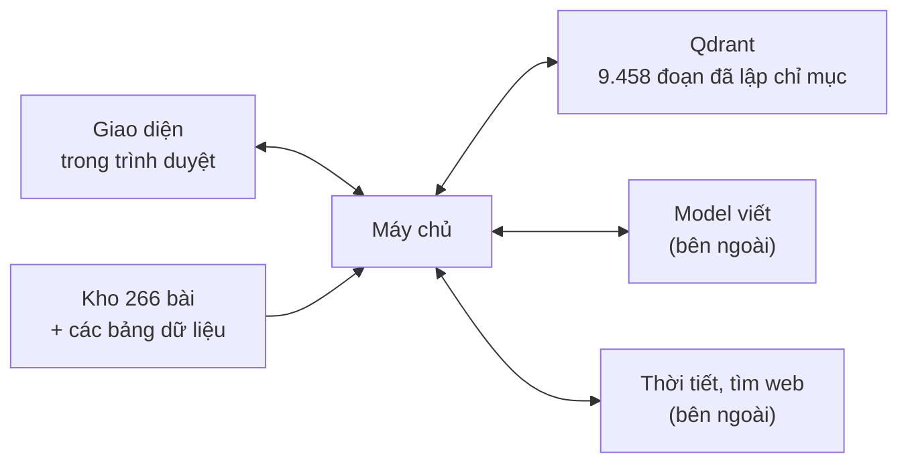

# Bài 6 — Kiến trúc: các khối, vì sao đặt như vậy, và khi một khối hỏng thì sao

*Cập nhật 16:11, ngày 22/11/2026 · phân xử chỗ lệch giữa các bài; giữ chữ tới khi kiểm (15:42) · trước đó: các khối, công nghệ và cách xử lý lỗi đọc từ chương trình và cấu hình sáng 22/11; thời gian từng bước lấy từ một lượt hỏi thật ngày 21/11 (Claude Sonnet 5.5). Bốn tình huống hỏng (Qdrant ngừng giữa chừng, Qdrant tắt lúc bật máy chủ, thiếu khoá model lúc bật, khởi động lại máy chủ giữa một cuộc) đã được thử thật trưa 22/11 qua trình duyệt, mỗi ca một lượt; các tình huống hỏng còn lại là đọc từ chương trình, chưa thử.*

**Bài trước đã biết:** người dùng thấy sáu trang; ở khung Trợ lý họ gõ câu hỏi và nhận câu trả lời có nguồn.
**Bài này thêm:** phía sau màn hình có những khối nào, một câu hỏi đi qua chúng theo thứ tự nào, **vì sao** các khối được đặt như vậy, và **một khối hỏng thì sao**. Bài mở bằng vài khái niệm về trang web và máy chủ, giảng từ đầu.

## Ý chính

- Hệ thống có **năm khối**: giao diện trong trình duyệt, máy chủ, cơ sở dữ liệu tìm kiếm (Qdrant), kho cùng các bảng dữ liệu, và các dịch vụ bên ngoài (model viết, thời tiết, tìm web).
- **Máy chủ là trung tâm.** Nó tìm trong kho, gọi model, chạy công cụ, kiểm. Giao diện không tự gọi model.
- Chỉ **bốn thứ** được gửi ra ngoài: lời gọi model viết, ảnh hỏi bằng ảnh, yêu cầu dự báo thời tiết, câu tra web. Tìm trong kho chạy trọn trên máy của dự án.
- Một câu hỏi đi qua sáu bước: xếp loại câu, tìm, ghép ngữ cảnh, model viết, kiểm, hiện (model trả chữ dần thì hiện trước, kiểm sau). Ở ví dụ chính: 3,7 giây, trong đó model viết 3,6 giây.
- Khi có thứ hỏng, hệ thống xử lý theo **hai tầng**. Khối chính hỏng (model viết, Qdrant, chỉ mục): dừng và nói thật, bằng một lời báo kèm nút "Thử lại". Khối phụ hỏng (xếp loại câu, thời tiết, tìm web): bỏ phần đó và trả lời tiếp. Nó không âm thầm gọi lại dịch vụ đang lỗi, và không tự đổi sang model khác.

## Từ dùng trong bài

| Tên trong bài | Tên gốc | Nghĩa |
|---|---|---|
| trình duyệt | **browser** | chương trình trên máy của người dùng để mở trang web (Chrome, Safari…) |
| giao diện | **frontend** | phần của ứng dụng chạy trong trình duyệt: các trang, nút bấm, ô gõ |
| máy chủ | **backend**, **server** | chương trình chạy trên máy của dự án, nhận yêu cầu từ giao diện và làm mọi việc phía sau |
| dịch vụ bên ngoài | **external service**, **API** | chương trình của một bên khác, chạy trên máy của họ; muốn dùng thì gửi yêu cầu qua mạng |
| khoá | **API key** | một chuỗi bí mật, như mật khẩu, mà dịch vụ bên ngoài cấp cho dự án để biết ai đang gọi và tính tiền ai |
| hạn giờ | **timeout** | thời gian chờ dài nhất cho một lần gọi; quá thì coi như lần gọi đó lỗi |
| bộ nhớ của máy chủ | **RAM**, **in-memory** | chỗ máy chủ giữ dữ liệu trong lúc đang chạy; tắt hay khởi động lại máy chủ là mất. Khác với **đĩa**, nơi dữ liệu còn nguyên sau khi tắt máy |
| sổ số đo | **log**, **metrics** | file ghi mỗi lượt hỏi một dòng số: thời gian từng bước, tiền, kết cục |

## Trình duyệt, máy chủ, và dịch vụ bên ngoài: ai ở đâu

Phần này dành cho người chưa làm trang web bao giờ. Năm ý dưới đây là đủ để đọc cả bài. Số bài ghi trong ngoặc (ví dụ "bài 22") là chỗ giảng kỹ hơn, chưa cần mở.

**Một ứng dụng web có hai nửa chạy trên hai máy khác nhau.** Nửa thứ nhất là giao diện, chạy trong trình duyệt, trên máy của người dùng. Nửa thứ hai là máy chủ, chạy trên máy của dự án. Người dùng gõ câu hỏi và bấm gửi; giao diện gửi câu hỏi đó qua mạng tới máy chủ, rồi chờ. Máy chủ làm việc và gửi kết quả về; giao diện vẽ kết quả lên màn hình.

**Thứ gì nằm ở giao diện thì người dùng xem được và sửa được.** Trình duyệt nào cũng cho người dùng mở xem chương trình của trang đang chạy và đổi nó. Thứ nằm ở máy chủ thì người dùng không chạm tới được. Ý này quyết định nhiều lựa chọn ở dưới.

**Máy chủ không tự làm hết mọi việc; có việc nó phải nhờ bên ngoài.** hue_rag không có model viết của riêng mình. Mỗi lần cần viết, máy chủ gửi một yêu cầu qua mạng tới máy của hãng model, kèm khoá của dự án, rồi chờ câu trả lời. Dự báo thời tiết và tìm web cũng vậy. Nhờ bên ngoài thì có ba điều phải chấp nhận: phải chờ, phải trả tiền (với model và tìm web), và **bên đó có thể hỏng** vào lúc mình đang cần. Vì vậy mỗi lần gọi ra ngoài đều có một hạn giờ, và chương trình phải quyết trước: quá hạn hoặc lỗi thì làm gì.

**Máy chủ là một chương trình chạy liên tục.** Nó được bật lên một lần rồi chạy suốt, chờ câu hỏi. Lúc bật, nó nạp sẵn và kiểm một số thứ đúng một lần: nạp model embedding, nối tới Qdrant, so kho với chỉ mục, đọc file cấu hình. Thứ nào chỉ được kiểm lúc bật thì khi nó đổi giữa chừng, máy chủ không biết; muốn máy chủ thấy thì phải tắt đi bật lại, gọi là **khởi động lại**. Khởi động lại cũng xoá sạch những gì máy chủ đang giữ trong bộ nhớ.

**Chữ của câu trả lời được gửi dần.** Máy chủ không đợi xong hết mới gửi một cục. Nó mở một đường nối với trình duyệt và gửi từng phần ngay khi có: dòng trạng thái, rồi chữ, rồi nguồn. Vì vậy có lúc người dùng đã thấy chữ trong khi máy chủ còn một bước chưa làm xong.

## Năm khối của hệ thống

| Khối | Làm gì | Làm bằng gì | Chạy ở đâu |
|---|---|---|---|
| **Giao diện** | sáu trang người dùng thấy (bài 5) | React, đóng gói bằng Vite; bản đồ bằng Leaflet | trình duyệt của người dùng |
| **Máy chủ** | nhận câu hỏi, tìm, gọi model, chạy công cụ, kiểm, xếp lịch, ghi sổ | Python, FastAPI; phần gọi model và nhận lời xin công cụ dùng thư viện OpenAI Agents SDK | máy của dự án |
| **Qdrant** | cất vector của mọi đoạn kèm chữ và thông tin của đoạn đó; trả về 30 đoạn gần câu hỏi nhất | Qdrant, chạy trong một hộp Docker | máy của dự án |
| **Kho và các bảng dữ liệu** | 266 bài viết; các bảng điểm tham quan, khoảng cách, chỗ ở, quán ăn, ảnh (dùng cho trang Lên kế hoạch và cho các công cụ của trợ lý); bảng sự kiện theo ngày (chỉ dùng cho ô hỏi đáp) | file chữ và file bảng | máy của dự án |
| **Dịch vụ bên ngoài** | model viết; dự báo thời tiết; tìm web | model: Claude Sonnet 5.5 qua Amazon Bedrock (trước đó gpt-6-luna qua OpenAI) · thời tiết: Open-Meteo · tìm web: Serper | máy của các bên đó |

Một model nữa không có trong hình vì nó nằm ngay trong máy chủ: model embedding nhỏ (multilingual-e5-small), dùng để đổi câu hỏi thành vector (bài 10). Nó chạy trên máy của dự án, không gọi ra ngoài.

Máy chủ chỉ gửi ra ngoài bốn thứ: lời gọi model viết, ảnh của chức năng hỏi bằng ảnh, yêu cầu dự báo thời tiết (không kèm chữ nào của người dùng), và câu tra web (chỉ khi kho đã từ chối cả câu hỏi). Việc tìm trong kho chạy trọn trên máy của dự án. Bảng từng thứ gửi những gì nằm ở nửa để tra.

## Một câu hỏi đi qua sáu bước

Ví dụ chính: *"Giá vé tham quan Đại Nội Huế là bao nhiêu?"*. Thời gian là của lượt hỏi thật.

| Bước | Ai làm | Việc | Thời gian |
|---|---|---|---|
| 1. Xếp loại câu | model, một lần gọi ngắn | câu này thuộc tuyến "về Huế" (bài 22) | 0,74 giây, chạy song song với các bước 2–4 |
| 2. Tìm | máy chủ, model embedding, Qdrant | chọn 10 đoạn trong kho (bài 13) | 0,04 giây |
| 3. Ghép ngữ cảnh | máy chủ | xếp 10 đoạn thành 10 khối có số nguồn (bài 15) | dưới 0,01 giây |
| 4. Viết | model viết | đọc 10 đoạn, viết câu trả lời có số nguồn; lượt này model không xin tìm thêm | 3,63 giây |
| 5. Kiểm | máy chủ | kiểm số nguồn; đạt thì gửi chữ, rồi dòng nguồn và dòng "có thể đã thay đổi"; hỏng thì chỉ gửi lời báo (bài 16) | dưới 0,01 giây |
| 6. Hiện | giao diện | vẽ câu trả lời khi máy chủ gửi tới | — |

Cả lượt: **3,7 giây**, 2 lần gọi model, 0,0178 USD (đo 21/11). Với model trả chữ dần, bước 6 chạy trước bước 5 (quyết định 4). Cuối lượt, máy chủ ghi một dòng vào sổ số đo: thời gian từng bước, số token, tiền, kết cục. Dòng đó không chứa chữ của câu hỏi hay câu trả lời.

Hai điều đọc được từ bảng:

- **Gần như toàn bộ thời gian chờ là model viết.** Phần của chính hệ thống (tìm, ghép, kiểm) chưa tới 0,1 giây.
- **Bước xếp loại chạy song song** với việc tìm và viết. Ở lượt này nó xong sau 0,75 giây, trước khi model viết xong, nên không cộng thêm vào thời gian chờ.

Câu khó hơn đi thêm các nhánh: model xin tìm thêm (bài 21), xin một công cụ (bài 24), hoặc kho từ chối rồi tra web (bài 25). Bước 2 nhanh là nhờ kho đã được cắt đoạn và cất vào Qdrant từ trước, khi không có người dùng (chặng 2).

## Quyết định và lý do

Mỗi quyết định có bốn gạch: đã chọn gì, vì sao, cách khác, cái giá. Chỗ nào không tìm thấy lý do được ghi lại thì ghi thẳng "chưa thấy ghi lý do", kèm điều kiểm được trong chương trình.

### 1. Vì sao mọi việc của câu trả lời nằm ở máy chủ, mà giao diện không gọi thẳng model?

- **Đã chọn:** giao diện chỉ nói chuyện với máy chủ của dự án. Chỉ máy chủ gọi model, Qdrant và các dịch vụ bên ngoài.
- **Vì sao:** gọi hãng model phải kèm khoá của dự án. Khoá đặt ở giao diện thì ai mở trang cũng lấy được và dùng bằng tiền của dự án. Các luật của sản phẩm ("chỉ trả lời từ kho", "kiểm số nguồn") cũng phải nằm ở nơi người dùng không sửa được; ý này là lập luận từ cách trình duyệt hoạt động, chưa có phép thử nào được ghi lại.
- **Cách khác:** giao diện gọi thẳng hãng model, bớt được một chặng: chưa thử.
- **Cái giá:** máy chủ ngừng thì ô hỏi đáp và việc lập lịch ngừng theo, dù trang web vẫn mở được.

### 2. Vì sao khối chính hỏng thì dừng và báo, còn khối phụ hỏng thì trả lời tiếp?

Khối chính là thứ thiếu thì không thể có câu trả lời: model viết, Qdrant. Khối phụ chỉ thêm một phần: dự báo thời tiết, mục tìm web, bước xếp loại câu.

- **Đã chọn:** khối chính lỗi thì lượt hỏi dừng, người dùng thấy một lời báo và nút "Thử lại". Thời tiết lỗi: câu trả lời vẫn được viết, và nói rõ là không lấy được dự báo. Tìm web lỗi: mục web chỉ còn một dòng báo chưa tra được. Xếp loại câu lỗi: câu được coi là "về Huế" và đi tiếp.
- **Vì sao:** với bước xếp loại, lý do có ghi: xếp nhầm một câu lạ vào "về Huế" thì phía sau vẫn còn các bước kiểm, còn chặn nhầm một câu về Huế thì không bước nào sửa được (bài 22). Với thời tiết, luật ghi trong chương trình là "lỗi thì không bao giờ đưa ra con số". Với tìm web, và với việc dừng hẳn khi model lỗi: chưa thấy ghi lý do.
- **Cách khác:** báo lỗi cả lượt khi một khối phụ hỏng: chưa thử.
- **Cái giá:** câu trả lời thiếu phần của khối đó. Với thời tiết và tìm web, người dùng được báo một dòng là chưa lấy được; với bước xếp loại câu thì không có dấu hiệu gì.

### 3. Vì sao dịch vụ bên ngoài lỗi thì máy chủ không âm thầm gọi lại, và không tự đổi sang model khác?

- **Đã chọn:** mỗi dịch vụ bên ngoài chỉ được gọi một lần. Phần viết của một lượt hỏi (kể cả các vòng model xin tìm thêm hay xin công cụ) có chung một hạn 45 giây; lỗi hoặc quá hạn thì dừng. Hai trường hợp máy chủ tự gọi model thêm đều không phải lỗi mạng mà là lỗi ở bước kiểm sau khi viết: chạy lại cả lượt ở lượt đang kèm câu trả lời liền trước, và từ 14:47 ngày 22/11 viết lại một lần khi model đã tự tìm mà chữ nộp không có số nguồn (bài 16, 21); mỗi lần có hạn 45 giây riêng. Hãng model đang dùng ghi ở một dòng cấu hình; đổi hãng là sửa dòng đó rồi khởi động lại máy chủ, do người làm.
- **Vì sao:** quyết định đã ghi (01/10/2026, chủ dự án duyệt, khi chuyển sang model của OpenAI): không gọi lại ở tầng ứng dụng, không có model dự phòng; lỗi của hãng thành lỗi báo rõ, không âm thầm gọi lại. Lý do của quyết định: chưa thấy ghi lý do. Điều thấy được: chương trình kiểm cấu hình từ chối hẳn các dòng "gọi lại" và "model dự phòng"; cả ba chỗ gọi ra ngoài đều gọi đúng một lần; với thư viện của OpenAI, chương trình phải tắt hẳn việc tự gọi lại có sẵn của thư viện.
- **Cách khác:** tự gọi lại khi lỗi mạng: chưa thử. Tự chuyển sang hãng dự phòng: chưa thử; model dự phòng sẽ chạy với lời dặn chưa được đo cho nó ("Chi tiết để tra").
- **Cái giá:** hãng trục trặc chốc lát thì người dùng phải tự bấm "Thử lại"; hãng sập lâu thì ô hỏi đáp ngừng tới khi hãng chạy lại hoặc có người đổi cấu hình (đường về gpt-6-luna cũng đang tạm dừng).

### 4. Vì sao chữ lúc thì hiện trước rồi mới kiểm, lúc thì được giữ tới khi kiểm xong?

- **Đã chọn:** hai giai đoạn. Model trả chữ dần (gpt-6-luna, từ 01/11): hiện trước, kiểm sau; kiểm hỏng thì xoá chữ đã hiện, hiện "Câu trả lời không đáp ứng yêu cầu trích dẫn." và nút "Thử lại". Model đang chạy (trả cả câu một lần), lượt có công cụ, từ 15:42 22/11: giữ chữ tới khi qua kiểm; hỏng thì chỉ thấy lời báo.
- **Vì sao:** giai đoạn một, để đọc sớm: đo 01/11 (gpt-6-luna, 38 câu, trình duyệt), chữ đầu tới sau 1,23 giây ở câu đứng giữa, sớm hơn 0,44 giây; dưới mốc 0,5 giây nhóm tự đặt; chủ dự án chọn giữ. Giai đoạn hai: chữ về một lần thì hiện trước hết lợi, mà cái giá "thấy chữ rồi mất" còn; trước khi mở, bước viết lại chạy ở 9 trên 114 lượt, đoạn chữ giữ chỗ đứng 17–25 giây rồi mới bị thay. Nhóm đã chốt mở.
- **Cách khác:** hiện trước cho cả model đang chạy: là bản trước 15:42 22/11. Giữ chữ cả ở model trả chữ dần: không làm, sẽ mất chữ chạy dần.
- **Cái giá:** model trả chữ dần: có lượt thấy chữ rồi mất (3 trên 48 và 4 trên 53 lượt, 21/11; bài 16). Model đang chạy: ở lượt viết lại, dòng trạng thái đứng lâu hơn; theo test và một lượt thật, chưa nhìn trên trình duyệt.

### 5. Vì sao khi kho và chỉ mục lệch nhau, máy chủ từ chối mọi câu hỏi?

Kho là các file bài viết; chỉ mục là bản đã cắt đoạn trong Qdrant. Sửa bài mà chưa cập nhật chỉ mục thì chỉ mục giữ đoạn cũ.

- **Đã chọn:** lúc bật, máy chủ so kho với chỉ mục. Lệch thì máy chủ vẫn chạy, nhưng mọi câu hỏi nhận lời báo "Dữ liệu tra cứu cần được lập chỉ mục lại."
- **Vì sao:** việc dừng khi lệch có từ lúc dựng hệ thống. Luật đã ghi của sản phẩm là chỉ trả lời từ kho; lập luận đứng sau: trả lời từ một chỉ mục không còn khớp kho là trái luật đó, vì có thể trích một đoạn đã bị sửa giá, sửa giờ (bài 12).
- **Cách khác:** chạy tiếp với chỉ mục cũ rồi báo "dữ liệu có thể đã cũ": không làm.
- **Cái giá:** sửa kho mà quên cập nhật chỉ mục thì từ lần khởi động sau, ô hỏi đáp ngừng hẳn. Phép so chỉ chạy lúc bật: trong lúc máy chủ đang chạy, nó không biết kho vừa đổi.

Sáu quyết định nhỏ hơn nằm ở nửa để tra, mục "Quyết định nhỏ hơn".

## Nếu… thì sao

Một tình huống kể trọn. Giả sử hãng model sập. Người dùng gõ một câu hỏi; máy chủ tìm trong kho xong sau 0,04 giây, gửi lời gọi tới hãng model và không nhận được gì. Nó không gọi lại. Người dùng thấy dòng "Không thể tạo câu trả lời vào lúc này." và nút "Thử lại"; bấm lại thì vẫn vậy cho tới khi hãng chạy lại. Trong lúc đó trang Khám phá, trang Bản đồ vẫn dùng được, và ai gõ đúng một câu đã được trả lời trong 24 giờ qua thì vẫn nhận lại câu trả lời đã nhớ, vì việc đó không cần gọi model. Phía dự án không có gì tự chữa: chờ hãng, hoặc có người sửa dòng cấu hình sang hãng khác rồi khởi động lại máy chủ.

Sáu tình huống đáng nhớ nhất (bảng đủ ở nửa để tra, mục "Mọi tình huống hỏng của bài này"). Ba dòng có chữ **(đã thử)** đã được thử thật trưa 22/11 qua trình duyệt, mỗi ca một lượt; các dòng còn lại là đọc từ chương trình. Lời báo trong ngoặc kép là nguyên văn.

| Nếu | Người dùng thấy gì | Muốn hết lỗi thì ai làm gì |
|---|---|---|
| hãng model lỗi, hoặc phần viết quá 45 giây | "Không thể tạo câu trả lời vào lúc này." và nút "Thử lại" | người dùng bấm "Thử lại"; sập lâu thì người vận hành đổi hãng trong cấu hình rồi khởi động lại máy chủ |
| Qdrant ngừng giữa lúc máy chủ đang chạy **(đã thử)** | "Hệ thống tra cứu tạm thời không khả dụng." và nút "Thử lại" ở mọi câu hỏi mới, sau khoảng 2 giây; câu đã nhớ vẫn được trả lại | người vận hành bật lại Qdrant; máy chủ dùng tiếp được ngay |
| Qdrant chưa chạy lúc máy chủ được bật **(đã thử)** | cùng lời báo trên; trang Khám phá không có danh sách bài | bật Qdrant, rồi **khởi động lại máy chủ**. Đã thử: chỉ bật Qdrant thì máy chủ không tự hồi, vì việc nối tới Qdrant chỉ làm lúc bật |
| kho đã sửa, chỉ mục chưa cập nhật, rồi máy chủ khởi động lại | "Dữ liệu tra cứu cần được lập chỉ mục lại." ở mọi câu hỏi | người vận hành tắt máy chủ, chạy lệnh cập nhật chỉ mục (bài 12), rồi bật lại máy chủ |
| một khối phụ hỏng: thời tiết, tìm web, hoặc bước xếp loại câu | vẫn có câu trả lời; thiếu phần của khối đó, kèm một dòng báo chưa lấy được (với thời tiết và tìm web) | không ai phải làm gì; dịch vụ chạy lại thì lượt sau có lại |
| máy chủ khởi động lại giữa một cuộc **(đã thử)** | màn hình không báo gì. Thẻ lịch vẫn còn hiện, nhưng lệnh sửa lịch bị coi như một câu hỏi thường và lịch không đổi; câu hỏi nối tiếp được trả lời lạc mạch | người dùng tải lại trang và làm lại từ đầu; **chưa có** cách giữ qua lần khởi động |

Khi điều kiện đổi (nhiều người hỏi cùng lúc, kho lớn gấp mười, đổi model, đưa lên mạng): bảng ở cùng mục trên. Tóm tắt: chưa có giới hạn số lượt chạy cùng lúc và mới đo một lần với nhiều người hỏi; có sẵn một bộ đếm số lượt mỗi ngày cho từng người nhưng đang tắt.

## Dễ nhầm

- **"Hệ thống chậm vì tìm trong kho lâu."** Không. Tìm mất khoảng 0,04 giây; chờ là chờ model viết.
- **"Lỗi thì hệ thống tự thử lại cho tới khi được."** Không. Dịch vụ bên ngoài lỗi thì nó không gọi lại.
- **"Hỏng gì cũng dừng cả lượt hỏi."** Không. Chỉ khối chính hỏng mới dừng và hiện lời báo lỗi; khối phụ hỏng thì vẫn có câu trả lời, chỉ thiếu đi một phần.

## Câu hỏi tự kiểm

Thử trả lời bằng lời của mình trước khi bấm mở đáp án.

1. Vì sao giao diện không gọi thẳng model cho nhanh?

Gọi model phải kèm khoá của dự án; thứ nằm ở giao diện thì người dùng lấy được. Các luật về nội dung cũng phải ở nơi người dùng không sửa được. Cái giá: máy chủ ngừng là ô hỏi đáp ngừng.

2. Hãng model sập thì người dùng thấy gì, và ai phải làm gì?

Thấy "Không thể tạo câu trả lời vào lúc này." và nút "Thử lại". Máy chủ không tự gọi lại, không có model dự phòng. Chờ hãng, hoặc người vận hành đổi hãng trong cấu hình rồi khởi động lại máy chủ.

3. Dịch vụ thời tiết sập thì khác gì với hãng model sập?

Thời tiết là khối phụ: câu trả lời vẫn được viết, nói rõ không lấy được dự báo, không đưa ra con số nào. Model viết là khối chính: lượt hỏi dừng và hiện lời báo.

4. Qdrant tắt lúc máy chủ đang chạy và Qdrant tắt lúc máy chủ được bật khác nhau thế nào?

Tắt giữa chừng: câu hỏi nào cũng lỗi cho tới khi Qdrant chạy lại, rồi máy chủ dùng tiếp được ngay. Tắt lúc bật: máy chủ chỉ nối tới Qdrant một lần lúc bật, nên còn phải khởi động lại máy chủ.

## Cấu hình đang chạy

*Theo chương trình và cấu hình sáng 22/11/2026.*

| Mục | Giá trị | Dùng để làm gì, vì sao là giá trị này | Đã thử giá trị khác chưa |
|---|---|---|---|
| Ngôn ngữ và thư viện của máy chủ | Python; FastAPI | — | chưa so thư viện khác |
| Thư viện gọi model và nhận lời xin công cụ | OpenAI Agents SDK | lo việc gọi model, nhận lời xin công cụ, ép dạng đầu ra; được giữ nguyên khi đổi sang Claude (bài 33) | chưa so thư viện khác |
| Giao diện | React, Vite; đóng thành file tĩnh do máy chủ gửi | bài 5 | bài 5 |
| Cơ sở dữ liệu tìm kiếm | Qdrant trong hộp Docker, cổng 6335, chỉ nhận yêu cầu từ chính máy đó | bài 12 | chưa so cái khác |
| Model embedding | multilingual-e5-small, chạy bằng CPU của máy | bài 10 | đã đo một model lớn gọi qua mạng: bỏ (bài 10) |
| Model viết | Claude Sonnet 5.5 qua Amazon Bedrock (đổi tạm từ 21/11) | bài 33 | bài 33 |
| Số lần gọi lại khi một dịch vụ bên ngoài lỗi hoặc quá hạn | 0, cho cả model viết, thời tiết, tìm web | quyết định 3 ở trên | chưa thử gọi lại khi lỗi mạng |
| Chạy lại cả lượt khi câu trả lời bị rút ở bước kiểm sau khi viết | 1 lần, chỉ ở ô chat, ở lượt đang kèm câu trả lời liền trước, trừ lượt có câu cố định và cuộc có lịch (từ 22/11; bài 16) | người dùng khỏi gặp màn hình lỗi ở tin kiểu "sửa lại thứ bạn vừa viết" | trước khi có: 3 trên 7 lần ra màn hình lỗi (đo 22/11) |
| Dịch vụ thời tiết | Open-Meteo, dự báo 7 ngày; kết quả giữ 30 phút | không cần khoá | chưa so |
| Dịch vụ tìm web | Serper; một lần gọi | bài 25 | đã thử một dịch vụ khác, không đổi (bài 25) |
| Khoảng cách giữa các điểm | bảng dựng sẵn; lúc trả lời không gọi mạng | bài 24 | mục "Quyết định nhỏ hơn" |
| Ngày âm lịch | thư viện tính lịch Việt Nam, chạy trên máy | bài 24 | — |
| Xếp loại câu và trả lời chạy song song | bật | chữ đầu tiên của câu về Huế tới sớm hơn | đã so với chạy lần lượt: sớm hơn 1,37 giây (khoảng tin cậy 0,34 tới 2,14; đo với gpt-6-luna, chưa đo lại với Claude; bài 22) |
| Các hạn giờ chính | 45 giây cho cả phần viết của một lượt · 45 giây riêng cho lần viết mục web · 10 giây cho xếp loại câu · 10 giây cho lần gọi hiểu lệnh sửa lịch · 20 giây cho hỏi bằng ảnh · 30 giây cho Qdrant · 5 giây cho tìm web · 3 giây cho thời tiết | không để một lượt hỏi bị treo | chưa so |
| Cuộc trò chuyện giữ trong bộ nhớ | 3 lượt gần nhất; hết hạn sau 30 phút; nhiều nhất 500 cuộc | bài 23 | trước 19/11 còn một trần 1.500 token cho lịch sử; chủ dự án cho bỏ (bài 23) |
| Câu trả lời đã nhớ | 24 giờ; nhiều nhất 500 câu; chỉ khớp khi ai đó gõ lại đúng câu đó (không tính khoảng trắng thừa, chữ hoa thường) ở lượt đầu của một cuộc mới | bài 34 | bài 34 |
| Giới hạn số lượt mỗi ngày theo địa chỉ mạng | có sẵn, đang tắt | để bật khi đưa lên mạng | — |
| Tài khoản người dùng, đăng nhập | không có | — | — |

## Bốn thứ được gửi ra ngoài

| Thứ ra ngoài | Gửi đi đâu | Gửi những gì |
|---|---|---|
| lời gọi model viết | hãng cung cấp model | lời dặn; câu hỏi; các câu hỏi trước của cuộc trò chuyện và câu trả lời liền trước; các đoạn của kho được chọn; kết quả của công cụ |
| ảnh hỏi bằng ảnh | hãng cung cấp model | tấm ảnh người dùng gửi, đã thu nhỏ |
| yêu cầu dự báo thời tiết | dịch vụ thời tiết | toạ độ cố định của trung tâm Huế, xin dự báo 7 ngày; không có chữ nào của người dùng |
| câu tra web | dịch vụ tìm web | câu hỏi của người dùng ở lượt đó, đã bỏ số điện thoại và email, cắt ngắn, thêm chữ "Huế"; ở câu hỏi nối tiếp thì là câu tìm do model viết. Chỉ gửi khi kho đã từ chối cả câu hỏi |

Việc tìm trong kho (đổi câu hỏi thành vector, hỏi Qdrant, chấm từ khoá) chạy trọn trên máy của dự án. Ngoài bốn thứ trên, trình duyệt của người dùng tự tải các ô nền của bản đồ từ một máy chủ bản đồ công cộng; việc này không đi qua máy chủ của dự án. Bài 37 nói kỹ phần an toàn và dữ liệu người dùng.

## Quyết định nhỏ hơn

**Vì sao cuộc trò chuyện chỉ được giữ trong bộ nhớ của máy chủ?** Để hiểu câu "còn chỗ đó thì sao?", hệ thống phải nhớ các lượt trước; có ba chỗ để giữ: trình duyệt (rồi gửi lại mỗi lần hỏi), bộ nhớ của máy chủ, hoặc đĩa. Đã chọn bộ nhớ của máy chủ: mỗi cuộc giữ 3 lượt gần nhất, hết hạn sau 30 phút không hoạt động, nhiều nhất 500 cuộc. Không ghi ra đĩa: kế hoạch phần nhớ hội thoại ghi rõ chữ của người dùng chỉ được nằm trong bộ nhớ và trong lời gọi model (bài 37). Không để trình duyệt giữ: lý do ghi trong chương trình — trình duyệt gửi lại "trợ lý đã nói thế này" thì người dùng sửa được câu đó để cài mệnh lệnh vào lời gọi model. Cái giá: khởi động lại máy chủ là mất hết các cuộc đang mở; chạy nhiều bản máy chủ cùng lúc thì chúng không thấy chỗ nhớ của nhau (bài 23).

**Vì sao khoảng cách tra trong một bảng dựng sẵn, còn thời tiết thì hỏi dịch vụ bên ngoài?** Khoảng cách giữa 40 điểm tham quan không đổi, nên được tính một lần lúc dựng bảng (nhờ một dịch vụ chỉ đường), rồi lúc trả lời chỉ tra bảng, không gọi mạng. Cách khác đã cân lúc lập kế hoạch: chương trình tự tính theo đường chim bay nhân 1,3; bỏ vì là phép ước thô, sai nhiều với hai điểm cách sông hay phải đi vòng. Thời tiết đổi theo giờ nên không dựng sẵn được; kết quả được giữ 30 phút. Cái giá: nơi không có trong bảng thì hệ thống không nói được khoảng cách (bài 24).

**Vì sao việc tìm trong kho chạy trọn trên máy, không nhờ một dịch vụ bên ngoài?** Model embedding nhỏ chạy bằng CPU ngay trong máy chủ; Qdrant chạy trên cùng máy. Lúc đầu chọn vì gì: chưa thấy ghi lý do. Về sau đã đo cách khác và giữ nguyên: một model embedding lớn hơn khoảng 70 lần, gọi qua một dịch vụ bên ngoài, giúp được 2 câu nhưng làm hỏng 3 câu trên 40 câu, và làm bước tìm chậm từ khoảng 0,02 giây lên khoảng 2,2 giây (bài 10). Điều thấy được: chạy trên máy thì bước tìm không tốn tiền mỗi câu, và câu hỏi của người dùng không rời máy ở bước này. Cái giá: máy chủ phải nạp model embedding lúc bật và giữ nó trong bộ nhớ.

**Vì sao tự viết từng bước, không dùng một bộ thư viện RAG trọn gói?** Chưa thấy ghi lý do; chưa thử bộ nào, không có phép so. Điều thấy được: mỗi bước (cắt đoạn, tìm, ghép ngữ cảnh, kiểm) là một phần chương trình riêng có bài test riêng, và nhiều lần thử ở các chặng sau thay đúng một bước rồi đo.

**Vì sao không chạy model viết ngay trên máy cho khỏi phụ thuộc hãng?** Chưa thử. Điều thấy được: máy phát triển chỉ có một card đồ hoạ nhỏ; các lần thử model chạy trên máy ở việc khác (xếp lại, nhận ảnh) đều không được chọn (bài 14, 26).

**Vì sao giao diện và máy chủ chung một chỗ?** Quyết định lúc chọn công nghệ giao diện: giao diện đóng thành file tĩnh, máy chủ gửi luôn, nên chỉ có một thứ phải bật (bài 5).

## Mọi tình huống hỏng của bài này

Dòng nào có chữ **(đã thử)** là đã được thử thật trưa 22/11 qua trình duyệt, mỗi ca một lượt; dòng có chữ **(đã đo 22/11)** là đã đo bằng một lượt có tiêu chí. Các dòng còn lại đọc từ chương trình, chưa thử; trong đó có ba ca phiên đo ghi rõ là chưa thử: Qdrant ngừng đúng lúc một câu đang được trả lời, mất mạng tới hãng model giữa chừng, dịch vụ tìm web hỏng. Lời báo trong ngoặc kép là nguyên văn.

**Hỏng lúc máy chủ được bật**

| Nếu | Hệ thống làm gì | Người dùng thấy gì | Muốn hết lỗi thì ai làm gì |
|---|---|---|---|
| thiếu khoá của hãng model **(đã thử với câu hỏi; lập lịch đọc từ chương trình)** | máy chủ vẫn chạy; đường báo tình trạng báo "thiếu" ở phần model viết; mọi câu hỏi và mọi lần lập lịch bị từ chối | "Không thể tạo câu trả lời vào lúc này."; không có nút gửi ảnh; các trang Khám phá, Bản đồ, Chỗ ở vẫn dùng được | người vận hành đặt khoá, khởi động lại máy chủ |
| Qdrant chưa chạy **(đã thử)** | máy chủ vẫn bật lên được (khoảng 8 giây); đường báo tình trạng báo "thiếu" ở phần Qdrant và phần tìm; không nhận câu hỏi, không lập lịch, không nạp danh sách bài. Bật Qdrant sau đó thì máy chủ này không tự hồi | "Hệ thống tra cứu tạm thời không khả dụng."; trang Khám phá báo chưa tải được danh sách bài; Trang chủ, Bản đồ, Chỗ ở, Giới thiệu vẫn chạy | bật Qdrant, khởi động lại máy chủ |
| kho đã sửa mà chỉ mục chưa cập nhật | không nhận câu hỏi nào | "Dữ liệu tra cứu cần được lập chỉ mục lại." | tắt máy chủ, chạy lệnh cập nhật chỉ mục (lệnh tự dừng nếu máy chủ còn chạy; bài 12), rồi bật lại máy chủ |
| bảng điểm của trang Lên kế hoạch trỏ tới một đoạn không còn trong chỉ mục | máy chủ **không bật lên được**, báo đúng mã của đoạn thiếu | không vào được trang nào | người vận hành sửa bảng điểm hoặc chỉ mục. Chương trình chọn dừng hẳn để lỗi lộ ngay lúc bật, không để một trang hỏng âm thầm |

**Hỏng giữa lúc máy chủ đang chạy: khối chính**

| Nếu | Hệ thống làm gì | Người dùng thấy gì | Muốn hết lỗi thì ai làm gì |
|---|---|---|---|
| hãng model lỗi, hoặc phần viết quá 45 giây | dừng lượt hỏi; không gọi lại; ghi kết cục vào sổ số đo | "Không thể tạo câu trả lời vào lúc này." và nút "Thử lại"; chữ đã hiện (nếu có) bị xoá | người dùng bấm "Thử lại"; sập lâu thì đổi hãng trong cấu hình. **Chưa có** model dự phòng |
| hãng model lỗi, nhưng câu hỏi trùng một câu đã nhớ trong 24 giờ | trả lại câu đã nhớ, vì việc này không cần gọi model | câu trả lời như bình thường | — |
| khoá của hãng model hết hạn | mỗi lần gọi model bị từ chối; đường báo tình trạng của hệ thống vẫn báo đủ (trả "ok") vì nó không gọi ra ngoài | "Không thể tạo câu trả lời vào lúc này." | người vận hành cấp khoá mới (với Claude: làm mới file khoá; không cần khởi động lại máy chủ vì chương trình đọc lại file khoá mỗi lần gọi, bài 33). Muốn biết model còn chạy không thì phải hỏi thử một câu thật |
| Qdrant ngừng **(đã thử)** | mọi câu hỏi mới lỗi sau khoảng 2 giây; câu đã nhớ vẫn được trả lại; đường báo tình trạng **vẫn báo đủ (trả "ok")**, vì phần Qdrant chỉ được kiểm lúc bật | "Hệ thống tra cứu tạm thời không khả dụng." và nút "Thử lại" | bật lại Qdrant; hỏi lại được ngay (2,9 giây ở lượt thử), không cần khởi động lại máy chủ |
| bước kiểm số nguồn hỏng | model đang chạy, lượt có công cụ: không gửi chữ (đã giữ tới khi kiểm); model trả chữ dần: rút lại chữ đã hiện | "Câu trả lời không đáp ứng yêu cầu trích dẫn." và nút "Thử lại" (bài 16) | người dùng bấm "Thử lại" |
| bước kiểm số nguồn hỏng ở lượt đang kèm câu trả lời liền trước, ở ô chat **(đã đo 22/11)** | gỡ chữ đã hiện, tự chạy lại cả lượt **một lần** không kèm câu trả lời cũ; lần hai hỏng thì báo như dòng trên | chờ lâu hơn khoảng 5 giây, rồi câu trả lời hoặc lời báo | — (có từ 22/11; trước đó 3 trên 7 lần ra màn hình lỗi ở tin kiểu "sửa lại thứ bạn vừa viết", sau 0 trên 5) |
| model đã tự tìm mà chữ nộp không có số nguồn nào (thường ở tin dài nhiều ý, khi hết lượt tìm) | viết lại **một lần**, không công cụ, từ các đoạn đã gom; vẫn không có ⇒ câu từ chối cố định | từ 15:42 22/11: dòng "Đang viết câu trả lời…" đứng lâu hơn (17–25 giây ở lượt đo trước khi mở), rồi câu trả lời có nguồn (cả lượt chậm hơn khoảng 10 giây; theo test và một lượt thật, chưa nhìn trên trình duyệt); hoặc "Tôi không tìm thấy đủ thông tin trong nguồn dữ liệu để trả lời câu hỏi này." | — (có từ 14:47 22/11; trước đó 5 trên 6 lần ra màn hình lỗi ở một tin 4 ý; bài 21) |
| một lỗi không lường trước trong chương trình | dừng lượt; ghi tên loại lỗi vào sổ, không ghi chữ của người dùng | "Đã xảy ra lỗi trong hệ thống. Vui lòng thử lại sau." | người làm hệ thống xem sổ |
| người dùng đóng trang giữa lúc chờ | máy chủ thấy đường nối bị ngắt, dừng lần gọi model, ghi kết cục "người dùng ngắt" | — | — |
| máy chủ khởi động lại giữa một cuộc **(đã thử)** | mất các cuộc trò chuyện đang mở, lịch đang giữ, câu trả lời đã nhớ | màn hình không báo gì. Ở trang Lên kế hoạch thẻ lịch vẫn hiện, nhưng lệnh "bỏ một điểm khỏi lịch" bị coi như câu hỏi thường và lịch không đổi; tải lại trang thì thẻ lịch biến mất. Ở khung Trợ lý, câu hỏi nối tiếp được trả lời lạc mạch; tải lại trang thì cuộc trò chuyện trống | người dùng tải lại trang, làm lại từ đầu. **Chưa có** cách giữ qua lần khởi động, và chưa có lời báo cho người dùng |

**Hỏng giữa lúc máy chủ đang chạy: khối phụ (hệ thống trả lời tiếp)**

| Nếu | Hệ thống làm gì | Người dùng thấy gì | Muốn hết lỗi thì ai làm gì |
|---|---|---|---|
| dịch vụ thời tiết lỗi, hoặc chậm quá 3 giây | công cụ thời tiết trả về "lỗi"; không đưa ra con số nào | câu trả lời nói rõ không lấy được dự báo (bài 24); ở Trang chủ, ô thời tiết ẩn đi | không ai; dịch vụ chạy lại thì có lại |
| dịch vụ tìm web lỗi, chậm quá 5 giây, hết hạn mức, hoặc thiếu khoá | mục web không có nội dung tìm được | câu từ chối của kho; mục "Từ web (chưa kiểm)" chỉ có dòng "Mình chưa tra được web lúc này."; kèm gợi ý cách hỏi | không ai; thiếu khoá / hết lượt thì người vận hành xử. Hết lượt đã xảy ra thật trưa 21/11 (bài 25); chưa ai cố ý làm hỏng để thử |
| bước xếp loại câu lỗi, hoặc chậm quá 10 giây | coi câu là "về Huế", đi tiếp (bài 22) | câu trả lời như bình thường | không ai |
| hỏi bằng ảnh mà model lỗi hoặc quá 20 giây | coi như không nhận ra ảnh | "Mình chưa nhận ra ảnh này — bạn gõ tên nơi / món bạn muốn hỏi nhé."; không phân biệt được với lúc model thật sự không nhận ra | người dùng gõ tên; chưa tách hai trường hợp |

**Khi điều kiện đổi**

| Nếu | Điều đã biết | Đã có chưa |
|---|---|---|
| nhiều người hỏi cùng lúc | mỗi câu hỏi giữ một đường nối giữa trình duyệt và máy chủ cho tới khi trả lời xong; nhiều người hỏi thì máy chủ giữ nhiều đường nối và gọi model nhiều lần cùng lúc. Mới đo một lần (27/10, trước khi có trợ lý) | **chưa có** giới hạn số lượt chạy cùng lúc; chưa đo lại |
| một người gửi rất nhiều câu | có bộ đếm số lượt mỗi ngày theo địa chỉ mạng của người gửi; quá thì nhận "Bạn đã dùng hết số lượt hỏi hôm nay. Vui lòng quay lại vào ngày mai." | có sẵn nhưng **đang tắt**; bật bằng một thiết lập lúc chạy máy chủ, để dành cho khi đưa lên mạng |
| kho lớn gấp mười | lập chỉ mục cả kho hiện mất 225 giây cho 9.458 đoạn; phần chấm từ khoá chỉ chạy trên 30 ứng viên nên không tăng theo cỡ kho (bài 11) | chưa đo ở cỡ đó |
| đổi model viết | sửa một dòng cấu hình; nhưng lời dặn và các ngưỡng phải đo lại (bài 33) | đã làm một lần (21/11) |
| đưa lên mạng | có gói đóng sẵn ba hộp, đã chạy thử trên máy (bài 36) | chưa đưa lên mạng |

## Giới hạn đã biết

- **Một máy, một bản máy chủ.** Hệ thống chưa được đưa lên mạng; mới đo một lần với nhiều người hỏi cùng lúc (27/10).
- **Phụ thuộc một hãng model tại một thời điểm.** Hãng đó chậm hay lỗi thì hệ thống chậm hay lỗi theo; không có dự phòng tự động.
- **Vài thứ chỉ nằm trong bộ nhớ của máy chủ** (cuộc trò chuyện đang mở, lịch đang giữ, câu trả lời đã nhớ 24 giờ): khởi động lại là mất.
- **Mới bốn tình huống hỏng được thử thật, mỗi ca một lượt** (22/11). Các dòng "hỏng thì thấy gì" còn lại đọc từ chương trình.
- **Đường báo tình trạng của hệ thống chỉ biết tình trạng lúc bật.** Đã thử: Qdrant ngừng giữa chừng thì nó vẫn báo đủ (trả "ok"). Nó cũng không gọi ra ngoài, nên có thể báo đủ trong khi hãng model đang từ chối mọi lần gọi.
- **Khởi động lại máy chủ giữa một cuộc thì người dùng không được báo.** Lịch và cuộc trò chuyện mất, nhưng màn hình vẫn hiện thẻ lịch cũ cho tới khi tải lại trang.

## Chi tiết để tra

- Trước 15:42 22/11 (lịch sử), với model đang chạy, chữ cũng hiện trước rồi mới kiểm: ở lượt phải viết lại, một đoạn chữ ngắn chưa phải câu trả lời ("cần tìm thêm về…") hiện khoảng 15–17 giây rồi bị thay; ở lượt bị rút, chữ đã hiện bị xoá.
- Lượt ví dụ chính: ngày 21/11/2026; thời gian từng bước theo sổ ghi: lần gọi xếp loại 0,74 giây (cả bước 0,75 giây), tìm 0,040 giây, ghép ngữ cảnh 0,004 giây, viết 3,63 giây, tổng 3,69 giây. Tiền: 0,0034 USD cho lần xếp loại, 0,0144 USD cho lần viết.
- Ví dụ "phải tìm thêm" mất 7,5 giây với 4 lần gọi model; lượt đó chạy ngày 20/11 với gpt-6-luna, chưa có lượt tương đương trên Claude.
- Giai đoạn chuẩn bị kho: cắt 266 bài thành 9.458 đoạn, đổi mỗi đoạn thành vector, lập thống kê từ khoá, cất vào Qdrant; khoảng 225 giây cho cả kho, khoảng nửa phút khi chỉ vài bài đổi.
- Cùng chỗ nhớ với cuộc trò chuyện còn có nhiều nhất 500 câu trả lời đã nhớ, mỗi câu giữ 24 giờ (bài 34). Hệ thống hiện chỉ chạy một bản máy chủ trên một máy, nên chỗ nhớ của chính bản đó là đủ.
- Các trang không cần model và Qdrant: Trang chủ, Bản đồ, Chỗ ở, Giới thiệu; trang Khám phá cần danh sách bài nạp lúc bật.
- Lần chạy lại (dòng "lượt đang kèm câu trả lời liền trước") và lần viết lại một lần (từ 14:47 22/11) mỗi lần có hạn 45 giây riêng; bước viết lại chạy trước, và cũng có thể chạy bên trong lần chạy lại. Nên một lượt như vậy có thể chờ khoảng 90 giây (lần đầu + lần chạy lại), khoảng 135 giây nếu lần chạy lại còn phải viết lại, và trên lý thuyết tới khoảng 180 giây nếu cả hai lần đều viết lại mà lần viết lại đầu vẫn hỏng ở một phép kiểm khác (suy từ chương trình, chưa đo). Tiền tính mọi lần gọi.
- Model dự phòng sẽ chạy với lời dặn và ngưỡng chưa được đo cho nó: ở bước xếp loại câu, gpt-6-luna xếp nhầm 0 trên 56 lượt, Claude 2 tới 4 trên 56 (bài 22).
- Trên đường Amazon Bedrock, "khoá" là một file khoá tạm; lúc khởi động máy chủ chỉ kiểm rằng đã được chỉ tới file đó, còn khoá được đọc lại ở mỗi lần gọi.
- Các đường gọi chính của máy chủ (mỗi đường là một địa chỉ mà giao diện gửi yêu cầu tới): ô chat (một đường trả cả câu, một đường gửi dần từng phần), mở một cuộc trò chuyện mới, hỏi bằng ảnh, tải lịch thành PowerPoint, danh sách bài và nội dung một bài cho trang Khám phá, báo thông tin chưa đúng, thời tiết cho Trang chủ, danh sách tính năng đang mở, lịch mẫu, dữ liệu bản đồ, dữ liệu trang Chỗ ở, trang theo dõi, và một đường báo tình trạng của hệ thống (đủ, hoặc thiếu khối nào).
- Trên đường gửi dần, máy chủ gửi cho giao diện các loại tin: trạng thái, chữ, thay chữ, nguồn, ghi chú, mục web, các tin của lịch (khung lịch, câu mô tả, lịch xong), thẻ hỏi lại, thẻ chọn điểm thay, lỗi, xong.
- Các bảng dữ liệu: 41 điểm tham quan có giờ, trong đó 40 điểm có toạ độ; bảng khoảng cách giữa 40 điểm; 136 cơ sở lưu trú; 467 quán ăn; bảng ảnh; 27 dòng sự kiện theo ngày (chặng 6, bài 24).
- Ảnh của chức năng hỏi bằng ảnh được thu nhỏ còn cạnh dài 1.024 điểm ảnh trước khi gửi; ảnh gốc nhiều nhất 10 MB.
- Khi hãng model lỗi sau khi máy chủ đã bắt đầu gửi dần, sổ số đo phân biệt hai kết cục: lỗi trước khi có chữ, và lỗi sau khi đã có chữ.
- Gói đóng sẵn để mang hệ thống sang máy khác gồm ba hộp (cửa nhận kết nối mã hoá, ứng dụng, Qdrant); đã chạy thử trên máy, chưa đưa lên mạng (bài 36).
- Bộ test của máy chủ: lần chạy đủ gần nhất (lượt kiểm chốt trưa 22/11) có 76 file, 2.060 ca (bài 38).

**Bài sau (bài 7):** bắt đầu chặng 2, giai đoạn chuẩn bị. Khối đầu tiên được mở ra là kho: 266 bài viết về Huế.

Nguồn (để giữ bài đúng — anh không cần đọc)

- Mục "Trình duyệt, máy chủ, và dịch vụ bên ngoài": kiến thức phổ thông về ứng dụng web, không phải số đo của dự án.
- Các khối và công nghệ: `pyproject.toml` (FastAPI, openai-agents, sentence-transformers, qdrant-client, thư viện âm lịch, python-pptx), `frontend/package.json` (React, Vite, Leaflet), `docker-compose.yml` (Qdrant, `127.0.0.1:6335`), `backend/config/settings.yaml` (model, các hạn giờ, `song_song_tra_loi`, `tra_web_timeout_seconds`, khối `anh`), `backend/api/app.py` (máy chủ gửi file tĩnh của giao diện) [đọc 22/11/2026].
- Thứ gửi ra ngoài: thời tiết (toạ độ cố định, 7 ngày, giữ 30 phút, hạn 3 giây, một lần gọi) `backend/llm/thoi_tiet.py`; tìm web (dựng câu tìm từ câu hỏi: bỏ số điện thoại, email, cắt, thêm "Huế"; một lần gọi; thiếu khoá thì không mở kết nối) `backend/llm/tra_web.py`, `backend/llm/assistant.py` (`web_cau_noi_tiep`); ảnh thu nhỏ `backend/api/routes/anh.py` + khối `anh` của `settings.yaml`; lịch sử mang câu trả lời liền trước `settings.yaml` (`nho_cau_tra_loi`); ô nền bản đồ do trình duyệt tải `backend/api/routes/cong.py`. Bảng sự kiện chỉ dùng cho ô hỏi đáp: `guides/RUNBOOK_BAN_GIAO.md` dòng 324.
- Thời gian từng bước, tiền, 2 lần gọi model của ví dụ chính: `data/hoc_cung_D/vi_du_di_suot_vet.json`, trường `so_do` (`routing_ms` 751,5; lần gọi xếp loại 740,8; `search_ms` 39,8; `context_ms` 3,9; `generation_ms` 3.633,1; `total_ms` 3.690,6; `usd` 0,01778) [đã chạy]. Ví dụ "phải tìm thêm" (gpt-6-luna, 20/11): `vi_du_tim_them_vet.json`.
- Quyết định 1: khoá chỉ ở máy chủ `backend/api/app.py` (chú thích ở `_tim_web_server`), `backend/llm/generator_openai_full_corpus.py` (`from_environment`).
- Quyết định 3 (không gọi lại, không dự phòng): hạn 45 giây chung cho cả phần viết `generator_openai_full_corpus.py` (`_run`, `asyncio.wait_for`), `assistant.py` (`deadline`); tắt việc tự gọi lại của thư viện OpenAI (`max_retries=0`); đường Bedrock gọi một lần `backend/llm/bedrock_model.py`. Quyết định đã ghi: `docs/superpowers/specs/2026-10-01-phase-6-openai-baseline-amendment.md` (Status: Approved by User; mục 2 "Application retry: none", "Model fallback: none"; dòng 65 "không silent retry") [chép, mở 15:15 22/11/2026; sửa theo bài 15 — trước đây bài này ghi "chưa thấy ghi lý do" cho cả quyết định]. Lý do của quyết định: không thấy trong file đó; đã dò thêm `guides/`, `bai_hoc/08_GENERATION.md`, chú thích quanh các dòng đó. Khoá cấm `retry`, `fallback` trong `backend/core/settings_loader.py` (`forbidden_keys`) [code]. Lần chạy lại hẹp, 3 trên 7: `assistant.py` (`answer_turn_stream_parallel`, `TEN_CHAY_LAI`, chú thích đầu hàm).
- Quyết định 3, phần hai model cư xử khác nhau: 0 / 56 (gpt-6-luna), 2 / 56 ở mức suy luận cao và 4 / 56 ở mức vừa (Claude): `data/thu_bedrock_2026-11-21/c_harness/RA_HARNESS.md` dòng 13 [riêng tư]. Tài khoản OpenAI đang ngừng dùng: `session_prompt/HIEN_TRANG.md` mục 4 (gạch 21:43 21/11/2026).
- Quyết định nhỏ "cuộc trò chuyện trong bộ nhớ" (trước là quyết định 5): `backend/api/conversations.py` (3 lượt, 30 phút, 500 cuộc; trần 1.500 token đã bỏ từ 19/11 theo chú thích ở hàm ghi lượt; máy chủ giữ lịch sử để trình duyệt không gửi lại lời trợ lý); không lưu ra đĩa: `docs/superpowers/plans/2026-11-03-phase-9-b3-plan.md` (mục D4 và mục "Không làm"). Câu trả lời đã nhớ: `backend/api/cache_tra_loi.py`.
- Tìm trong kho chạy trên máy (mục "Quyết định nhỏ hơn"): model embedding lớn gọi qua mạng (giúp 2, hỏng 3 trên 40; 0,02 lên 2,2 giây): `bai_hoc/19_BANG_TONG_CAC_LAN_SO_SANH.md` (hàng về Qwen3-Embedding-8B) và bài 10 của giáo trình.
- Quyết định 6: `backend/api/app.py` (khối `lifespan`: lệch kho và chỉ mục ⇒ lời báo "Dữ liệu tra cứu cần được lập chỉ mục lại."; chỉ kiểm lúc khởi động); lý do: bài 12 của giáo trình, mục "Vì sao không làm cách khác".
- Quyết định 2 (hai tầng): lý do của bước xếp loại câu `backend/llm/full_corpus_prompt.py` (`ROUTER_INSTRUCTIONS`) và `backend/llm/assistant.py` (`_pick_route`); luật "không bao giờ đưa số" của thời tiết `backend/llm/thoi_tiet.py` (chú thích đầu file). Cách chia "khối chính, khối phụ" là cách người viết gom các nhánh lỗi lại để giảng; chương trình không dùng hai chữ đó.
- Quyết định 4 (hiện trước, kiểm sau): chữ đầu 1,23 giây ở câu đứng giữa, sớm hơn 0,44 giây [0,37; 0,54] so với chờ cả câu, mốc tự đặt 0,5 giây, chủ dự án chọn giữ (01/11, 38 câu, trình duyệt, gpt-6-luna): `bai_hoc/17_GIAO_DIEN_VA_TOC_DO.md` và `report_agent/2026-10-31_streaming_spec/`. 3 / 48 và 4 / 53 lượt bị rút (21/11): bài 16 của giáo trình. Chữ tới một lần với Claude: `session_prompt/HIEN_TRANG.md` mục 1.
- Câu hỏi tự kiểm: thêm theo lựa chọn của chủ dự án trưa 22/11; đáp án chỉ nhắc lại nội dung của bài.
- Lời báo và các nhánh lỗi: `backend/api/routes/chat.py` (`GENERATION_FAILURE_MESSAGE`, `RETRIEVAL_UNAVAILABLE_MESSAGE`, `INTERNAL_ERROR_MESSAGE`, `_loi_trich_dan`, `_error_response_for`, `StreamEvents.failure`, kết cục `client_disconnected`, `stream_error_after_text`; tra câu đã nhớ trước khi gọi model); `backend/api/app.py` (Qdrant lỗi lúc khởi động; thiếu khoá model ⇒ máy chủ vẫn chạy; `lt2.kiem_doan_mo_ta` nằm ngoài khối bắt lỗi ⇒ máy chủ không khởi động); Qdrant ngừng giữa chừng: `backend/retrieval/full_corpus.py`, `backend/vectorstore/qdrant.py`; hỏi bằng ảnh lỗi: `backend/api/routes/anh.py`, `frontend/src/HoiBangAnh.jsx`; đường báo tình trạng: `backend/api/health.py`, `guides/RUNBOOK_BAN_GIAO.md` dòng 376. Nút "Thử lại", xoá chữ đã hiện: `frontend/src/chat.jsx`, `frontend/src/stream.js`. Tất cả [suy từ code, chưa thử thật]; đối chiếu độc lập: `data/hoc_cung_D/kiem/muc_moi_05_06_17_20.md` (phần bài 06).
- Giới hạn lượt theo địa chỉ mạng, đang tắt khi chưa đặt biến môi trường: `backend/api/gioi_han.py`. Nhiều người hỏi cùng lúc mới đo một lần (27/10): `guides/RUNBOOK_BAN_GIAO.md` dòng 466.
- Chạy song song, sớm hơn 1,37 giây [0,34; 2,14]: `backend/llm/assistant.py` (`_luot_stream`); `bai_hoc/19_BANG_TONG_CAC_LAN_SO_SANH.md` hàng số 27.
- Khoảng cách: `settings.yaml` (`khoang_cach`); hai cách đã cân: `docs/superpowers/plans/2026-11-16-khoang-cach-plan.md`. Model chạy trên máy không được chọn: `bai_hoc/07_RERANKING.md`, `bai_hoc/15_TRA_WEB_VA_HOI_BANG_ANH.md`. Giao diện và máy chủ chung một chỗ: `bai_hoc/17_GIAO_DIEN_VA_TOC_DO.md` phần 1.
- Các đường gọi của máy chủ: `backend/api/routes/chat.py`, `anh.py`, `cong.py`, `xuat.py`, `backend/api/health.py`, `feedback.py`, `theo_doi.py`. Các loại tin trên đường gửi dần: `chat.py` (các lời gọi `sse_event`).
- Số của các bảng dữ liệu: chú thích trong `settings.yaml` (khoảng cách 40 điểm, lưu trú 136, quán 467, sự kiện 27 dòng); 41 điểm, 40 có toạ độ: `data/hoc_cung_D/kiem/bai_05_06.md` dòng 52.
- Ba hộp của gói đóng sẵn: `bai_hoc/BAN_DO_DU_AN.md`. 76 file, 2.060 ca test (lượt kiểm chốt trưa 22/11): phiên điều phối báo; bài 38.

- Bốn ca thử thật trưa 22/11 (12:07–12:16, qua trình duyệt, máy chủ trên bản main lúc đó, model đang chạy, mỗi ca một lượt): Qdrant ngừng giữa chừng (lỗi sau khoảng 2 giây; câu đã nhớ vẫn trả; đường báo tình trạng vẫn "ok"; bật lại là hỏi được ngay, 2,9 giây), bật máy chủ khi Qdrant tắt (lên sau khoảng 8 giây; "degraded"; không tự hồi), bật thiếu biến trỏ file khoá model ("degraded"; lời báo lỗi tạo câu trả lời), khởi động lại giữa một cuộc: báo cáo của phiên đo, `data/test_cuoi/chay_2026-11-22_e_khoi_hong/KET_QUA.md` [riêng tư; đã chạy; người viết chép từ tin của phiên đo, chưa tự mở file]. Ba ca phiên đo ghi là chưa thử: Qdrant ngừng đúng lúc đang trả lời, mất mạng tới hãng model giữa chừng, dịch vụ tìm web hỏng.

- Tìm web lỗi thì mục web hiện dòng "Mình chưa tra được web lúc này.": `backend/llm/tra_web.py` (`WEB_LOI_TEXT`), `backend/llm/assistant.py` [code; sửa 22/11 sau khi agent viết bài 25 đối chiếu].

- Cập nhật theo bộ thay đổi mở 14:47 22/11/2026: `bai_hoc/VIEC_MOI_XONG.md` mục 42, 43; `guides/RUNBOOK_BAN_GIAO.md` mục 10.1; `backend/config/settings.yaml` (`het_luot_viet_lai: true`) [code; số đo: đã chạy, phiên đo; người viết không chạy lại]. Nhãn "(đã đo 22/11)" của dòng chạy lại: `report_agent/2026-11-22/b_nho_dap_chay_lai.md` dòng 32, 36 [người thứ hai kiểm].

- Đã qua một lượt kiểm chéo sau lượt cập nhật 14:47 (`data/hoc_cung_D/kiem/cap_nhat_14h47.md`) [riêng tư]. Theo đó: dòng viết lại ở bảng đủ thêm thứ người dùng thấy (`bai_hoc/VIEC_MOI_XONG.md` mục 42, đính chính 15:14; runbook 10.1 hàng "Lưới viết lại"); câu "hai trường hợp tự gọi thêm" sửa thành "lỗi ở bước kiểm sau khi viết" (lần chạy lại xét `citation_error` bất kỳ, gồm lỗi kiểm con số, kiểm lịch — `answer_turn_stream_parallel`) và gộp vào "Đã chọn" của quyết định 3; thời gian xấu nhất của lượt chạy lại tính lại theo code (`_luot_stream` có `deadline` mới mỗi lần; `_viet_lai_het_luot` chạy trong `_luot_stream`, trước bước chạy lại; viết lại xong mà còn lỗi không phải "không có mã nguồn" thì `citation_error` vẫn còn) [suy từ code, chưa đo]. Cắt nửa để hiểu: quyết định 5 cũ (cuộc trò chuyện trong bộ nhớ) chuyển xuống "Quyết định nhỏ hơn"; số đo xếp loại câu của quyết định 3 chuyển xuống "Chi tiết để tra".

- Quyết định 4, giai đoạn hai (giữ chữ tới khi kiểm, mở 15:42 22/11/2026; 9 / 114 lượt viết lại, 17–25 giây; đường chữ chạy dần không giữ): `backend/config/settings.yaml` dòng `giu_chu_toi_kiem`; `backend/llm/assistant.py` (chú thích `giu_chu_toi_kiem`; trong luồng gửi chữ: chỉ gom khi generator báo `chu_ve_mot_lan`, qua kiểm thì phát, bị rút thì không phát, viết lại thì phát bản viết lại như mảnh đầu); `backend/tests/test_giu_chu_toi_kiem.py` [code, đọc 22/11; không chạy test]; `guides/RUNBOOK_BAN_GIAO.md` mục 0 (46 tính năng, 15:51) và 10.1 hàng "Lưới viết lại" [chép].

