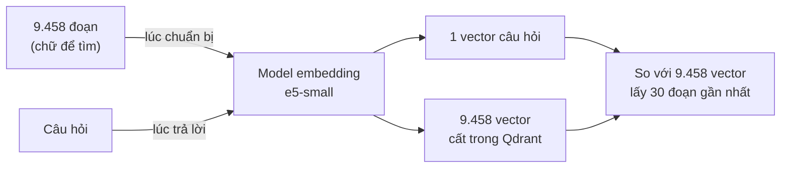

# Bài 10 — Biến mỗi đoạn thành một dãy số mang nghĩa: embedding

*Cập nhật 14:17, ngày 22/11/2026 · cấu hình chép từ hệ thống đang chạy sáng 22/11, đối chiếu lại chương trình lúc 13:47; số của các phép so lấy từ các báo cáo đo ngày 29/08, 24–25/10 và 30/10; người viết không chạy lại phép đo nào; riêng bước tìm của ví dụ chính được chạy lại sáng 22/11 để lấy điểm số từng đoạn (không gọi model viết).*

**Bài trước đã biết:** kho 266 bài đã được cắt thành 9.458 đoạn, và mỗi đoạn có một "chữ để tìm" gồm tên bài, tên các mục chứa nó, và thân đoạn.
**Bài này thêm:** làm sao để máy, khi nhận một câu hỏi, biết đoạn nào trong 9.458 đoạn nói về cùng một chuyện với câu hỏi, kể cả khi hai bên dùng chữ khác nhau; vì sao chọn model này; và model đó không chạy được thì sao.

## Ý chính

- Một **model embedding** nhận một đoạn chữ và trả về một dãy số có độ dài cố định, gọi là **vector**. Hai đoạn chữ gần nghĩa thì hai vector gần nhau.
- hue_rag dùng model **multilingual-e5-small**: mỗi đoạn thành một vector 384 con số. Model chạy ngay trên máy chủ, không gọi dịch vụ ngoài, không tốn tiền.
- Lúc chuẩn bị, cả 9.458 đoạn đi qua model một lần. Lúc trả lời, chỉ câu tìm đi qua model, rồi máy tìm 30 vector gần nhất. Hai phía phải được tính theo cùng một cách: cùng model, cùng phiên bản, đúng tiền tố, cùng dạng chữ có dấu.
- Đã so với năm model khác, trong đó có một model lớn hơn khoảng 70 lần. Không model nào tìm tốt hơn rõ trên các bộ câu đã đo; model lớn giúp 2 câu, làm hỏng 3 câu trên 40 câu, và chậm hơn khoảng 100 lần.
- Tìm theo nghĩa có chỗ yếu riêng (tên riêng, con số), nên nó không đứng một mình: bài 11 thêm một bước chấm lại 30 ứng viên theo chữ trùng.

## Từ dùng trong bài

| Tên trong bài | Tên gốc | Nghĩa |
|---|---|---|
| vector | **embedding**, **dense vector** | dãy 384 con số đại diện cho nghĩa của một đoạn chữ |
| model embedding | **embedding model**; ở đây là **intfloat/multilingual-e5-small** | model đổi chữ thành vector; khác với model viết |
| số chiều | **dimension** | số con số trong một vector; ở đây là 384 |
| độ gần | **cosine similarity** | số từ −1 tới 1 đo hai vector giống nhau tới đâu; càng gần 1 thì hai đoạn chữ càng gần nghĩa |
| tiền tố | **prefix** `query: ` / `passage: ` | chữ thêm vào đầu câu hỏi / đầu đoạn để model e5 biết đang đọc loại nào |
| tìm theo nghĩa | **dense retrieval**, **semantic search** | tìm các đoạn có vector gần vector câu hỏi nhất |

## So chữ trùng không đủ để biết hai đoạn chữ có cùng chuyện không

Cách tìm dễ nghĩ ra nhất là so chữ: đoạn nào có nhiều chữ trùng với câu hỏi thì lấy. Cách này hỏng khi người hỏi và người viết bài nói cùng một chuyện bằng chữ khác nhau: người hỏi gõ theo cách nói thường ngày, bài trong kho viết theo cách của văn bản.

Cần thêm một cách so hai đoạn chữ theo **nghĩa**. Embedding là cách đó. (Cách so chữ vẫn được dùng, ở bài 11; hai cách bù cho nhau.)

## Model embedding đổi một đoạn chữ thành 384 con số

Model embedding là một model ngôn ngữ nhỏ được huấn luyện cho đúng một việc: nhận một đoạn chữ, trả ra một dãy số. Với model hue_rag dùng, dãy đó luôn có 384 con số, dù đoạn chữ dài hay ngắn.

Từng con số riêng lẻ không có nghĩa gì với người đọc. Thứ có nghĩa là **hai dãy giống nhau tới đâu**: model được huấn luyện sao cho hai đoạn chữ gần nghĩa cho ra hai dãy số gần giống nhau. Mức giống đó được tính thành một con số gọi là **độ gần cosine**; hai dãy giống hệt thì độ gần bằng 1.

Số thật của ví dụ chính, câu *"Giá vé tham quan Đại Nội Huế là bao nhiêu?"*:

| So câu hỏi với | Độ gần |
|---|---|
| đoạn đứng đầu (nói về các dịch vụ thu phí riêng trong Đại Nội, có nhắc giá vé vào cổng) | 0,904 |
| đoạn đứng thứ 30, đoạn cuối cùng còn được lấy | 0,883 |
| một đoạn không liên quan (dòng ghi trang Facebook của một quán cà phê) | 0,743 |

Hai điều đọc được từ bảng. Đoạn nói đúng chuyện có độ gần cao hơn đoạn không liên quan. Nhưng các con số nằm rất sát nhau: hạng 1 và hạng 30 chỉ chênh 0,02. Vì vậy hệ thống chỉ dùng độ gần để **xếp thứ tự**, không dùng nó như một điểm tuyệt đối kiểu "trên 0,9 là đúng".

Model này không trả lời câu hỏi, không viết được gì. Nó chỉ cho phép so nghĩa bằng phép tính.

## Lúc chuẩn bị tính cho 9.458 đoạn, lúc trả lời chỉ tính cho câu hỏi

**Lúc chuẩn bị.** "Chữ để tìm" của từng đoạn được đưa qua model. Kết quả là 9.458 vector, cất vào Qdrant cùng với chữ của đoạn (bài 12). Việc này làm một lần cho mỗi phiên bản của kho.

**Lúc trả lời.** Câu hỏi *"Giá vé tham quan Đại Nội Huế là bao nhiêu?"* đi qua đúng model đó và thành một vector. Qdrant so vector này với 9.458 vector đã cất và trả về **30 đoạn gần nhất**, gọi là 30 **ứng viên**. Ở lượt hỏi thật của ví dụ này, việc tính vector câu hỏi cộng với việc tìm trong Qdrant mất 36 mili giây.

30 ứng viên chưa phải kết quả cuối. Chúng còn được chấm lại theo từ khoá; rồi thứ tự theo nghĩa và thứ tự theo từ khoá được trộn lại để giữ 10 đoạn (bài 11, 13). Mỗi lần tìm khác trong một lượt hỏi (trợ lý tìm thêm, hay tìm riêng cho từng ý của tin nhiều ý) cũng đi đúng đường này với câu tìm của nó.

## Hai phía chỉ so được với nhau khi được tính theo cùng một cách

Vector của đoạn được tính từ trước, vector của câu hỏi được tính lúc hỏi. Phép so chỉ có nghĩa nếu hai phía được tính theo cùng một cách. hue_rag giữ ba điều:

- **Cùng một model, cùng một phiên bản.** Chương trình ghi cố định một mã phiên bản của model. Tải lại sau này vẫn ra đúng model đó, nên vector của kho và vector của câu hỏi không lệch nhau mà không ai biết.
- **Đúng tiền tố.** Họ model e5 được huấn luyện với một quy ước: đoạn tài liệu bắt đầu bằng `passage: `, câu hỏi bắt đầu bằng `query: `. Chương trình tự thêm hai tiền tố này.
- **Cùng một dạng chữ có dấu.** Một chữ tiếng Việt có dấu có thể được lưu trong máy theo hai cách mà mắt nhìn giống hệt. Kho được lưu theo một dạng chuẩn; chương trình đưa câu hỏi về đúng dạng đó trước khi tính. Đã đo trên 108 câu được máy đổi sang dạng kia: đoạn đúng bị đẩy xuống thấp hơn rõ, còn số câu có đủ đoạn đúng trong 10 đoạn thì gần như không đổi.

## Giữ model nhỏ vì các model lớn hơn không tìm tốt hơn trên bộ câu của dự án

multilingual-e5-small không được chọn vì nó được cho là tốt nhất. Nó được giữ vì trong các model đã so, không model nào tìm tốt hơn nó một cách rõ ràng; và trong ba model được đo cả chất lượng lẫn tốc độ, nó nhanh nhất. Nó chạy được trên máy không cần card đồ hoạ.

Lần so đáng nhớ nhất: thay nó bằng một model lớn hơn khoảng 70 lần, phải gọi qua mạng. Trên 40 câu, model lớn giúp được 2 câu, làm hỏng 3 câu, và chậm hơn khoảng 100 lần. Số đủ của hai lần so ở mục "Đã so".

## Quyết định và lý do

### 1. Vì sao dùng multilingual-e5-small?

- **Đã chọn:** multilingual-e5-small, vector 384 con số.
- **Vì sao:** đã đo hai lần (mục trên; số đủ ở "Đã so"): không model nào tìm tốt hơn rõ, và e5-small nhanh gấp 2 tới 2,6 lần hai model 768 chiều.
- **Cách khác:** e5-base, một model tiếng Việt, MiniLM-L12, hai model Qwen3: đã đo, không chọn.
- **Cái giá:** hai model 768 chiều chưa từng được chấm trên toàn kho; "e5-base có tốt hơn trên toàn kho không" là câu chưa đo.

### 2. Vì sao model embedding chạy ngay trên máy chủ, không gọi một dịch vụ qua mạng?

- **Đã chọn:** chạy trên CPU của máy chủ, không cần card đồ hoạ.
- **Vì sao:** đã đo ở lần thử model lớn qua mạng: thời gian tính vector câu hỏi và tìm từ 21 lên 2.228 mili giây ở câu đứng giữa, có lần dịch vụ treo hơn một phút; câu hỏi của người dùng phải gửi ra ngoài; thêm tiền ở mỗi câu.
- **Cách khác:** gọi model lớn qua mạng: đã đo, bỏ. Dịch vụ embedding trả tiền của các hãng lớn: chưa thử.
- **Cái giá:** máy chủ phải nạp model lúc bật (mục "Nếu… thì sao", dòng 1).

### 3. Vì sao vector của các đoạn được tính sẵn lúc chuẩn bị, chỉ câu hỏi mới tính lúc hỏi?

- **Đã chọn:** 9.458 vector tính một lần, cất vào Qdrant; lúc hỏi chỉ tính một vector cho câu tìm.
- **Vì sao:** lập luận từ số đo: tính vector cho cả kho mất khoảng 195 giây (đo sáng 22/11); tính cho một câu hỏi và tìm mất khoảng 36 mili giây.
- **Cách khác:** chưa thấy ai đề xuất. Khi sửa vài bài, chỉ đoạn đổi chữ được tính lại (bài 12).
- **Cái giá:** đổi model embedding là phải tính lại vector cho cả kho.

### 4. Vì sao lấy 30 ứng viên?

- **Đã chọn:** 30 đoạn gần nhất theo nghĩa là đầu vào của bước chấm từ khoá và bước trộn.
- **Vì sao:** chưa thấy ghi lý do lúc đặt 30. Điều thấy được: đã thử lấy 100 ứng viên, kém hơn, mất đoạn đúng ở 1 câu (bài 13); 200 chỉ được đếm ở một phép chẩn đoán.
- **Cách khác:** 100: đã đo, bỏ.
- **Cái giá:** đoạn không lọt 30 ứng viên thì không bước nào sau cứu được: 7 trên 40 câu ở lần đo cuối tháng 10.

### 5. Vì sao không đặt ngưỡng độ gần, dưới ngưỡng thì coi như kho không có?

- **Đã chọn:** không có ngưỡng; bước tìm luôn trả về 30 đoạn gần nhất.
- **Vì sao:** chưa thấy ghi lý do. Điều thấy được: độ gần dồn vào một dải hẹp: ở ví dụ chính, hạng 1 là 0,904, hạng 30 là 0,883, một đoạn không liên quan vẫn 0,743. Việc nhận ra "không đoạn nào trả lời được" được giao cho model viết (bài 15, 16).
- **Cách khác:** ngưỡng độ gần: chưa thử.
- **Cái giá:** câu kho không có vẫn đưa đủ đoạn cho model và tốn một lần gọi model trước khi bị từ chối.

## Nếu… thì sao

Đọc từ chương trình; người viết chưa thử lại các dòng này.

| Nếu | Hệ thống làm gì | Người dùng thấy gì | Đã có chưa / ai làm gì |
|---|---|---|---|
| model embedding không nạp được lúc bật máy chủ (thiếu bản tải sẵn, lỗi tải) | phần tìm kho không sẵn sàng; trang web vẫn mở | mọi câu hỏi và mọi lần lập lịch: "Hệ thống tra cứu tạm thời không khả dụng."; trang Khám phá không có danh sách bài; các trang khác vẫn chạy | người vận hành sửa chỗ thiếu rồi khởi động lại máy chủ |
| tính vector câu hỏi lỗi giữa lúc đang chạy | lượt hỏi đó dừng | cùng lời báo trên, kèm nút "Thử lại" | người dùng bấm "Thử lại" |
| câu gõ không dấu | vẫn tìm, nhưng vector và từ khoá lệch xa kho có dấu | hay nhận câu từ chối | ngoài phạm vi của đồ án: người dùng được coi là gõ có dấu |
| câu có dấu ở dạng lưu khác (nhìn giống hệt) | chương trình đưa về dạng chuẩn trước khi tính | không thấy khác | đã có |
| đổi sang một model embedding khác | đổi bằng file cấu hình: máy chủ không bật, vì chương trình kiểm cấu hình chỉ nhận model đang dùng. Sửa trong chương trình mà chưa dựng lại chỉ mục: bản ghi chỉ mục (ghi tên và phiên bản model) không khớp | lần lượt: không vào được trang nào; "Dữ liệu tra cứu cần được lập chỉ mục lại." | sửa chương trình kiểm, dựng lại toàn bộ chỉ mục (khoảng 225 giây với kho hiện nay); chưa ai làm |
| kho lớn gấp mười | phần tính vector lúc chuẩn bị tăng theo số đoạn; lúc hỏi vẫn chỉ tính một vector | — | lập luận, chưa đo: dựng lại toàn bộ lâu hơn nhiều; cập nhật vài bài vẫn chỉ tính đoạn đổi chữ |

## Dễ nhầm

- **"Model embedding hiểu câu hỏi rồi chọn đoạn."** Không. Nó chỉ đổi chữ thành số. Việc chọn là một phép so khoảng cách, không có suy luận nào.
- **"Model embedding và model viết là một."** Không. Model embedding là e5-small, chạy trên máy, 0 đồng. Model viết là một model lớn gọi qua mạng, tính tiền theo lượt.
- **"Vector càng nhiều con số, model càng lớn thì tìm càng đúng."** Không đúng trên bộ câu của dự án: vector 4.096 con số từ model lớn hơn khoảng 70 lần giúp 2 câu và làm hỏng 3 câu trên 40 câu.

## Câu hỏi tự kiểm

1. Độ gần 0,904 của đoạn đứng đầu nói lên điều gì, và không nói lên điều gì?

Nó nói đoạn đó gần câu hỏi hơn các đoạn khác, nên được xếp trên. Nó không nói đoạn đó chắc chắn trả lời được: hạng 30 vẫn 0,883, một đoạn không liên quan vẫn 0,743. Vì vậy độ gần chỉ dùng để xếp thứ tự.

2. Vì sao giữ model nhỏ khi đã thử một model lớn hơn khoảng 70 lần?

Trên 40 câu, model lớn giúp 2 câu, làm hỏng 3 câu, chậm khoảng 100 lần vì phải gọi qua mạng. Luật ghi trước là không câu nào đang đủ được thành thiếu, nên model lớn bị loại.

3. Ba điều nào phải giữ để vector câu hỏi so được với vector của kho?

Cùng model và cùng phiên bản; đúng tiền tố `query: ` / `passage: `; câu hỏi được đưa về cùng dạng chữ có dấu với kho.

4. Model embedding không nạp được lúc bật máy chủ thì người dùng thấy gì?

Trang web vẫn mở, nhưng mọi câu hỏi và mọi lần lập lịch nhận "Hệ thống tra cứu tạm thời không khả dụng.", trang Khám phá không có danh sách bài, cho tới khi người vận hành sửa chỗ thiếu và khởi động lại máy chủ.

## Cấu hình đang chạy

*Chép từ hệ thống đang chạy sáng 22/11/2026. Cấu hình đổi thì mục này phải chép lại.*

| Mục | Giá trị | Dùng để làm gì, vì sao là giá trị này | Đã thử giá trị khác chưa |
|---|---|---|---|
| Model embedding | `intfloat/multilingual-e5-small` | model đa ngữ có tiếng Việt; nhanh nhất trong ba model được đo cả chất lượng lẫn tốc độ | đã so 5 model khác (mục "Đã so") |
| Phiên bản model | ghi cố định một mã phiên bản | tải lại vẫn ra đúng model đã dùng để tính vector của kho | không áp dụng |
| Số chiều | 384 | do model quy định, không chỉnh được | 768 và 4.096, qua việc thử model khác |
| Độ dài tối đa model đọc được | 512 token | giới hạn của model. Bước cắt đoạn còn chặt hơn: mỗi đoạn phải vừa cả giới hạn 256 token của một model ứng viên cũ, nên không đoạn nào bị cắt cụt | đã thử chỉ giữ giới hạn 512: số đoạn ít đi 61, kết quả tìm không khác (bài 8) |
| Tiền tố | `passage: ` cho đoạn, `query: ` cho câu hỏi | quy ước huấn luyện của họ model e5 | chưa đo việc bỏ tiền tố |
| Chuẩn hoá độ dài vector | có, mọi vector có độ dài 1 | để độ gần cosine chỉ phụ thuộc hướng | chưa thử |
| Cách đo độ gần | cosine | đi cùng việc chuẩn hoá ở trên | chưa thử |
| Nơi chạy | CPU của máy chủ, số thực 32 bit | không cần card đồ hoạ, không gửi câu hỏi ra dịch vụ ngoài ở bước này | đã thử gọi model qua mạng (model lớn, đã bỏ) |
| Số đoạn tính mỗi lô lúc chuẩn bị | 8 | ảnh hưởng tốc độ; gần như không ảnh hưởng kết quả (chưa đo) | chưa so |
| Số ứng viên lấy ra | 30 | đầu vào cho bước chấm lại theo từ khoá (bài 13) | đã thử 100: kém hơn, mất đoạn đúng ở 1 câu (200 chỉ được đếm ở một phép chẩn đoán; bài 13) |
| Chuẩn hoá chữ có dấu của câu hỏi | có (dạng NFC) | kho ở dạng này; câu hỏi dạng khác làm lệch cả vector lẫn từ khoá | đã đo có và không có |
| Tên phương án trong file cấu hình | `candidate_id: e5-small-384` (mục `full_corpus_runtime`) | hệ thống đọc dòng này để biết dùng bộ chỉ mục nào | — |

Trong file cấu hình còn tên hai model ứng viên cũ (multilingual-e5-base và một model tiếng Việt). Chúng không được dùng để tìm; bước cắt đoạn dùng giới hạn độ dài của cả ba model để kiểm mỗi đoạn (bài 8).

## Đã so

### Lần 1 — chọn model, khi kho mới có nhóm bài món ăn

**Vấn đề.** Phải chọn một model embedding cho tiếng Việt. Có model đa ngữ nhỏ, model đa ngữ lớn hơn, và model làm riêng cho tiếng Việt; không biết trước cái nào hợp với bài viết về Huế.

**So gì, trên bộ nào.** Năm model, cùng một bộ 45 câu hỏi về món ăn, trên 572 đoạn (kho lúc đó chỉ có nhóm món ăn). Thước chính là **nDCG@5**: một điểm từ 0 tới 1 cho biết đoạn đúng đứng cao tới đâu trong 5 đoạn đầu; bằng 1 nghĩa là đoạn đúng luôn đứng đầu. Luật ghi trước khi đo: một model chỉ được coi là "thắng rõ" khi điểm này hơn mốc ít nhất 0,03, mức hơn đó không phải do may (khoảng tin cậy không chứa 0), và không nhóm câu nào bị tụt.

| Model | Số câu có đoạn đúng trong 5 đoạn đầu (trên 45) | nDCG@5 | Thời gian tìm, câu ở giữa | Kết luận |
|---|---|---|---|---|
| multilingual-e5-small (mốc) | 41 | 0,7425 | 27 mili giây | **giữ** |
| multilingual-e5-base (lớn hơn, 768 chiều) | 42 | 0,7061 | 57 mili giây | không thắng rõ |
| model tiếng Việt (768 chiều) | 40 | 0,7164 | 71 mili giây | không thắng rõ |
| MiniLM-L12 | — | 0,4709 | — | loại: 83 đoạn (14,5 %) dài quá giới hạn của model nên bị cắt cụt |
| Qwen3-Embedding-0.6B | — | 0,6175 | — | loại: tính 572 đoạn trên CPU mất khoảng 765 giây |

**Đọc bảng này thế nào.**
- Ba model đầu sát nhau: chênh 1–2 câu trên 45, và điểm của hai model lớn hơn còn thấp hơn mốc một chút.
- Không model nào đạt luật "thắng rõ", nên không có lý do về chất lượng để bỏ mốc.
- Khi chất lượng ngang nhau, model nhỏ thắng về tốc độ: nhanh gấp 2 tới 2,6 lần so với hai model 768 chiều.

**Đã chọn: giữ multilingual-e5-small.**

**Giới hạn của phép đo.** Chỉ đo trên nhóm món ăn, 45 câu, với cách cắt đoạn của thời điểm đó. Hai model 768 chiều chưa từng được chấm lại trên toàn kho. Nếu bị hỏi "e5-base có tốt hơn trên toàn kho không" thì câu trả lời đúng là: chưa đo.

### Lần 2 — thử một model lớn hơn khoảng 70 lần, trên toàn kho

**Vấn đề.** Lượt đo chất lượng cho thấy ở một phần câu hỏi, đoạn chứa đáp án không lọt vào 10 đoạn đưa cho model viết. Giả thuyết đem thử: model embedding nhỏ quá nên hiểu nghĩa kém; thay model lớn sẽ khá hơn.

**So gì, trên bộ nào.** Thay e5-small bằng Qwen3-Embedding-8B (khoảng 8 tỉ tham số so với khoảng 118 triệu; vector 4.096 con số; phải gọi qua một dịch vụ trên mạng). Đo trên 40 câu có đánh dấu sẵn đoạn nào chứa đáp án, rồi kiểm lại trên 15 câu khác không dùng để chọn. Thước: với mỗi câu, 10 đoạn đưa cho model viết có chứa **đủ** các đoạn đúng không. Luật ghi trước: phải tốt lên rõ (không phải do may), và không câu nào đang đủ được phép thành thiếu; thời gian chậm thêm được theo dõi so với mức 50 mili giây.

| Đo gì | e5-small (đang dùng) | Qwen3-8B | Nghĩa là |
|---|---|---|---|
| 40 câu: tốt lên / như cũ / tụt | mốc | 2 / 35 / 3 | 3 câu đang đủ đoạn đúng thành thiếu ⇒ phạm luật |
| Tỉ lệ câu có đủ đoạn đúng trong 10 đoạn (40 câu) | 0,600 | 0,575 | không tăng mà còn giảm nhẹ |
| 15 câu kiểm lại: tốt lên / như cũ / tụt | mốc | 2 / 10 / 3 | lặp lại đúng hiện tượng đó |
| Thời gian tính vector câu hỏi và tìm (câu ở giữa / câu chậm) | 21 / 28 mili giây | 2.228 / 6.487 mili giây | chậm khoảng 100 lần |
| Tiền | 0 | 0,0089 USD cho cả lượt thử | nhỏ, nhưng thành tiền thêm ở mỗi câu hỏi |

**Đọc bảng này thế nào.**
- Model lớn giúp 2 câu và làm hỏng 3 câu. Tính gộp là không khá hơn.
- Nó chậm hơn khoảng 100 lần vì phải gọi qua mạng, và có những lần chờ rất lâu ở phía dịch vụ.
- Với model nhỏ, 16 trên 40 câu thiếu đoạn đúng trong 10 đoạn. Trong 16 câu đó: ở **9 câu** đoạn đúng đã nằm trong 30 ứng viên nhưng đứng dưới hạng 10 (hỏng ở thứ tự, đổi model embedding không chữa được); ở **7 câu** đoạn đúng không lọt 30 ứng viên (hỏng ở chính bước tìm theo nghĩa).
- Model lớn cũng không chữa được 7 câu kia: số câu có đủ đoạn đúng trong 30 ứng viên của nó là 31 trên 40, ít hơn 33 của model nhỏ. Trên 15 câu kiểm lại thì ngược chiều (13 so với 11), tức không có lợi thế ổn định.

**Đã chọn: giữ multilingual-e5-small, xoá chỉ mục thử.**

**Giới hạn của phép đo.** 40 và 15 câu là bộ nhỏ, chỉ thấy được khác biệt lớn. Kết luận "model lớn không khá hơn" đúng cho model này trên bộ câu này, không phải cho mọi model lớn.

## Quyết định nhỏ hơn

**Vì sao không huấn luyện thêm model embedding trên dữ liệu về Huế?** Chưa thử. Các lượt đo từ cuối tháng 10 cho thấy phần thiếu lớn hơn nằm ở thứ tự xếp (9 trên 16 câu thiếu là do đoạn đúng đã có trong 30 ứng viên nhưng đứng ngoài 10), nên nhóm làm ở bước tìm và ở số đoạn đưa cho model viết (bài 13). Lần 2 sau đó cho thấy thay model lớn hơn cũng không giúp.

**Vì sao 384 chiều là đủ?** Chưa đo riêng số chiều. Căn cứ gián tiếp: model 768 chiều và 4.096 chiều đều không tìm tốt hơn trên bộ câu của dự án.

**Vì sao ghim mã phiên bản của model?** Để tải lại sau này vẫn ra đúng model đã tính vector của kho; bản ghi chỉ mục ghi cả mã đó và máy chủ so lúc bật.

## Giới hạn đã biết

- **Câu gõ không dấu.** Đã đo trên 32 câu, cả bước tìm (vector và từ khoá), trên kho cuối tháng 10, câu không dấu do máy bỏ dấu, đếm đoạn đúng trong 5 đoạn đầu: có dấu thì 13 câu có đủ đoạn đúng, bỏ dấu còn 1 câu. Câu không dấu được xếp ngoài phạm vi của đồ án; người dùng gõ không dấu sẽ hay nhận câu từ chối.
- **Tên riêng và con số.** Vector mang nghĩa chung của cả đoạn, không giữ chính xác từng chữ. Hai đoạn về hai quán khác nhau có thể có vector rất gần nhau. Bài 11 thêm từ khoá để bù chỗ này.
- **Đoạn không lọt 30 ứng viên thì không được xét nữa.** Bước chấm theo từ khoá chỉ chấm lại 30 ứng viên này, không tìm lại trên cả kho. Một đoạn trùng chữ y hệt câu hỏi nhưng không lọt 30 theo nghĩa sẽ bị bỏ sót.
- **Bước tìm luôn trả về 30 đoạn**, kể cả khi kho không có gì liên quan. Việc nhận ra "không đoạn nào trả lời được" là của model viết (bài 15, 16).

## Chi tiết để tra

- Lần 1 đo ngày 29/08/2026 trên bản thử chỉ có nhóm món ăn; mỗi model chạy 3 lần lặp; khoảng tin cậy tính bằng cách rút lại bộ câu 10.000 lần. Mức chênh nDCG@5 so với mốc: e5-base −0,0364, model tiếng Việt −0,0262; cả hai khoảng tin cậy đều chứa 0.
- Lần 2 đo ngày 30/10/2026 trên kho của thời điểm đó (trước các đợt bổ sung kho giữa tháng 11). Lượt đo lặp lại cho thời gian 2.305 / 7.240 mili giây; trên 15 câu kiểm lại có lần dịch vụ treo hơn một phút.
- Con số "khoảng 70 lần" là tỉ lệ số tham số của hai model theo thông tin công khai của chúng (khoảng 8 tỉ và khoảng 118 triệu), không phải số đo của dự án.
- Ba độ gần 0,904 / 0,883 / 0,743 lấy bằng cách chạy lại riêng bước tìm cho câu ví dụ chính sáng 22/11, lúc kho có 9.442 đoạn (không gọi model viết); cùng lần chạy đó, 10 đoạn giữ lại trùng với 10 đoạn của lượt hỏi thật ngày 21/11.
- Số 36 mili giây là của một lượt hỏi ngày 21/11; số 21 / 28 mili giây là số đo trên 40 câu ngày 30/10. Hai số đo ở hai thời điểm, kho khác cỡ, không so thẳng với nhau.
- Số đo "thứ hạng tụt khi câu hỏi ở dạng chữ có dấu khác": điểm MRR (điểm từ 0 tới 1 theo vị trí của đoạn đúng đầu tiên) giảm 0,20; đưa về dạng chuẩn thì trở lại như cũ.
- Qdrant tìm 30 vector gần nhất bằng một cách tìm gần đúng (tên là HNSW), không so lần lượt với cả 9.458 vector. Đã đo trên kho cuối tháng 10: kết quả giống hệt cách tìm chính xác ở 108 trên 108 câu.
- Dựng lại vector cho cả kho nằm trong việc dựng lại chỉ mục, cả việc mất khoảng 225 giây. Khi chỉ sửa vài bài, hệ thống chỉ tính lại vector cho những đoạn đổi chữ (bài 12).

**Bài sau (bài 11):** tìm theo nghĩa yếu ở tên riêng và con số. Bài 11 giảng cách thứ hai, tìm theo chữ trùng (BM25), và vì sao hai cách được dùng cùng nhau.

Nguồn (để giữ bài đúng — anh không cần đọc)

- Model, mã phiên bản, 384 chiều, 512 token, CPU, float32, lô 8: `backend/embedding/full_corpus.py`, `DENSE_MODEL_SPECS` [code, đọc 22/11/2026]; khớp bản ghi chỉ mục `data/full_corpus_builds/hue_full_corpus_7a2_e5_small_384.json` (`dense.*`, `qdrant.distance: cosine`) [đã chạy].
- Tiền tố `passage: ` / `query: `: cùng file, hàm `prepare_document`, `prepare_query`; chuẩn hoá độ dài: `normalize_embeddings=True` ở `embed_documents_matrix`, `embed_queries` [code].
- Tìm gần đúng HNSW giống tìm chính xác 108 / 108 câu: `bao_cao_he_thong/91_BAO_CAO_SO_SANH_PHUONG_AN.md` thẻ N2-15 = T3-04 [đã chạy, kho cũ]. Chỉ giữ giới hạn 512 ⇒ ít đi 61 đoạn, không khác: thẻ N2-05; 100 ứng viên kém hơn (200 chỉ đếm ở phép chẩn đoán T3-01): thẻ T3-03 [theo biên bản kiểm độc lập `data/hoc_cung_D/kiem/bai_02_10.md`].
- Chuẩn hoá NFC câu hỏi và số MRR −0,204 (108 câu do máy đổi dạng; số câu đủ đoạn đúng trong 10 đoạn "không khác"): `backend/retrieval/full_corpus.py`, hàm `normalize_query` (chú thích trong code); `bao_cao_he_thong/91_BAO_CAO_SO_SANH_PHUONG_AN.md` thẻ T3-05 [đã chạy].
- 30 ứng viên; từ khoá chỉ chấm lại 30 ứng viên của bước tìm theo nghĩa: `backend/retrieval/full_corpus.py`, hàm `search` (`candidate_pool = 30`, nhánh `dense_bm25_rrf`) [code].
- 9.458 đoạn, 266 bài: bản ghi chỉ mục và số điểm Qdrant, đọc 10:02 22/11/2026 [đã chạy].
- 36 mili giây (`dense_ms` của lượt ví dụ chính): `data/hoc_cung_D/vi_du_di_suot_vet.json` [đã chạy, riêng tư].
- Độ gần 0,904 (hạng 1), 0,883 (hạng 30), 0,743 (đoạn `foods/cafes/…#7`, một dòng ghi fanpage): chạy riêng bước tìm bằng `data/hoc_cung_D/tools/vet_tim.py`, kết quả ở `data/hoc_cung_D/vet_tim_ba_vi_du.json` [người viết chạy 22/11/2026, không gọi model viết, 0 đồng].
- 16 câu thiếu = 9 (đủ trong 30 ứng viên, ngoài 10) + 7 (thiếu ngay trong 30 ứng viên); 33 ⇒ 31 trên 40 và 11 ⇒ 13 trên 15 câu có đủ đoạn đúng trong 30 ứng viên: `report_agent/2026-10-27_phan_ton_phase_cu/qwen3_8b_implementation.md` (dòng "dev 40: context đủ 24, pool dense 33, thiếu ở context 16, thiếu ngay ở pool dense 7"; dòng `pool_dense_gold_all` 0,825 ⇒ 0,775 và 0,733 ⇒ 0,867) [đã chạy].
- Lần 1 (41 / 42 / 40 câu trên 45; nDCG@5 0,7425 / 0,7061 / 0,7164; 27,40 / 57,09 / 71,24 mili giây; MiniLM-L12 0,4709, cắt cụt 83 đoạn; Qwen3-0.6B 0,6175, khoảng 765 giây; luật "thắng rõ"; 3 lần lặp, bootstrap 10.000): `bao_cao_he_thong/91_BAO_CAO_SO_SANH_PHUONG_AN.md` thẻ N2-07 [đã chạy; báo cáo ghi nhãn "chưa kiểm lại Phase 0–7", "kho, cấu hình cũ"]. Hai model 768 chiều chưa chấm trên toàn kho: cùng file, thẻ N2-08.
- Lần 2 (2 / 35 / 3; 0,600 ⇒ 0,575; 2 / 10 / 3; 21 / 28 ⇒ 2.228 / 6.487 mili giây; lần lặp 2.305 / 7.240; 0,0089 USD; 9 / 40 câu có đoạn đúng trong 30 ứng viên nhưng ngoài 10): `report_agent/2026-10-27_phan_ton_phase_cu/qwen3_8b_implementation.md` [đã chạy; có biên bản review riêng `qwen3_8b_review.md`]. Chi tiết "9 / 40" chép qua `bai_hoc/04_EMBEDDING_VA_TU_KHOA.md` (bài đã qua kiểm độc lập 11/11).
- Không dấu 1 / 32 so với 13 / 32: `bai_hoc/04_EMBEDDING_VA_TU_KHOA.md` mục "Khi nào hỏng", nguồn gốc ở `bao_cao_he_thong/91_BAO_CAO_SO_SANH_PHUONG_AN.md` thẻ N2-11, N2-13 [đã chạy, kho cũ].
- Bước cắt đoạn kiểm giới hạn của cả ba model trong cấu hình: `backend/ingestion/chunking/full_corpus_chunker.py` (hàm kiểm lặp qua `full_corpus.embedding_models`) và `backend/config/settings.yaml` [code].
- 225 giây dựng lại chỉ mục: `guides/RUNBOOK_BAN_GIAO.md` mục 5b [đã chạy, phiên khác đo].
- Cỡ hai model (8 tỉ, 118 triệu tham số): thông tin công khai, chưa tra lại trong phiên này.
- Mục "Quyết định và lý do", "Nếu… thì sao", "Quyết định nhỏ hơn", "Câu hỏi tự kiểm" (thêm 13:47 22/11/2026 theo khuôn mới; gom từ "Đã so", bảng cấu hình, mục "Vì sao không làm cách khác" cũ). Khoảng 195 giây tính vector cho cả kho (9.436 đoạn, sáng 22/11): `bai_hoc/VIEC_MOI_XONG.md` mục 32 [đã chạy]. Model không nạp được lúc bật ⇒ lỗi phụ thuộc, không phải chỉ mục cũ: `backend/retrieval/full_corpus.py`, `build_full_corpus_retrieval_service` bước 4 (chú thích C-01) và `backend/api/app.py` (lời báo) [code, chưa thử]. Tính vector câu hỏi lỗi lúc chạy ⇒ cùng lời báo: `search` ("Dense query embedding failed") và `backend/api/routes/chat.py` [code, chưa thử]. Bản ghi chỉ mục kiểm `model_id`, `revision`, `dimension`, `candidate_id`: `full_corpus.py` (các lỗi "Dense … mismatch") [code]. Lý do đặt 30 ứng viên và lý do không có ngưỡng: người viết dò chú thích quanh `candidate_pool` và `search`, không thấy. 7 / 40 câu thiếu ngay trong 30 ứng viên: dòng Nguồn về lần 2 ở trên. Người dùng gõ có dấu là phạm vi của sản phẩm: `session_prompt/HIEN_TRANG.md` mục 4 "Sản phẩm" [quyết định đã ghi]. Câu "mỗi lần tìm khác trong lượt hỏi cũng đi đường này": `backend/llm/assistant.py` (lần tìm của công cụ tìm kho và `cac_ve_tim` gọi cùng dịch vụ tìm) [suy từ code].
- Các mục mới đã qua một lượt đối chiếu độc lập (một agent khác chỉ đọc, 22/11/2026), các dòng sai / lệch đã sửa lúc 14:17: `data/hoc_cung_D/kiem/muc_moi_02_07_11_va_phu_luc.md` [riêng tư]. `candidate_id` chỉ nhận `e5-small-384`: `backend/core/settings_loader.py` [code]. Trang Khám phá chỉ nạp khi phần tìm sẵn sàng: `backend/api/app.py` (`nap_kham_pha`) [code]. 200 ứng viên chỉ đếm ở phép chẩn đoán: bài 13 [chép].

