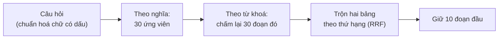

# Bài 13 — Tìm: lấy 30 ứng viên, trộn hai bảng xếp hạng, giữ 10 đoạn

*Cập nhật 10:30, ngày 22/11/2026 · cơ chế đọc từ chương trình đang chạy; số của ví dụ lấy từ lần chạy lại riêng bước tìm sáng 22/11 (không gọi model viết); số của các phép so lấy từ các báo cáo đo từ 24/10 tới 19/11, phần lớn với model viết gpt-6-luna; người viết không chạy lại phép đo nào.*

**Bài trước đã biết:** chặng 2: kho được cắt thành 9.458 đoạn, mỗi đoạn có vector và phần từ khoá, tất cả nằm trong Qdrant.
**Bài này thêm:** chặng 3 bắt đầu. Người dùng gõ một câu; trong vài chục mili giây chương trình chọn ra 10 đoạn. Bài này đi qua bốn bước của việc chọn đó, và chỉ ra bước tìm hỏng ở đâu.

## Ý chính

- Bước tìm có bốn việc nối nhau: chuẩn hoá câu hỏi, lấy **30 ứng viên** theo nghĩa, chấm lại 30 ứng viên theo từ khoá, **trộn hai bảng xếp hạng** rồi giữ **10 đoạn**.
- Hai bảng được trộn theo **thứ hạng**, không theo điểm, bằng một công thức tên là RRF: mỗi đoạn nhận `1 / (60 + hạng)` từ mỗi bảng. Đoạn đứng cao ở cả hai bảng thì lên đầu.
- Bước tìm không gọi model viết, và nó nhanh: vài chục mili giây một câu (26 tới 42 mili giây ở ba câu ví dụ).
- Khi hệ thống từ chối một câu mà kho có, chỗ chính phải xem là bước này: đoạn đúng không lọt vào 10 đoạn. Trên 40 câu khó, 16 câu thiếu đoạn đúng; 9 câu vì đoạn đúng đứng dưới hạng 10, 7 câu vì nó không lọt cả 30 ứng viên.
- Lấy nhiều ứng viên hơn (100 thay vì 30) không giúp. Đưa cho model viết nhiều đoạn hơn (10 thay vì 5) thì giúp rõ; đưa hơn 10 thì không khá hơn.

## Từ dùng trong bài

| Tên trong bài | Tên gốc | Nghĩa |
|---|---|---|
| tìm | **retrieval** | bước chọn các đoạn sẽ đưa cho model viết |
| tìm lai | **hybrid search** | dùng cả tìm theo nghĩa lẫn tìm theo từ khoá |
| RRF | **Reciprocal Rank Fusion** | cách trộn nhiều bảng xếp hạng: cộng `1 / (k + hạng)` của đoạn ở từng bảng |
| số đoạn đưa cho model | **top-k**; ở đây k = 10 | số đoạn đứng đầu được giữ lại sau khi trộn |
| từ chối nhầm | **false refusal** | kho có câu trả lời mà hệ thống vẫn nói "không đủ thông tin" |

## Bốn việc của bước tìm

1. **Chuẩn hoá câu hỏi.** Chữ có dấu được đưa về một dạng chuẩn, rồi câu hỏi được đổi thành vector (bài 10).
2. **Lấy 30 ứng viên theo nghĩa.** Qdrant trả về 30 đoạn có vector gần vector câu hỏi nhất, xếp từ gần tới xa. Đây là bảng xếp hạng thứ nhất.
3. **Chấm lại theo từ khoá.** BM25 chấm điểm đúng 30 đoạn đó theo chữ trùng với câu hỏi (bài 11). Đây là bảng xếp hạng thứ hai. Đoạn không trùng chữ nào thì không có mặt ở bảng này.
4. **Trộn và giữ 10.** Hai bảng được trộn thành một; 10 đoạn đứng đầu được đưa cho model viết.

## Hai bảng được trộn theo thứ hạng, không theo điểm

Điểm theo nghĩa là một số gần 0,9; điểm từ khoá có thể lên vài chục. Hai loại điểm không cùng thước, cộng thẳng thì bên có số to sẽ lấn át. Cách trộn ở đây bỏ qua điểm, chỉ nhìn **thứ hạng**: mỗi đoạn nhận từ mỗi bảng một lượng `1 / (60 + hạng)`, rồi cộng hai lượng lại. Hạng 1 được 1/61, hạng 2 được 1/62, hạng 30 được 1/90.

Số thật của ví dụ chính, câu *"Giá vé tham quan Đại Nội Huế là bao nhiêu?"*:

| Đoạn | Hạng theo nghĩa | Hạng theo từ khoá | Tổng sau khi trộn | Hạng cuối |
|---|---|---|---|---|
| các dịch vụ thu phí riêng trong Đại Nội, có nhắc giá vé vào cổng | 1 | 1 | 1/61 + 1/61 = 0,0328 | 1 |
| lưu ý phân biệt vé vào cửa với vé dịch vụ | 6 | 6 | 1/66 + 1/66 = 0,0303 | 2 |
| dòng bảng giá vé gộp 3 điểm | 19 | 3 | 1/79 + 1/63 = 0,0285 | 5 |
| một đoạn tư vấn chọn vé | 2 | 22 | 1/62 + 1/82 = 0,0283 | 7 |

Đọc bảng: đoạn đứng đầu ở cả hai bảng thì đứng đầu sau khi trộn. Đoạn đứng giữa ở cả hai bảng (6 và 6) thắng đoạn rất cao ở một bảng nhưng thấp ở bảng kia (2 và 22). Tức là cách trộn này thưởng cho đoạn được **cả hai cách tìm cùng đồng ý**.

Hai đoạn bằng điểm thì xếp theo mã của chúng trong cơ sở dữ liệu (sinh từ mã đoạn), để cùng một câu hỏi chạy lại lần nào cũng ra cùng thứ tự.

## Bước tìm nhanh và không dùng model viết

Ở ví dụ chính: tính vector câu hỏi và hỏi Qdrant mất 38 mili giây, chấm từ khoá 3,5 mili giây, trộn chưa tới 0,1 mili giây. Cả bước tìm 42 mili giây. Cả lượt hỏi đó mất 3,7 giây; gần như toàn bộ là lần gọi model viết (3,63 giây). Lần gọi model để xếp loại câu chạy cùng lúc nên không cộng thêm.

Bước tìm cũng **tất định**: cùng câu hỏi, cùng kho thì luôn ra cùng 10 đoạn. Nhờ vậy khi một câu trả lời sai, có thể chạy lại riêng bước tìm (không tốn tiền) để xem 10 đoạn đó là gì.

## Từ chối nhầm là lỗi của bước tìm

Model viết chỉ đọc các đoạn được đưa. Đoạn chứa đáp án không nằm trong đó thì model không thể trả lời, dù kho có; nó làm đúng lời dặn và trả câu từ chối. Người dùng thấy hệ thống "không biết" một điều mà kho có.

Rà 22 câu từ chối nhầm của bản đầu tiên (thời còn đưa 5 đoạn): cả 22 câu đều thiếu đoạn đúng trong phần đưa cho model; không câu nào có đủ đoạn mà model vẫn từ chối. Vậy muốn bớt từ chối nhầm thì chỗ chính phải sửa là bước tìm. Sửa lời dặn cũng đổi được con số này, nhưng kéo theo lỗi nặng hơn (bài 15).

Đoạn đúng bị rơi ở đâu? Trên 40 câu khó có đánh dấu sẵn đoạn chứa đáp án, 16 câu thiếu đoạn đúng trong 10 đoạn:

- **9 câu:** đoạn đúng có trong 30 ứng viên nhưng đứng dưới hạng 10. Hỏng ở thứ tự.
- **7 câu:** đoạn đúng không lọt cả 30 ứng viên. Hỏng ở bước tìm theo nghĩa; từ khoá không cứu được vì nó chỉ chấm lại 30 đoạn này.

Ví dụ "kho có mà tìm không ra" của cả bộ thuộc loại thứ hai. Câu *"Vào chùa ở Huế có phải cởi giày không?"*: bài chùa Thiên Mụ có một câu nói phải bỏ giày dép khi vào điện thờ, nhưng đoạn đó không được lấy ra ở lần tìm nào của lượt hỏi.

Số câu từ chối nhầm trên 158 câu hỏi mẫu có đáp án trong kho đã giảm qua ba mốc: 22 câu khi đưa 5 đoạn; 12 câu khi đưa 10 đoạn (cùng đợt đó còn hai thay đổi nhỏ khác, không tách riêng được: chuẩn hoá chữ có dấu và bộ kiểm số nguồn mới); và 3 câu ở lượt đo cả hệ thống ngày 12/11, sau khi trợ lý được tự tìm thêm (bài 21, 23). Các số này đo với model viết gpt-6-luna.

Ở trợ lý đang chạy còn một đường từ chối không do bước tìm: hết số vòng thì chương trình trả câu từ chối, kể cả khi các đoạn đã đủ (bài 21).

## Dễ nhầm

- **"Từ chối nhầm là do model viết kém."** Ở lần rà kỹ nhất (22 câu, thời đưa 5 đoạn) thì không: cả 22 câu đều thiếu đoạn đúng trong phần model được đọc.
- **"Lấy càng nhiều ứng viên càng ít sót."** Ít sót ở vòng ứng viên thì đúng, nhưng ứng viên thêm vào vẫn đứng dưới hạng 10, nên model viết vẫn không thấy.
- **"Trộn hai cách tìm là cộng điểm."** Không. Trộn theo thứ hạng, vì hai loại điểm không cùng thước.

## Những điều cần nhớ

- Bốn việc: chuẩn hoá câu hỏi, 30 ứng viên theo nghĩa, chấm lại theo từ khoá, trộn theo thứ hạng (RRF, hằng số 60) rồi giữ 10.
- Vài chục mili giây, không gọi model viết, cùng câu hỏi luôn ra cùng 10 đoạn.
- Từ chối nhầm là lỗi của bước tìm: trên 40 câu khó, 16 câu thiếu đoạn đúng (9 do thứ tự, 7 do không lọt 30 ứng viên).
- Đưa 10 đoạn thay vì 5 làm điểm "đủ ý" tăng 0,26 trên thang 5; trên 88 câu của phép so, từ chối nhầm giảm từ 13 xuống 7.
- Lấy 100 ứng viên, hay đưa 15 đoạn, đều không khá hơn.

## Cấu hình đang chạy

*Chép từ hệ thống đang chạy sáng 22/11/2026. Cấu hình đổi thì mục này phải chép lại.*

| Mục | Giá trị | Dùng để làm gì, vì sao là giá trị này | Đã thử giá trị khác chưa |
|---|---|---|---|
| Cách tìm (`retrieval_treatment`) | `dense_bm25_rrf`: nghĩa lấy ứng viên, BM25 chấm lại, trộn theo hạng | — | đã thử 10 cách trộn khác, và cách để từ khoá tự tìm trên cả kho (mục "Đã so") |
| Số ứng viên | 30 | đầu vào của bước chấm lại và trộn | đã thử 100: kém hơn, mất đoạn đúng ở 1 câu (200 chỉ được đếm ở một phép chẩn đoán) |
| Hằng số của RRF | 60 | làm chênh lệch giữa các hạng đầu không quá lớn | đã thử 2, 10 và 30: không bản nào qua điều kiện (bản 10 làm mất 1 câu) |
| Số đoạn đưa cho model viết ở lần tìm đầu (`max_context_documents`) | 10 | model thấy nhiều chỗ của kho hơn | đã so 5 với 10 (10 thắng); đã thử 15 đoạn, cả mục, cả bài (không khá hơn) |
| Tìm riêng từng vế cho câu hỏi nhiều ý (`tim_theo_ve`) | bật từ sáng 22/11: giữ nguyên 10 đoạn tìm bằng cả câu, nối thêm 2 đoạn đầu của lần tìm riêng từng vế hỏi (nhiều nhất 6 vế) | với câu nhiều ý, 10 đoạn tìm bằng cả câu dồn về vế chính, vế phụ không có đoạn nào | đã so bật / tắt (bài 23); câu hỏi một ý không đổi gì |
| Xếp lại bằng model (`reranker`) | không | bài 14 | bài 14 |
| Chuẩn hoá chữ có dấu của câu hỏi | có | bài 10 | đã đo có và không |
| Lọc theo chủ đề | không | bài 9 | chưa đo |
| Bộ chỉ mục dùng (`candidate_id`) | `e5-small-384` | bài 10 | bài 10 |
| Viết lại câu hỏi trước khi tìm | không; tìm bằng chính câu người dùng gõ | — | đã thử cho model viết lại câu tìm, 3 cách: không đạt (bài 23) |

Công thức trộn: điểm của một đoạn = tổng trên các bảng có mặt nó của `1 / (60 + hạng của nó ở bảng đó)`.

## Đã so

### Đưa cho model viết 5 đoạn hay 10 đoạn

**Vấn đề.** Thời đầu hệ thống đưa 5 đoạn. 22 trên 158 câu có đáp án trong kho bị từ chối, và rà lại thì cả 22 đều thiếu đoạn đúng.

**So gì, trên bộ nào.** Không đổi cách tìm, chỉ giữ 10 đoạn thay vì 5. Đo trên 120 câu của nhóm để thử (88 câu tính điểm), kiểm lại trên 56 câu của nhóm để kiểm lại; model viết gpt-6-luna; người chấm cho điểm "đủ ý" từ 1 tới 5 (bài 19).

| Đo gì | 5 đoạn | 10 đoạn |
|---|---|---|
| Điểm "đủ ý", nhóm câu để thử | mốc | tăng 0,26 (không phải do may: khoảng tin cậy từ +0,08 tới +0,48) |
| Điểm "đủ ý", nhóm câu để kiểm lại | mốc | tăng 0,27 |
| Số câu từ chối nhầm, trên 88 câu của phép so | 13 | 7 |
| Số câu từ chối nhầm trên 158 câu, sau khi đưa vào hệ thống (gộp cả hai thay đổi nhỏ khác) | 22 | 12 |
| Tiền mỗi câu | mốc | khoảng 1,5 lần |

**Đọc bảng này thế nào.** Cùng cách tìm, chỉ cần cho model thấy thêm 5 đoạn thì câu trả lời đủ ý hơn rõ và số câu bị từ chối nhầm giảm gần một nửa (13 xuống 7 trong chính phép so). Cái giá là tiền mỗi câu tăng khoảng một nửa.

**Đã chọn: 10 đoạn.** Đây là lần thắng duy nhất của đợt rà lại mọi lựa chọn cuối tháng 10.

### Đưa nhiều hơn 10 thì sao

Thử ngày 19/11, trên cả 176 câu mẫu và 32 câu an toàn, model viết gpt-6-luna, bản 10 đoạn được chạy lại cùng buổi để so:

| Cách thử | Điểm "đủ ý" so với 10 đoạn | Kết luận |
|---|---|---|
| 15 đoạn | chênh −0,008 (khoảng tin cậy từ −0,140 tới +0,116: không khác) | bỏ; có 1 câu trả lời thiếu số nguồn |
| thay mỗi đoạn bằng cả mục chứa nó | chênh −0,008 (từ −0,047 tới +0,031: không khác) | bỏ; có 1 câu ngoài kho được trả lời, và mất một cảnh báo an toàn ở một lượt |
| thay mỗi đoạn bằng cả bài | dừng sớm, chỉ chạy trên 30 câu chọn sẵn | bỏ; đắt gấp 5,5 lần, và dòng cảnh báo bị lấy nhầm từ một hoạt động khác trong cùng bài (phần này mới một người đọc) |

**Đọc bảng này thế nào.** Từ 5 lên 10 thì được; từ 10 lên nữa thì phần được và phần mất gần ngang nhau, lại thêm rủi ro. 10 đoạn được giữ.

### Lấy nhiều ứng viên hơn, hay trộn kiểu khác

| Cách thử | Kết quả | Kết luận |
|---|---|---|
| lấy 100 ứng viên thay vì 30 | số câu có đủ đoạn đúng trong vòng ứng viên: từ 31 lên 37 trên 40; nhưng trong 10 đoạn đưa cho model: chỉ từ 22 lên 23, và 1 câu bị mất đoạn đúng | bỏ |
| để từ khoá tự tìm trên cả kho rồi trộn với kết quả theo nghĩa | điểm thứ hạng gần như không đổi (0,726 so với 0,721); mất đoạn đúng ở 1 tới 2 câu | bỏ |
| 10 cách trộn khác (đổi hằng số, đổi trọng số) | không cách nào thắng rõ | bỏ |

**Đọc bảng này thế nào.** Thêm ứng viên mà thứ tự không tốt hơn thì ứng viên mới cũng nằm dưới hạng 10. Chỗ cần sửa là thứ tự, hoặc số đoạn model được thấy.

**Giới hạn của các phép đo.** Thước "đoạn đúng" chỉ có cho 55 câu khó (40 để thử, 15 để kiểm lại), mỗi ý chỉ đánh dấu một chỗ trong kho; chênh lệch nhỏ thì chưa đo ra. Phần lớn số trên đo trên kho cuối tháng 10; hai dòng 40 câu của bảng cuối và con số 16 câu thiếu ở thân bài đo ở hai lần gắn nhãn khác nhau nên số câu "đủ" lệch nhau (22 và 24).

## Giới hạn đã biết

- **Câu cần ghép nhiều nguồn và câu so sánh.** Điểm thứ hạng của hai loại này khoảng 0,53–0,54, so với 0,80 của câu hỏi một dữ kiện: các mảnh cần ghép khó cùng lọt 10 đoạn. Phần trợ lý chữa một phần bằng việc tự tìm thêm (bài 21).
- **Dòng bảng giá.** Đoạn rất ngắn, ít chữ, dễ bị xếp thấp. Từng có một dòng giá đúng đứng tận hạng 191.
- **Tìm theo nghĩa bỏ sót từ đầu** thì không gì phía sau cứu được trong cùng lần tìm (7 trên 40 câu khó).
- **Câu gõ không dấu** (bài 10).
- **Bước tìm luôn trả về 10 đoạn**, không có khái niệm "không tìm thấy". Việc nhận ra không đoạn nào trả lời được là của model viết.

## Vì sao không làm cách khác

**Vì sao không dùng một model để xếp lại 30 ứng viên cho đúng hơn?** Đã đo ba cách; không cách nào được giữ. Đây là nội dung của bài 14.

**Vì sao không cho model viết lại câu hỏi cho dễ tìm trước khi tìm?** Đã đo ba cách: chỉ thêm được 0 tới 1 trên 12 câu tìm đủ từ khoá, trong khi điều kiện là ít nhất 3 (bài 23).

**Vì sao không tăng hẳn lên 20 hay 30 đoạn, model bây giờ đọc được rất dài?** Đã đo tới 15 đoạn ở lần tìm đầu và các cách đưa nhiều chữ hơn: không khá hơn, lại phát sinh lỗi. Chưa thử 20 hay 30 đoạn ở lần tìm đầu. Lượt nào trợ lý tự tìm thêm thì model đã đọc nhiều hơn 10 đoạn: ở ví dụ "phải tìm thêm" là 27 đoạn.

## Chi tiết để tra

- Điểm thứ hạng dùng ở bài này là MRR theo từ khoá của đáp án: với mỗi câu, đoạn đầu tiên chứa từ khoá của đáp án đứng hạng mấy; bằng 1 nghĩa là luôn đứng đầu. Trên 158 câu có đáp án trong kho: khoảng 0,72 (đo đầu tháng 11). Thước này gần đúng: đoạn chứa từ khoá chưa chắc đủ ý. Các quyết định quan trọng dùng thước "đoạn đúng" (bài 18).
- 22 câu từ chối nhầm ban đầu chia gần đều: khoảng một nửa có đoạn đúng trong 30 ứng viên nhưng dưới hạng 5 lúc đó, khoảng một nửa không lọt 30 ứng viên.
- Ngày 01/11 chủ dự án tự đọc 20 cặp câu trả lời (không biết cặp nào là 5 hay 10 đoạn) và chọn giữ 10.
- Thử 15 đoạn: người thứ hai đọc tay 37 cặp câu lệch điểm; "15 đoạn" có 4 câu thêm được ý thật và 5 câu mất ý thật.
- Câu gõ không dấu: điểm thứ hạng từ 0,73 xuống khoảng 0,16–0,19 (kho cuối tháng 10).
- Việc tìm riêng từng vế cho câu hỏi nhiều ý được mở lúc 09:47 ngày 22/11, sau một lượt so bật / tắt trên model đang chạy; số của nó ở bài 23.

**Bài sau (bài 14):** 9 trên 16 câu thiếu là do thứ tự. Ý tự nhiên là dùng một model xếp lại 30 ứng viên. Bài 14 kể ba lần thử ý đó và vì sao không lần nào được giữ.

Nguồn (để giữ bài đúng — anh không cần đọc)

- Bốn việc, 30 ứng viên, hằng số 60, phá hoà theo mã, đoạn 0 điểm không vào bảng từ khoá: `backend/retrieval/full_corpus.py` (`normalize_query`, `reciprocal_rank_fusion`, `search`) [code, đọc 22/11/2026]. 10 đoạn, cách tìm, không xếp lại: `backend/config/settings.yaml` (`max_context_documents`, `retrieval_treatment`, `reranker`).
- Bảng thứ hạng và thời gian từng bước của ví dụ chính (38,0 · 3,45 · 0,06 · 42,0 mili giây): `data/hoc_cung_D/vet_tim_ba_vi_du.json` [người viết chạy riêng bước tìm 22/11/2026, 0 đồng]. Cả lượt 3,7 giây: `data/hoc_cung_D/vi_du_di_suot_vet.json`.
- 16 câu thiếu = 9 + 7 trên 40 câu: `report_agent/2026-10-27_phan_ton_phase_cu/qwen3_8b_implementation.md` (dòng mốc "dev 40: context đủ 24, pool dense 33, thiếu ở context 16, thiếu ngay ở pool dense 7") [đã chạy 30/10].
- 22 câu từ chối nhầm đều thiếu đoạn đúng; chia gần đều; 22 ⇒ 12 ⇒ (4–6) trên 158; MRR 0,72 và 0,80 / 0,54 / 0,53; dòng giá hạng 191; không dấu 0,73 ⇒ 0,16–0,19: `bai_hoc/06_RETRIEVAL.md` và nguồn gốc `bao_cao_he_thong/06_BAO_CAO_TIM_KIEM.md` [đã chạy; chép qua bài 6 cũ]. 3 trên 158 ở lượt giữa kỳ 12/11: `bai_hoc/BAN_DO_DU_AN.md` mục "Chỗ còn yếu đã biết".
- 5 so với 10 đoạn (+0,26 [+0,08; +0,48] trên 88 câu; +0,27; 22 ⇒ 12; tiền × 1,5; lần thắng duy nhất): `bai_hoc/19_BANG_TONG_CAC_LAN_SO_SANH.md` hàng số 10 [đã chạy]. Chủ dự án đọc 20 cặp ngày 01/11: `bai_hoc/06_RETRIEVAL.md`.
- 15 đoạn / cả mục / cả bài (19/11): `bai_hoc/VIEC_MOI_XONG.md` mục 14 [đã chạy; máy kiểm + người thứ hai đọc 37 cặp].
- 100 ứng viên (31 ⇒ 37; 22 ⇒ 23; mất 1), từ khoá tự tìm trên cả kho (0,726 so 0,721; mất 1–2), 10 cách trộn, hằng số RRF 10 / 30: `bai_hoc/19_BANG_TONG_CAC_LAN_SO_SANH.md` hàng số 5, 6 và `bai_hoc/06_RETRIEVAL.md`; 100 và 200: `bao_cao_he_thong/91_BAO_CAO_SO_SANH_PHUONG_AN.md` thẻ T3-03 [đã chạy, kho cũ].
- Model viết lại câu tìm (0–1 / 12): `bai_hoc/19_BANG_TONG_CAC_LAN_SO_SANH.md` hàng số 34. Tìm riêng từng vế: `backend/config/settings.yaml` (`tim_theo_ve`, mở 09:47 22/11/2026), `report_agent/2026-11-22/b_tim_theo_ve.md`.
- 13 ⇒ 7 trên 88 câu; đợt đưa vào hệ thống gộp ba thay đổi; hằng số RRF 2 / 10 / 30; 200 ứng viên chỉ đếm ở phép chẩn đoán: `bao_cao_he_thong/91_BAO_CAO_SO_SANH_PHUONG_AN.md` thẻ S2, T3-01, T3-02, T3-03 [theo biên bản kiểm độc lập `data/hoc_cung_D/kiem/bai_13_16.md`].
- Ba câu ví dụ 42,0 · 25,8 · 30,1 mili giây; 27 đoạn ở lượt "áo dài" (10 + 9 + 8): `data/hoc_cung_D/vet_tim_ba_vi_du.json`, `vi_du_tim_them_vet.json`.
- Ví dụ cởi giày: `data/hoc_cung_D/kiem/bai_02_10.md` dòng 26.

