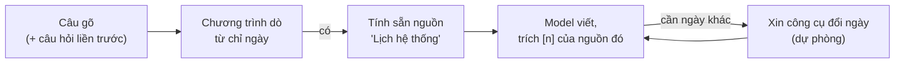

# Bài 24 — Việc phải đúng thì chương trình tính: ngày âm lịch làm mẫu, rồi thời tiết, khoảng cách và các công cụ khác

*Cập nhật 00:44, ngày 24/11/2026 · khớp hệ thống 00:30 24/11 (58 tính năng mở, 6 tắt, kho 269 bài / 9.533 đoạn, bảng điểm bản 16) · “ ” thay « » ở dòng "Lưu ý trong nguồn" (22:49 23/11) · lượt cả bộ test gần nhất xong 01:00 24/11 trên đúng bản code này: 96 file, 4 bỏ vì cần khoá OpenAI, 92 chạy, 2.325 ca đạt, không file nào đỏ (bài 38) · mốc cũ: Nguồn · đã áp biên bản kiểm độc lập 01:16 24/11 · 06:35 24/11: áp biên bản kiểm độc lập của đợt gom (cụm lượt cả bộ test).*

**Bài trước đã biết:** model được xin công cụ (bài 3, bài 21); tin nối tiếp được hiểu nhờ lịch sử (bài 23).
**Bài này thêm:** việc có đáp án đúng duy nhất (hôm nay là ngày nào, rằm tháng Giêng rơi vào thứ mấy, mai có mưa không, từ A tới B bao xa) do chương trình làm, model chỉ diễn đạt. Bài đi kỹ một việc mẫu là ngày và âm lịch, rồi các việc còn lại theo cùng khuôn.

## Ý chính

- **Khuôn chung:** chương trình tính, dựng một khối chữ có con số, đưa vào danh sách nguồn với **một số [n] riêng**, như một đoạn lấy từ kho, để câu trả lời trích được. Model chỉ chọn tham số trong danh sách đóng (số ngày, mã địa điểm) và trích nguồn đó.
- **Ngày và âm lịch** là mẫu: câu có từ chỉ ngày thì chương trình **tính sẵn trước khi gọi model** nguồn "Lịch hệ thống"; công cụ đổi ngày chỉ còn làm dự phòng.
- **Thời tiết:** Open-Meteo, toạ độ cố định, hạn 3 giây, giữ 30 phút; lỗi thì không đưa số nào; câu bão, lũ thì model không nhận số, chương trình nối khối cố định có số 112. Sau khi model viết, câu chứa **số thời tiết lạ bị gỡ** (số km, phút thì soi ở lượt có số khoảng cách do chương trình đưa).
- **Khoảng cách** tra bảng dựng sẵn cho 40 điểm, không gọi mạng lúc trả lời; "gần một điểm" và "liệt kê bài" cũng do chương trình tính. Từ trưa 23/11 "gần một điểm" in cạnh tên quán **giờ hoạt động chép nguyên từ bài kho** (nếu bài có ghi).
- Công cụ chỉ được đưa khi câu có từ khoá đúng loại. Cộng tổng tiền chuyến đi đã thử giao cho chương trình hai lần, **cả hai lần bỏ**.

## Từ dùng trong bài

| Tên trong bài | Tên gốc | Nghĩa |
|---|---|---|
| tính sẵn | **pre-compute** | chương trình tính và đưa kết quả vào ngữ cảnh trước lần gọi model đầu, model khỏi phải xin |
| nguồn do chương trình dựng | — | khối chữ chương trình viết (lịch, dự báo, khoảng cách), có số [n] như một đoạn kho |
| kiểm số sau khi viết | — | bước so mọi số thời tiết, khoảng cách trong chữ model với các số chương trình đã đưa |

## Ngày âm lịch: chương trình tính sẵn trước khi gọi model

Model không biết hôm nay là ngày nào, và đổi âm sang dương là phép tính thiên văn model hay lệch một ngày. "Năm nay" còn là bẫy: từ đầu tháng 1 dương tới Tết, năm âm vẫn là năm cũ. Chương trình dùng một thư viện lịch âm Việt Nam chạy trên máy, tính theo giờ Việt Nam, nhận năm 1976–2100.

**Dò từ chỉ ngày** trong câu gõ và câu hỏi liền trước ("hôm nay", "cuối tuần", "rằm", "Tết"…), hẹp có chủ ý: "hoa mai", "vua thứ hai", "xây khi nào" không tính.

**Dựng nguồn "Lịch hệ thống"**: luôn có hôm nay và ngày mai; thêm 7 ngày của tuần được hỏi, rằm tháng này hay tháng tới, và mọi ngày âm nêu trong câu hoặc trong 10 đoạn kho vừa tìm (nhiều nhất 6). Ngày âm không kèm năm thì ghi cả lần đã qua và lần sắp tới, kèm "đã qua / còn bao nhiêu ngày", để model khỏi tự so với hôm nay.

Ví dụ, câu *"Rằm tháng Giêng năm nay rơi vào thứ mấy?"* với hôm nay là 22/11/2026. Đây là kết quả của riêng phần tính ngày, người viết gọi thẳng (không qua máy chủ, không gọi model; rút gọn):

- Hôm nay: Chủ nhật, 22/11/2026 — ngày 14 tháng 10 âm lịch, năm Bính Ngọ.
- Năm âm lịch nay: rằm tháng Giêng là Thứ Ba, 03/03/2026 — đã qua 264 ngày.
- Lần sắp tới: Thứ Bảy, 20/02/2027, năm Đinh Mùi — còn 90 ngày nữa.
- Ghi chú: người dùng không nêu năm thì trả lời ghi rõ năm của từng ngày; lần đã qua thì nói là đã qua.

Dòng ghi chú có vì lỗi thật 09/11: hỏi tháng 11 về "Tết năm nay", model gọi Tết sắp tới là "năm nay".

**Công cụ đổi ngày** chỉ dùng khi cần ngày chưa có trong nguồn (ví dụ ngày âm ở đoạn tìm thêm): model gửi loại lịch, ngày, tháng, năm, tháng nhuận; chương trình tính, trả thêm một nguồn; nhiều nhất 2 lần mỗi câu.

**Sự kiện theo ngày cùng khuôn:** câu nêu khoảng ngày và hỏi lễ hội thì chương trình tra bảng 27 dòng chép từ kho, đổi âm ra dương, đăng một nguồn.

## Thời tiết, khoảng cách và các việc khác theo cùng khuôn

| Việc | Chương trình làm | Model làm | Khi không có số |
|---|---|---|---|
| **thời tiết** | hỏi Open-Meteo dự báo 7 ngày cho toạ độ trung tâm Huế; dựng khối số (nhiệt độ, khả năng mưa, lượng mưa) kèm giờ lấy số; **tự nối khối đó dưới câu trả lời** | chọn từ ngày nào tới ngày nào (0 tới 6) | lỗi: chỉ câu "chưa lấy được dự báo"; hỏi xa hơn 7 ngày: không đưa công cụ, nối "Mình chỉ có dự báo 7 ngày tới…" |
| **khoảng cách** | tra bảng km đường đi, phút đi xe giữa 40 điểm; câu đúng dạng "A đến B bao xa" thì tra sẵn | chọn mã hai điểm, hoặc "nơi khác" | "Mình chưa có số khoảng cách cho nơi này." |
| **gần một điểm có gì** | quán có bài kho trong 2 km đường chim bay, hoặc điểm tham quan gần nhất; tối đa 5; cạnh tên quán in giờ hoạt động của bài kho (nếu bài có ghi) | chọn mã điểm và loại; tự so giờ với bữa được hỏi | "Mình chưa có vị trí của nơi này nên chưa tính được những gì ở gần đó." |
| **liệt kê bài** | đi qua mọi bài của một nhóm kho, so nguyên cụm từ | chọn nhóm và cụm từ | báo không có bài nào khớp |

**Gần một điểm in kèm giờ của quán (từ 11:56 23/11).** Hai lần, 22/11 ("Gần Đại Nội có quán nào ăn trưa…") và 23/11 ("…trưa ăn gì gần đó?"), trợ lý kể Bún bò Bà Nga cho bữa trưa, vì công cụ chỉ xếp quán theo khoảng cách. Nay cạnh tên quán, công cụ in nguyên dòng "Giờ hoạt động" chép từ bài riêng của quán: "- Bún bò Bà Nga (giờ hoạt động theo bài của quán: 18h - 23h): cách Đại Nội Huế khoảng 1,0 km theo đường chim bay." 30 trên 41 quán có bài kho có dòng này; 11 quán kia không in gì, chương trình không đoán giờ. Đối chiếu giờ với bữa là việc model tự làm; chương trình không soát lại (dòng 7b "Đã so").

**Câu bão, lũ có thêm một lớp.** Khi model chọn loại "bão / lũ" cho công cụ thời tiết, hoặc câu này hay câu liền trước có từ nguy hiểm thời tiết (bão, lũ, lụt, ngập, sạt lở, áp thấp, giông, lốc…; đủ ở "Chi tiết để tra"), model **không nhận con số nào**. Chương trình nối dưới câu trả lời: "Dự báo dưới đây chỉ có nhiệt độ và mưa, không có thông tin bão hay áp thấp.", bảng mưa, rồi câu cố định: "Với bão, lũ, ngập: hãy theo dõi bản tin chính thức của Trung tâm Dự báo khí tượng thủy văn quốc gia (https://nchmf.gov.vn) và cổng cảnh báo lũ quét, sạt lở (https://luquetsatlo.nchmf.gov.vn); khi gặp nguy hiểm gọi 112." Lượt bão kết thúc kiểu khác vẫn có câu này; ba trường hợp không có nó: "Chi tiết để tra". Tin sửa lịch tả thời tiết xấu mà không có từ nào trong danh sách thường cũng không có câu này ("Giới hạn đã biết"). Đọc từ chương trình, chưa thử thật từng nhánh. Lớp này có vì tối 16/11 model tự viết "chưa xác nhận có bão" ngay trên bảng mưa (3 trên 5 lượt chạy lại).

**Kiểm số sau khi viết.** Mọi số thời tiết (°C, %, mm) trong chữ model phải có trong số chương trình đưa, trong đoạn kho được trích, hoặc trong câu hỏi (kèm đơn vị). Số km, phút chỉ được soi như vậy ở lượt có số khoảng cách do chương trình đưa. Từ 21/11 câu chứa số lạ bị gỡ; còn số nguồn thì phần còn lại vẫn là câu trả lời, không còn thì cả câu thành câu từ chối. Ngày tháng không có bước kiểm này.

**Công cụ nào được đưa khi nào.** Tìm kho và liệt kê bài: mọi lượt hỏi đáp. Các công cụ khác chỉ khi câu gõ hoặc câu hỏi liền trước có từ khoá đúng loại (từ chỉ ngày, từ thời tiết, "bao xa", "gần"…). Danh sách đủ, trần vòng: "Chi tiết để tra".

## Quyết định và lý do

### 1. Vì sao ngày, dự báo, khoảng cách do chương trình tính?

- **Đã chọn:** chương trình tính và in số; model gửi tham số trong danh sách đóng và viết lời quanh số.
- **Vì sao:** luật ghi ở đầu phần tính ngày: phép tính giao cho chương trình. Trước khi làm (30/10, gpt-6-luna), 6 trên 12 câu hỏi theo ngày bị từ chối nhầm vì model không biết ngày. Có công cụ (09/11): bớt 9 câu từ chối nhầm, 0 câu sai ngày. Với khoảng cách, kho hầu như không ghi "từ A tới B bao xa": đếm 16/11, 4 trên 6 câu kiểu đó bị từ chối.
- **Cách khác:** thêm dòng "hôm nay là…" để model tự tính: đã đo, từ chối nhầm chỉ 5,0 xuống 4,5 (cần giảm ít nhất 3), bỏ. Khoảng cách theo đường chim bay nhân 1,3: không làm (mục "Quyết định nhỏ hơn").
- **Cái giá:** nơi, ngày, dạng câu ngoài phạm vi chương trình thì không có số.

### 2. Vì sao lịch được tính sẵn trước lần gọi model?

- **Đã chọn:** câu có từ chỉ ngày thì "Lịch hệ thống" đã có trong ngữ cảnh ngay lần gọi đầu.
- **Vì sao:** chỉ có công cụ thì câu ngày phải chờ hai tới bốn lần gọi model. Đo 10/11 trên 19 câu (gpt-6-luna): chữ đầu ở câu đứng giữa 5,60 xuống 2,35 giây, ở mức 95 % câu 10,14 xuống 4,56 giây, lần gọi model 52 xuống 31; công cụ dự phòng không được gọi lần nào.
- **Cách khác:** chỉ có công cụ (bản 09/11): đã đo như trên.
- **Cái giá:** chỉ các dạng ngày đã liệt kê được tính sẵn; dạng lạ đi đường công cụ, chậm hơn.

### 3. Vì sao chỉ đưa công cụ khi câu có từ khoá?

- **Đã chọn:** cổng theo từ khoá của câu gõ và câu hỏi liền trước.
- **Vì sao:** ghi trong chương trình: công cụ có mặt ở mọi lượt làm đổi cách model trả lời cả câu không liên quan. Đã gặp hai lần: 05/11, thêm công cụ tính tiền làm câu miễn vé bỏ điều kiện 3 trên 3 lần (bản đang chạy 1 trên 3); 17/11, bản "luôn đưa công cụ thời tiết" làm một câu hỏi giá đi lại bị nối bảng mưa, trái luật ghi trước, chủ dự án chọn lùi.
- **Cách khác:** chế độ "luôn đưa" cả các công cụ có sẵn trong cấu hình từ 21/11: chưa đo trên model nào. Riêng bản luôn đưa công cụ thời tiết đã đo 17/11 với gpt-6-luna và bị lùi (dòng 4b của "Đã so").
- **Cái giá:** câu cần công cụ mà thiếu từ khoá thì model không thấy công cụ: đếm 21/11 trên 310 câu, sót 4 trên 60 (thời tiết 3, ngày 1). Lần sửa 21/11 thêm từ cho ba câu thời tiết, không nhắc câu về ngày; chưa đếm lại.

### 4. Vì sao thời tiết lỗi thì không đưa con số nào, và không gọi lại?

- **Đã chọn:** một lần gọi, hạn 3 giây; lỗi, quá hạn, sai dạng, số ngoài khoảng hợp lý đều là "lỗi", model chỉ nhận câu "chưa lấy được dự báo".
- **Vì sao:** luật ghi trong chương trình: lỗi thì không bao giờ đưa số. Không gọi lại: quyết định đã ghi trong kế hoạch của tính năng (một lần gọi, hạn 3 giây, không thử lại), chưa thấy ghi lý do. Điều thấy được: mọi dịch vụ bên ngoài của hệ thống đều chỉ gọi một lần (bài 6).
- **Cách khác:** gọi lại khi lỗi; dịch vụ thời tiết thứ hai: chưa thử.
- **Cái giá:** Open-Meteo chậm quá 3 giây là lượt đó không có dự báo.

### 5. Vì sao cộng tổng tiền chuyến đi không giao cho chương trình?

- **Đã chọn:** chương trình không cộng tiền; hỏi tổng tiền vé thì model tự cộng giá có nguồn.
- **Vì sao:** hai lần thử, phép cộng đều đúng mà câu trả lời tệ đi (cả hai gpt-6-luna). 05/11: cộng đúng 8 trên 8, nhưng có công cụ thì câu miễn vé bỏ điều kiện 3 trên 3 lần. 19/11: in sẵn tổng, đúng 5 trên 5 ca đối chiếu, nhưng 6 trên 12 lượt hỏi tổng tiền ra câu từ chối, vì thấy dòng "còn điểm chưa có giá" là model đi tìm giá, không thấy, rồi từ chối cả câu.
- **Cách khác:** hai bản trên: đã đo, bỏ. Dặn model "không tự cộng tổng": đã đo, 1 trên 2 câu kín vẫn tự viết dòng "Tổng".
- **Cái giá:** tổng tiền là số model tự cộng; ba lượt đo 19/11 đúng, nhưng không có bước kiểm. Không phải việc nào giao cho chương trình cũng hơn.

## Nếu… thì sao

Tình huống kể trọn: hỏi *"Mai Huế có mưa không?"* lúc Open-Meteo không trả lời. Sau 3 giây là lỗi; model viết câu không số; chương trình nối: "Mình chưa lấy được dự báo thời tiết lúc này — bạn xem bản tin của Trung tâm Dự báo khí tượng thủy văn quốc gia: https://nchmf.gov.vn". Đọc từ chương trình, chưa thử thật.

| Nếu | Người dùng thấy gì | Đã có chưa |
|---|---|---|
| hỏi thời tiết xa hơn 7 ngày | "Mình chỉ có dự báo 7 ngày tới, chưa có dự báo cho ngày bạn hỏi; …" | đã có |
| hỏi khoảng cách tới khách sạn, ga, sân bay | "Mình chưa có số khoảng cách cho nơi này." | **chưa có** số cho nơi ngoài 40 điểm |
| hỏi "trưa ăn gì gần X" mà quán gần nhất trong kho chỉ mở tối | trợ lý nói quán đó không mở buổi trưa (lượt đo: 0 / 6 sai); quán kho không ghi giờ: ở lượt đo model nói nguồn không ghi, chương trình không bảo đảm | in giờ: đã có từ 11:56 23/11 (dòng 7b); quán không ghi giờ: chưa đo riêng |
| model viết một số mưa không có nguồn, hoặc số km không có nguồn ở lượt dùng công cụ khoảng cách | câu đó bị gỡ khỏi câu trả lời | đã có từ 21/11 |
| máy chủ chưa sẵn sàng khi hỏi câu bão | "Hệ thống tra cứu tạm thời không khả dụng." hoặc "Không thể tạo câu trả lời vào lúc này.", không có câu 112 | **chưa có**; đọc từ chương trình |
| câu bão nói vòng, không có từ nào trong danh sách | có thể thiếu câu bản tin chính thức + 112 (1 trên 22 câu dò) | ghi giới hạn |

## Dễ nhầm

- **"Model biết hôm nay là ngày nào."** Không. Ngày hôm nay do chương trình đưa vào, theo giờ Việt Nam.
- **"Số thời tiết model tự nghĩ ra hoặc đọc web."** Không. Số do chương trình lấy từ Open-Meteo và in; model không được thêm số.

## Câu hỏi tự kiểm

1. Vì sao lịch được tính sẵn chứ không chờ model xin công cụ?

Để bớt vòng gọi model. Đo 10/11: chữ đầu 5,60 xuống 2,35 giây, lần gọi model 52 xuống 31 trên 19 câu.

2. Open-Meteo sập thì người dùng thấy gì?

Câu trả lời không có số dự báo, kèm câu "Mình chưa lấy được dự báo thời tiết lúc này…" chỉ tới bản tin chính thức.

3. Câu bão, lũ khác câu dự báo thường ở đâu?

Model không nhận số; chương trình nối bảng mưa có nhãn "không có thông tin bão" và câu cố định chỉ bản tin chính thức + 112.

4. Vì sao không cho chương trình cộng tổng tiền chuyến đi?

Hai lần thử: phép cộng đúng, nhưng model bỏ điều kiện miễn vé, hoặc từ chối 6 trên 12 lượt.

## Cấu hình đang chạy

*Theo chương trình và cấu hình trưa 22/11/2026; hàng `gan_diem_gio` theo cấu hình trưa 23/11.*

| Mục | Giá trị | Dùng để làm gì, vì sao là giá trị này | Đã thử giá trị khác chưa |
|---|---|---|---|
| Công cụ đổi ngày (`ngay_lich`) | bật; nhiều nhất 2 lần mỗi câu | dự phòng cho ngày chưa có trong nguồn "Lịch hệ thống" | — |
| Khoảng năm đổi được | 1976–2100 | trước 1976 hai miền dùng lịch âm khác nhau (Tết 1968: miền Bắc 29/01, miền Nam 30/01); so với bảng Tết tính sẵn thì khớp mọi năm từ 1966 | — |
| Thư viện lịch | thư viện lịch âm Việt Nam, giờ UTC+7 | lịch Trung Quốc tính theo UTC+8, lệch Tết một số năm (1985: 21/01 so với 20/02) | không dùng lịch Trung Quốc |
| Số ngày âm tính sẵn tối đa | 6 mỗi lượt | — | chưa so |
| Dòng "hôm nay" trong tin gửi model (`today_line`) | tắt | đã thay bằng nguồn tính sẵn | đã thử bật: dòng 1 |
| Sự kiện theo ngày (`su_kien_theo_ngay`) | bật 21/11; bảng 27 dòng; khoảng hỏi tối đa 62 ngày | khoảng dài hơn thì danh sách thành "cả năm" | dòng 6 |
| Thời tiết (`thoi_tiet`) | bật 07/11; Open-Meteo; 7 ngày; hạn 3 giây; giữ 30 phút; 1 lần mỗi câu | dự báo không đổi từng phút | chưa so dịch vụ khác |
| Ngưỡng dòng "nếu mưa" trong lịch | khả năng mưa từ 60 % | — | chưa so |
| Câu bão / lũ (`bao_lu_cong_cu`) | bật 17/11 | dòng 4 | bản "luôn đưa công cụ thời tiết": lùi |
| Cổng đưa công cụ (`cong_cong_cu`, cả hai đường model) | theo từ khoá | quyết định 3 | "luôn đưa": có sẵn, chưa đo |
| Khoảng cách (`khoang_cach`) | bật 16/11; 40 điểm, 1.560 cặp; nhiều nhất 3 lần mỗi câu | — | dòng 5 |
| Luật số phút | 1,25 × phút của dịch vụ chỉ đường + 5 | khớp 6 / 6 cặp đối chiếu | sàn 40 km/h: bỏ |
| Khoảng cách tính sẵn (`khoang_cach_tinh_san`) | bật 16/11; chỉ câu đúng dạng hai điểm | dòng 5 | — |
| Gần một điểm (`gan_diem`) | mở 22/11; 2 km chim bay; tối đa 5; nhiều nhất 3 lần mỗi câu | cùng ngưỡng "gần" của mục ăn uống trong thẻ lịch | chưa so |
| Giờ quán trong "gần một điểm" (`gan_diem_gio`) | mở 23/11 (vào nhánh chính 11:56), tính năng thứ 49; đọc trường giờ của bảng quán bản 4 (30 quán kho có giờ); chữ giờ dài nhiều nhất 160 ký tự, qua cùng phép kiểm chữ sạch như tên quán | chữ giờ đi thẳng tới model và người dùng nên phải sạch như tên quán; tắt thì chữ công cụ như cũ từng byte | tắt: dòng 7b |
| Liệt kê bài (`liet_ke_bai`) | mở 22/11; mọi lượt hỏi đáp; nhiều nhất 2 lần mỗi câu | — | dòng 8 |
| Kiểm số sau khi viết | gỡ câu chứa số lạ (từ 21/11); lượt có lịch thì rút cả câu như cũ | trước 21/11 số lạ làm rút cả câu trả lời | — |

## Đã so

| # | Thử gì, so với gì | Bộ câu, model, ngày | Kết quả | Giữ / bỏ |
|---|---|---|---|---|
| 1 | dòng "hôm nay là…" trong tin gửi model | bộ đo của bước xếp loại câu; gpt-6-luna; 02/11 | từ chối nhầm 5,0 ⇒ 4,5 (cần giảm ≥ 3) | bỏ |
| 2 | công cụ đổi ngày, so với không có | bộ câu ngày; gpt-6-luna; 09/11 | bớt 9 câu từ chối nhầm, 0 câu sai ngày | **giữ** |
| 3 | tính sẵn lịch, so với chỉ có công cụ | 19 câu có ngày; gpt-6-luna; 10/11; đo ở máy chủ | chữ đầu 5,60 ⇒ 2,35 s; mức 95 % 10,14 ⇒ 4,56 s; lần gọi 52 ⇒ 31; tiền 0,00049 ⇒ 0,00036 USD / câu | **giữ** |
| 4 | câu bão: model không nhận số, chương trình nối khối | bộ 31 câu do người khác soạn; gpt-6-luna; 17/11 | model tự nhận định có / không có bão: 3 / 5 (trước) ⇒ không ở câu gốc; câu cần khối 112 có khối: 21 / 22; câu thường vẫn có bảng: 3 / 3 | **giữ** |
| 4b | luôn đưa công cụ thời tiết | cùng bộ + 176 câu mẫu; gpt-6-luna; 17/11 | 1 câu hỏi giá đi lại bị nối bảng mưa | bỏ |
| 5 | công cụ khoảng cách; rồi tra sẵn khi câu đúng dạng | 16 câu, hai lần đo (công cụ, rồi tra sẵn); gpt-6-luna; 16/11 | đúng cặp 13 / 14 (tra sẵn: 14 / 14); 0 số sai; nơi ngoài bảng ra số 0 / 2; chữ đầu 3,7 ⇒ 1,9 s | **giữ** |
| 5b | tra sẵn, bản đầu chỉ đếm hai tên | 21 câu phá của người review | 15 / 21 ra sai cặp ⇒ đổi sang chỉ nhận dạng câu quen ⇒ 0 sai | sửa rồi giữ |
| 6 | sự kiện theo ngày | 10 câu; Claude Sonnet 5.5; 21/11 | bị từ chối 4 / 10 ⇒ 0 / 10; 40 ngày dương trong câu trả lời: 0 sai | **giữ** |
| 7 | gần một điểm | 12 câu mù; Claude Sonnet 5.5; 21/11 | 0 lỗi; 30 / 30 số km / phút đúng số chương trình; 0 / 12 câu bịa "gần" | **giữ** |
| 7b | "gần một điểm" in giờ quán, bật ↔ tắt | 8 câu: 6 câu kèm bữa (sáng, trưa, tối) quanh Đại Nội, cầu Trường Tiền, Cung An Định + 2 câu không kèm bữa (Đại Nội, chùa Thiên Mụ); mỗi bên một lượt, cùng buổi; Claude Sonnet 5.5; 23/11 | câu gợi ý cho bữa được hỏi một quán kho ghi đóng bữa đó: tắt 5 / 6 ⇒ bật 0 / 6; 16 / 16 lượt không lỗi, 0 câu bị rút; 2 câu không kèm bữa không mất quán, dài hơn tới 1,4 lần (giờ từng quán) | **giữ** (mức đạt ghi trước; người viết code tự đọc, phiên điều phối đọc lại 16 câu thô; phiên đo chưa chấm) |
| 8 | liệt kê bài | 7 câu xin danh sách; Claude Sonnet 5.5; 21/11 | bài đúng loại trong ngữ cảnh: lăng 2 ⇒ 8 / 8, chùa 1 ⇒ 6 / 6; mức "cả bảy câu đạt" ghi trước không đạt (5 / 7) | **giữ** (nhóm đã chốt) |
| 9 | chương trình cộng tiền | 05/11 và 19/11; gpt-6-luna | 8 / 8 và 5 / 5 phép cộng đúng; nhưng bỏ điều kiện miễn vé 3 / 3, và 6 / 12 lượt từ chối | bỏ cả hai |

**Đọc bảng thế nào.** Các dòng giữ có chung một kiểu: chương trình làm phép tính, model chỉ đọc. Dòng 4b và 9 cho thấy giới hạn: mỗi công cụ thêm vào đổi cách model cư xử ở cả phần khác của câu trả lời, nên công cụ chỉ được đưa đúng lúc và mọi lần thêm đều đo lại bộ câu an toàn.

**Giới hạn của các phép đo.** Bộ câu nhỏ (10 tới 31 câu), phần lớn do nhóm soạn. Dòng 1–5 và 9 đo với gpt-6-luna; dòng 6–8 (cả 7b) đo với Claude Sonnet 5.5; chưa dòng nào đo trên cả hai model. Dòng 7b chưa đo: điểm ngoài ba điểm đã thử, câu hỏi tiếp trong một cuộc. Trên trình duyệt mới có một câu (12:36 23/11, lượt do công cụ tự lái, đã đi đủ các bước, do một agent con chạy, chưa có người thứ hai kiểm): 3 quán, cả 3 kèm giờ và đều mở buổi trưa.

## Quyết định nhỏ hơn

**Vì sao khoảng cách tra bảng dựng sẵn?** Toạ độ 40 điểm được gửi cho một dịch vụ chỉ đường công khai một lần lúc dựng bảng (1.560 cặp); lúc trả lời chỉ tra bảng, không gọi mạng, nên không chờ và câu của người dùng không rời máy. Khoảng cách giữa các điểm cố định không đổi (lập luận, không phải số đo). Phút của dịch vụ đó nhanh hơn thực tế nên được đổi bằng luật "1,25 × phút + 5", khớp 6 trên 6 cặp đối chiếu với nguồn công khai; hằng số "không nhanh hơn 40 km/h" chọn bằng mắt trước đó bị review bắt (đổi số phút ở 1.082 trên 1.560 cặp, chỉ khớp 3 trên 6) và bỏ. Đường chim bay nhân 1,3: không làm; kế hoạch chọn đường đi thật vì nó đúng hơn với cặp điểm cách sông, đường vòng (quyết định đã ghi, chưa đo). Cái giá: nơi ngoài 40 điểm (khách sạn, ga, sân bay) không có số; không có đi bộ, đi thuyền.

**Vì sao câu được coi là lượt bão cả khi chỉ câu hỏi liền trước có từ nguy hiểm?** Chương trình chọn "thừa hơn sót": "vậy có nên ra biển không" ngay sau một câu bão vẫn là chuyện bão. Cái giá: câu hỏi tiếp không liên quan ngay sau câu bão cũng nhận câu 112 ở cuối; riêng câu dẫn "không theo dõi được tin bão" thì chỉ đặt khi chính câu đang hỏi có từ nguy hiểm.

**Vì sao bước kiểm số gỡ câu ở lượt thường mà rút cả câu ở lượt có lịch?** Ghi trong chương trình: chữ của lượt lịch được ghép với khung lịch do chương trình dựng, nên không gỡ từng câu được; lượt lịch giữ cách cũ (rút lại, nút "Thử lại").

**Vì sao "gần một điểm" in nguyên dòng giờ của kho cho model đọc, mà không để chương trình tự loại quán theo bữa?** Lý do ghi lại chỉ có một: sổ bàn giao gọi đây là "bước kế rẻ nhất" — bảng quán đã có sẵn chỗ chứa giờ chép từ kho (bản 3 có cho 6 quán; bản sửa chép thêm cho đủ 30 quán), rồi chỉ cần một dòng in giờ cạnh tên quán. Vì sao không để chương trình tự loại quán theo bữa như ở thẻ lịch: chưa thấy ghi. Điều thấy được: chú thích chương trình ghi việc in giờ là để câu "trưa ăn gì gần X" không gợi ý quán chỉ mở buổi tối, và quán kho không ghi giờ thì không bịa giờ; dòng giờ của kho viết tự do (ví dụ "Khoảng 11:15 – 20:00 hằng ngày; bánh canh có thể hết sớm trước 17:00"); cùng lỗi ở thẻ lịch thì nhóm chọn cách kia, chương trình bỏ quán khỏi bữa theo dấu "bữa không hợp" của 6 quán (bài 30). Cách khác: thêm một câu vào mô tả công cụ "người dùng nêu bữa / giờ thì tra giờ mở cửa trong kho trước khi gợi ý" (hướng sửa đã ghi sau lần thấy đầu): không làm. Cái giá: đúng hay sai là do model đọc giờ; câu trả lời dài hơn.

**Vì sao tra sẵn khoảng cách chỉ nhận một dạng câu hẹp?** Bản đầu chỉ đếm "có đúng hai tên điểm" thì 15 trên 21 câu phá của người review ra sai cặp (hỏi khoảng cách tới nơi thứ ba, tên điểm nằm trong tên khách sạn…), mà bước kiểm số vẫn cho qua vì số "có nguồn". Đổi sang chỉ nhận dạng "[từ] A <từ nối> B <từ hỏi khoảng cách>": 0 câu sai cặp; câu khác dạng đi đường công cụ, chậm hơn nhưng đúng.

## Giới hạn đã biết

- **Ngày model viết không bị chương trình kiểm lại.** Bước kiểm số chỉ soi số thời tiết và khoảng cách; ngày chỉ được bảo đảm nhờ nguồn tính sẵn và số nguồn.
- **Dạng ngày ít gặp** đi đường công cụ, chậm hơn; câu không dấu không bật công cụ.
- **Thời tiết "tuần sau"** chỉ có số cho phần nằm trong 7 ngày; chương trình ghi rõ dự báo có tới ngày nào.
- **Khoảng cách và "gần"** chỉ cho 40 điểm (bảng điểm của lịch có 41; một điểm chưa có toạ độ nên không vào bảng khoảng cách, bài 27) và 41 quán có vị trí; "gần" là đường chim bay.
- **Giờ quán của công cụ "gần" chỉ có cho 30 trên 41 quán kho** (bài riêng có dòng "Giờ hoạt động"); 11 quán kia công cụ không in giờ; ở lượt đo, model nói nguồn không ghi giờ — chương trình không bảo đảm điều đó (một trong 11 quán, Cơm Tấm Okla, có bài kho ghi phục vụ trong khung giờ buổi trưa mà không có dòng "Giờ hoạt động"). Model tự so giờ với bữa, chương trình không kiểm lại câu trả lời; quán mở sát giờ bữa vẫn được gợi ý cho bữa trưa, kèm giờ: ở lượt đo, bên bật kể Thúy – Bánh canh Nam Phổ (mở từ khoảng 11:15) cho bữa trưa ở 3 trong 4 câu hỏi bữa trưa, và lượt trình duyệt trưa 23/11 cũng kể quán này cho câu "Trưa nay ăn gì gần Đại Nội?"; tiêu chí đo không tính đây là lỗi. Trước 11:56 23/11 công cụ không in giờ.
- **Liệt kê bài so nguyên cụm từ, không hiểu cụm đó nói về cái gì.** Bài khớp ở thân bài được đưa cho model kèm dòng đầu tiên có cụm từ. Đếm trên cả kho, cụm "miễn phí" khớp 31 bài, 19 bài chỉ vì một thứ phụ (wifi, vé trẻ em, gửi xe…), trong đó có hai điểm thu vé (Suối Mơ, Đèo Hải Vân); mỗi lần gọi công cụ chỉ lọc trong một nhóm bài nên số bài model nhận ít hơn thế. Ở hai lượt hỏi thật ngày 22/11, model đọc dòng kèm theo và tự bỏ các bài đó, nhưng hai lượt chưa đủ để nói là luôn bỏ: trợ lý vẫn có thể kể một điểm thu vé là miễn phí. Danh sách cũng đổi giữa các lần gõ cùng một câu (8 điểm rồi 6 điểm). Chương trình chưa lọc.
- **Tổng tiền là số model tự cộng.**
- **Lưới từ nguy hiểm thời tiết** vẫn sót vài cách nói tự nhiên ("nước có lên nữa không") và nhận thừa vài câu ("bão giá", tên phim).
- **Tin sửa lịch tả thời tiết xấu mà không có từ nào trong danh sách** ("gió giật mạnh quá, bỏ Đầm Chuồn đi", "mưa to quá…", "biển động mạnh…"): lịch được sửa như thường, nhưng câu bản tin chính thức + 112 chỉ hiện khi đường trả lời thường (chạy song song với lần hiểu ý sửa lịch, bài 31) kịp để model gọi công cụ thời tiết loại bão, lũ trước khi lần hiểu ý xong — thường là không kịp, nên thường không có câu đó; tin không có cả từ thời tiết nào ("biển động mạnh…") thì model không được đưa công cụ thời tiết, nên không có câu đó (trừ khi câu hỏi liền trước có từ thời tiết). Tin có "bão", "lũ", "áp thấp nhiệt đới", "sạt lở"… thì luôn có. Đếm trên sổ ghi lượt thật tới tối 22/11 (0 đồng): 16 lượt sửa lịch có chữ thời tiết, 15 khớp danh sách, lượt còn lại là "mưa to" (mưa, không phải bão). Nhóm đã chốt giữ giới hạn, không nới danh sách từ: chủ dự án đã đóng việc mở thêm phần bão, lũ (19/11).

## Chi tiết để tra

- Sự kiện theo ngày, thử trên giao diện tối 22/11 (Claude Sonnet 5.5, gõ vào Chủ nhật 22/11, mỗi câu một lần): câu hỏi về "cuối tuần này" được trả lời rằng phần cuối tuần còn lại là Chủ nhật 22/11, không có lễ hội ngày cố định, kèm bốn hoạt động lặp hằng tuần; câu hỏi về ngày 24/11 được trả lời rằng không thấy lễ hội nào có ngày cố định rơi vào hôm đó (Thứ Ba). Không câu nào bị từ chối; 8,0 và 7,8 giây.
- Nguồn "Lịch hệ thống" mang tên "Lịch hệ thống — tính theo giờ Việt Nam"; nguồn sự kiện mang tên "Lễ hội và hoạt động theo ngày — code tra từ các bài của kho"; nguồn dự báo "Dự báo thời tiết Huế (Open-Meteo)"; nguồn liệt kê "Mục lục kho tư liệu". Bản thân các nguồn này không kéo theo dòng "Giờ mở cửa, giá vé, lịch lễ hội có thể đã thay đổi — hãy kiểm lại với nơi đến trước khi đi." Riêng nguồn liệt kê, nguồn "gần một điểm" và thẻ nơi: bài nào của danh sách được nêu đúng tên trong câu trả lời thì được tính như bài đã trích, nên nếu bài đó thuộc nhóm vé, địa điểm, lễ hội hoặc là bài "Lưu trú ở Huế" thì dòng đó vẫn hiện.
- Câu lưu ý an toàn của bài đi qua công cụ liệt kê, "gần một điểm" hay thẻ nơi (bài được nêu đúng tên, như gạch trên): chương trình tìm trong chữ của bài câu "tạm ngừng khi lũ / lệnh cấm / thời tiết xấu" để nối dòng "Lưu ý trong nguồn “tên bài — tên mục”: …" (bài 15; tới 22:49 23/11 tên bài nằm trong dấu « », từ 22:49 trong ngoặc kép “ ”, cùng hướng với việc bỏ « » khỏi các dòng sửa lịch — bản đó vào nhánh chính 00:13 24/11 — theo lời chủ dự án 21:48 "tôi thấy còn bị dính ký tự như: «"). Trước 09:10 23/11 nó chỉ xét từng dòng của file bài; câu vắt qua hai dòng thì không dòng nào đủ ý, nên dòng lưu ý rơi, trong khi cùng bài đi qua tìm kho thì vẫn có. Trong 7 bài của kho có câu loại này, đúng một bài bị: "Đi lại ở Huế" (câu thuyền có thể phải dừng chạy khi nước sông dâng cao hoặc có lệnh cấm xuất bến). Nay chương trình xét từng dòng trước, chưa thấy thì xét cả bài đã nối dòng. So trên cả 267 bài (kho lúc so): dòng lưu ý chương trình nối ra trùng với dòng lưu ý tính từ nguyên văn bài, ở cả 267 bài. Một bản soát của model khác hãng (22/11) nêu lỗi này; cách nó đề nghị (chỉ xét bản nối dòng) làm rơi câu của một bài khác và đổi câu ở ba bài, nên nhóm sửa theo cách trên. Lượt thật từng gặp: 0 trên 27 lượt trích nguồn mục lục (15–22/11). Bằng chứng: ca test và phép chạy trên kho; chưa có lượt thật.
- Nguồn "Lịch hệ thống": dòng "Ghi chú: người dùng không nêu năm…" là lời dặn cho model. Từ 22:25 22/11, người dùng bấm mở nguồn này chỉ thấy các dòng ngày, không thấy dòng ghi chú đó; chữ model nhận không đổi. Trước đó, 15 lượt thật có nguồn mang dòng này, 3 lượt câu trả lời trích nó. Bằng chứng: một ca test; chưa nhìn trên trình duyệt.
- Nguồn "Tin bão / lũ chính thức" (lượt model gọi công cụ thời tiết loại bão, lũ): đoạn chữ model nhận là một lời dặn cho model, không phải tin bão. Câu trả lời trích nguồn này thì tên nguồn là một nút trong khung "Nguồn đã dùng" dưới câu trả lời; bấm vào là mở đoạn trích. Trước 22:15 22/11, đoạn mở ra chính là lời dặn đó: "Phần thời tiết do hệ thống tự nối dưới câu trả lời: nguồn tin bão / lũ chính thức, số 112 và dự báo mưa thường. Dự báo này không có thông tin bão / áp thấp: không viết là có hay không có bão, lũ; không trấn an; chỉ trả lời phần khác của câu hỏi (nếu có)." Nay đoạn mở ra là câu bản tin chính thức + 112 ("Với bão, lũ, ngập: hãy theo dõi bản tin chính thức…; khi gặp nguy hiểm gọi 112."); chữ model nhận không đổi. Đã gặp ở lượt thật: trong sổ ghi 17–22/11, 21 lượt model gọi công cụ thời tiết loại bão, lũ, 9 lượt câu trả lời trích nguồn đó (phần lớn là câu "Ngày mai có bão vào Huế không?"). Bằng chứng của bản sửa: một ca test; chưa nhìn trên trình duyệt.
- Bảng sự kiện: 17 lễ hội ngày cố định, 6 lễ hội kho chỉ ghi khoảng, 4 hoạt động theo tuần; không có sự kiện một lần và lễ hội "theo kế hoạch từng năm"; câu hỏi về quá khứ ("tuần trước") không tra; "tháng 7" trần hiểu là tháng dương.
- Khối dự báo ghi "khả năng mưa cao nhất trong ngày", vì số của Open-Meteo là giờ dễ mưa nhất, không phải cả ngày (tra 15/11). Ghi công "Dữ liệu thời tiết: Open-Meteo.com (CC BY 4.0)" và giờ lấy số. Hỏi theo buổi thì thêm "Đây là dự báo theo cả ngày, không riêng buổi bạn hỏi."
- Có dự báo mà model trả câu từ chối thì chương trình thay bằng "Mình có dự báo cho ngày bạn hỏi:" rồi nối bảng (review 06/11 bắt 4 trên 20 lượt câu từ chối đứng ngay trên bảng số).
- Kiểm số nhận số người dùng tự gõ kèm đơn vị ("63 % thì mưa nhiều không") từ 21/11, sau khi 5 trên 7 lượt bị rút oan ở lượt người dùng mô phỏng.
- Khoảng cách: câu trả lời trích nguồn khoảng cách mà không nhắc "kẹt xe" thì chương trình nối "Số ước theo đường đi trên bản đồ, chưa tính kẹt xe hay dừng nghỉ." (model tự chép câu này chỉ ở 33 trên 52 câu).
- Tra sẵn khoảng cách chỉ nhận dạng câu "[từ] A <từ nối> B <từ hỏi khoảng cách>"; ba nơi, câu so sánh, câu "từ đó sang…" đi đường công cụ.
- Từ nguy hiểm thời tiết (lưới thường, chuyển từ nửa để hiểu 12:15 23/11): bão, lũ, lụt, ngập, sạt lở, áp thấp, giông, dông, lốc, mưa đá, nước dâng…
- Từ khoá đưa công cụ (chuyển từ thân bài, đợt áp biên bản): đổi ngày khi có từ chỉ ngày; thời tiết khi có từ thời tiết hay từ nguy hiểm thời tiết, trừ câu hỏi xa hơn 7 ngày; khoảng cách khi có "bao xa", "mấy km", "cách nhau"…, trừ khi đã tra sẵn; gần một điểm khi có "gần", "quanh", "cạnh", "lân cận", "kế bên", "sát bên". Từ khoá xét ở câu gõ và câu hỏi liền trước.
- Thời tiết không cộng vòng vào trần vòng; ngày, khoảng cách, gần một điểm, liệt kê bài mỗi cái cộng 1.
- Câu bản tin chính thức + 112 ở lượt bão kết thúc kiểu khác (chuyển từ nửa để hiểu 22:16 22/11, không đổi nội dung): từ chối hay câu cố định thì ở dòng ghi chú; chạm trần vòng thì nối vào chữ; lỗi giữa lượt hay câu bị rút thì nối sau lời báo.
- **Không có** câu bản tin chính thức + 112 ở ba trường hợp (chuyển từ nửa để hiểu 12:15 23/11, không đổi nội dung): máy chủ báo lỗi ngay từ đầu (kho tra cứu hoặc model chưa sẵn sàng), mạng đứt giữa chừng (lời báo do giao diện viết), và lượt hiện thẻ hỏi lại. Đọc từ chương trình, chưa thử thật từng nhánh.
- Từ 22:06 22/11, ở tin sửa lịch: nếu đường trả lời thường đã kịp để model gọi công cụ thời tiết loại bão, lũ rồi mới bị huỷ (vì tin hoá ra là lệnh sửa), việc "model đã tra cứu bão, lũ" được ghi nhớ sang lượt sửa lịch, nên lượt sửa vẫn có câu bản tin chính thức + 112 (giao diện đặt câu này ở đầu khung lịch) dù câu gõ không có từ nào trong danh sách. Trước đó dấu này mất cùng đường bị huỷ. Bằng chứng: một ca test gọi thẳng phần chép dấu và lưới cuối (có dấu thì có câu 112, không có dấu thì không); chưa có ca test chạy đủ hai đường song song theo đúng thứ tự, chưa có lượt thật. Bản sửa không chữa ca "không kịp" ở "Giới hạn đã biết".
- Kiểm số sau khi viết, ở lượt chữ được giữ tới khi qua kiểm nguồn: từ 22:06 22/11 chữ hiện ra là bản đã gỡ câu có số lạ, không còn cảnh chữ gốc hiện rồi bị thay (bài 6, "Chi tiết để tra").
- Hỏi ngày trước năm 1976 hay sau 2100: "Mình chỉ đổi được ngày từ năm 1976 đến 2100 (trước 1976 lịch âm hai miền khác nhau)." (cố ý). Dò từ chỉ ngày còn nhận "ngày mai", "tuần sau", "mùng", "âm lịch", "năm nay", "thứ Bảy"; "mai" đứng một mình không tính.
- Màn đầu Trang chủ có một dòng thời tiết "Huế hôm nay" (nhiệt độ thấp nhất – cao nhất, khả năng mưa cao nhất, giờ lấy số), đọc cùng dịch vụ, không gọi model; lỗi thì dòng đó ẩn (bài 5).
- Lượt đo thời tiết sau khi sửa nhãn mưa (14 câu): 0 số sai, gọi công cụ 9 / 9 (gpt-6-luna).

**Bài sau (bài 25):** khi kho không có: tra web một lần, để riêng mục "chưa kiểm".

Nguồn (để giữ bài đúng — anh không cần đọc)

- Ví dụ rằm tháng Giêng: người viết gọi `nl.lich_san("Rằm tháng Giêng năm nay rơi vào thứ mấy?", "", now=22/11/2026 12:00)` bằng `uv run --no-sync python` trong `backend/`, 12:15 22/11/2026 [đã chạy; hàm thuần, không gọi model]; cùng lúc kiểm `co_tu_ngay`: "Lăng Tự Đức xây khi nào?" ⇒ không, "vua thứ hai triều Nguyễn là ai" ⇒ không.
- Phần ngày: `backend/llm/ngay_lich.py` (chú thích đầu file: thư viện, UTC+7, 1976–2100, Tết 1968 / 1985; `_TU_NGAY`, `_THU_TU`, `co_tu_ngay_luot`, `lich_san`, `SO_NGAY_AM_TOI_DA`, `GHI_CHU_NAM` và chú thích 09/11, `CAU_NGOAI_KHOANG`); `backend/llm/assistant.py` (`_before_model` gọi `_nguon_lich_san`, `ngay_lich_for_turn` ≤ 2 lần); mô tả công cụ `NGAY_LICH_MO_TA` (`backend/llm/full_corpus_prompt.py`) [code, đọc 22/11].
- 6 / 12 câu (30/10), dòng "hôm nay" không đỡ: `docs/superpowers/plans/2026-11-08-phase-9-t1-ngay-plan.md` mục 1 [kế hoạch]; 5,0 ⇒ 4,5: `bai_hoc/19_BANG_TONG_CAC_LAN_SO_SANH.md` dòng 33; bớt 9 câu, 0 sai ngày, 5,60 ⇒ 2,35 … 52 ⇒ 31: dòng 23 và `bai_hoc/14_VIEC_DE_NHAM_THI_CODE_LAM.md` (nguồn gốc `bao_cao_he_thong/07_…`) [đã chạy, gpt-6-luna; chép].
- Sự kiện theo ngày: `backend/llm/su_kien.py` (chú thích đầu file, `KHOANG_TOI_DA`, `dong_nguon`, `_QUA_KHU`), `assistant.py` `_nguon_su_kien`; 27 dòng: `settings.yaml` dòng `su_kien_bang`; 4 / 10 ⇒ 0 / 10, 40 ngày: dòng `su_kien_theo_ngay` + `bai_hoc/VIEC_MOI_XONG.md` mục 28 [đã chạy 21/11, Claude].
- Thời tiết: `backend/llm/thoi_tiet.py` (chú thích đầu file "lỗi … không bao giờ đưa số", `HUE_LAT/LON`, `TIMEOUT_S`, `CACHE_S`, `SO_NGAY`, `MIEN`, `NGUONG_MUA`, `CAU_LOI`, `CAU_BAO_LU`, `CAU_NGOAI_7_NGAY`, `CAU_KHONG_PHAI_TIN_BAO`, `CAU_DAN_DU_BAO`, `lay_du_bao`, `khoi_du_bao`, `_BAO_LU_RONG`, `_BAO_LU_THEM`); `assistant.py` (`thoi_tiet_for_turn`, `_thoi_tiet_bao_lu`, `_thoi_tiet_cuoi`, `luoi_cuoi_bao`, `loi_bao_luoi_cuoi`, `_finish_generated` nhánh chạm trần) [code]. Lỗi 16/11 và 3 / 5, bảng 31 câu, "luôn đưa" lùi: `bai_hoc/14_…` mục "Câu hỏi bão, lũ" (nguồn gốc `report_agent/2026-11-12_ra_khoang_cach/b_cau_bao_implementation.md`) [đã chạy 17/11, gpt-6-luna; chép]. 14 câu 0 số sai 9 / 9, 4 / 20: `bao_cao_he_thong/07_…` dòng 301, 382 [đã chạy].
- Kiểm số: `assistant.py` (`_so_la`, `_go_so_la`, `kiem_so_sau_khi_viet`; chú thích 5 / 7 rút oan) [code]; không có kiểm ngày: `_so_la` chỉ có nhánh `thoi_tiet` và `khoang_cach` [suy từ code].
- Cổng công cụ: `assistant.py` `_lich_extra`; `generator_openai_full_corpus.py` `max_turns_for` (không cộng vòng cho thời tiết); lý do "công cụ có mặt mọi lượt đổi cách model tìm": chú thích `_TU_NGAY` trong `ngay_lich.py`; 310 câu, 4 / 60: `report_agent/2026-11-21/c_cong_cong_cu.md` mục 1 [đã chạy 21/11]; "luôn đưa" chưa đo: cùng báo cáo, dòng "[chưa kiểm]".
- Khoảng cách: `backend/llm/khoang_cach.py` (chú thích đầu file, `HE_SO_OSRM`, `PHUT_CONG` và chú thích 6 / 6, `CAU_CHUA_CO`, `CAU_GHI_CHU`, `cap_tinh_san`), `assistant.py` (`khoang_cach_for_turn` ≤ 3 lần, `set_notice` câu kẹt xe); 1.560 cặp, 4 / 6, 13 / 14, 1,9 s, 15 / 21, 1.082 / 1.560, 33 / 52: `bai_hoc/14_…` mục "Khoảng cách" (nguồn gốc `report_agent/2026-11-12_ra_khoang_cach/c_khoang_cach_implementation.md`, `c_kc_tinh_san_implementation.md`) [đã chạy 16/11, gpt-6-luna; chép]; chim bay × 1,3 bị bỏ: `docs/superpowers/plans/2026-11-16-khoang-cach-plan.md` (qua bài 6 giáo trình).
- Gần một điểm: `backend/llm/gan_diem.py` (chú thích đầu file, `KM_TOI_DA`, `SO_TOI_DA`, `CAU_NGOAI_BANG`, `_TU_KHOA`); số 12 câu mù: `bai_hoc/VIEC_MOI_XONG.md` mục 31 [đã chạy 21/11, Claude]. Liệt kê bài: `backend/llm/liet_ke.py` (`NHOM`, `SO_LAN_MOI_LUOT`), `LIET_KE_MO_TA`; số: `VIEC_MOI_XONG.md` mục 36 [đã chạy 21/11, Claude]. Dòng làm chứng là dòng đầu có cụm từ: `liet_ke.py` hàm `loc` [code]; 31 bài, 19 bài vì thứ phụ, hai điểm thu vé, 8 rồi 6 điểm, hai lượt thật: `guides/RUNBOOK_BAN_GIAO.md` mục 10.1 hàng "Câu xin danh sách theo MỘT ĐẶC ĐIỂM" (ghi 16:46 22/11), `data/bo_sung_kho_2026-11-22/c_x11_hai_van/liet_ke_cum_tu.py` [riêng tư; phiên khác đếm; người kiểm độc lập chạy lại hàm ra 31, chưa đếm lại 19].
- Cộng tiền: 05/11 (8 / 8; 3 / 3 ↔ 1 / 3; dặn không cộng 1 / 2): `bai_hoc/14_…` "Một chuyện thật: dặn model…", `bai_hoc/19_…` dòng 20 [đã chạy, gpt-6-luna; chép]. 19/11 (5 / 5; 6 / 12; nguyên nhân qua sổ vết): `bai_hoc/VIEC_MOI_XONG.md` mục 13 ý 3 [đã chạy, gpt-6-luna]; giới hạn "model tự cộng": `guides/RUNBOOK_BAN_GIAO.md` 10.2 dòng `lich_vao_hoi_thuong`.
- Câu bão nói vòng 1 / 22; lưới sót "nước có lên nữa không": `guides/RUNBOOK_BAN_GIAO.md` 10.1 [chép].
- Ba trường hợp không có câu 112: `backend/api/routes/chat.py` (`_retrieval_not_ready`, `_error_response_for(GeneratorNotReadyError…)` trước khi mở luồng, không qua `loi_bao_luoi_cuoi`), `frontend/src/stream.js` (lời báo mạng đứt), `assistant.py` `luoi_cuoi_bao` (bỏ qua khi có thẻ hỏi lại) [suy từ code, chưa thử]. Số km chỉ soi khi có số do chương trình đưa: `_so_la` (`so_code` rỗng ⇒ không soi) [code]. Thừa hơn sót: `thoi_tiet.la_luot_bao_lu`, `assistant._luot_bao_lu`, `_can_dau_bao_lu`; gỡ câu / rút cả câu: `kiem_so_sau_khi_viet`; tra sẵn dạng hẹp, 15 / 21: `report_agent/2026-11-12_ra_khoang_cach/c_kc_tinh_san_implementation.md` (qua `bai_hoc/14_…`) [chép]. Dòng "hôm nay" 5,0 ⇒ 4,5 (bộ đo B1, 02/11) và mức 95 %: `bao_cao_he_thong/07_…` dòng 104–106, 464 [đã chạy]. Chim bay × 1,3 là phương án (b) của kế hoạch, không có phép đo: `docs/superpowers/plans/2026-11-16-khoang-cach-plan.md` mục 2.
- Bài đã qua một lượt đối chiếu độc lập với chương trình và số đo ngày 22/11 (32 dòng: 7 lệch, đã sửa; người kiểm tự chạy lại hàm tính lịch, ra đúng các số của ví dụ): `data/hoc_cung_D/kiem/bai_23_26.md` [riêng tư].

- "Không gọi lại" của thời tiết là quyết định đã ghi: `docs/superpowers/plans/2026-11-05-phase-9-b5b-plan.md` hàng D7 ("timeout 3 s, không thử lại"; cột lý do chỉ nói lỗi hạ tầng khác kết quả rỗng và hạn mức 10.000 / ngày — không nói vì sao không gọi lại); `backend/llm/thoi_tiet.py` docstring dòng 6 [code; phân xử 22/11].
- Tin sửa lịch tả thời tiết xấu (đợt 22:16 22/11/2026). Giới hạn: `guides/RUNBOOK_BAN_GIAO.md` mục 10.2 hàng "Tin SỬA LỊCH có lời tả thời tiết xấu…" (ba câu ví dụ, "thường là không kịp", "luôn có" với bão / lũ / áp thấp nhiệt đới / sạt lở, 16 lượt / 15 khớp / "mưa to", chủ dự án đóng việc mở thêm bão / lũ 19/11) [chép, đã mở nguồn]; số gốc và câu dựng "gió giật mạnh", "mưa to quá", "biển động mạnh" không khớp lưới: `data/thu_bedrock_2026-11-21/harness/dem_gpt_harness_2211/KET_QUA.md` mục 1 hàng A6 (239 lượt sửa có hành động, 16 có chữ thời tiết; `dem_harness.py`) [riêng tư, đã mở; đã chạy, phiên khác]. Cơ chế: `backend/llm/assistant.py` `_sua_song_song` (dòng 2236–2299: lần hiểu ý chạy song song với `_answer_core` trên trace phụ `phu`; lượt sửa ⇒ `huy()` rồi `_giu_dau_bao_lu(trace, phu)` dòng 2299), `_giu_dau_bao_lu` dòng 1067–1072 (chỉ chép `thoi_tiet_ctx["bao_lu_model"]`), `luoi_cuoi_bao` dòng 1043–1056 (lưới chữ HOẶC `bao_lu_model`); gọi ở route sau khi lõi xong: `backend/api/routes/chat.py` dòng 796; câu ở đầu khung lịch: `chat.py` `_notice_event` dòng 642–650 (chú thích) [code, đọc 22:16 22/11/2026]. Bản sửa: commit `70ba72d5` (gộp `dc43cc93` 22:06 22/11/2026); ca test `backend/tests/test_phat_ban_da_kiem.py::test_storm_mark_of_the_cancelled_normal_path_survives_into_the_edit_turn` (gọi thẳng `_giu_dau_bao_lu` + `luoi_cuoi_bao`, có đối chứng không dấu; file có 3 hàm test — đếm bằng `grep`, không chạy) [code]. "Chưa dựng ca ép thứ tự sự kiện": `KET_QUA.md` hàng A6 [riêng tư]; chưa có lượt thật / cả bộ test sau bản sửa: `session_prompt/HIEN_TRANG.md` mục 1 gạch "Bản sửa sau cổng tối" [chép]. Để giữ độ dài nửa để hiểu, câu "lượt bão kết thúc kiểu khác…" của đoạn "Câu bão, lũ" chuyển xuống "Chi tiết để tra", không đổi nội dung; dòng Cập nhật rút gọn.
- Dòng "có thể đã thay đổi" với nguồn liệt kê / gần một điểm (sửa câu sai 22:24 22/11/2026; bản trước ghi "không nguồn nào trong số này kéo theo"): `backend/llm/assistant.py` `set_notice` dòng 1264–1302 — `bai_neu` = bài của `trace.muc_luc_bai` thuộc nguồn `lk.NGUON_SOURCE` ("he-thong-muc-luc"), `gd.NGUON_SOURCE` hoặc thẻ nơi, có tên (`tieu_de`) nằm trong câu trả lời; dòng `MAY_HAVE_CHANGED_NOTICE` nối khi nguồn trích HOẶC bài trong `bai_neu` có `rel` bắt đầu bằng `NOTICE_SOURCE_PREFIXES` (dòng 69: vé, địa điểm, lễ hội, "Lưu trú ở Huế"); câu nguyên văn: `backend/llm/full_corpus_prompt.py` dòng 79; nguồn lịch / sự kiện mang `source` "he-thong-lich" / "he-thong-su-kien" (`ngay_lich.py` dòng 284, `su_kien.py` dòng 20), không có `muc_luc_bai` [code, đọc 22:24 22/11/2026].
- Nguồn "Tin bão / lũ chính thức" (bản sửa thứ tư, đợt 22:24 22/11/2026): commit `ee7feb2c` (gộp `e51276d6` 22:15 22/11/2026) — `backend/api/routes/chat.py` `_source_responses` dòng 489–497 (nguồn có `title == tt.TIEU_DE_NGUON_BAO_LU` và `source == tt.NGUON_SOURCE` ⇒ `excerpts=[tt.CAU_BAO_LU]`); tiêu đề và lời dặn nguyên văn: `backend/llm/thoi_tiet.py` dòng 80–82 (`TIEU_DE_NGUON_BAO_LU`, `KET_QUA_BAO_LU`), câu 112 dòng 39–40 (`CAU_BAO_LU`); nguồn đăng ở `assistant.py` dòng 826, 840; giao diện: `frontend/src/SourceLine.jsx` (từ 10:00 23/11 là khung "Nguồn đã dùng (n bài)", mỗi bài một nút; bấm ⇒ mở `excerpts`; bản đọc 22:24 22/11 là dòng "Nguồn:") [code, đọc lại 23/11]. Ca test `backend/tests/test_nguon_bao_lu.py` (hàm `test_storm_source_shows_the_official_bulletin_sentence_not_the_model_instruction`, có đối chứng bài kho và nguồn dự báo thường giữ nguyên; file có thêm một hàm của bản sửa nguồn "Lịch hệ thống", gộp 22:25) [code; không chạy]. Số 21 lượt gọi công cụ loại bão / lũ, 9 lượt trích (17/11: 1; 22/11: 8), phần lớn câu "Ngày mai có bão vào Huế không?": `data/thu_bedrock_2026-11-21/harness/dem_gpt_harness_2211/KET_QUA.md` mục 5 gạch "Lỗi #3 của Neon" [riêng tư, đã mở; đã chạy, phiên khác — đọc sổ vết, chưa nhìn trình duyệt]; docstring ca test ghi cùng số "9 / 21 lượt bão / lũ thật có trích" [code]. Lưu ý: 21 là số lượt model GỌI công cụ loại bão / lũ, không phải mọi lượt hỏi bão.
- Kiểm số phát bản đã gỡ (đợt 22:16 22/11/2026): `assistant.py` dòng 2121–2125 (`chu_phat(cho_kiem if trace.kiem_so_go is None else chu_cua_model(trace))`); giảng đủ ở bài 6, khối Nguồn [code].
- Hai câu sự kiện theo ngày trên giao diện tối 22/11 (dòng B21): `data/test_cuoi/chay_2026-11-22_e_sau_dong/KET_QUA.md` [riêng tư; đã chạy qua trình duyệt 17:04–17:08 22/11, phiên đo; mỗi dòng một lần; người viết đã đọc bảng kết quả].

- Nguồn "Lịch hệ thống" không còn gửi dòng ghi chú năm lên giao diện (thêm 22:43 22/11/2026): commit `0dda7a02` (22:21), gộp `8471a408` (22:25) — `backend/api/routes/chat.py` hàm dựng nguồn gửi giao diện lọc dòng `nl.GHI_CHU_NAM`; ca test: hàm thứ hai của `backend/tests/test_nguon_bao_lu.py` [code, đọc diff]; "15 lượt thật mang dòng đó, 3 lượt trích": lời commit `0dda7a02` [chép, chưa mở sổ đếm].
- Câu lưu ý qua công cụ liệt kê / gần một điểm / thẻ nơi (đợt 23/11/2026): commit `63ccf07c` (gộp `c2579fad` 09:10 23/11/2026) — `backend/llm/assistant.py` `_doan_bai` (từng dòng `bai.dong` trước, rồi `"\n".join(bai.dong)` làm lưới sau), gọi ở `set_notice` cho `bai_neu`; đầu dòng `TIEN_TO = "Lưu ý trong nguồn"`, khuôn `«nhãn»: câu` (tới 22:49 23/11; nay `“nhãn”: câu`): `backend/llm/luu_y_nguon.py` `dong_tam_ngung`; ca test `backend/tests/test_luu_y_qua_liet_ke.py` (câu hai dòng ra dòng lưu ý; câu một dòng giữ nguyên) [code; không chạy test]. 267 / 267 bài: lời commit, chú thích `_doan_bai`, lời gộp `c2579fad` ("re-ran … the 267-article comparison") [chép, đã mở nguồn]. Một bài "Đi lại ở Huế", 7 bài có câu tạm ngừng (đường công cụ ra câu ở 6 / 7), 0 / 27 lượt trích nguồn mục lục (sổ vết 15–22/11), cách chỉ nối dòng làm rơi câu của "Cẩm nang nghệ thuật biểu diễn Huế" và đổi câu ở ba bài: `data/review_khac_hang/2026-11-22_harness/e_tai_hien_carbon/KET_QUA.md` hàng 4.2.1 [riêng tư, đã mở; đã chạy, phiên đo]; bản soát nêu là Gemini 4 Carbon điểm 4.2.1: `data/review_khac_hang/2026-11-22_harness/KET_QUA_gemini-4-carbon.md` (tiêu đề "Điểm 4.2.1") và bảng đếm của nhóm `data/thu_bedrock_2026-11-21/harness/dem_gpt_harness_2211/KET_QUA.md` hàng 4.2.1 [riêng tư, đã mở]. Runbook mục 10.1 hàng "Hỏi quy định / cách tham gia một hoạt động…" chưa ghi bản sửa này [đã mở].
- Giờ quán trong công cụ "gần một điểm" (đợt 12:15 23/11/2026, tính năng thứ 49). Code: commit `cc9bd6d6` (11:38, tắt), mở ở `bcc5077b`, gộp `dec94bbb` (cả hai 11:56 23/11/2026 — giờ commit; dòng cấu hình ghi "MỞ 11:44", trang hiện trạng ghi "11:5x": bài dùng giờ commit gộp) — `backend/llm/gan_diem.py` `_chu_gio` (khuôn "(giờ hoạt động theo bài của quán: …)"), `ket_qua(…, in_gio)` và docstring (vì sao: quán chỉ mở tối, thấy 22 và 23/11; quán không ghi giờ thì không bịa), `CAU_GHI_CHU_QUAN`; `backend/llm/assistant.py` `AssistantFlags.gan_diem_gio` (chú thích "Vì sao…", "Tắt ⇒ chữ công cụ như cũ từng byte"), `_lich_extra` truyền `in_gio=flags.gan_diem_gio`; `backend/llm/quan_lich.py` `GIO_TOI_DA = 160`, `nap_bang_quan` kiểm `gio_kho` bằng `_ten_sach` (chú thích "đi tới model và người dùng … cùng phép kiểm chữ sạch như tên quán"); `backend/config/settings.yaml` dòng `gan_diem_gio: true` và `lich_trinh_bang_quan` (bản 4, md5 `bf0bb75e4224`) [code]. 49 tính năng: `session_prompt/HIEN_TRANG.md` mục 1 gạch "[11:57 23/11/2026] Nay 49 MỞ" [chép]. 467 quán / 41 quán kho / 30 có `gio_kho`; Bún bò Bà Nga "18h - 23h", Quán Nhỏ "06:00 - 10:00", dòng của Thúy - Bánh canh Nam Phổ: người viết đọc `data/phase_9/lich_trinh/bang_quan_lich_v4.json` bằng `python3` trưa 23/11 [riêng tư; đã chạy]. Dòng ví dụ trong thân bài dựng theo khuôn `_chu_gio` + `ket_qua` với khoảng cách 1,0 km lấy từ câu trả lời thô K1 [suy từ code + chép số; người viết không gọi công cụ].
- Dòng 7b "Đã so": tiêu chí ghi trước `data/thu_bedrock_2026-11-21/harness/c_gan_diem_gio_2311/TIEU_CHI.md` (11:33, trước khi gọi model: 8 câu K1–K6 + D1, D2, chỉ số quyết, sàn, mức tụt ở D1 / D2) · số máy đếm + bản người viết code tự đọc `KET_QUA_SO_MAY.md` (11:38: 16 / 16 lượt, 0 lỗi, 0 câu rút; K1–K6 tắt 5 SAI / bật 0; D1 508 ⇒ 711 ký tự, × 1,4; "Phép này KHÔNG cho biết…") · câu trả lời thô `luot_1/tho.jsonl` (người viết bài mở K1, K2 hai bên: bên tắt kể Bún bò Bà Nga trong danh sách bữa trưa không lời rào, bên bật ghi Bà Nga và Quán Nhỏ không mở buổi trưa) [riêng tư; đã chạy, phiên khác; người viết đã mở]. Ai đọc: runbook mục 10.1 hàng "Hỏi "gần X có quán / điểm gì" kèm BỮA hoặc GIỜ" ("[C đo; phiên điều phối đọc 16 câu thô + một lượt qua đường stream của server: đúng]"; "Chưa đo: điểm ngoài ba điểm đã thử, lượt hỏi tiếp trong một cuộc, model cũ, trình duyệt") và `session_prompt/sessions/STATUS_A.md` mục 1 ("tôi tự đọc 16 câu thô") [chép, đã mở]; phiên đo chưa chấm: `session_prompt/sessions/STATUS_E.md` mục 1 (việc "Chấm bản "gần X kèm bữa" của C" còn mở) [đã mở]. Lỗi thấy hai lần (22/11: 1 / 5 tin có quán ở lượt thật; 23/11: lượt "dùng như người thật", tin gia đình) và hướng sửa cũ "thêm một câu vào mô tả công cụ": runbook bản trước `cc9bd6d6` (`git show cc9bd6d6^:guides/RUNBOOK_BAN_GIAO.md`, cùng hàng) [đã mở]; `data/playwright_mcp/luot_2311/NHAT_KY.md` dòng 10:46 [riêng tư, đã mở]. Lý do chọn in giờ thay cho bộ lọc hay câu dặn: không thấy ở code, `CHUAN_BI_GAN_X_KEM_BUA.md` (`data/thu_bedrock_2026-11-21/harness/c_quan_lech_bua_2311/`, riêng tư, đã mở — chỉ ghi cách làm), runbook, trang hiện trạng ⇒ "chưa thấy ghi lý do". Cách của thẻ lịch (dấu "bữa không hợp", 6 quán): runbook 10.2 hàng "Quán gợi ý cho bữa trưa / tối của lịch và giờ mở cửa" [chép].
- Chuyển trong đợt 12:15 23/11/2026 để giữ độ dài nửa để hiểu (không đổi nội dung): ba trường hợp không có câu 112, danh sách đủ từ nguy hiểm thời tiết, câu trần vòng theo công cụ (đã có sẵn ở "Chi tiết để tra") xuống "Chi tiết để tra"; bỏ câu ví dụ "cuối tuần này có lễ hội gì?" ở đoạn sự kiện theo ngày (còn ở "Chi tiết để tra"). Dòng Cập nhật cũ (11:12 23/11): "câu lưu ý an toàn của bài đi qua công cụ liệt kê / gần một điểm / thẻ nơi không còn rơi khi câu nằm trên hai dòng (bản sửa 09:10 23/11); khung "Nguồn đã dùng", dòng thời tiết ở màn đầu · 22:43 22/11: nguồn "Lịch hệ thống", câu 112 ở tin sửa lịch, nguồn tin bão · cơ chế đọc từ chương trình và cấu hình trưa 22/11; ví dụ ngày âm lịch là kết quả của chính phần tính ngày, người viết chạy lúc 12:15 22/11 (không gọi model)".
- Dòng thời tiết ở màn đầu (giao diện từ 10:00 23/11): `frontend/src/TrangChu.jsx` hàm `ThoiTiet` ("Huế hôm nay", `tmin`–`tmax` °C, "khả năng mưa cao nhất", "Số liệu lúc …"), chỉ vẽ khi tính năng `thoi_tiet` mở và `trang_thai === "ok"` [code]; tên "dòng thời tiết" theo bài 5.

- Đợt áp biên bản kiểm độc lập (12:45 23/11/2026; `data/hoc_cung_D/kiem/dot_2311_trua_k1_kiem.md` mục "Bài 24" hàng 4, 10, 12, 16, 17, 19, 20 + câu khó hiểu [riêng tư]). Hai câu hỏi lần 22/11 và 23/11: `data/thu_bedrock_2026-11-21/do/gan_diem_main/luot_1/luot.jsonl` (câu "Gần Đại Nội có quán nào ăn trưa, mà vé vào Đại Nội bao nhiêu tiền?" có "Bà Nga" trong trả lời) [riêng tư; đã chạy, phiên khác; người viết mở trường `cau`]; runbook bản trước `git show cc9bd6d6^:guides/RUNBOOK_BAN_GIAO.md` hàng "Hỏi "gần X có quán / điểm gì" … kèm BỮA hoặc GIỜ" ("Thấy lần HAI 11:09 23/11/2026 … "…trưa ăn gì gần đó?" ⇒ Bún bò Bà Nga") [chép, đã mở]. Lý do "bước kế rẻ nhất": cùng hàng runbook bản trước ("dữ liệu để sửa nay đã có — bảng quán bản 3 mang `khong_bua` / `gio_kho` ⇒ bước kế rẻ nhất: công cụ in giờ kho cạnh tên quán") [chép, đã mở]; câu dặn nguyên văn ở cột "Mới thấy một lần; hướng sửa rẻ nếu lặp: thêm một câu vào mô tả công cụ "người dùng nêu bữa / giờ thì tra giờ mở cửa trong kho trước khi gợi ý"" [chép]. Vế "quán không ghi giờ": `c_gan_diem_gio_2311/KET_QUA_SO_MAY.md` dòng "Phép này KHÔNG cho biết: … quán kho không ghi giờ (11 quán — bên bật model nói thật "nguồn không ghi giờ")" [riêng tư; đã chạy, phiên khác; đã mở] ⇒ ghi là điều thấy ở lượt đo, không phải việc chương trình bảo đảm. Cơm Tấm Okla: `scripts/grep_kb.sh "Okla"` (bài kho ghi phục vụ trong khung giờ buổi trưa; rút gọn), `scripts/grep_kb.sh "Giờ hoạt động"` không có dòng nào của bài này; bảng `data/phase_9/lich_trinh/bang_quan_lich_v4.json`: 467 quán, 41 quán kho, 30 có `gio_kho`, Okla không có `gio_kho` [riêng tư; tự đếm bằng python3]. Quán mở sát giờ bữa: câu "lượt đo không có ca này" của bản 12:45 SAI, đã sửa ở lượt áp cuối (gạch dưới). D2 quanh chùa Thiên Mụ: `c_gan_diem_gio_2311/TIEU_CHI.md` dòng 8 [riêng tư; đã mở]. Danh sách từ khoá đưa công cụ chuyển từ thân bài xuống "Chi tiết để tra" để giữ độ dài (không đổi nội dung). Câu "Model tự so giờ với bữa được hỏi, không có bước kiểm sau" thay theo gợi ý câu khó hiểu của biên bản.

- Lượt áp cuối (13:25 23/11/2026; biên bản `data/hoc_cung_D/kiem/dot_2311_trua_k2_sau_bien_ban_kiem.md` mục "Bài 24" hàng 8, 11, 14 [riêng tư]). Quán mở sát giờ bữa: `data/thu_bedrock_2026-11-21/harness/c_gan_diem_gio_2311/luot_1/tho.jsonl` bên bật, trường `answer` — K1 "Thúy – Bánh canh Nam Phổ: cách khoảng 1,4 km, mở khoảng 11:15 – 20:00", K2 cùng quán cùng giờ, K5 "Thúy – Bánh canh Nam Phổ mở khoảng 11:15–20:00 hằng ngày"; K6 (câu trưa thứ tư) không có quán này (Bánh ép Nhà Su "mở từ 11:00 đến 22:00"); K4 (bữa tối) có Thúy kèm lời rào "đi tối có thể không còn" [riêng tư; đã chạy, phiên khác; người áp tự đọc bằng python3]; khung trưa 11:00–13:30 và luật chỉ tính quán có giờ không phủ bữa: `TIEU_CHI.md` dòng "Chỉ số QUYẾT" [chép]; lượt trình duyệt: `data/playwright_mcp/luot_2311_trua/NHAT_KY.md` hàng 12:36 bước B ("Trưa nay ăn gì gần Đại Nội?" ⇒ 3 quán, có Thúy "mở khoảng 11:15 – 20:00") [riêng tư; đã mở]. "Bản 3 có cho 6 quán": người áp tự đếm `data/phase_9/lich_trinh/bang_quan_lich_v3.json` (41 quán kho, 6 có `gio_kho`, 6 có `khong_bua`) và `v4` (30 `gio_kho`); lời commit `cc9bd6d6` ("hours line for thirty restaurants") [riêng tư; tự đếm].

- Đợt V2 đầu chiều 23/11/2026 (đọc cây chính `64f188fa`). Dòng Cập nhật trước: "Cập nhật 13:25, ngày 23/11/2026 · khớp hệ thống 13:25 23/11 (49 tính năng mở, 5 tắt, kho 267 bài); đã áp hai lượt kiểm: công cụ "gần một điểm" in giờ hoạt động của quán chép từ bài kho (tính năng thứ 49); lượt đo bật ↔ tắt chưa qua phiên đo chấm · cơ chế đọc từ chương trình; số đo chép từ báo cáo 05–23/11, có ghi model · lần sửa trước: Nguồn.". Nhãn lượt trình duyệt 12:34–12:41 23/11: bản trước ghi "sổ việc ghi là dở, chưa ai chạy lại" (theo `session_prompt/VIEC_DANG_MO.md` gạch "[12:48 23/11/2026]"; ở `origin/main` `6089f8bd` gạch đó vẫn ghi "DỞ"); nay "đã đi đủ các bước, do một agent con chạy, chưa có người thứ hai kiểm" — phiên điều phối xem lại, chốt 13:5x 23/11 (lời giao V2 của phiên D) [chép]; `data/playwright_mcp/luot_2311_trua/NHAT_KY.md` mục "ĐÃ LÀM / CHƯA LÀM": bước A–F đều "ĐÃ LÀM" [riêng tư; người viết đã mở].
- Quét số cũ 20:46 23/11/2026: chỉ dòng Cập nhật ("khớp hệ thống 13:52 23/11 (50 tính năng mở, 5 tắt, kho 267 bài)" ⇒ 57 mở, 6 tắt, kho 269); "tính năng thứ 49" (dòng Cập nhật, bảng cấu hình) là số thứ tự lúc mở công cụ đó, giữ; "Chi tiết để tra" gạch câu lưu ý: "so trên cả 267 bài" giữ, thêm "(kho lúc so)". Lệnh: `corpus.file_count` / `corpus.chunk_count` của `data/full_corpus_builds/hue_full_corpus_7a2_e5_small_384.json` (269 / 9533) và đếm dòng `: true` / `: false` dưới `assistant:` của `backend/config/settings.yaml` (57 / 6), chạy 20:40 23/11/2026 trên cây chính `03229b64` [đã chạy].

- **Đợt 00:44 24/11/2026 (cụm G5; người viết đọc cây chính `origin/main` `429b2046`).** Ngoặc kép: `git show 22f89c24` (22:38; gộp `16896cb7` 22:49 23/11) — `backend/llm/luu_y_nguon.py` `dong_tam_ngung`: `return f"{TIEN_TO} “{nhan}”: {cau}"` (trước `«{nhan}»`); docstring: `nhan` = "nhãn nguồn — tên bài [— tên mục]"; ba file test chạm đổi theo (`test_gan_diem.py`, `test_liet_ke_bai.py`, `test_noi_dong_tam_ngung.py`) và hàng runbook mục 10.1 "Hỏi quy định / cách tham gia một hoạt động…" ("Lưu ý trong nguồn “tên bài — tên mục”") [code; chép]. Lời gộp: "owner asked for no guillemets in user-facing lines; coordinator read the diff and re-ran the touched test" [chép]. Lời chủ dự án về « »: `data/loi_user/2026-11-23.md` dòng 21:48 ("tôi thấy còn bị dính ký tự như: «", nói về các dòng sửa lịch) [riêng tư; chép từng chữ]. Nửa để hiểu không đổi chữ ngoài dòng Cập nhật (14.013 ⇒ 13.948, do dòng Cập nhật ngắn lại). Dòng Cập nhật trước: "Cập nhật 20:46, ngày 23/11/2026 · số kho / số tính năng / mức test theo hệ thống lúc code đứng yên tối 23/11 (57 tính năng mở, 6 tắt, kho 269 bài) · bản 14:12: công cụ "gần một điểm" in giờ hoạt động của quán (tính năng thứ 49); nâng nhãn lượt trình duyệt trưa 23/11 · cơ chế đọc từ chương trình; số đo chép từ báo cáo 05–23/11, có ghi model · lần sửa trước: Nguồn.".
- **Áp biên bản kiểm độc lập 01:16 24/11/2026** (`data/hoc_cung_D/kiem/dot_2411_k2_giao_dien_anh_kiem.md` hàng 24.2; báo cáo `data/hoc_cung_D/viet/dot_2411_a1_ap_giao_dien_anh.md` [riêng tư]). "Cùng đợt" ⇒ "cùng hướng": dòng lưu ý vào nhánh chính ở gộp `16896cb7` 22:49 23/11; dòng sửa lịch bỏ « » ở `9c813279` (22:14 23/11 trên nhánh) và tới nhánh chính ở gộp `2f509805` 00:13 24/11 (`git show -s`) [đã chạy lệnh git]. Lời chủ dự án 21:48 chép từng chữ: `data/loi_user/2026-11-23.md` [riêng tư]. Giữ độ dài: dòng Cập nhật rút chữ; "một việc làm mẫu" ⇒ "một việc mẫu". Nửa để hiểu 13.948 ⇒ 13.945 ký tự. Dòng Cập nhật trước: "Cập nhật 00:44, ngày 24/11/2026 · khớp hệ thống 00:30 24/11 (58 tính năng mở, 6 tắt, kho 269 bài / 9.533 đoạn, bảng điểm bản 16) · dòng "Lưu ý trong nguồn" dùng ngoặc kép “ ” thay « » (từ 22:49 23/11; chỉ ở nửa để tra) · lượt cả bộ test gần nhất 20:09 23/11, TRƯỚC bản gộp này · các mốc trước: Nguồn."

