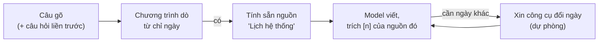

# Bài 24 — Việc phải đúng thì chương trình tính: ngày âm lịch làm mẫu, rồi thời tiết, khoảng cách và các công cụ khác

*Cập nhật 12:54, ngày 22/11/2026 · sửa theo một lượt đối chiếu độc lập · cơ chế đọc từ chương trình và cấu hình trưa 22/11; ví dụ ngày âm lịch là kết quả của chính phần tính ngày, người viết chạy lúc 12:15 22/11 (không gọi model); số đo chép từ báo cáo 05/11 – 22/11, ghi rõ model ở từng con số.*

**Bài trước đã biết:** model được xin công cụ (bài 3, bài 21); tin nối tiếp được hiểu nhờ lịch sử (bài 23).
**Bài này thêm:** việc có đáp án đúng duy nhất (hôm nay là ngày nào, rằm tháng Giêng rơi vào thứ mấy, mai có mưa không, từ A tới B bao xa) do chương trình làm, model chỉ diễn đạt. Bài đi kỹ một việc làm mẫu là ngày và âm lịch, rồi các việc còn lại theo cùng khuôn.

## Ý chính

- **Khuôn chung:** chương trình tính, dựng một khối chữ có con số, đưa vào danh sách nguồn với **một số [n] riêng**, như một đoạn lấy từ kho, để câu trả lời trích được. Model chỉ chọn tham số trong danh sách đóng (số ngày, mã địa điểm) và trích nguồn đó.
- **Ngày và âm lịch** là mẫu: câu có từ chỉ ngày thì chương trình **tính sẵn trước khi gọi model** nguồn "Lịch hệ thống"; công cụ đổi ngày chỉ còn làm dự phòng.
- **Thời tiết:** Open-Meteo, toạ độ cố định, hạn 3 giây, giữ 30 phút; lỗi thì không đưa số nào; câu bão, lũ thì model không nhận số, chương trình nối khối cố định có số 112. Sau khi model viết, câu chứa **số thời tiết lạ bị gỡ** (số km, phút thì soi ở lượt có số khoảng cách do chương trình đưa).
- **Khoảng cách** tra bảng dựng sẵn cho 40 điểm, không gọi mạng lúc trả lời; "gần một điểm" và "liệt kê bài" cũng do chương trình tính.
- Công cụ chỉ được đưa khi câu có từ khoá đúng loại. Cộng tổng tiền chuyến đi đã thử giao cho chương trình hai lần, **cả hai lần bỏ**.

## Từ dùng trong bài

| Tên trong bài | Tên gốc | Nghĩa |
|---|---|---|
| tính sẵn | **pre-compute** | chương trình tính và đưa kết quả vào ngữ cảnh trước lần gọi model đầu, model khỏi phải xin |
| nguồn do chương trình dựng | — | khối chữ chương trình viết (lịch, dự báo, khoảng cách), có số [n] như một đoạn kho |
| kiểm số sau khi viết | — | bước so mọi số thời tiết, khoảng cách trong chữ model với các số chương trình đã đưa |

## Ngày âm lịch: chương trình tính sẵn trước khi gọi model

Model không biết hôm nay là ngày nào, và đổi âm sang dương là phép tính thiên văn model hay lệch một ngày. "Năm nay" còn là bẫy: từ đầu tháng 1 dương tới Tết, năm âm vẫn là năm cũ. Chương trình dùng một thư viện lịch âm Việt Nam chạy trên máy, tính theo giờ Việt Nam, nhận năm 1976–2100.

**Dò từ chỉ ngày** trong câu gõ và câu hỏi liền trước ("hôm nay", "cuối tuần", "rằm", "Tết"…), hẹp có chủ ý: "hoa mai", "vua thứ hai", "xây khi nào" không tính.

**Dựng nguồn "Lịch hệ thống"**: luôn có hôm nay và ngày mai; thêm 7 ngày của tuần được hỏi, rằm tháng này hay tháng tới, và mọi ngày âm nêu trong câu hoặc trong 10 đoạn kho vừa tìm (nhiều nhất 6). Ngày âm không kèm năm thì ghi cả lần đã qua và lần sắp tới, kèm "đã qua / còn bao nhiêu ngày", để model khỏi tự so với hôm nay.

Ví dụ, câu *"Rằm tháng Giêng năm nay rơi vào thứ mấy?"* với hôm nay là 22/11/2026. Đây là kết quả của riêng phần tính ngày, người viết gọi thẳng nó (không qua máy chủ, không gọi model), không phải một lượt hỏi đáp thật (rút gọn):

- Hôm nay: Chủ nhật, 22/11/2026 — ngày 14 tháng 10 âm lịch, năm Bính Ngọ.
- Năm âm lịch nay: rằm tháng Giêng là Thứ Ba, 03/03/2026 — đã qua 264 ngày.
- Lần sắp tới: Thứ Bảy, 20/02/2027, năm Đinh Mùi — còn 90 ngày nữa.
- Ghi chú: người dùng không nêu năm thì trả lời ghi rõ năm của từng ngày; lần đã qua thì nói là đã qua.

Dòng ghi chú có vì lỗi thật 09/11: hỏi tháng 11 về "Tết năm nay", model gọi Tết sắp tới là "năm nay".

**Công cụ đổi ngày** chỉ dùng khi cần ngày chưa có trong nguồn (ví dụ ngày âm ở đoạn tìm thêm): model gửi loại lịch, ngày, tháng, năm, tháng nhuận; chương trình tính, trả thêm một nguồn; nhiều nhất 2 lần mỗi câu.

**Sự kiện theo ngày cùng khuôn:** câu nêu khoảng ngày và hỏi lễ hội ("cuối tuần này có lễ hội gì?") thì chương trình tra bảng 27 dòng chép từ kho, đổi âm ra dương, đăng một nguồn.

## Thời tiết, khoảng cách và các việc khác theo cùng khuôn

| Việc | Chương trình làm | Model làm | Khi không có số |
|---|---|---|---|
| **thời tiết** | hỏi Open-Meteo dự báo 7 ngày cho toạ độ trung tâm Huế; dựng khối số (nhiệt độ, khả năng mưa, lượng mưa) kèm giờ lấy số; **tự nối khối đó dưới câu trả lời** | chọn từ ngày nào tới ngày nào (0 tới 6) | lỗi: chỉ câu "chưa lấy được dự báo"; hỏi xa hơn 7 ngày: không đưa công cụ, nối "Mình chỉ có dự báo 7 ngày tới…" |
| **khoảng cách** | tra bảng km đường đi, phút đi xe giữa 40 điểm; câu đúng dạng "A đến B bao xa" thì tra sẵn | chọn mã hai điểm, hoặc "nơi khác" | "Mình chưa có số khoảng cách cho nơi này." |
| **gần một điểm có gì** | quán có bài kho trong 2 km đường chim bay, hoặc điểm tham quan gần nhất; tối đa 5 | chọn mã điểm và loại | "Mình chưa có vị trí của nơi này nên chưa tính được những gì ở gần đó." |
| **liệt kê bài** | đi qua mọi bài của một nhóm kho, so nguyên cụm từ | chọn nhóm và cụm từ | báo không có bài nào khớp |

**Câu bão, lũ có thêm một lớp.** Khi model chọn loại "bão / lũ" cho công cụ thời tiết, hoặc câu này hay câu liền trước có từ nguy hiểm thời tiết (bão, lũ, lụt, ngập, sạt lở, áp thấp, giông, dông, lốc, mưa đá, nước dâng…), model **không nhận con số nào**. Chương trình nối dưới câu trả lời: "Dự báo dưới đây chỉ có nhiệt độ và mưa, không có thông tin bão hay áp thấp.", bảng mưa, rồi câu cố định: "Với bão, lũ, ngập: hãy theo dõi bản tin chính thức của Trung tâm Dự báo khí tượng thủy văn quốc gia (https://nchmf.gov.vn) và cổng cảnh báo lũ quét, sạt lở (https://luquetsatlo.nchmf.gov.vn); khi gặp nguy hiểm gọi 112." Lượt bão kết thúc kiểu khác vẫn có câu này: từ chối hay câu cố định thì ở dòng ghi chú; chạm trần vòng thì nối vào chữ; lỗi giữa lượt hay câu bị rút thì nối sau lời báo. **Không có** câu này ở ba trường hợp: máy chủ báo lỗi ngay từ đầu (kho tra cứu hoặc model chưa sẵn sàng), mạng đứt giữa chừng (lời báo do giao diện viết), và lượt hiện thẻ hỏi lại. Đọc từ chương trình, chưa thử thật từng nhánh. Lớp này có vì tối 16/11 model tự viết "chưa xác nhận có bão" ngay trên bảng mưa (3 trên 5 lượt chạy lại).

**Kiểm số sau khi viết.** Mọi số thời tiết (°C, %, mm) trong chữ model phải có trong số chương trình đưa, trong đoạn kho được trích, hoặc trong câu hỏi (kèm đơn vị). Số km, phút chỉ được soi như vậy ở lượt có số khoảng cách do chương trình đưa. Từ 21/11 câu chứa số lạ bị gỡ; còn số nguồn thì phần còn lại vẫn là câu trả lời, không còn thì cả câu thành câu từ chối. Ngày tháng không có bước kiểm này.

**Công cụ nào được đưa khi nào.** Tìm kho và liệt kê bài: mọi lượt hỏi đáp. Đổi ngày: có từ chỉ ngày. Thời tiết: có từ thời tiết hay từ nguy hiểm thời tiết, trừ câu hỏi xa hơn 7 ngày. Khoảng cách: có "bao xa", "mấy km", "cách nhau"…, trừ khi đã tra sẵn. Gần một điểm: có "gần", "quanh", "cạnh", "lân cận", "kế bên", "sát bên". Từ khoá xét ở câu gõ và câu hỏi liền trước. Mỗi công cụ ngày, khoảng cách, gần một điểm, liệt kê bài được đưa thì trần vòng (số lần gọi model nhiều nhất của một lượt, bài 21) cộng 1; công cụ thời tiết không cộng.

## Quyết định và lý do

### 1. Vì sao ngày, dự báo, khoảng cách do chương trình tính?

- **Đã chọn:** chương trình tính và in số; model gửi tham số trong danh sách đóng và viết lời quanh số.
- **Vì sao:** luật ghi ở đầu phần tính ngày: phép tính giao cho chương trình. Trước khi làm (30/10, gpt-6-luna), 6 trên 12 câu hỏi theo ngày bị từ chối nhầm vì model không biết ngày. Có công cụ (09/11): bớt 9 câu từ chối nhầm, 0 câu sai ngày. Với khoảng cách, kho hầu như không ghi "từ A tới B bao xa": đếm 16/11, 4 trên 6 câu kiểu đó bị từ chối.
- **Cách khác:** thêm dòng "hôm nay là…" để model tự tính: đã đo, từ chối nhầm chỉ 5,0 xuống 4,5 (cần giảm ít nhất 3), bỏ. Khoảng cách theo đường chim bay nhân 1,3: không làm (mục "Quyết định nhỏ hơn").
- **Cái giá:** nơi, ngày, dạng câu ngoài phạm vi chương trình thì không có số.

### 2. Vì sao lịch được tính sẵn trước lần gọi model?

- **Đã chọn:** câu có từ chỉ ngày thì "Lịch hệ thống" đã có trong ngữ cảnh ngay lần gọi đầu.
- **Vì sao:** chỉ có công cụ thì câu ngày phải chờ hai tới bốn lần gọi model. Đo 10/11 trên 19 câu (gpt-6-luna): chữ đầu ở câu đứng giữa 5,60 xuống 2,35 giây, ở mức 95 % câu 10,14 xuống 4,56 giây, lần gọi model 52 xuống 31; công cụ dự phòng không được gọi lần nào.
- **Cách khác:** chỉ có công cụ (bản 09/11): đã đo như trên.
- **Cái giá:** chỉ các dạng ngày đã liệt kê được tính sẵn; dạng lạ đi đường công cụ, chậm hơn.

### 3. Vì sao chỉ đưa công cụ khi câu có từ khoá?

- **Đã chọn:** cổng theo từ khoá của câu gõ và câu hỏi liền trước.
- **Vì sao:** ghi trong chương trình: công cụ có mặt ở mọi lượt làm đổi cách model trả lời cả câu không liên quan. Đã gặp hai lần: 05/11, thêm công cụ tính tiền làm câu miễn vé bỏ điều kiện 3 trên 3 lần (bản đang chạy 1 trên 3); 17/11, bản "luôn đưa công cụ thời tiết" làm một câu hỏi giá đi lại bị nối bảng mưa, trái luật ghi trước, chủ dự án chọn lùi.
- **Cách khác:** chế độ "luôn đưa" có sẵn trong cấu hình: chưa đo trên model đang chạy.
- **Cái giá:** câu cần công cụ mà thiếu từ khoá thì model không thấy công cụ: đếm 21/11 trên 310 câu, sót 4 trên 60 (đã thêm các từ bị sót).

### 4. Vì sao thời tiết lỗi thì không đưa con số nào, và không gọi lại?

- **Đã chọn:** một lần gọi, hạn 3 giây; lỗi, quá hạn, sai dạng, số ngoài khoảng hợp lý đều là "lỗi", model chỉ nhận câu "chưa lấy được dự báo".
- **Vì sao:** luật ghi trong chương trình: lỗi thì không bao giờ đưa số. Không gọi lại: chưa thấy ghi lý do. Điều thấy được: mọi dịch vụ bên ngoài của hệ thống đều chỉ gọi một lần (bài 6).
- **Cách khác:** gọi lại khi lỗi; dịch vụ thời tiết thứ hai: chưa thử.
- **Cái giá:** Open-Meteo chậm quá 3 giây là lượt đó không có dự báo.

### 5. Vì sao cộng tổng tiền chuyến đi không giao cho chương trình?

- **Đã chọn:** chương trình không cộng tiền; hỏi tổng tiền vé thì model tự cộng giá có nguồn.
- **Vì sao:** hai lần thử, phép cộng đều đúng mà câu trả lời tệ đi (cả hai gpt-6-luna). 05/11: cộng đúng 8 trên 8, nhưng có công cụ thì câu miễn vé bỏ điều kiện 3 trên 3 lần. 19/11: in sẵn tổng, đúng 5 trên 5 ca đối chiếu, nhưng 6 trên 12 lượt hỏi tổng tiền ra câu từ chối, vì thấy dòng "còn điểm chưa có giá" là model đi tìm giá, không thấy, rồi từ chối cả câu.
- **Cách khác:** hai bản trên: đã đo, bỏ. Dặn model "không tự cộng tổng": đã đo, 1 trên 2 câu kín vẫn tự viết dòng "Tổng".
- **Cái giá:** tổng tiền là số model tự cộng; ba lượt đo 19/11 đúng, nhưng không có bước kiểm. Không phải việc nào giao cho chương trình cũng hơn.

## Nếu… thì sao

Tình huống kể trọn: hỏi *"Mai Huế có mưa không?"* lúc Open-Meteo không trả lời. Sau 3 giây là lỗi; model viết câu không số; chương trình nối: "Mình chưa lấy được dự báo thời tiết lúc này — bạn xem bản tin của Trung tâm Dự báo khí tượng thủy văn quốc gia: https://nchmf.gov.vn". Đọc từ chương trình, chưa thử thật.

| Nếu | Người dùng thấy gì | Đã có chưa |
|---|---|---|
| hỏi thời tiết xa hơn 7 ngày | "Mình chỉ có dự báo 7 ngày tới, chưa có dự báo cho ngày bạn hỏi; …" | đã có |
| hỏi khoảng cách tới khách sạn, ga, sân bay | "Mình chưa có số khoảng cách cho nơi này." | **chưa có** số cho nơi ngoài 40 điểm |
| model viết một số mưa không có nguồn, hoặc số km không có nguồn ở lượt dùng công cụ khoảng cách | câu đó bị gỡ khỏi câu trả lời | đã có từ 21/11 |
| máy chủ chưa sẵn sàng khi hỏi câu bão | "Hệ thống tra cứu tạm thời không khả dụng." hoặc "Không thể tạo câu trả lời vào lúc này.", không có câu 112 | **chưa có**; đọc từ chương trình |
| câu bão nói vòng, không có từ nào trong danh sách | có thể thiếu câu bản tin chính thức + 112 (1 trên 22 câu dò) | ghi giới hạn |

## Dễ nhầm

- **"Model biết hôm nay là ngày nào."** Không. Ngày hôm nay do chương trình đưa vào, theo giờ Việt Nam.
- **"Số thời tiết model tự nghĩ ra hoặc đọc web."** Không. Số do chương trình lấy từ Open-Meteo và in; model không được thêm số.

## Câu hỏi tự kiểm

1. Vì sao lịch được tính sẵn chứ không chờ model xin công cụ?

Để bớt vòng gọi model. Đo 10/11: chữ đầu 5,60 xuống 2,35 giây, lần gọi model 52 xuống 31 trên 19 câu.

2. Open-Meteo sập thì người dùng thấy gì?

Câu trả lời không có số dự báo, kèm câu "Mình chưa lấy được dự báo thời tiết lúc này…" chỉ tới bản tin chính thức.

3. Câu bão, lũ khác câu dự báo thường ở đâu?

Model không nhận số; chương trình nối bảng mưa có nhãn "không có thông tin bão" và câu cố định chỉ bản tin chính thức + 112.

4. Vì sao không cho chương trình cộng tổng tiền chuyến đi?

Hai lần thử: phép cộng đúng, nhưng model bỏ điều kiện miễn vé, hoặc từ chối 6 trên 12 lượt.

## Cấu hình đang chạy

*Theo chương trình và cấu hình trưa 22/11/2026.*

| Mục | Giá trị | Dùng để làm gì, vì sao là giá trị này | Đã thử giá trị khác chưa |
|---|---|---|---|
| Công cụ đổi ngày (`ngay_lich`) | bật; nhiều nhất 2 lần mỗi câu | dự phòng cho ngày chưa có trong nguồn "Lịch hệ thống" | — |
| Khoảng năm đổi được | 1976–2100 | trước 1976 hai miền dùng lịch âm khác nhau (Tết 1968: miền Bắc 29/01, miền Nam 30/01); so với bảng Tết tính sẵn thì khớp mọi năm từ 1966 | — |
| Thư viện lịch | thư viện lịch âm Việt Nam, giờ UTC+7 | lịch Trung Quốc tính theo UTC+8, lệch Tết một số năm (1985: 21/01 so với 20/02) | không dùng lịch Trung Quốc |
| Số ngày âm tính sẵn tối đa | 6 mỗi lượt | — | chưa so |
| Dòng "hôm nay" trong tin gửi model (`today_line`) | tắt | đã thay bằng nguồn tính sẵn | đã thử bật: dòng 1 |
| Sự kiện theo ngày (`su_kien_theo_ngay`) | bật 21/11; bảng 27 dòng; khoảng hỏi tối đa 62 ngày | khoảng dài hơn thì danh sách thành "cả năm" | dòng 6 |
| Thời tiết (`thoi_tiet`) | bật 07/11; Open-Meteo; 7 ngày; hạn 3 giây; giữ 30 phút; 1 lần mỗi câu | dự báo không đổi từng phút | chưa so dịch vụ khác |
| Ngưỡng dòng "nếu mưa" trong lịch | khả năng mưa từ 60 % | — | chưa so |
| Câu bão / lũ (`bao_lu_cong_cu`) | bật 17/11 | dòng 4 | bản "luôn đưa công cụ thời tiết": lùi |
| Cổng đưa công cụ (`cong_cong_cu`, cả hai đường model) | theo từ khoá | quyết định 3 | "luôn đưa": có sẵn, chưa đo |
| Khoảng cách (`khoang_cach`) | bật 16/11; 40 điểm, 1.560 cặp; nhiều nhất 3 lần mỗi câu | — | dòng 5 |
| Luật số phút | 1,25 × phút của dịch vụ chỉ đường + 5 | khớp 6 / 6 cặp đối chiếu | sàn 40 km/h: bỏ |
| Khoảng cách tính sẵn (`khoang_cach_tinh_san`) | bật 16/11; chỉ câu đúng dạng hai điểm | dòng 5 | — |
| Gần một điểm (`gan_diem`) | mở 22/11; 2 km chim bay; tối đa 5; nhiều nhất 3 lần mỗi câu | cùng ngưỡng "gần" của mục ăn uống trong thẻ lịch | chưa so |
| Liệt kê bài (`liet_ke_bai`) | mở 22/11; mọi lượt hỏi đáp; nhiều nhất 2 lần mỗi câu | — | dòng 8 |
| Kiểm số sau khi viết | gỡ câu chứa số lạ (từ 21/11); lượt có lịch thì rút cả câu như cũ | trước 21/11 số lạ làm rút cả câu trả lời | — |

## Đã so

| # | Thử gì, so với gì | Bộ câu, model, ngày | Kết quả | Giữ / bỏ |
|---|---|---|---|---|
| 1 | dòng "hôm nay là…" trong tin gửi model | bộ đo của bước xếp loại câu; gpt-6-luna; 02/11 | từ chối nhầm 5,0 ⇒ 4,5 (cần giảm ≥ 3) | bỏ |
| 2 | công cụ đổi ngày, so với không có | bộ câu ngày; gpt-6-luna; 09/11 | bớt 9 câu từ chối nhầm, 0 câu sai ngày | **giữ** |
| 3 | tính sẵn lịch, so với chỉ có công cụ | 19 câu có ngày; gpt-6-luna; 10/11; đo ở máy chủ | chữ đầu 5,60 ⇒ 2,35 s; mức 95 % 10,14 ⇒ 4,56 s; lần gọi 52 ⇒ 31; tiền 0,00049 ⇒ 0,00036 USD / câu | **giữ** |
| 4 | câu bão: model không nhận số, chương trình nối khối | bộ 31 câu do người khác soạn; gpt-6-luna; 17/11 | model tự nhận định có / không có bão: 3 / 5 (trước) ⇒ không ở câu gốc; câu cần khối 112 có khối: 21 / 22; câu thường vẫn có bảng: 3 / 3 | **giữ** |
| 4b | luôn đưa công cụ thời tiết | cùng bộ + 176 câu mẫu; gpt-6-luna; 17/11 | 1 câu hỏi giá đi lại bị nối bảng mưa | bỏ |
| 5 | công cụ khoảng cách; rồi tra sẵn khi câu đúng dạng | 16 câu, hai lần đo (công cụ, rồi tra sẵn); gpt-6-luna; 16/11 | đúng cặp 13 / 14 (tra sẵn: 14 / 14); 0 số sai; nơi ngoài bảng ra số 0 / 2; chữ đầu 3,7 ⇒ 1,9 s | **giữ** |
| 5b | tra sẵn, bản đầu chỉ đếm hai tên | 21 câu phá của người review | 15 / 21 ra sai cặp ⇒ đổi sang chỉ nhận dạng câu quen ⇒ 0 sai | sửa rồi giữ |
| 6 | sự kiện theo ngày | 10 câu; Claude Sonnet 5.5; 21/11 | bị từ chối 4 / 10 ⇒ 0 / 10; 40 ngày dương trong câu trả lời: 0 sai | **giữ** |
| 7 | gần một điểm | 12 câu mù; Claude Sonnet 5.5; 21/11 | 0 lỗi; 30 / 30 số km / phút đúng số chương trình; 0 / 12 câu bịa "gần" | **giữ** |
| 8 | liệt kê bài | 7 câu xin danh sách; Claude Sonnet 5.5; 21/11 | bài đúng loại trong ngữ cảnh: lăng 2 ⇒ 8 / 8, chùa 1 ⇒ 6 / 6; mức "cả bảy câu đạt" ghi trước không đạt (5 / 7) | **giữ** (nhóm đã chốt) |
| 9 | chương trình cộng tiền | 05/11 và 19/11; gpt-6-luna | 8 / 8 và 5 / 5 phép cộng đúng; nhưng bỏ điều kiện miễn vé 3 / 3, và 6 / 12 lượt từ chối | bỏ cả hai |

**Đọc bảng thế nào.** Các dòng giữ có chung một kiểu: chương trình làm phép tính, model chỉ đọc. Dòng 4b và 9 cho thấy giới hạn: mỗi công cụ thêm vào đổi cách model cư xử ở cả phần khác của câu trả lời, nên công cụ chỉ được đưa đúng lúc và mọi lần thêm đều đo lại bộ câu an toàn.

**Giới hạn của các phép đo.** Bộ câu nhỏ (10 tới 31 câu), phần lớn do nhóm soạn. Dòng 1–5 và 9 đo với gpt-6-luna; dòng 6–8 đo với Claude Sonnet 5.5; chưa dòng nào đo trên cả hai model.

## Quyết định nhỏ hơn

**Vì sao khoảng cách tra bảng dựng sẵn?** Toạ độ 40 điểm được gửi cho một dịch vụ chỉ đường công khai một lần lúc dựng bảng (1.560 cặp); lúc trả lời chỉ tra bảng, không gọi mạng, nên không chờ và câu của người dùng không rời máy. Khoảng cách giữa các điểm cố định không đổi (lập luận, không phải số đo). Phút của dịch vụ đó nhanh hơn thực tế nên được đổi bằng luật "1,25 × phút + 5", khớp 6 trên 6 cặp đối chiếu với nguồn công khai; hằng số "không nhanh hơn 40 km/h" chọn bằng mắt trước đó bị review bắt (đổi số phút ở 1.082 trên 1.560 cặp, chỉ khớp 3 trên 6) và bỏ. Đường chim bay nhân 1,3: không làm; kế hoạch chọn đường đi thật vì nó đúng hơn với cặp điểm cách sông, đường vòng (quyết định đã ghi, chưa đo). Cái giá: nơi ngoài 40 điểm (khách sạn, ga, sân bay) không có số; không có đi bộ, đi thuyền.

**Vì sao câu được coi là lượt bão cả khi chỉ câu hỏi liền trước có từ nguy hiểm?** Chương trình chọn "thừa hơn sót": "vậy có nên ra biển không" ngay sau một câu bão vẫn là chuyện bão. Cái giá: câu hỏi tiếp không liên quan ngay sau câu bão cũng nhận câu 112 ở cuối; riêng câu dẫn "không theo dõi được tin bão" thì chỉ đặt khi chính câu đang hỏi có từ nguy hiểm.

**Vì sao bước kiểm số gỡ câu ở lượt thường mà rút cả câu ở lượt có lịch?** Ghi trong chương trình: chữ của lượt lịch được ghép với khung lịch do chương trình dựng, nên không gỡ từng câu được; lượt lịch giữ cách cũ (rút lại, nút "Thử lại").

**Vì sao tra sẵn khoảng cách chỉ nhận một dạng câu hẹp?** Bản đầu chỉ đếm "có đúng hai tên điểm" thì 15 trên 21 câu phá của người review ra sai cặp (hỏi khoảng cách tới nơi thứ ba, tên điểm nằm trong tên khách sạn…), mà bước kiểm số vẫn cho qua vì số "có nguồn". Đổi sang chỉ nhận dạng "[từ] A <từ nối> B <từ hỏi khoảng cách>": 0 câu sai cặp; câu khác dạng đi đường công cụ, chậm hơn nhưng đúng.

## Giới hạn đã biết

- **Ngày model viết không bị chương trình kiểm lại.** Bước kiểm số chỉ soi số thời tiết và khoảng cách; ngày chỉ được bảo đảm nhờ nguồn tính sẵn và số nguồn.
- **Dạng ngày ít gặp** đi đường công cụ, chậm hơn; câu không dấu không bật công cụ.
- **Thời tiết "tuần sau"** chỉ có số cho phần nằm trong 7 ngày; chương trình ghi rõ dự báo có tới ngày nào.
- **Khoảng cách và "gần"** chỉ cho 40 điểm và 41 quán có vị trí; "gần" là đường chim bay; công cụ "gần" không biết giờ mở cửa.
- **Tổng tiền là số model tự cộng.**
- **Lưới từ nguy hiểm thời tiết** vẫn sót vài cách nói tự nhiên ("nước có lên nữa không") và nhận thừa vài câu ("bão giá", tên phim).

## Chi tiết để tra

- Nguồn "Lịch hệ thống" mang tên "Lịch hệ thống — tính theo giờ Việt Nam"; nguồn sự kiện mang tên "Lễ hội và hoạt động theo ngày — code tra từ các bài của kho"; nguồn dự báo "Dự báo thời tiết Huế (Open-Meteo)"; nguồn liệt kê "Mục lục kho tư liệu". Không nguồn nào trong số này kéo theo dòng "có thể đã thay đổi" của bài vé.
- Bảng sự kiện: 17 lễ hội ngày cố định, 6 lễ hội kho chỉ ghi khoảng, 4 hoạt động theo tuần; không có sự kiện một lần và lễ hội "theo kế hoạch từng năm"; câu hỏi về quá khứ ("tuần trước") không tra; "tháng 7" trần hiểu là tháng dương.
- Khối dự báo ghi "khả năng mưa cao nhất trong ngày", vì số của Open-Meteo là giờ dễ mưa nhất, không phải cả ngày (tra 15/11). Ghi công "Dữ liệu thời tiết: Open-Meteo.com (CC BY 4.0)" và giờ lấy số. Hỏi theo buổi thì thêm "Đây là dự báo theo cả ngày, không riêng buổi bạn hỏi."
- Có dự báo mà model trả câu từ chối thì chương trình thay bằng "Mình có dự báo cho ngày bạn hỏi:" rồi nối bảng (review 06/11 bắt 4 trên 20 lượt câu từ chối đứng ngay trên bảng số).
- Kiểm số nhận số người dùng tự gõ kèm đơn vị ("63 % thì mưa nhiều không") từ 21/11, sau khi 5 trên 7 lượt bị rút oan ở lượt người dùng mô phỏng.
- Khoảng cách: câu trả lời trích nguồn khoảng cách mà không nhắc "kẹt xe" thì chương trình nối "Số ước theo đường đi trên bản đồ, chưa tính kẹt xe hay dừng nghỉ." (model tự chép câu này chỉ ở 33 trên 52 câu).
- Tra sẵn khoảng cách chỉ nhận dạng câu "[từ] A <từ nối> B <từ hỏi khoảng cách>"; ba nơi, câu so sánh, câu "từ đó sang…" đi đường công cụ.
- Thời tiết không cộng vòng vào trần vòng; ngày, khoảng cách, gần một điểm, liệt kê bài mỗi cái cộng 1.
- Hỏi ngày trước năm 1976 hay sau 2100: "Mình chỉ đổi được ngày từ năm 1976 đến 2100 (trước 1976 lịch âm hai miền khác nhau)." (cố ý). Dò từ chỉ ngày còn nhận "ngày mai", "tuần sau", "mùng", "âm lịch", "năm nay", "thứ Bảy"; "mai" đứng một mình không tính.
- Trang chủ có một ô thời tiết đọc cùng dịch vụ, không gọi model; lỗi thì ô đó ẩn.
- Lượt đo thời tiết sau khi sửa nhãn mưa (14 câu): 0 số sai, gọi công cụ 9 / 9 (gpt-6-luna).

**Bài sau (bài 25):** khi kho không có: tra web một lần, để riêng mục "chưa kiểm".

Nguồn (để giữ bài đúng — anh không cần đọc)

- Ví dụ rằm tháng Giêng: người viết gọi `nl.lich_san("Rằm tháng Giêng năm nay rơi vào thứ mấy?", "", now=22/11/2026 12:00)` bằng `uv run --no-sync python` trong `backend/`, 12:15 22/11/2026 [đã chạy; hàm thuần, không gọi model]; cùng lúc kiểm `co_tu_ngay`: "Lăng Tự Đức xây khi nào?" ⇒ không, "vua thứ hai triều Nguyễn là ai" ⇒ không.
- Phần ngày: `backend/llm/ngay_lich.py` (chú thích đầu file: thư viện, UTC+7, 1976–2100, Tết 1968 / 1985; `_TU_NGAY`, `_THU_TU`, `co_tu_ngay_luot`, `lich_san`, `SO_NGAY_AM_TOI_DA`, `GHI_CHU_NAM` và chú thích 09/11, `CAU_NGOAI_KHOANG`); `backend/llm/assistant.py` (`_before_model` gọi `_nguon_lich_san`, `ngay_lich_for_turn` ≤ 2 lần); mô tả công cụ `NGAY_LICH_MO_TA` (`backend/llm/full_corpus_prompt.py`) [code, đọc 22/11].
- 6 / 12 câu (30/10), dòng "hôm nay" không đỡ: `docs/superpowers/plans/2026-11-08-phase-9-t1-ngay-plan.md` mục 1 [kế hoạch]; 5,0 ⇒ 4,5: `bai_hoc/19_BANG_TONG_CAC_LAN_SO_SANH.md` dòng 33; bớt 9 câu, 0 sai ngày, 5,60 ⇒ 2,35 … 52 ⇒ 31: dòng 23 và `bai_hoc/14_VIEC_DE_NHAM_THI_CODE_LAM.md` (nguồn gốc `bao_cao_he_thong/07_…`) [đã chạy, gpt-6-luna; chép].
- Sự kiện theo ngày: `backend/llm/su_kien.py` (chú thích đầu file, `KHOANG_TOI_DA`, `dong_nguon`, `_QUA_KHU`), `assistant.py` `_nguon_su_kien`; 27 dòng: `settings.yaml` dòng `su_kien_bang`; 4 / 10 ⇒ 0 / 10, 40 ngày: dòng `su_kien_theo_ngay` + `bai_hoc/VIEC_MOI_XONG.md` mục 28 [đã chạy 21/11, Claude].
- Thời tiết: `backend/llm/thoi_tiet.py` (chú thích đầu file "lỗi … không bao giờ đưa số", `HUE_LAT/LON`, `TIMEOUT_S`, `CACHE_S`, `SO_NGAY`, `MIEN`, `NGUONG_MUA`, `CAU_LOI`, `CAU_BAO_LU`, `CAU_NGOAI_7_NGAY`, `CAU_KHONG_PHAI_TIN_BAO`, `CAU_DAN_DU_BAO`, `lay_du_bao`, `khoi_du_bao`, `_BAO_LU_RONG`, `_BAO_LU_THEM`); `assistant.py` (`thoi_tiet_for_turn`, `_thoi_tiet_bao_lu`, `_thoi_tiet_cuoi`, `luoi_cuoi_bao`, `loi_bao_luoi_cuoi`, `_finish_generated` nhánh chạm trần) [code]. Lỗi 16/11 và 3 / 5, bảng 31 câu, "luôn đưa" lùi: `bai_hoc/14_…` mục "Câu hỏi bão, lũ" (nguồn gốc `report_agent/2026-11-12_ra_khoang_cach/b_cau_bao_implementation.md`) [đã chạy 17/11, gpt-6-luna; chép]. 14 câu 0 số sai 9 / 9, 4 / 20: `bao_cao_he_thong/07_…` dòng 301, 382 [đã chạy].
- Kiểm số: `assistant.py` (`_so_la`, `_go_so_la`, `kiem_so_sau_khi_viet`; chú thích 5 / 7 rút oan) [code]; không có kiểm ngày: `_so_la` chỉ có nhánh `thoi_tiet` và `khoang_cach` [suy từ code].
- Cổng công cụ: `assistant.py` `_lich_extra`; `generator_openai_full_corpus.py` `max_turns_for` (không cộng vòng cho thời tiết); lý do "công cụ có mặt mọi lượt đổi cách model tìm": chú thích `_TU_NGAY` trong `ngay_lich.py`; 310 câu, 4 / 60: `report_agent/2026-11-21/c_cong_cong_cu.md` mục 1 [đã chạy 21/11]; "luôn đưa" chưa đo: cùng báo cáo, dòng "[chưa kiểm]".
- Khoảng cách: `backend/llm/khoang_cach.py` (chú thích đầu file, `HE_SO_OSRM`, `PHUT_CONG` và chú thích 6 / 6, `CAU_CHUA_CO`, `CAU_GHI_CHU`, `cap_tinh_san`), `assistant.py` (`khoang_cach_for_turn` ≤ 3 lần, `set_notice` câu kẹt xe); 1.560 cặp, 4 / 6, 13 / 14, 1,9 s, 15 / 21, 1.082 / 1.560, 33 / 52: `bai_hoc/14_…` mục "Khoảng cách" (nguồn gốc `report_agent/2026-11-12_ra_khoang_cach/c_khoang_cach_implementation.md`, `c_kc_tinh_san_implementation.md`) [đã chạy 16/11, gpt-6-luna; chép]; chim bay × 1,3 bị bỏ: `docs/superpowers/plans/2026-11-16-khoang-cach-plan.md` (qua bài 6 giáo trình).
- Gần một điểm: `backend/llm/gan_diem.py` (chú thích đầu file, `KM_TOI_DA`, `SO_TOI_DA`, `CAU_NGOAI_BANG`, `_TU_KHOA`); số 12 câu mù: `bai_hoc/VIEC_MOI_XONG.md` mục 31 [đã chạy 21/11, Claude]. Liệt kê bài: `backend/llm/liet_ke.py` (`NHOM`, `SO_LAN_MOI_LUOT`), `LIET_KE_MO_TA`; số: `VIEC_MOI_XONG.md` mục 36 [đã chạy 21/11, Claude].
- Cộng tiền: 05/11 (8 / 8; 3 / 3 ↔ 1 / 3; dặn không cộng 1 / 2): `bai_hoc/14_…` "Một chuyện thật: dặn model…", `bai_hoc/19_…` dòng 20 [đã chạy, gpt-6-luna; chép]. 19/11 (5 / 5; 6 / 12; nguyên nhân qua sổ vết): `bai_hoc/VIEC_MOI_XONG.md` mục 13 ý 3 [đã chạy, gpt-6-luna]; giới hạn "model tự cộng": `guides/RUNBOOK_BAN_GIAO.md` 10.2 dòng `lich_vao_hoi_thuong`.
- Câu bão nói vòng 1 / 22; lưới sót "nước có lên nữa không": `guides/RUNBOOK_BAN_GIAO.md` 10.1 [chép].
- Ba trường hợp không có câu 112: `backend/api/routes/chat.py` (`_retrieval_not_ready`, `_error_response_for(GeneratorNotReadyError…)` trước khi mở luồng, không qua `loi_bao_luoi_cuoi`), `frontend/src/stream.js` (lời báo mạng đứt), `assistant.py` `luoi_cuoi_bao` (bỏ qua khi có thẻ hỏi lại) [suy từ code, chưa thử]. Số km chỉ soi khi có số do chương trình đưa: `_so_la` (`so_code` rỗng ⇒ không soi) [code]. Thừa hơn sót: `thoi_tiet.la_luot_bao_lu`, `assistant._luot_bao_lu`, `_can_dau_bao_lu`; gỡ câu / rút cả câu: `kiem_so_sau_khi_viet`; tra sẵn dạng hẹp, 15 / 21: `report_agent/2026-11-12_ra_khoang_cach/c_kc_tinh_san_implementation.md` (qua `bai_hoc/14_…`) [chép]. Dòng "hôm nay" 5,0 ⇒ 4,5 (bộ đo B1, 02/11) và mức 95 %: `bao_cao_he_thong/07_…` dòng 104–106, 464 [đã chạy]. Chim bay × 1,3 là phương án (b) của kế hoạch, không có phép đo: `docs/superpowers/plans/2026-11-16-khoang-cach-plan.md` mục 2.
- Bài đã qua một lượt đối chiếu độc lập với chương trình và số đo ngày 22/11 (32 dòng: 7 lệch, đã sửa; người kiểm tự chạy lại hàm tính lịch, ra đúng các số của ví dụ): `data/hoc_cung_D/kiem/bai_23_26.md` [riêng tư].

