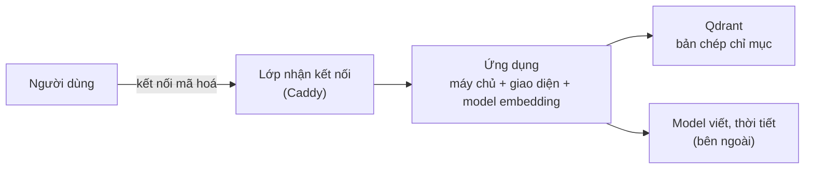

# Bài 36 — Bật hệ thống trên máy, và đóng gói bằng Docker

*Cập nhật 13:54, ngày 22/11/2026 · lệnh bật đọc từ chương trình ở cây chính trưa 22/11 (lệnh có từ trưa 22/11); các ca hỏng lúc bật lấy từ bài 6 (thử thật 22/11); gói ba hộp đọc từ bản nháp riêng tư và lần chạy thử trên máy ngày 10/11 (gpt-6-luna, kho lúc đó 204 bài); người viết không chạy lệnh bật, không dựng gói; bài đã qua một lượt đối chiếu độc lập và sửa theo đó.*

**Bài trước đã biết:** máy chủ kiểm một số thứ đúng một lần lúc bật, và bật lúc Qdrant tắt thì không tự hồi (bài 6); kho đổi thì phải cập nhật chỉ mục (bài 12); khoá và các thiết lập lúc chạy (bài 37).
**Bài này thêm:** bật cả hệ thống trên máy phát triển bằng một lệnh, lệnh đó làm gì và báo gì; "hộp Docker" là gì và hệ thống dùng nó ở đâu; gói ba hộp để mang sang máy khác; và những việc còn phải làm trước khi đưa lên mạng.

## Ý chính

- **Bật trên máy phát triển là một lệnh.** Lệnh kiểm từng điều kiện theo thứ tự: có file bí mật, giao diện đã dựng, có bản ghi chỉ mục, biết đường tới file khoá model, Qdrant chạy và đủ số đoạn, rồi mới bật máy chủ. Cuối cùng nó in **"SẴN SÀNG"** hoặc **đúng một dòng "thiếu gì ⇒ làm gì"**.
- Lệnh có vì **các ca hỏng thử thật trưa 22/11** (bài 6): máy chủ vẫn lên khi thiếu Qdrant hay thiếu khoá, nhưng mọi câu hỏi lỗi mà màn hình không nói vì sao.
- **Qdrant chạy trong một hộp Docker** ngay trên máy phát triển, chỉ nhận yêu cầu từ chính máy đó. Máy chủ thì chạy thẳng trên máy, không trong hộp.
- **Có một gói ba hộp** (lớp nhận kết nối, ứng dụng, Qdrant) để mang hệ thống sang máy khác; đã chạy thử trên máy ngày 10/11. **Chưa đưa lên mạng**: chủ dự án dặn tập trung hoàn thành ở máy trước. Gói nháp đã cũ so với chương trình hiện tại và phải cập nhật trước khi dựng lại.

## Từ dùng trong bài

| Tên trong bài | Tên gốc | Nghĩa |
|---|---|---|
| Docker | **Docker** | phần mềm chạy chương trình trong những "hộp" cách ly, mỗi hộp mang sẵn đủ thứ nó cần; trên máy phát triển là Docker Desktop của Windows |
| ảnh đóng gói | **image** | bản đóng gói của một hộp: chương trình, thư viện, dữ liệu cần thiết, đóng thành một khối; máy nào có Docker cũng chạy được giống nhau |
| hộp | **container** | một ảnh đóng gói đang chạy |
| file mô tả các hộp | **compose file** | file liệt kê các hộp, ảnh của từng hộp, cổng mở, thư mục gắn vào; một lệnh bật hết theo file đó |
| cổng | **port** | số của "cửa" trên một máy mà một chương trình đứng nghe; máy chủ hue_rag nghe ở cổng 8010, Qdrant ở 6335 |
| tiến trình | **process** | một chương trình đang chạy trên máy; máy chủ hue_rag là một tiến trình, tắt là mất mọi thứ nó giữ trong bộ nhớ |
| lớp nhận kết nối | **reverse proxy** (Caddy) | chương trình đứng ngoài cùng, nhận mọi kết nối từ mạng, lo kết nối mã hoá (bài 35), rồi chuyển vào ứng dụng |
| dựng giao diện | **build** | đổi chương trình giao diện thành các file tĩnh để máy chủ gửi cho trình duyệt (bài 5) |

## Một lệnh bật kiểm từng điều kiện trước khi bật máy chủ

Trước trưa 22/11, bật hệ thống là gõ tay ba bốn lệnh: bật Qdrant, kiểm số đoạn, đặt đường tới file khoá, bật máy chủ. Nay chỉ còn một lệnh. Nó làm theo thứ tự này, và dừng ở bước đầu tiên không đạt:

| Bước | Kiểm gì | Không đạt thì in (rút gọn) |
|---|---|---|
| 1 | có file bí mật ở gốc dự án (chỉ xem có file, không đọc) | thiếu file bí mật ⇒ đặt lại rồi chạy lại |
| 2 | giao diện đã được dựng | giao diện chưa được dựng ⇒ chạy lệnh dựng |
| 3 | có bản ghi chỉ mục (bài 12) | chỉ mục chưa được dựng trên máy này |
| 4 | nếu model viết là Claude: biết đường tới file khoá Bedrock, và file đó có thật | chưa biết file khoá ở đâu ⇒ ghi đường dẫn vào một file riêng tư, hoặc đặt thiết lập lúc chạy |
| 5 | bật Qdrant; chờ tối đa khoảng 30 giây cho tới khi Qdrant báo có đủ 9.458 đoạn như bản ghi lúc dựng chỉ mục | không có Docker ⇒ bật Docker Desktop · Qdrant không trả lời · chỉ mục có N đoạn, bản ghi ghi 9.458 ⇒ chỉ mục lệch kho |
| 6 | cổng 8010 đã có máy chủ chưa: có và báo đủ thì dùng luôn; có mà báo thiếu thì bảo tắt nó trước | cổng đang có một máy chủ báo chưa sẵn sàng ⇒ tắt nó rồi chạy lại |
| 7 | bật máy chủ; chờ tới 90 giây cho đường báo tình trạng | máy chủ tự thoát · không trả lời sau 90 giây · lên nhưng phần nào "chưa sẵn sàng" |

Đạt hết, lệnh in: "SẴN SÀNG — mở http://127.0.0.1:8010   (Ctrl+C ở cửa sổ này để tắt server · log: …)". Ctrl+C tắt máy chủ, để nguyên Qdrant. Mỗi dòng dừng đều bắt đầu bằng "CHƯA BẬT ĐƯỢC — ".

Đã chạy thật trên máy, ở một cổng tạm, bốn ca: đủ mọi thứ thì 14 giây ra "SẴN SÀNG" và hỏi được qua trình duyệt; thiếu đường tới file khoá, hoặc đường dẫn trỏ tới file không có, thì ra một dòng nói thiếu gì; gõ lại khi máy chủ đang chạy thì báo đã chạy sẵn; Ctrl+C tắt gọn. **Chưa thử** ca quan trọng nhất: gõ lệnh lúc Qdrant đang tắt (máy vừa mở lại). Các dòng báo khác (Docker chưa bật, chỉ mục lệch, giao diện chưa dựng) mới đọc từ lệnh.

Đường tới file khoá Bedrock được lấy theo thứ tự: thiết lập lúc chạy nếu người bật đặt; không thì dòng đầu của một file riêng tư trong thư mục dữ liệu (thư mục không vào git). File riêng tư đó chỉ chứa một đường dẫn, không chứa khoá. Lệnh không đọc nội dung file bí mật hay file khoá; chỉ xem file có tồn tại.

## Lệnh bật không thay các việc khác của người vận hành

- **Kho đổi:** tắt máy chủ, chạy lệnh cập nhật chỉ mục (khoảng 30 giây), rồi bật lại (bài 12). Lệnh cập nhật tự dừng nếu thấy máy chủ còn mở ở cổng 8010. Nếu quên, lệnh bật sẽ thấy số đoạn lệch và dừng ở bước 5.
- **Giao diện đổi:** dựng lại giao diện rồi bật lại.
- **Đổi model viết:** sửa một dòng cấu hình, khởi động lại (bài 33).

## Qdrant chạy trong một hộp Docker, máy chủ chạy thẳng trên máy

Trên máy phát triển, Docker chỉ dùng cho Qdrant. File mô tả hộp nằm trong repo: ghim đúng một bản Qdrant, gắn thư mục dữ liệu từ ổ đĩa vào hộp (dữ liệu còn khi hộp tắt), mở cổng **chỉ cho chính máy đó**. Máy chủ và model embedding chạy thẳng bằng Python, không trong hộp.

**Gói ba hộp** là để mang cả hệ thống sang một máy khác (ví dụ một máy thuê trên mạng):

- **Lớp nhận kết nối** là hộp duy nhất mở ra mạng; nó tự xin chứng nhận cho kết nối mã hoá khi có tên miền, và không gom chữ của đường gửi dần.
- **Ứng dụng** mang sẵn máy chủ, giao diện đã dựng, model embedding, và đúng các bài kho đã lập chỉ mục. Khoá không nằm trong ảnh; chỉ nạp lúc chạy. Hộp này không mở cổng ra ngoài.
- **Qdrant** chạy một bản chép của chỉ mục, không mở cổng ra ngoài.

Ảnh của ứng dụng có các bảng dữ liệu riêng tư (bảng điểm lịch, quán, chỗ ở…), nên không được đẩy lên kho ảnh công khai; nó được dựng ngay trên máy sẽ chạy. Bản nháp của gói nằm trong thư mục dữ liệu riêng tư, không trong repo.

Gói đã chạy thử trên máy một lần, ngày 10/11, với gpt-6-luna và kho 204 bài (số ở nửa để tra); kết nối mã hoá thật chưa thử.

## Quyết định và lý do

### 1. Vì sao gom việc bật thành một lệnh, mà không để máy chủ tự từ chối khởi động khi thiếu?

- **Đã chọn:** một lệnh ngoài máy chủ kiểm từng điều kiện rồi mới bật; máy chủ giữ nguyên cách cũ (vẫn lên khi thiếu, báo "thiếu" ở đường báo tình trạng).
- **Vì sao:** lý do ghi đầu lệnh: các ca thử thật trưa 22/11 cho thấy máy chủ vẫn lên mà mọi câu lỗi, màn hình không nói vì sao, và bật Qdrant sau không tự hết. Máy chủ vẫn lên khi thiếu khoá; nhờ vậy các trang không cần model (Khám phá, Bản đồ, Chỗ ở) vẫn dùng được (bài 6), nhưng đây là hệ quả, chưa thấy ghi là lý do.
- **Cách khác:** sửa máy chủ cho tự nối lại Qdrant khi Qdrant chạy lại: chưa thử. Để máy chủ từ chối khởi động khi thiếu: không làm.
- **Cái giá:** lệnh chỉ dùng được ở máy phát triển (đường dẫn, cổng 8010, Docker Desktop). Người chạy máy chủ bằng tay vẫn có thể gặp đủ bốn ca cũ.

### 2. Vì sao lệnh kiểm khoá trước, rồi Qdrant, rồi mới bật máy chủ?

- **Đã chọn:** đúng thứ tự trong bảng ở trên; dừng ở lỗi đầu tiên, in đúng một dòng.
- **Vì sao:** chú thích trong lệnh: kiểm khoá trước khi bật gì để lỗi này không lẫn với lỗi khác. Qdrant phải đủ đoạn trước khi bật máy chủ vì máy chủ chỉ nối tới Qdrant và so kho với chỉ mục một lần lúc bật (bài 6, 12).
- **Cách khác:** bật hết rồi đọc đường báo tình trạng: là cách gõ tay trước đây, người bật phải tự hiểu chữ "not_ready".
- **Cái giá:** mỗi lần chỉ thấy một lỗi; thiếu hai thứ thì phải chạy hai lần.

### 3. Vì sao Qdrant chạy trong hộp Docker và chỉ nhận yêu cầu từ chính máy?

- **Đã chọn:** một hộp Qdrant ghim đúng một bản, dữ liệu gắn từ ổ đĩa, cổng chỉ mở cho chính máy.
- **Vì sao:** chưa thấy ghi lý do. Điều thấy được: file mô tả ghi đúng một bản Qdrant bằng một mã nhận dạng duy nhất (mã băm), nên lần nào tải cũng ra cùng một bản; lệnh bật, bộ test và các phép đo đều nói chuyện với Qdrant qua cổng 6335 của chính máy; gói ba hộp dùng cùng bản Qdrant đó.
- **Cách khác:** cài Qdrant thẳng lên máy: chưa thử. Một dịch vụ Qdrant thuê trên mạng: không làm.
- **Cái giá:** phải bật Docker Desktop trước; mở lại máy là Qdrant tắt. Lệnh cập nhật chỉ mục chụp bản sao lưu nằm **trong** hộp, hộp bị tạo lại là mất (bài 12).

### 4. Vì sao chưa đưa lên mạng?

- **Đã chọn:** chưa đưa; gói nằm ở dạng nháp đã chạy thử trên máy.
- **Vì sao:** chủ dự án quyết: xong hết ở máy, tự thử một lần ở máy, rồi mới đưa lên nếu làm (19/11); đưa lên mạng không bắt buộc, là điểm cộng (21/11); sáng 22/11: "giờ tập trung hoàn thành ở local đi nhé".
- **Cách khác:** đưa lên sớm để có người dùng thật: không làm (quyết định đã ghi).
- **Cái giá:** các chốt cho bản trên mạng (bài 37) chưa được thử trên máy thật; mọi số đo là của máy phát triển.

## Nếu… thì sao

Một tình huống kể trọn. Sáng hôm sau, chủ dự án mở lại máy và chạy lệnh bật. Docker Desktop chưa chạy, nên lệnh dừng ngay ở bước 5 với một dòng: docker không bật được Qdrant, hãy bật Docker Desktop rồi chạy lại. Chủ dự án bật Docker Desktop, chạy lại. Lần này Qdrant lên, đủ 9.458 đoạn, đường tới file khoá đã ghi từ hôm trước trong file riêng tư, máy chủ bật và lệnh in "SẴN SÀNG". Nếu khoá Bedrock đã hết hạn qua đêm, lệnh vẫn in "SẴN SÀNG", vì nó chỉ thấy file khoá có tồn tại; câu hỏi đầu tiên mới lộ lỗi (bài 33).

Lời báo của người dùng là nguyên văn; các dòng đọc từ chương trình, trừ dòng có chữ **(đã thử)** (bài 6).

| Nếu | Lệnh bật hoặc người dùng thấy gì | Ai làm gì |
|---|---|---|
| Docker Desktop chưa chạy | lệnh dừng: không có lệnh docker, hoặc docker không bật được Qdrant (đọc từ lệnh, chưa thử) | người bật mở Docker Desktop |
| chỉ mục lệch kho | lệnh dừng: chỉ mục có N đoạn, bản ghi ghi 9.458 | chạy lệnh cập nhật chỉ mục (bài 12) |
| cổng 8010 có một máy chủ cũ bật lúc Qdrant tắt **(đã thử ca gốc)** | lệnh dừng: cổng đang có máy chủ báo chưa sẵn sàng, hãy tắt nó trước | tắt máy chủ cũ, chạy lại |
| khoá Bedrock hết hạn | lệnh vẫn in "SẴN SÀNG"; câu hỏi nhận "Không thể tạo câu trả lời vào lúc này." | chủ dự án làm mới file khoá; không cần bật lại |
| dựng lại gói ba hộp bằng bản nháp hiện có | ứng dụng có thể không khởi động hoặc không trả lời được: bản nháp chép bảng dữ liệu cũ, thiếu bảng khoảng cách, bảng sự kiện, bảng điểm mới; danh sách file bài chép vào gói sinh từ bản ghi chỉ mục ngày 16/11 (263 bài, kho nay 266); file mô tả gói không có chỗ đưa file khoá Bedrock vào hộp, nên mọi câu sẽ nhận "Không thể tạo câu trả lời vào lúc này." | cập nhật gói trước khi dựng (đọc từ file, chưa dựng thử) |
| đưa gói lên mạng mà tên miền chưa có kết nối mã hoá | cookie bị trình duyệt bỏ, trợ lý mất trí nhớ hội thoại, không báo lỗi | đặt tên miền có kết nối mã hoá trước (ghi trong bản nháp) |

## Dễ nhầm

- **"Cả hệ thống chạy trong Docker."** Trên máy phát triển, chỉ Qdrant chạy trong hộp; máy chủ chạy thẳng. Gói ba hộp là cho máy khác.
- **"Lệnh in SẴN SÀNG là hỏi được."** Gần đúng: lệnh không gọi thử model, nên khoá hết hạn vẫn lọt.
- **"Gói đã sẵn sàng đưa lên mạng."** Chưa: bản nháp dựng ngày 10/11 cho gpt-6-luna và kho 204 bài; phải cập nhật bảng dữ liệu, cách cấp khoá Bedrock, và các việc ở bài 37.

## Câu hỏi tự kiểm

1. Vì sao lệnh bật chờ Qdrant đủ đoạn rồi mới bật máy chủ?

Máy chủ chỉ nối tới Qdrant và so kho với chỉ mục một lần lúc bật. Bật trước khi Qdrant sẵn sàng thì mọi câu lỗi, và bật Qdrant sau không tự hết.

2. Trên máy phát triển, Docker dùng cho việc gì?

Chỉ để chạy Qdrant, trong một hộp ghim đúng bản, cổng chỉ mở cho chính máy. Máy chủ chạy thẳng bằng Python.

3. Gói ba hộp gồm gì, và hộp nào mở ra mạng?

Lớp nhận kết nối, ứng dụng, Qdrant. Chỉ lớp nhận kết nối mở ra mạng; hai hộp kia chỉ nói chuyện bên trong.

4. Vì sao gói dùng danh sách cho phép?

Bản đầu dùng danh sách chặn và lọt file đánh giá, câu hỏi mẫu. Danh sách cho phép mặc định cấm hết; cái giá là thiếu file thì tính năng tự tắt.

## Cấu hình đang chạy

| Mục | Giá trị | Dùng để làm gì | Đã thử giá trị khác chưa |
|---|---|---|---|
| Cổng máy chủ | 8010 | lệnh bật, lệnh cập nhật chỉ mục đều dò cổng này | phiên đo dùng 8011–8099 cho máy chủ thử |
| Cổng Qdrant | 6335 (và 6336), chỉ cho chính máy | — | — |
| Bản Qdrant | một bản ghim bằng mã băm (1.18.3) | cùng bản ở máy phát triển và trong gói | — |
| Chờ Qdrant đủ đoạn · chờ máy chủ | 30 giây · 90 giây | cả lệnh ra "SẴN SÀNG" sau khoảng 14 giây khi mọi thứ đủ | — |
| `HUE_BEDROCK_CREDS_FILE` | đặt trước lệnh, hoặc lấy từ file riêng tư chỉ ghi đường dẫn | đường tới file khoá tạm | — |
| Chế độ không tải model từ mạng | bật khi chạy máy chủ | model embedding đã có trên máy | — |
| Sổ của máy chủ khi bật bằng lệnh | một file trong thư mục tạm | xem khi lệnh báo máy chủ tự thoát | — |
| Gói ba hộp: trần bộ nhớ | ứng dụng 2 GB, Qdrant 768 MB | đo 07/11: ứng dụng khoảng 1,5 GB | — |
| Gói ba hộp: thiết lập đặt sẵn | 50 lượt mỗi địa chỉ, cookie mã hoá, tắt trang mô tả, tắt tra web; trần tổng mỗi ngày chưa có trong bản nháp | bài 37 | — |

## Quyết định nhỏ hơn

**Vì sao gói chỉ chép đúng từng file được liệt kê?**

- **Đã chọn:** danh sách cho phép, sinh tự động từ bản ghi chỉ mục: mặc định cấm hết, mở đúng các mục cần và từng bài kho một; gặp đường dẫn lạ (thư mục đánh giá, câu kín, sao lưu) thì dừng.
- **Vì sao:** bản gói đầu tiên (07/11) dùng danh sách chặn và lọt 16 file đánh giá (có câu hỏi mẫu) cùng 148 file ghi chú, sao lưu; người dựng kiểm bằng một lệnh chỉ in 3 dòng đầu nên báo "0 file". Một phiên khác đếm đủ mới thấy.
- **Cách khác:** danh sách chặn, thêm dòng cho đủ: là bản 07/11, đã bỏ.
- **Cái giá:** thiếu một file là tính năng tự tắt. Ngày 10/11 hỏi bằng ảnh tự tắt vì danh sách thiếu file tên ảnh; người kiểm phát hiện.

**Vì sao chỉ chạy một tiến trình máy chủ, không nhiều bản cho nhanh?** Lý do ghi trong file dựng gói: kho cuộc trò chuyện và mã lượt nằm trong bộ nhớ của tiến trình, nên không chạy nhiều bản. Cái giá: một máy chủ phục vụ mọi người; các bộ đếm và bộ nhớ ở bài 34, 35, 37 chỉ đúng khi có một tiến trình.

## Những việc phải làm trước khi đưa lên mạng

| Việc | Trạng thái |
|---|---|
| cập nhật danh sách file của gói theo chương trình hiện tại (bảng điểm mới, bảng quán bản 2, bảng khoảng cách, bảng sự kiện; sinh lại danh sách bài theo kho 266 bài) | chưa |
| chỗ đưa file khoá Bedrock vào hộp ứng dụng | chưa có trong file mô tả gói |
| đặt trần tổng lượt mỗi ngày trong file mô tả gói | chưa |
| cách cấp khoá cho Bedrock trên máy chủ (khoá tạm hiện nay không dùng lâu được) | chưa; việc của chủ dự án |
| lớp chặn tiền ở phía hãng model, trần tổng lượt mỗi ngày (bài 37) | trần tổng có sẵn, đang tắt; lớp phía hãng chưa |
| trần kích thước yêu cầu ở lớp nhận kết nối | chưa |
| kết nối mã hoá thật với tên miền | chưa thử |
| lớp nhận kết nối chuyển đúng địa chỉ thật của người dùng vào ứng dụng | bản nháp đã bật cách đọc địa chỉ đó |
| sổ truy cập của hộp có giữ địa chỉ mạng không | chưa kiểm |
| một lượt chạy thử gói mới trên máy, rồi trên máy thật | chưa |

## Giới hạn đã biết

- **Lệnh bật chỉ cho máy phát triển** và không gọi thử model, nên không bắt được khoá hết hạn.
- **Khởi động lại máy chủ là mất** cuộc trò chuyện, lịch đang giữ, câu trả lời đã nhớ (bài 6).
- **Gói ba hộp là bản nháp từ 10–18/11**, chưa theo kịp chương trình hiện tại; mọi số của lần chạy thử là của gpt-6-luna và kho 204 bài.
- **Bản sao lưu chỉ mục do lệnh cập nhật chụp nằm trong hộp Qdrant**; hộp bị tạo lại là mất.

## Chi tiết để tra

- Lệnh bật không đọc file bí mật hay file khoá; nó chỉ xem file có tồn tại. Khi model viết là gpt-6-luna, nó không cần file khoá Bedrock.
- Máy chủ đã chạy sẵn ở cổng 8010 và báo đủ thì lệnh in "SẴN SÀNG (server đã chạy sẵn)" và không bật thêm.
- Gói: ảnh ứng dụng dùng thư viện học máy bản chạy bằng CPU (máy thuê không có card đồ hoạ); model embedding đóng sẵn đúng bản chương trình kiểm; ảnh không có git nên mã bản chương trình phải truyền lúc chạy, không thì sổ ghi "không rõ".
- Gói: sổ của từng hộp có trần 10 MB, giữ 3 file; ứng dụng chỉ lên sau khi Qdrant nhận kết nối.
- Dựng gói phải chạy từ cây chính, không từ một cây tạm có liên kết tới thư mục dữ liệu (Docker không chép theo liên kết ra ngoài).
- Lần chạy thử trên máy, 10/11 (gpt-6-luna; kho lúc đó 204 bài): dựng gói 191 giây, ảnh 3,57 GB; đường báo tình trạng đủ sau 10 giây; câu trong kho có nguồn, câu ngoài kho đúng câu từ chối; đặt giới hạn 2 lượt thì lượt thứ ba bị chặn, kể cả khi giả địa chỉ; sổ có 0 chữ câu hỏi, 0 địa chỉ mạng. Kết nối mã hoá thật chưa thử vì máy chỉ có địa chỉ không mã hoá.
- Lần chạy thử 10/11, bộ nhớ: ứng dụng khoảng 940 MB, Qdrant 230 MB, lớp nhận kết nối 18 MB; bật theo thứ tự Qdrant ⇒ ứng dụng ⇒ lớp nhận kết nối.
- Lần dựng 07/11: ảnh 6,1 GB vì còn bộ nhớ đệm thư viện thừa; bỏ đi còn 3,57 GB (10/11).

**Bài sau (bài 37):** bảo mật: khoá, dữ liệu người dùng, và chữ lạ chen vào lời dặn.

Nguồn (để giữ bài đúng — anh không cần đọc)

- Bốn ca chạy thật của lệnh bật (14 giây, cổng tạm), ca Qdrant tắt chưa thử: `bai_hoc/VIEC_MOI_XONG.md` mục 41 [chép; phiên đo chạy, phiên điều phối đọc].
- Lệnh bật: `scripts/bat_he_thong.sh` (đủ: chú thích "Vì sao có (thử thật 12:07–12:16 22/11/2026)", các hàm `dung`, thứ tự bước, 30 giây, 90 giây, chuỗi "SẴN SÀNG — mở …", "CHƯA BẬT ĐƯỢC — ", file riêng tư chỉ chứa đường dẫn, "KHÔNG đọc nội dung `.env` hay file khoá") [code, đọc ở cây chính 22/11; không chạy, không mở file riêng tư]. Bảng bước là người viết rút gọn chữ của lệnh.
- Bốn ca thử thật: bài 6 của giáo trình, mục "Mọi tình huống hỏng"; `guides/RUNBOOK_BAN_GIAO.md` mục 2 (gạch "Dừng nếu") [chép; đã chạy 22/11].
- Cập nhật chỉ mục, tự dừng khi cổng 8010 mở, bản chụp nằm trong hộp: `guides/RUNBOOK_BAN_GIAO.md` mục 5b; bài 12 [chép].
- Hộp Qdrant: `docker-compose.yml` (mã băm, v1.18.3, `127.0.0.1:6335:6333`, `127.0.0.1:6336:6334`, thư mục gắn) [code].
- Gói ba hộp: `data/phase_12/deploy_nhap/compose.yml`, `Dockerfile`, `Caddyfile` [riêng tư; đọc 22/11]: trần bộ nhớ, thiết lập đặt sẵn, `--proxy-headers`, không nén luồng gửi dần, các file `COPY` (bảng điểm v3, v9, toạ độ v9, ảnh v7, quán v1, lưu trú v6 — không có bảng khoảng cách, bảng sự kiện, bảng điểm v10, quán v2 mà `backend/config/settings.yaml` hiện trỏ tới). "Ứng dụng có thể không khởi động": chú thích `lich_trinh_bang_v2` trong `settings.yaml` ("thiếu file / cột ⇒ không khởi động") [suy từ code, chưa thử].
- Lần chạy thử 10/11, danh sách cho phép, chuyện 07/11 (16 file đánh giá, 148 file, lệnh in 3 dòng), hỏi bằng ảnh tự tắt: `bai_hoc/18_DONG_GOI_DOCKER.md` (nguồn của bài đó trỏ `report_agent/2026-11-08_phase_9_ban_13/b_deploy_cuc_bo_implementation.md`) [chép, đã chạy 10/11].
- Quyết định 5: `session_prompt/HIEN_TRANG.md` mục 2 (bước 8), mục 4 (gạch 19/11 "THỨ TỰ ĐÓNG"; "AWS GÁC… 08:55 22/11/2026": "giờ tập trung hoàn thành ở local đi nhé") [chép].
- Việc trước khi đưa lên mạng: `data/ra_bao_mat_2026-11-22/BANG_RUI_RO.md` (R1, R2, R9, R10) [riêng tư]; `guides/RUNBOOK_BAN_GIAO.md` mục 8 [chép].
- Hai lý do thêm gói có thể không trả lời: `data/phase_12/deploy_nhap/Dockerfile.dockerignore` (sinh 16/11, 263 dòng bài kho; kho nay 266 bài — `HIEN_TRANG.md` mục 1), `compose.yml` (chỉ `env_file`, không biến hay thư mục cho file khoá Bedrock) [riêng tư; đọc từ file, chưa dựng thử]. Biên bản kiểm ghi "204 bài" cho danh sách đó; đếm lại ra 263. Một tiến trình: `Dockerfile` dòng 68 [riêng tư]. Ảnh có bảng dữ liệu riêng tư; kho đã ở repo công khai từ 20/11: `Dockerfile` dòng 6, `.githooks/pre-commit` dòng 5–6.
- Bài đã qua một lượt đối chiếu độc lập 22/11: `data/hoc_cung_D/kiem/bai_33_38.md` [riêng tư]; dòng không áp ở `data/hoc_cung_D/viet/viet_33_38.md` mục "Sau lượt kiểm".
- Quyết định 3: không tìm thấy lý do chọn Docker cho Qdrant trong `docker-compose.yml`, runbook mục 1, bài cũ 18 [đã dò].

