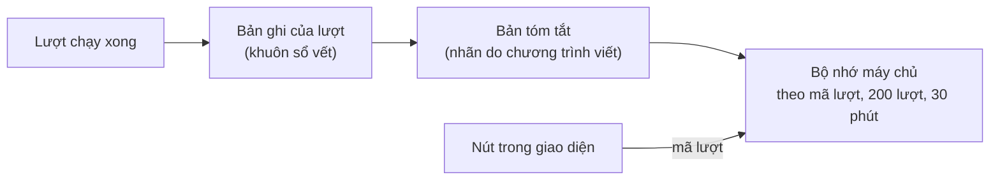

# Bài 42 — Vì sao trả lời vậy: chương trình kể lại một lượt từ chính bản ghi của lượt đó

*Cập nhật 07:33, ngày 24/11/2026 · khớp hệ thống 07:57 24/11/2026 (59 tính năng mở, 6 tắt; tự đếm lại bằng lệnh ở `guides/RUNBOOK_BAN_GIAO.md` mục 0) · model đang chạy ở máy chủ dự án: Claude Sonnet 5.5 (bản deploy sẽ dùng gpt-6-luna; nút chưa chạy trên đường đó) · cơ chế đọc từ chương trình; hai ví dụ là chữ của khung chép từ lượt trình duyệt thật sáng 24/11; người viết không chạy lại · 07:45: đã áp biên bản kiểm độc lập (58 khẳng định: 45 đúng, 2 sai, 11 lệch); các câu áp sau biên bản chưa có người thứ hai đọc. · 07:59: sửa theo bản gộp 07:57 24/11 (bản tóm tắt hết hạn sau 30 phút; chữ của khung nói "đưa … đoạn kho cho model"; lời báo mới) — phiên D đọc từ chương trình, chưa có người thứ hai đọc; chữ mới chưa ai nhìn trên trình duyệt.*

**Bài trước đã biết:** model xin tìm thêm, xin công cụ (bài 21, 23); chương trình tính sẵn việc phải đúng (bài 24); sổ vết có nội dung (bài 37).
**Bài này thêm:** nút "Vì sao trả lời vậy?": người xem thấy gì, khung dựng từ đâu, vì sao làm như vậy, và chỗ nó chưa nói được.

## Ý chính

- Ở máy demo, dưới mỗi câu trả lời có nút **"Vì sao trả lời vậy?"** (ô Trợ lý, trợ lý nổi, cột lịch trang Lên kế hoạch). Bấm ra khung: câu tóm tắt, các lần gọi model, các lần tìm và công cụ theo thứ tự đã ghi, các nguồn, thời gian.
- **Không model nào viết lời giải thích.** Cuối lượt, chương trình lấy đúng bản ghi mà sổ vết dùng, sắp lại thành một bản tóm tắt. Mọi nhãn và câu giải thích trong khung do chương trình viết sẵn; phần còn lại chép nguyên từ lượt đó (câu gõ, câu tìm model đã viết, tên bài).
- Bản tóm tắt nằm trong **bộ nhớ của máy chủ**, theo **mã lượt**, giữ 200 lượt gần nhất, mỗi bản 30 phút; khởi động lại là mất; không ghi file. Nó chứa câu người dùng gõ, nên có cùng hạn 30 phút với trí nhớ cuộc trò chuyện (bài 37).
- Mở trên nhánh chính từ 07:18 24/11 (máy demo có nút từ lần khởi động lại máy chủ sau giờ đó); bản deploy để tắt.
- Giới hạn chính: khung nói được câu trả lời dựa vào **nguồn nào**, chưa nói được **câu nào** dựa vào **đoạn nào**.

## Từ dùng trong bài

| Tên trong bài | Tên gốc | Nghĩa |
|---|---|---|
| mã lượt | **turn id** | chuỗi ngẫu nhiên 16 ký tự máy chủ cấp cho một lượt có câu trả lời cuối; nút 👍 / 👎 và nút của bài này dùng nó để chỉ đúng lượt đó |
| bản ghi của lượt | **trace** | những gì chương trình ghi lại trong lúc một lượt chạy: câu, từng lần tìm, gọi model, công cụ, nguồn, thời gian |
| bản tóm tắt lượt | — | bản rút gọn của bản ghi, đã gắn nhãn tiếng Việt, đúng thứ khung hiện |
| tính giải thích được | **explainability** | người ngoài xem được hệ thống đã làm gì để ra một câu trả lời |

## Nút nằm dưới câu trả lời, bấm ra khung có tối đa sáu nhóm

Nút chỉ hiện ở lượt đã xong và có câu trả lời cuối. Bấm lần đầu, giao diện hỏi máy chủ; bấm lại thì khung gập, mở lại không hỏi nữa.

Khung có tiêu đề "Trợ lý đã làm gì để ra câu trả lời này", một câu tóm tắt, rồi các nhóm đánh số (nhóm nào không có thì không vẽ): (1) các lần gọi model, mỗi lần một nhãn và số giây; (2) "Model đọc câu lệnh, code áp lên lịch", chỉ ở lượt sửa lịch; (3) các lần tìm và công cụ, theo thứ tự đã ghi; mỗi lần tìm ghi câu đem đi tìm và ai viết nó, các bài tìm ra (mỗi bài mấy đoạn, đoạn tốt nhất đứng thứ mấy), bài nào được trích; (4) tra web; (5) các nguồn, đúng số câu trả lời đang dùng; (6) thời gian. Câu đem đi xử lý khác câu gõ (lượt từ biểu mẫu hay từ thẻ chọn: chương trình ghép thêm các ô đã chọn) thì khung in cả hai; lượt nối tiếp thì không. Cuối khung là các ghi chú nói thật.

**Ví dụ 1 — hỏi đáp** (lượt trình duyệt sáng 24/11, lượt đầu của cuộc): *"Chùa Thiên Mụ mở cửa mấy giờ, vào có mất vé không?"*. Câu tóm tắt: "Trợ lý gọi model 4 lần, tìm trong kho 3 lần, đưa 20 đoạn kho cho model, trích 4 nguồn." (chữ của chương trình từ 07:57; lượt chụp 06:41 còn in "đọc 20 đoạn") Gọi model: phân loại, hai lần "Quyết định tìm thêm / gọi công cụ", viết. Lần tìm đầu "Hệ thống tìm bằng chính câu của bạn" đưa 10 đoạn cho model; hai lần sau "Model tự viết thêm câu tìm" ("Chùa Thiên Mụ giờ mở cửa và giá vé tham quan", "Chùa Thiên Mụ địa chỉ và giờ mở cửa") thêm 6 và 4 đoạn mới: 20 đoạn. Bốn nguồn: một đoạn bài Chùa Thiên Mụ, một đoạn bài vé tham quan Quần thể Di tích, hai đoạn bài vé biểu diễn sông Hương, mục du thuyền (tên rút gọn). Tổng 9,1 giây.

Khung bày ra một chỗ điều dòng nguồn phải bấm từng mục mới thấy: hai trong bốn nguồn là đoạn về du thuyền; nó vẫn không cho biết câu nào dựa vào hai đoạn đó (quyết định 5).

**Ví dụ 2 — sửa lịch.** Xếp lịch ví dụ 2 ngày, rồi gõ *"bỏ điểm đầu tiên của ngày 2"*. Câu tóm tắt: "Model đọc câu lệnh ra 1 việc; đặt vào lịch và kiểm luật là việc của code." Gọi model: "Hiểu câu lệnh sửa lịch", "Phân loại câu hỏi". **Model đọc ra:** "Bỏ · Lăng Tự Đức · ngày 2". **Code làm:** "Đã bỏ Lăng Tự Đức. Buổi sáng ngày 2 nay để trống." (nhãn "đã làm"). Ghi chú nói thêm: kiểm giờ mở cửa, khu, nhịp đi là việc của code. Đúng cách chia việc của bài 31.

## Chương trình dựng bản tóm tắt từ bản ghi của lượt, không hỏi lại model

Trong lúc một lượt chạy, chương trình ghi lại từng việc nó làm. **Sổ vết** (bài 37), khi bật ở máy phát triển, chép bản ghi đó ra file, mỗi lượt một dòng. Nút của bài này dùng **cùng khuôn bản ghi**, nhưng không đọc, không ghi file sổ vết; sổ vết tắt thì nút vẫn chạy.

1. **Cấp mã lượt.** Lượt có câu trả lời cuối được cấp một mã lượt ngẫu nhiên, gửi kèm tin báo "xong" cho giao diện. Mã này không suy ra được từ mã cuộc trò chuyện và không nằm trong cookie (mẩu dữ liệu trình duyệt tự gửi kèm mỗi lần hỏi, bài 37). Khi tính năng mở, tin báo "xong" mang thêm một dấu "lượt này có bản tóm tắt"; có dấu đó và có mã lượt thì giao diện mới vẽ nút.
2. **Dựng và cất.** Cuối lượt, cùng lúc ghi sổ vết, chương trình dựng bản tóm tắt rồi cất vào bộ nhớ của máy chủ, mã lượt làm khoá. Bước này hỏng thì chỉ thành một dòng cảnh báo; câu trả lời không bị ảnh hưởng.
3. **Lấy ra.** Bấm nút, giao diện gửi mã lượt lên; máy chủ trả bản đang giữ.

**Bộ nhớ của máy chủ** (bài 6) là chỗ chương trình giữ dữ liệu trong lúc đang chạy. Hệ quả: khởi động lại máy chủ là mất mọi bản tóm tắt (nút cũ vẫn trên màn hình, bấm chỉ thấy lời báo); và chỗ giữ có trần 200 lượt **chung cho mọi người** dùng cùng máy chủ, lượt thứ 201 vào thì bản cất sớm nhất bị bỏ; mỗi bản còn hết hạn sau 30 phút kể từ lúc cất.

## Mỗi loại lượt có một câu tóm tắt cố định

Mỗi lượt vào đúng một loại, xét từ trên xuống. Câu tóm tắt chép nguyên văn; *n* là số chương trình điền.

| Loại lượt | Nhận ra bằng | Câu tóm tắt |
|---|---|---|
| lấy lại từ bộ nhớ câu trả lời | lượt trúng câu trả lời đã nhớ (bài 34) | "Câu trả lời lấy lại từ một lượt giống hệt trước đó — không gọi model, không tìm lại." |
| sửa lịch | lượt có lệnh sửa, có dòng kết quả, hoặc đi từ nút chọn | "Model đọc câu lệnh ra *n* việc; đặt vào lịch và kiểm luật là việc của code." (không có việc nào: "Lượt sửa lịch này không có việc nào do model đọc ra.") |
| lập lịch | lượt đi từ biểu mẫu trang Lên kế hoạch | "Code xếp khung lịch; model được gọi *n* lần để viết câu tả các điểm từ kho." |
| ngoài phạm vi | bước phân loại xếp câu ra ngoài phạm vi | "Bước phân loại xếp câu này ngoài phạm vi văn hoá – du lịch Huế ⇒ không tìm trong kho, trả một câu cố định." |
| nhờ làm thay | người dùng nhờ đặt chỗ, gửi tin… | "Bạn nhờ trợ lý tự làm một việc hệ thống không có (đặt chỗ, gửi tin, xem tình trạng phòng…) ⇒ trả một câu nói thật cố định." |
| từ chối | câu trả lời là câu từ chối | "Trợ lý gọi model *n* lần, tìm trong kho *n* lần, đưa *n* đoạn kho cho model; lượt này không có căn cứ đủ để trả lời." |
| hỏi đáp | mọi lượt còn lại | "Trợ lý gọi model *n* lần, tìm trong kho *n* lần, đưa *n* đoạn kho cho model, trích *n* nguồn." |

Ghi chú đi kèm cũng do chương trình chọn. Lượt từ chối nói rõ code hay model quyết từ chối. Lượt có mục web thêm "Phần «Từ web» lấy ngoài kho, chưa được kiểm với kho." (lượt thật: hỏi một quán có chỗ đậu ô tô không, kho từ chối, khung ghi câu đem đi tra và "4 nguồn web"). Các ghi chú khác: "Chi tiết để tra".

## Quyết định và lý do

### 1. Vì sao lời giải thích là bản ghi do chương trình sắp lại, không để model tự kể nó đã làm gì?

- **Đã chọn:** không gọi model nào; bản tóm tắt chỉ sắp lại thứ lượt đó đã ghi.
- **Vì sao:** sổ vận hành ghi: khung chỉ sắp lại thứ đã ghi nên không thêm rủi ro cho câu trả lời. Nhóm đếm trước khi xây (152 dòng sổ vết 23/11): 8 trong 9 nhóm thông tin khung cần đã có sẵn. Lập luận, không phải số đo: model kể lại thì có thể kể sai việc nó đã làm; bản ghi thì không.
- **Cách khác:** cho model viết lời giải thích: không làm.
- **Cái giá:** thứ không ghi thì khung không có (công cụ nhận đầu vào gì).

### 2. Vì sao giữ trong bộ nhớ theo mã lượt, có trần, không ghi file?

- **Đã chọn:** bộ nhớ của máy chủ, khoá là mã lượt, 200 lượt gần nhất, mỗi bản giữ 30 phút (hạn giờ thêm lúc 07:57 24/11, bằng hạn của trí nhớ cuộc trò chuyện).
- **Vì sao:** ghi trong chương trình: không đọc, không ghi file, không ghi dòng sổ nào có chữ người dùng, nên không phụ thuộc sổ vết; mã lượt ngẫu nhiên, không nằm trong cookie, nên người khác không đoán được lượt của ai. Số 200: chưa thấy ghi lý do. Điều thấy được: chú thích "trần RAM: bỏ lượt cũ nhất (mỗi bản vài KB)"; mã của nút 👍 / 👎 giữ 2.000 lượt.
- **Cách khác:** đọc file sổ vết khi bấm: không làm. Chưa thấy ghi lý do. Điều thấy được: sổ vết mặc định tắt (bài 37).
- **Cái giá:** khởi động lại là mất; máy đông người thì lượt cũ hết chỗ nhanh.

### 3. Vì sao máy demo mở, bản deploy để tắt?

- **Đã chọn:** mở trên nhánh chính từ 07:18 24/11 cho máy demo; chương trình đóng gói bản deploy tự ghi tính năng về tắt, không ghi được thì dừng.
- **Vì sao:** trang đề xuất mà chủ dự án đã tick hướng "Giải thích" (06:16 24/11) ghi: chỉ bật ở máy demo, không bật cho khách, vì bản ghi từng lượt có chữ người dùng gõ. Điều thấy được: bản tóm tắt chứa câu gõ, câu đem đi xử lý, các câu tìm model viết.
- **Cách khác:** mở cả ở bản deploy: không làm.
- **Cái giá:** khách bản deploy không thấy nút. Lệnh đóng gói chưa chạy thật. Ở máy demo, đây là chỗ thứ ba giữ chữ người dùng trong bộ nhớ; từ 07:57 24/11 nó có hạn 30 phút ("Giới hạn đã biết").

### 4. Vì sao nhãn từng bước do chương trình viết sẵn?

- **Đã chọn:** máy chủ viết mọi nhãn; giao diện in nguyên.
- **Vì sao:** ghi trong chương trình: hàm dựng nhận đúng khuôn một dòng sổ vết nên thử được trên dòng thật mà không gọi model; nó đã chạy 0 lỗi trên 1.409 dòng sổ vết thật. Vì sao ở máy chủ chứ không ở giao diện: chưa thấy ghi lý do. Điều thấy được: chú thích "Nhãn do code viết — giao diện in nguyên, không tự dịch mã".
- **Cách khác:** để model đặt nhãn: không làm.
- **Cái giá:** công cụ mới quên thêm nhãn thì khung in "Công cụ: " kèm tên nội bộ.

### 5. Vì sao chưa có phần "câu nào của câu trả lời dựa vào đoạn nào"?

- **Đã chọn:** khung dừng ở mức nguồn: bài, đề mục, số.
- **Vì sao:** hệ thống chưa làm phép đối chiếu đó. Phép đếm trước khi xây chỉ ra đây là mảnh lớn nhất còn thiếu trong bản ghi: chỉ có số nguồn model tự gắn và danh sách nguồn mức bài. Bản ghi cũng chưa có đầu vào của công cụ và chữ của bản viết bị bỏ. Khuôn dữ liệu không chừa chỗ sẵn cho nó.
- **Cách khác:** không làm trong bản này.
- **Cái giá:** ví dụ 1: thấy hai đoạn du thuyền được trích, không biết câu nào dựa vào.

### 6. Vì sao là nút dưới từng câu trả lời, không phải một trang riêng?

- **Đã chọn:** nút ngay dưới lượt, khung mở tại chỗ.
- **Vì sao:** chưa thấy ghi lý do. Điều thấy được: trang đề xuất tả hướng này là nút dưới mỗi câu.
- **Cách khác:** trang liệt kê các lượt gần đây: không làm.
- **Cái giá:** tải lại trang là mất cả cuộc trò chuyện lẫn nút.

## Nếu… thì sao

Lời báo trong ngoặc kép là nguyên văn; ô nào không nói đã thấy là đọc từ chương trình, chưa thử thật.

| Nếu | Hệ thống làm gì | Người dùng thấy gì | Đã có chưa |
|---|---|---|---|
| máy chủ khởi động lại, lượt ngoài 200 lượt gần nhất, hoặc bản đã quá 30 phút | trả "Chi tiết của lượt này không còn được giữ." | "Chi tiết của lượt này không còn được giữ (đã quá 30 phút, máy chủ đã khởi động lại, hoặc lượt đã quá cũ). Muốn xem chi tiết, hãy hỏi lại câu này." | có chủ đích; bản chữ trước 07:57 đã thấy trên trình duyệt bằng lời báo giả; chữ mới chưa ai nhìn; khung đã mở trong 30 phút thì vẫn nằm trên màn hình |
| lượt lỗi, bị rút, bị ngắt, hoặc hỏi lại bằng thẻ nút | không cấp mã lượt | không có nút | có chủ đích |
| bước nhận ảnh (bài 26) | không cấp mã lượt | không có nút; lượt trả lời đi sau thì có | chưa thử |
| lượt trúng bộ nhớ câu trả lời | bản tóm tắt loại "lấy lại từ bộ nhớ câu trả lời" | câu tóm tắt đó và dòng "Hệ thống nhớ tạm câu trả lời của những câu hỏi lặp lại y nguyên; khởi động lại máy chủ thì bộ nhớ này mất." | chưa thấy trên trình duyệt: một lượt thử ở cuộc mới không trúng (chưa rõ vì sao); lượt thử còn lại là lượt thứ hai của cuộc nên theo chương trình không được tra |
| tính năng tắt | không cất | không có nút | có test |
| mạng lỗi lúc bấm | — | "Chưa lấy được chi tiết của lượt này. Bấm nút lần nữa để thử lại." | có |

## Dễ nhầm

- **"Bấm nút là hỏi model vì sao nó trả lời vậy."** Không có lời gọi model nào. Khung là bản ghi của lượt, do chương trình sắp lại.
- **"Nguồn trong khung là đoạn mà từng câu dựa vào."** Khung chỉ nói câu trả lời trích những nguồn nào. Phép đối chiếu câu ↔ đoạn chưa có.
- **"Các nhóm trong khung xếp theo đúng thứ tự thời gian."** Không đúng. Mỗi nhóm đứng theo thứ tự đã ghi; vài lời gọi model chạy song song nên đó không phải thứ tự giờ (ví dụ 2), và giữa lần gọi model với lần tìm không có mốc giờ chung.

## Câu hỏi tự kiểm

1. Giảng viên hỏi: "Giải thích này có phải model tự bịa ra không?" Trả lời thế nào?

Không. Không model nào được gọi; chương trình sắp lại bản ghi của chính lượt đó, nhãn do chương trình viết sẵn.

2. Sáng hôm sau máy chủ được khởi động lại; bấm nút của một lượt hôm trước thì thấy gì, vì sao?

Dòng báo chi tiết không còn được giữ: bản tóm tắt chỉ nằm trong bộ nhớ của máy chủ.

3. Vì sao bản deploy để tắt nút này?

Bản tóm tắt chứa chữ người dùng gõ; trang đề xuất chủ dự án đã tick ghi: chỉ bật ở máy demo.

4. Ở lượt sửa lịch, khung tách "Model đọc ra" và "Code làm" để chỉ ra điều gì?

Model chỉ đọc câu lệnh ra việc cần làm; đặt vào lịch và kiểm luật là việc của chương trình (bài 31).

## Cấu hình đang chạy

| Mục | Giá trị | Dùng để làm gì, vì sao là giá trị này | Đã thử giá trị khác chưa |
|---|---|---|---|
| `vi_sao` | mở (máy demo, từ 07:18 24/11); tắt ở gói deploy | bật nút và việc cất bản tóm tắt; thiếu dòng trong cấu hình thì coi là tắt | giai đoạn tắt (07:07–07:18 24/11 trên nhánh chính) |
| hạn giữ một bản tóm tắt | 30 phút kể từ lúc cất | cùng hạn với trí nhớ cuộc trò chuyện: bản tóm tắt có chữ người dùng gõ, mà trang Giới thiệu nói chữ đó ở trong bộ nhớ tối đa 30 phút | bản đầu (07:07–07:57 24/11) không có hạn giờ |
| trần số lượt giữ | 200 | bỏ lượt cất sớm nhất khi vượt; lý do của số: chưa thấy ghi | chưa thử |
| độ dài câu đem đi xử lý in trong khung | 300 ký tự, quá thì cắt kèm "…" | câu đem đi có thể dài hơn câu gõ vì chương trình ghép thêm các ô đã chọn (biểu mẫu, thẻ chọn) | chưa thử |
| số bài hiện sẵn mỗi lần tìm | 4, còn lại sau nút "Xem thêm *n* bài" | một lần tìm có thể ra tới 10 bài | chưa thử |
| số bước hiện sẵn | 4, còn lại sau nút "Xem thêm *n* bước" | tin nhiều ý có thể tìm 6–7 lần | chưa thử |
| `so_vet` | tắt | không liên quan: nút không đọc, không ghi file sổ vết | — |

## Đã so

Tính năng này không có phép so hai phương án. Các lần kiểm đã có:

| Kiểm gì | Bằng gì | Kết quả |
|---|---|---|
| hàm dựng trên dữ liệu thật | chạy hàm trên mọi dòng sổ vết thật đã có, không gọi model | 0 lỗi trên 1.409 dòng; 0 trên 6.475 dòng tên bài còn hiện tên file |
| test riêng | 7 ca: lượt hỏi đáp đủ bốn nhóm đúng thứ tự, câu gửi khác câu gõ, từ chối / ngoài phạm vi / bộ nhớ câu trả lời, sửa lịch, trần và mặc định tắt, dấu ở tin báo "xong" chỉ khi mở, cất theo mã lượt và lời báo khi tắt | đạt; khi mở, nhóm chạy lại thêm các file test đọc tin báo "xong" hoặc cấu hình |
| trình duyệt | ba lượt tự lái trên bản ghép thử, sáng 24/11, 16 lượt qua model thật (15 câu gõ và một lần xếp lịch, đếm trong ba script; sổ của nhóm ghi "khoảng 25"; model: Claude Sonnet 5.5), màn 1536 × 695 và 390 điểm ảnh | đã thấy: hỏi đáp, nối tiếp, ngoài phạm vi, nhờ làm thay, lập lịch ở cột lịch, sửa lịch, từ chối kèm mục web, lời báo "không còn được giữ" (giả lời báo), trợ lý nổi, màn điện thoại |

Giới hạn của phép kiểm: các lượt trình duyệt do công cụ tự lái, chưa ai bấm tay; chữ khung của lượt đầu (dùng cho ví dụ 1, 2) ghi trước ba lần sửa cuối của nhánh (khuôn khung, tên bài, đánh số nhóm) — nhãn và tiêu đề nhóm của hai ví dụ khớp chương trình hiện tại, thứ tự in nguồn thì chưa (bản hiện tại xếp theo số).

## Giới hạn đã biết

- **Chữ người dùng trong bản tóm tắt.** Bản tóm tắt chứa câu gõ, câu đem đi xử lý, các câu tìm model viết, câu đem đi tra web. Bản đầu (07:07–07:57 24/11) không có hạn giờ; người kiểm bài này chỉ ra điều đó trái câu "tối đa 30 phút" của bài 37 và của trang Giới thiệu. Từ 07:57 mỗi bản hết hạn sau 30 phút kể từ lúc cất; bản quá hạn bị xoá ở lần cất hoặc lần đọc kế. Trong 30 phút đó ai cầm mã lượt thì lấy được bản; mã ngẫu nhiên 16 ký tự, chỉ trình duyệt đã nhận lượt đó có. Khung đã mở thì vẫn nằm trên màn hình sau 30 phút (dữ liệu đã ở trình duyệt). Tính năng vẫn chỉ mở ở máy demo.
- Chưa có phép đối chiếu từng câu của câu trả lời với đoạn nó dựa vào.
- Không có thứ tự chung giữa lần gọi model và bước tìm / công cụ; ba phần thời gian không cộng đúng bằng tổng, khung ghi "Vài bước chạy song song nên các phần không cộng đúng bằng tổng." Lượt sửa lịch chỉ có tổng.
- Ở lượt sửa lịch, "Model đọc ra" và "Code làm" là hai danh sách rời: chương trình không ghi việc nào ứng với dòng kết quả nào.
- Bước nhận ảnh không có khung; lượt lỗi, bị rút, bị ngắt không có nút.
- Chưa thấy trên trình duyệt: lượt trúng bộ nhớ câu trả lời, bản in, lượt bấm nút thẻ chọn, model cũ (gpt-6-luna).
- Chủ dự án chưa tự thử.

## Chi tiết để tra

**Nhãn của lần tìm** (chép từ chương trình): "Hệ thống tìm bằng chính câu của bạn" · "Model tự viết thêm câu tìm" · "Hệ thống tìm bằng *n* câu tìm (câu của bạn và từng vế hỏi)" (tin nhiều ý, bài 23) · "Hệ thống tìm bằng câu tìm do bước phân loại viết" · "Hệ thống tìm trong kho". Lần model xin tìm mà chương trình không cho chạy (cuộc đã có lịch, hoặc đã hết số lần tìm) không hiện thành một bước.

**Nhãn của lần gọi model:** "Phân loại câu hỏi" · "Quyết định tìm thêm / gọi công cụ" · "Viết câu trả lời" · "Hiểu câu lệnh sửa lịch" · "Viết câu tả các điểm trong lịch" · "Viết mục «Từ web»" · "Gọi model".

**Công cụ** có nhãn "(code tính sẵn)" là việc chương trình làm trước khi gọi model (bài 24): ngày và âm lịch, khoảng cách, lễ hội theo ngày. Các bước khác cũng do chương trình tự chạy: đọc lịch đang có, tra web, viết lại từ bằng chứng đã gom, chạy lại lượt.

**Các ghi chú khác** (nguyên văn): từ chối do code — "Không có đoạn nào để đưa cho model ⇒ code trả câu từ chối cố định, không gọi model viết."; từ chối do model — "Câu từ chối là câu cố định của hệ thống: model nhận các đoạn tìm được và trả đúng câu đó thay vì tự viết từ hiểu biết riêng. Hệ thống không tự kiểm lại là kho có thật sự thiếu hay không." · lập lịch — "Khung lịch (điểm nào, ngày nào, giờ nào) do code xếp theo luật — không gọi model. Model chỉ viết câu tả cho từng điểm từ bài trong kho." (kèm số câu bị bộ kiểm loại nếu có) · lượt sửa lịch không gọi model (đi từ nút bấm) — "Bạn bấm nút — code áp thẳng lựa chọn đó, không gọi model." · ngoài phạm vi — "Câu trả lời của lượt này là câu cố định do code trả, không phải model tự viết." · nhờ làm thay — "Câu trả lời của lượt này là câu cố định do code chọn theo loại việc được nhờ." · viết lại — "Bản viết đầu không qua được phép kiểm nguồn nên hệ thống cho viết lại một lần từ bằng chứng đã gom." · có lịch sử — "Model được đưa kèm *n* lượt trước của cuộc trò chuyện."

**Thời gian của ví dụ 1:** gọi model 0,92 · 1,9 · 1,8 · 5,1 giây; tìm 0,23 giây, dựng phần đưa cho model 0,02 giây, model xử lý và viết 9 giây, tổng 9,1 giây. **Ví dụ 2:** "Hiểu câu lệnh sửa lịch" 2,1 giây, "Phân loại câu hỏi" 0,65 giây (đứng sau dù không chạy sau: hai lời gọi này chạy song song, khung không xếp theo giờ), tổng 2,3 giây; khung còn ghi 6 nguồn của câu tả các điểm và "Model được đưa kèm 1 lượt trước của cuộc trò chuyện." (chữ từ 07:57)

**Mốc giờ:** bản thử đầu 06:27 24/11 · lõi máy chủ 06:34 · vào nhánh chính 07:07 khi tính năng còn tắt · mở ở máy demo 07:18 (giờ gộp).

**Cách thử 2 phút** (máy demo): hỏi "Chùa Thiên Mụ mở cửa mấy giờ, vào có mất vé không?", bấm nút dưới câu trả lời; rồi xếp lịch 2 ngày ở trang Lên kế hoạch, gõ ở ô Trợ lý một lệnh bỏ một điểm, bấm nút ở lượt đó để thấy "Model đọc ra" và "Code làm".

- **Bản ghi này còn dùng để ĐẾM.** Cùng dữ liệu "bài nào được trích ở lần tìm nào" cho phép đếm trên mọi lượt đã ghi xem việc trợ lý tự tìm thêm có đóng góp không: 222 trong 560 lượt hỏi đáp có nguồn (40 %) có ít nhất một bài được trích chỉ nhờ lần tìm sau (bài 23, "Đã so").
- Đường trả cả câu một lần (không gửi dần) cũng cất bản tóm tắt, nhưng thân trả về không mang dấu "có bản tóm tắt"; giao diện của sản phẩm chỉ dùng đường gửi dần [theo sổ của phiên viết code, chưa thử].

**Bài sau (bài 27):** chặng 6, trang Lên kế hoạch.

Nguồn (để giữ bài đúng — anh không cần đọc)

- Cơ chế cất / lấy, trần 200, không ghi file, không phụ thuộc `so_vet`, không gọi model, mã lượt không nằm trong cookie, không chừa chỗ cho câu ↔ đoạn: `backend/api/vi_sao.py` dòng 1–13 (docstring), 25 (`MAX_LUOT`), 47–60 (`KhoViSao`, `OrderedDict`, `popitem(last=False)`), 258–276 (`cat`, route `GET /api/vi_sao/{turn_id}`, 404 `"Chi tiết của lượt này không còn được giữ."`) [code].
- Loại lượt và thứ tự xét: `vi_sao.py` `_loai` dòng 74–89; câu tóm tắt và ghi chú: `tom_tat` dòng 211–243; nhãn: `NHAN_GOI`, `NHAN_CONG_CU`, `CODE_CHAY`, `BO_QUA` dòng 29–41; nhãn lần tìm `_buoc_tim` dòng 124–133; bỏ mục `sau_lich` / `het_luot` dòng 157; nhãn lùi `f"Công cụ: {ten}"` dòng 164; cắt 300 ký tự `TRAN_CAU_GUI` dòng 26, 247 [code].
- Chỗ nối: `backend/api/routes/chat.py` `_ghi_vet` dòng 351–361 (sổ vết rồi `vi_sao.cat`, mỗi cái bọc lỗi riêng, chỉ `logger.warning`); `StreamEvents.done` dòng 723–731 (`turn_id` chỉ khi `answered`, `vi_sao: true` khi `co_vi_sao`); `finish` dòng 782 (`answered=trace.citation_error is None` ⇒ lượt bị rút không có mã); `failure` dòng 798 và `fixed` với `clarify` dòng 739 (`done()` không mã); `_answer_events` dòng 837–841 (`ghi_vet` sau `remember`); `_new_turn_id` dòng 306–309 [code].
- Mã lượt 16 ký tự: `backend/api/feedback.py` dòng 35 (`secrets.token_urlsafe(12)`), `MAX_TURNS = 2000` dòng 24 [code].
- Đăng ký route + kho trong RAM: `backend/api/app.py` dòng 255–256 [code]. Mặc định tắt khi thiếu dòng: `backend/llm/assistant.py` dòng 143–144 [code]. Cấu hình: `backend/config/settings.yaml` dòng 99 `vi_sao: true` (chú thích ghi "MỞ 07:10"; giờ gộp trên nhánh chính là 07:18 — dùng giờ gộp) [code]. Gói deploy: `deploy/docker/dong_goi.sh` dòng 23–26 (sed về `false`, không ghi được thì `exit 1`) [code; lệnh đóng gói chưa chạy thật — `session_prompt/HIEN_TRANG.md` mục 1, chép].
- Bản ghi khuôn sổ vết: `backend/core/so_vet.py` `ban_ghi` dòng 30–65, `vet_tim` có `title` từ 24/11 dòng 18–28 [code]. Route ảnh chỉ ghi sổ vết, không mã lượt, không `vi_sao`: `backend/api/routes/anh.py` dòng 118 [code].
- Giao diện: `frontend/src/ViSao.jsx` (cả file: lời báo "Đang lấy chi tiết…", "không còn được giữ (…)", "Chưa lấy được…", tiêu đề khung và nhóm, `SO_BAI_DAU = 4`, `SO_BUOC_DAU = 4`, xếp nguồn theo số đang hiện dòng 82, dòng ghi thời gian dòng 167, không gọi lại khi đã tải dòng 24) [code]; nút vẽ khi `done.vi_sao === true && done.turn_id`: `frontend/src/chat.jsx` dòng 184–186, 494; cột lịch: `frontend/src/LenKeHoach.jsx` dòng 150 [code].
- Bộ nhớ đệm chỉ tra lượt đầu không lịch sử, không nút / biểu mẫu: `chat.py` `_tra_cache` dòng 274–287; chỉ lưu lượt có nguồn và mọi công cụ là tìm kho: `backend/api/cache_tra_loi.py` `luot_luu_duoc` dòng 49–52 [code].
- Test 7 ca: `backend/tests/test_vi_sao.py` (7 hàm `test_…`) [code, người viết không chạy]. Chạy lại các file đọc `done` / settings khi mở: lời commit gộp `fdbdce73` [chép].
- 0 lỗi / 1.409 dòng, 0 / 6.475 dòng bài mang tên file: `guides/RUNBOOK_BAN_GIAO.md` mục 10.3 hàng "Nút 'Vì sao trả lời vậy?'", `session_prompt/HIEN_TRANG.md` mục 1 [chép]; script `data/x15_phan_ai_2026-11-23/b_vi_sao/thu_tren_so_vet.py` [riêng tư; người viết không chạy lại vì script ghi file mẫu].
- 8 / 9 nhóm thông tin, 152 dòng sổ vết 23/11, nhóm thiếu là câu ↔ đoạn, mã lượt dùng làm khoá, sổ vết chưa có đường ra giao diện: `data/x15_phan_ai_2026-11-23/so_vet_du_truong.md` [riêng tư, chép].
- "Chỉ bật ở máy demo, không bật cho khách ở bản deploy (nhật ký từng lượt có chữ người dùng gõ)", "nút dưới mỗi câu": `data/x15_phan_ai_2026-11-23/DE_XUAT.md` mục "Hướng 2" [riêng tư, chép]. Chủ dự án tick "Giải thích" 06:16 24/11: `data/loi_user/2026-11-24.md` dòng 4 [riêng tư, chép]; `session_prompt/HIEN_TRANG.md` mục 4 [chép].
- Ví dụ 1: `data/x15_phan_ai_2026-11-23/c_vi_sao/a1_hoi_dap_1536.txt` (ghi 06:41 24/11); ví dụ 2: `b2_sua_lich_1536.txt` (06:41), câu lệnh trong `luot_that.py` dòng 51; ví dụ mục web: `d1_tu_choi_web_1536.txt` (06:53); lời báo "không còn được giữ" bằng giả 404: `luot_that_3.py` dòng 42–45, `d4_dong_404_1536.txt`; `c2_bo_nho_dem_390.txt`, `d3_bo_nho_dem_1536.txt` mang câu tóm tắt loại hỏi đáp ("gọi model 4 lần…", "gọi model 2 lần…") ⇒ không trúng bộ nhớ câu trả lời; `session_prompt/sessions/STATUS_C.md` ghi "CHƯA thấy: lượt trúng bộ nhớ câu trả lời" [riêng tư / chép]. Tên bài dài trong ví dụ đã rút gọn.
- Mốc giờ: `git log` — `d0946fca` 06:27 (bản thử giao diện), `e89640eb` 06:34 (lõi), `f13fe32e` / `07b22eb1` 07:07 (gộp, còn tắt), `9562520c` 07:16 (mở), `fdbdce73` 07:18 (gộp bản mở) [đã chạy `git log` lúc viết bài, 24/11; giờ là giờ commit]. 59 mở / 6 tắt: lệnh runbook mục 0, người viết chạy trên cây chính lúc viết, ra 59 và 6 [đã chạy].
- Lượt trình duyệt, cỡ màn, "khoảng 25 lượt" (người kiểm độc lập đếm lời hỏi trong ba script `luot_that*.py` cùng thư mục ra 16 — bài dùng 16): `session_prompt/sessions/STATUS_C.md` dòng 6, `session_prompt/HIEN_TRANG.md` mục 1 [chép]. Chưa thấy bản in, thẻ chọn, model cũ; chủ dự án chưa tự thử: cùng hai nơi [chép].
- **Áp biên bản kiểm độc lập** (`data/hoc_cung_D/kiem/dot_2411_k5_bai_42_vi_sao.md` [riêng tư]; phiên D áp 07:45 24/11): câu "lượt nối tiếp thì in cả hai câu" SAI — `backend/api/routes/chat.py` `_model_query` dòng 246–258: câu đem đi chỉ đổi khi lượt mang các ô đã chọn (phiên D tự mở); chú thích ở `vi_sao.py` dòng 26 và `ViSao.jsx` dòng 95 ghi "lịch sử ghép vào" là lệch với code. Bộ nhớ câu trả lời: giảng ở bài 34, không phải bài 23. "Mảnh lớn nhất còn thiếu" thay "nhóm duy nhất": `so_vet_du_truong.md` dòng 14–20 liệt kê năm chỗ thiếu. Hạn giờ: bài 37 "Ý chính" (30 phút / 24 giờ) ↔ `vi_sao.py` dòng 7–9, 25 (chỉ trần số lượt). Giờ mở: công tắc đọc lúc khởi động (`backend/api/app.py`), không có hồ sơ ghi giờ máy chủ demo khởi động lại sau 07:18. Phép đếm "tìm thêm": `data/x15_phan_ai_2026-11-23/b_vi_sao/dem_tim_them_ra.txt` (phiên D tự mở: 560 · 320 · 222 · 74; một phiên đếm). Bài 37 chưa có dòng nói về chỗ giữ thứ ba này — sửa ở lượt gom kế. Nửa để hiểu 12.984 ⇒ 13.936 ký tự sau khi áp (đích 13.000).
- **Theo bản gộp 07:57 24/11** (`fb03709e`; phiên D sửa 07:59 24/11): `git diff bcbadb86 HEAD -- backend/api/vi_sao.py frontend/src/ViSao.jsx` — hạn 30 phút (`KhoViSao` dùng `TTL_SECONDS` của `backend/api/conversations.py` dòng 17; commit `46d7236f` 07:53), chữ câu tóm tắt / ghi chú đổi sang "đưa … đoạn kho cho model", "Model được đưa kèm … lượt trước" (commit `4188e72a` 07:41, sau một lượt soát khác hãng), lời báo có thêm "đã quá 30 phút" và "hãy hỏi lại câu này" (`e1653dd3` 07:56), hai chú thích lệch code đã sửa [đã chạy lệnh git, đã đọc diff]. Hai ví dụ vẫn là lượt chụp 06:41; các câu trong ngoặc kép của ví dụ đã đổi theo chữ mới của chương trình, số giữ nguyên. Mức kiểm của bản gộp theo tin của phiên điều phối: file test riêng 7 ca đạt, một phiên khác đọc; chữ lời báo mới chưa ai nhìn trên trình duyệt [chép].

